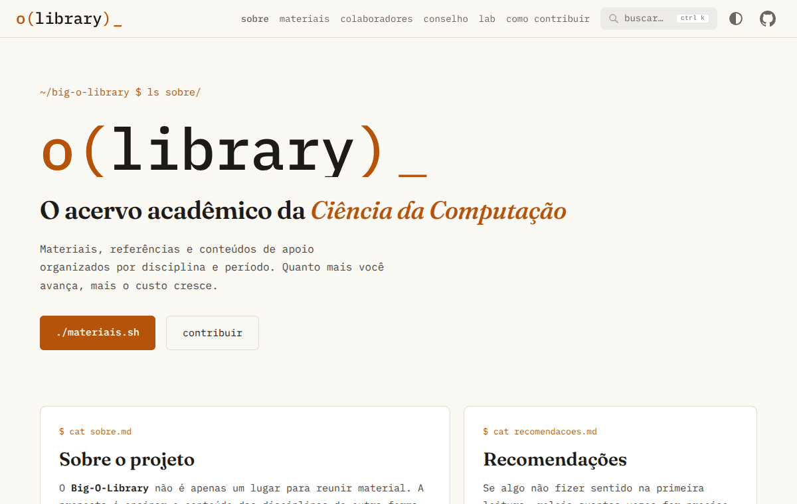
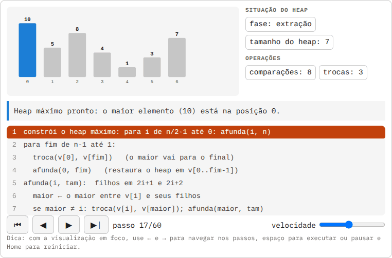

<p align="center">
  <picture>
    <source media="(prefers-color-scheme: dark)" srcset="themes/big-o-library/assets/images/bigo-library-dark.svg">
    <source media="(prefers-color-scheme: light)" srcset="themes/big-o-library/assets/images/bigo-library-light.svg">
    
  </picture>
</p>

<h1 align="center">
  Big-O-Library
  
  
  <a href="https://github.com/thallesgsrv/Big-O-Library/actions/workflows/build.yml"></a>
</h1>

<p align="center">
  <a href="#status"></a>
  <a href="#contribuição"></a>
</p>

<p align="center">
  Acervo colaborativo de materiais das disciplinas de Ciência da Computação.
</p>

A ideia surgiu a partir da forma como o professor [João Arthur](https://github.com/joaoarthurbm) organizou e disponibilizou o material de sua disciplina. O objetivo é levar esse modelo para as demais disciplinas do curso.

## Como é

<p align="center">
  <picture>
    <source media="(prefers-color-scheme: dark)" srcset=".github/img/home-escuro.png">
    
  </picture>
</p>

As páginas de algoritmos têm animações passo a passo, com pseudocódigo sincronizado, controle por teclado e suporte aos temas claro e escuro:

<p align="center">
  
</p>

## Recomendações

Antes de consultar qualquer material, um conselho: se algo não fizer sentido na primeira leitura, releia quantas vezes for preciso. Nada escrito por outra pessoa é impossível de entender, e o resultado depende do quanto você está disposto a se dedicar.

Sobre dedicação, vale assistir a [Você tem brio?](https://youtu.be/TRPBY_lxJfE), de Clóvis de Barros Filho.

## Conteúdo

Os materiais ficam no [site](https://thallesgsrv.github.io/Big-O-Library/docs/), organizados por período e por optativas. Por enquanto há disciplinas do 1º ao 3º período e, nas optativas, Algoritmos Avançados com visualizações interativas (BFS, DFS, Dijkstra, Segment Tree, Lazy Propagation e LCA). A lista completa e atualizada está sempre no site.

## Rodando localmente

### O que você precisa

| Ferramenta | Versão | Observação |
|---|---|---|
| [Git](https://git-scm.com/) | qualquer recente | Precisa estar no PATH. O site lê as datas de atualização do histórico do Git, então **use `git clone`**: baixar o ZIP do GitHub não funciona (o build falha com `failed to load Git data`). |
| [Hugo **extended**](https://gohugo.io/installation/) | **0.165.0** | Versão usada no site e no CI. A partir da 0.166 o Hugo gera marcação das fórmulas (KaTeX 0.18) incompatível com o CSS do repositório (KaTeX 0.16), então use exatamente esta. Confira com `hugo version`: a linha precisa conter `+extended`. |

Não é preciso Node, Go, submódulos do Git nem internet para compilar: o tema, a busca (FlexSearch) e as fórmulas (KaTeX) estão dentro do repositório, em `themes/big-o-library/`.

### Passo a passo

**Linux (Debian/Ubuntu)**

```bash
# 1) Git e Hugo extended (em ARM, troque amd64 por arm64)
sudo apt update && sudo apt install -y git curl
curl -LO https://github.com/gohugoio/hugo/releases/download/v0.165.0/hugo_extended_0.165.0_linux-amd64.deb
sudo apt install -y ./hugo_extended_0.165.0_linux-amd64.deb
hugo version        # deve mostrar v0.165.0 ... +extended

# 2) Baixe o projeto
git clone https://github.com/thallesgsrv/Big-O-Library.git
cd Big-O-Library

# 3) Suba o servidor local
hugo server
```

**macOS** (o `brew install hugo` instala a versão mais recente; baixe a 0.165.0 em [Releases](https://github.com/gohugoio/hugo/releases/tag/v0.165.0), arquivo `hugo_extended_0.165.0_darwin-universal.tar.gz`, e coloque o binário no PATH)

```bash
brew install git
git clone https://github.com/thallesgsrv/Big-O-Library.git
cd Big-O-Library
hugo server
```

**Windows (PowerShell)**

```powershell
winget install Git.Git
winget install Hugo.Hugo.Extended --version 0.165.0
# feche e abra o terminal para o PATH atualizar, depois:
git clone https://github.com/thallesgsrv/Big-O-Library.git
cd Big-O-Library
hugo server
```

Abra **http://localhost:1313/Big-O-Library/** (note o `/Big-O-Library/` no final). O site recarrega sozinho quando você salva um arquivo. Para parar, use `Ctrl+C`.

Para criar uma disciplina nova já com o modelo:

```bash
hugo new --kind disciplina docs/01-periodo/nome-da-disciplina/index.md
```

### Se der erro

| Erro ou sintoma | Causa e solução |
|---|---|
| `hugo: command not found` | Hugo não instalado ou terminal aberto antes da instalação. Instale e abra um terminal novo. |
| `failed to load Git data: not a git repository` | Você baixou o ZIP. Use `git clone`. |
| Erro de versão ou de recurso do Hugo, ou fórmulas sem estilo | Versão diferente da 0.165.0 ou sem `+extended`. Instale a versão indicada e confira com `hugo version`. |
| Sua página não aparece | `date` no futuro (use `hugo server -F` para ver mesmo assim), `weight` repetido no período, ou subpáginas dentro de um `index.md` (use `_index.md`). |
| Site com fontes diferentes das do site publicado | Opcional: `python3 scripts/baixar_fontes.py` baixa as fontes (precisa de Python 3 e internet). Não é necessário para contribuir. |

## Estrutura do repositório

```text
content/docs/                      materiais: NN-periodo/disciplina/ e optativas/
content/contribuir.md              guia de escrita (publicado no site)
content/lab/                       laboratório: jogo de complexidade e mapa de pré-requisitos
data/disciplinas.yaml              disciplinas e pré-requisitos do mapa (com ou sem pasta)
data/conselho.yaml                 Conselho dos Sábios
data/jogo.yaml                     trechos do jogo "Qual a complexidade?"
themes/big-o-library/layouts/      templates do site (páginas, cards, parciais bo-*)
themes/big-o-library/assets/css/   estilo do projeto (custom.css)
themes/big-o-library/assets/viz/   motor das animações de algoritmos (viz.js / viz.css)
themes/big-o-library/archetypes/   modelo para novas disciplinas
scripts/                           validar.py, a11y.js, deploy.sh, baixar_fontes.py, baixar_vendor.py e tests/ (testes das animações)
package.json                       ferramentas de manutenção (CSS, testes, lint, a11y); contribuir não precisa de Node
Makefile                           atalhos: make serve, make check...
hugo.yaml                          configuração do Hugo
.github/                           CONTRIBUTING, código de conduta, guias (animações e quiz), configuração dos links (lychee/) e workflows do CI
```

Para criar uma animação de algoritmo, veja o [guia de animações](.github/GUIA-ANIMACOES.md).
Para colocar um quiz interativo em qualquer página, veja o [guia de quiz](.github/GUIA-QUIZ.md).

## Checagens de qualidade

O CI roda tudo isto a cada Pull Request. Dá para rodar localmente antes de enviar (`make check` faz as quatro primeiras de uma vez):

| Comando | O que confere |
|---|---|
| `python3 scripts/validar.py` | front matter (título, peso, descrição, autores, data), pesos repetidos, datas no futuro, algoritmos de animação inexistentes, pré-requisitos e ciclos no mapa, fotos do Conselho |
| `npm run lint:md` | defeitos de renderização no Markdown: cabeçalho sem espaço, tabela com colunas erradas, link vazio, imagem sem texto alternativo |
| `npm test` | animações: cada algoritmo termina certo (vetor ordenado, distâncias corretas...) |
| `npm run build:css` | recompila o CSS do tema; o CI falha se o `main.css` commitado estiver defasado |
| `npm run a11y` | auditoria de acessibilidade (axe-core) em todas as páginas, nos temas claro e escuro. Precisa do site compilado com `hugo --baseURL / -d public-check` e de `CHROME_PATH` apontando para um Chrome/Chromium |

Só `validar.py` precisa de Python (com `pip install pyyaml`); o resto precisa de Node 20 ou mais novo e de `npm ci` uma vez. Escrever conteúdo continua exigindo só o Hugo.

Uma vez por semana, o workflow "Links externos" confere se os links para fora do site continuam no ar.

## Publicação

O site publicado vem da branch `gh-pages`. O workflow `.github/workflows/build.yml` valida, testa e compila o site em cada push e Pull Request; ele não publica. (Há também o workflow manual `pages.yml`, para quem preferir migrar a publicação para o GitHub Actions; as instruções estão no próprio arquivo.) Quem tem permissão de escrita no repositório gera e envia o site com o script `scripts/deploy.sh`:

```bash
git checkout main && git pull
./scripts/deploy.sh "mensagem do commit"
```

O script publica o que está na **sua pasta** (inclusive alterações ainda não commitadas), por isso rode com `git status` limpo. Contribuidores não precisam publicar nada: abrem o Pull Request e a publicação é feita pelos mantenedores depois do merge.

## Contribuição

Contribuições são bem-vindas. Se você já cursou alguma disciplina e quer compartilhar material, abra uma [issue](https://github.com/thallesgsrv/Big-O-Library/issues) ou envie um [Pull Request](https://github.com/thallesgsrv/Big-O-Library/pulls).

Para escrever ou editar uma disciplina, siga o [guia de escrita dos materiais](https://thallesgsrv.github.io/Big-O-Library/contribuir/) (também em [CONTRIBUTING.md](.github/CONTRIBUTING.md)). Só o cabeçalho é obrigatório; o restante do markdown é livre, e cada disciplina pode ter a estrutura que fizer mais sentido. Há um modelo pronto para começar: `hugo new --kind disciplina docs/NN-periodo/nome-da-disciplina/index.md`.

## Avisos

Este projeto é um material complementar produzido por estudantes e não substitui o conteúdo oficial, as aulas ou as orientações dos professores.

Sempre que possível, materiais de terceiros serão referenciados e vinculados à fonte original, respeitando suas licenças e direitos autorais.

## Roadmap

Estado atual: **em desenvolvimento**. O que está planejado, em ordem aproximada de prioridade:

- [ ] Mais tópicos de matemática discreta: probabilidade discreta (FMCC1) e grafos (FMCC2)
- [ ] Estruturas de dados em EDA: árvores binárias de busca, tabelas hash
- [ ] Páginas para as disciplinas do mapa de pré-requisitos que ainda não têm material
- [ ] Animações novas: lista encadeada, árvore binária de busca
- [ ] Imagem de pré-visualização (Open Graph) por disciplina

Quer ajudar com algum item? Veja [como contribuir](.github/CONTRIBUTING.md) ou abra uma issue.

## Histórico de Estrelas

<a href="https://www.star-history.com/?repos=thallesgsrv%2FBig-O-Library&type=date&legend=top-left">
  <picture>
    <source media="(prefers-color-scheme: dark)" srcset="https://api.star-history.com/chart?repos=thallesgsrv/Big-O-Library&type=date&theme=dark&legend=top-left" />
    <source media="(prefers-color-scheme: light)" srcset="https://api.star-history.com/chart?repos=thallesgsrv/Big-O-Library&type=date&legend=top-left" />
    
  </picture>
</a>
