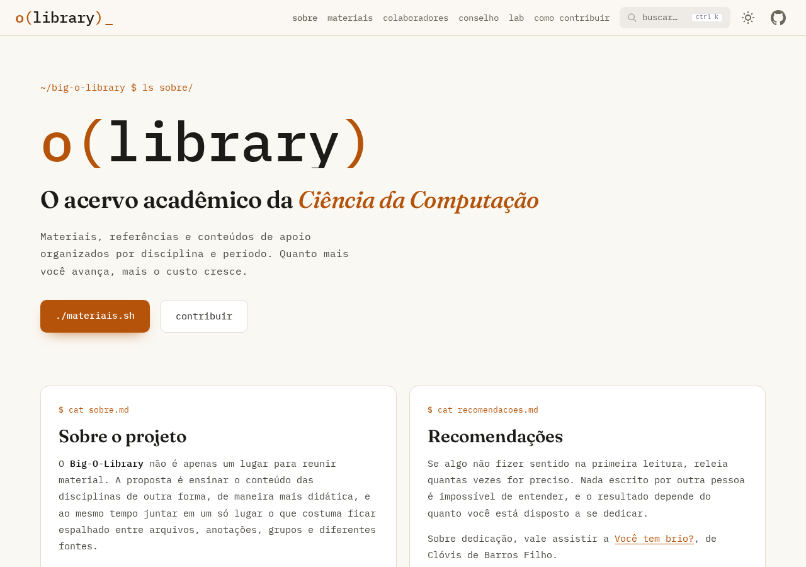
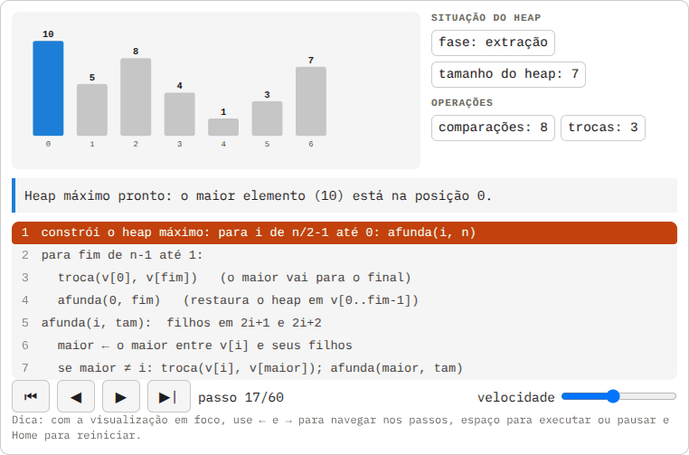

<p align="center">
  <picture>
    <source media="(prefers-color-scheme: dark)" srcset="themes/big-o-library/assets/images/bigo-library-dark.svg">
    
  </picture>
</p>

<p align="center">
  Acervo colaborativo de materiais e conteúdos para estudantes de Ciência da Computação.
</p>

<p align="center">
  <a href="https://thallesgsrv.github.io/Big-O-Library/"></a>
</p>

<p align="center">
  <a href="https://github.com/thallesgsrv/Big-O-Library/actions/workflows/build.yml"></a>
  <a href="LICENSE"></a>
  <a href="https://github.com/thallesgsrv/Big-O-Library/commits/main"></a>
  <a href="https://gohugo.io/"></a>
</p>

<p align="center">
  <a href="#sobre">Sobre</a> &nbsp;|&nbsp;
  <a href="#o-que-tem-no-site">No site</a> &nbsp;|&nbsp;
  <a href="#rodando-localmente">Rodando localmente</a> &nbsp;|&nbsp;
  <a href="#contribuindo">Contribuindo</a> &nbsp;|&nbsp;
  <a href="#estrutura-do-repositório">Estrutura</a>
</p>

<p align="center">
  <picture>
    <source media="(prefers-color-scheme: dark)" srcset=".github/img/home-escuro.png">
    
  </picture>
</p>

## Sobre

O Big-O-Library não é só um lugar para reunir material. A proposta é ensinar o conteúdo das disciplinas de forma mais didática e, ao mesmo tempo, juntar em um só lugar o que costuma ficar espalhado entre arquivos, anotações, grupos e fontes diferentes.

A ideia surgiu da forma como o professor [João Arthur](https://github.com/joaoarthurbm) organizou o material da disciplina dele. O objetivo é levar esse modelo para as demais disciplinas do curso.

## O que tem no site

**Materiais por período.** Cada disciplina é uma página escrita em Markdown, organizada do 1º ao 9º período, mais optativas e guias de Bash/Linux e Git/GitHub. Há suporte a código com destaque de sintaxe, fórmulas em LaTeX (KaTeX), avisos, gabaritos que começam fechados e quizzes interativos.

**Animações de algoritmos.** As páginas de algoritmos trazem execução passo a passo, com pseudocódigo sincronizado, contagem de comparações e trocas e controle de velocidade.

<p align="center">
  
</p>

**Laboratório.** O jogo "Qual a complexidade?", para treinar a identificação da classe Big-O de trechos de código, e um mapa de pré-requisitos que mostra o curso como um grafo.

**Conselho dos Sábios.** Professores que contribuíram com material, com uma frase marcante de cada um.

O site tem ainda busca em todas as páginas (`Ctrl + K`), tema claro, escuro ou do sistema, e passa por auditoria de acessibilidade com axe-core no CI.

## Rodando localmente

Você precisa de [Git](https://git-scm.com/) e do [Hugo **extended**](https://gohugo.io/installation/) **0.165.0**. Use exatamente essa versão: a partir da 0.166 o Hugo gera marcação de fórmulas incompatível com o CSS do repositório. Não é preciso Node, Go, submódulos nem internet.

```bash
git clone https://github.com/thallesgsrv/Big-O-Library.git
cd Big-O-Library
hugo server
```

Abra <http://localhost:1313/Big-O-Library/>. O site recarrega a cada alteração.

Use `git clone`, não o ZIP do GitHub: o site lê as datas de atualização do histórico do Git e o build falha sem ele.

Prefere não instalar nada? O repositório tem um [`.devcontainer`](.devcontainer/devcontainer.json) com Hugo, Node e Python já configurados, pronto para o GitHub Codespaces.

Instalação por sistema (Linux, macOS e Windows), erros comuns, checagens de qualidade e publicação estão em [DESENVOLVIMENTO.md](.github/DESENVOLVIMENTO.md).

## Contribuindo

Cada disciplina é um arquivo Markdown em `content/docs/`. Para criar uma nova já com o modelo:

```bash
hugo new --kind disciplina docs/NN-periodo/nome-da-disciplina/index.md
```

Depois é só preencher o conteúdo, conferir com `hugo server` e abrir um Pull Request. Quem preferir não usar Git pode abrir uma [issue](https://github.com/thallesgsrv/Big-O-Library/issues) com o material.

| Quero... | Onde ver |
| :-- | :-- |
| Escrever ou melhorar uma disciplina | [Guia de escrita](https://thallesgsrv.github.io/Big-O-Library/contribuir/) e [CONTRIBUTING.md](.github/CONTRIBUTING.md) |
| Criar a animação de um algoritmo | [Guia de animações](.github/GUIA-ANIMACOES.md) |
| Colocar um quiz em uma página | [Guia de quiz](.github/GUIA-QUIZ.md) |
| Rodar as checagens antes do PR | [Checagens de qualidade](.github/DESENVOLVIMENTO.md#checagens-de-qualidade) |

Material de terceiros entra como link para a fonte original, não como cópia. Ao contribuir, você concorda em seguir o [Código de Conduta](.github/CODE_OF_CONDUCT.md) e em publicar o material próprio sob a licença MIT.

## Estrutura do repositório

```text
content/docs/                 materiais: NN-periodo/disciplina/ e optativas/
content/lab/                  laboratório: jogo de complexidade e mapa de pré-requisitos
content/contribuir.md         guia de escrita publicado no site
data/                         disciplinas e pré-requisitos, Conselho dos Sábios, trechos do jogo
themes/big-o-library/         tema: layouts, CSS, motor das animações, busca e fórmulas
scripts/                      validação, acessibilidade, deploy e testes das animações
.github/                      guias de contribuição e desenvolvimento, workflows do CI
hugo.yaml                     configuração do Hugo
```

## Aviso

Este projeto é um material complementar produzido por estudantes e não substitui o conteúdo oficial, as aulas ou as orientações dos professores. Materiais de terceiros são referenciados e vinculados à fonte original, respeitando suas licenças e direitos autorais.

## Licença

[MIT](LICENSE)
