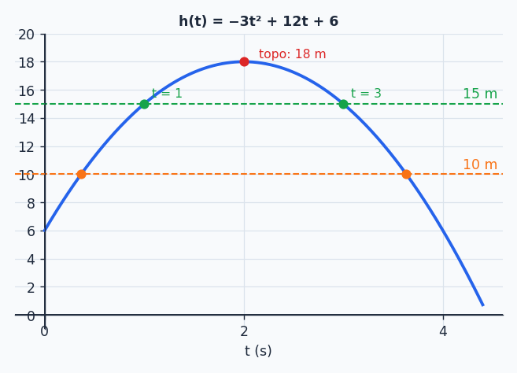
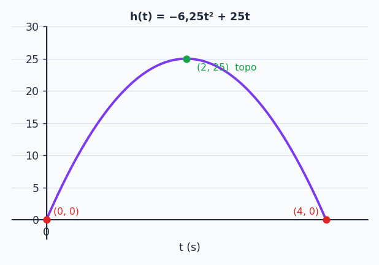

## Sobre

No tópico anterior a gente andou em **um** sentido: dada a função, desenhar a parábola. Agora vamos andar no sentido contrário (dada a parábola, **descobrir a função**) e depois usar tudo em problemas com cara de jogo: flechas, catapultas, drones.

Se algum elemento da parábola (vértice, raízes, intercepto, $\Delta$) estiver nebuloso, dê uma passada rápida no tópico *Função do 2º grau* antes de continuar.

## Revisão relâmpago

Para $f(x)=ax^2+bx+c$ com $a\ne0$:

| Elemento | Fórmula |
| --- | --- |
| Concavidade | $a>0$ para cima, $a<0$ para baixo |
| Discriminante | $\Delta=b^2-4ac$ |
| Raízes | $x=\dfrac{-b\pm\sqrt\Delta}{2a}$ |
| Vértice | $x_v=\dfrac{-b}{2a}$, $y_v=\dfrac{-\Delta}{4a}$ |
| Intercepto | $(0,c)$ |

## Descobrindo a equação a partir de pontos

Na reta, dois pontos bastavam. Aqui são **três incógnitas** ($a$, $b$ e $c$), e para achar três incógnitas você precisa de **três equações**: cada ponto $(x_i,y_i)$ vira uma equação. Por isso são necessários **três pontos**.

**Algoritmo:**

1. Escreva a fórmula geral $f(x)=ax^2+bx+c$.
2. Substitua cada um dos três pontos na fórmula (sai um sistema $3\times3$).
3. Resolva o sistema (substituição, adição, escalonamento ou Cramer, o que você preferir).
4. Escreva a função final com os valores de $a$, $b$ e $c$.

### Exemplo 1: pontos $(1,2)$, $(2,3)$ e $(3,6)$

**Passo 2:** substituindo os pontos em $y=ax^2+bx+c$:

$$
\begin{cases}
a+b+c=2\\
4a+2b+c=3\\
9a+3b+c=6
\end{cases}
$$

**Passo 3:** o truque é **eliminar o $c$** (que aparece sozinho nas três). Subtraia a 1ª equação da 2ª, e depois a 1ª da 3ª:

$$
\begin{cases}
3a+b=1\\
8a+2b=4
\end{cases}
$$

Agora multiplique a primeira por $-2$ e some com a segunda: $-6a-2b+8a+2b=-2+4\Rightarrow 2a=2\Rightarrow a=1$.

Volta: $3\cdot1+b=1\Rightarrow b=-2$. E na equação original: $1-2+c=2\Rightarrow c=3$.

**Passo 4:**

$$
f(x)=x^2-2x+3
$$

> [!TIP]
> **Prova real obrigatória:** substitua os três pontos na função. $f(1)=1-2+3=2$ ✓, $f(2)=4-4+3=3$ ✓, $f(3)=9-6+3=6$ ✓.

### Exemplo 2: pontos $(-1,0)$, $(0,1)$ e $(1,4)$

Um ponto com $x=0$ é um presente: ele entrega o $c$ de graça.

$$
\begin{cases}
a-b+c=0\\
c=1\\
a+b+c=4
\end{cases}
\;\Rightarrow\;
\begin{cases}
a-b=-1\\
a+b=3
\end{cases}
$$

Somando as duas: $2a=2$, então $a=1$ e $b=2$. Resultado: $f(x)=x^2+2x+1$ (que é $(x+1)^2$, o que faz sentido: toca o eixo $x$ em $-1$).

### Exemplo 3: pontos $(-2,15)$, $(0,3)$ e $(3,0)$

Novamente $x=0$ dá $c=3$. Substituindo nas outras duas:

$$
\begin{cases}
4a-2b=12\\
9a+3b=-3
\end{cases}
$$

Multiplique a primeira por $3$ e a segunda por $2$ e some: $12a-6b+18a+6b=36-6\Rightarrow30a=30\Rightarrow a=1$. Então $12-6b=36$ e $b=-4$.

$$
f(x)=x^2-4x+3
$$

### E no computador?

Um sistema $3\times3$ é um pedido clássico para a álgebra linear (você vai ver em outro período). Em Python, a ideia fica assim:

```python
import numpy as np

pontos = [(1, 2), (2, 3), (3, 6)]
A = np.array([[x**2, x, 1] for x, _ in pontos], dtype=float)
y = np.array([y for _, y in pontos], dtype=float)

a, b, c = np.linalg.solve(A, y)
print(a, b, c)   # 1.0 -2.0 3.0
```

Cada linha de `A` é o "$x^2,\ x,\ 1$" de um ponto, exatamente as equações que você montou à mão.

### Atalhos quando a pista é outra

Se o enunciado entregar **as raízes** ou **o vértice**, nem precisa do sistema:

- **Com as raízes $x_1$ e $x_2$:** $f(x)=a\,(x-x_1)(x-x_2)$, e use um terceiro ponto para achar $a$.
- **Com o vértice $(x_v,y_v)$:** $f(x)=a\,(x-x_v)^2+y_v$, e use outro ponto para achar $a$.

## Problemas de trajetória e otimização

O roteiro é quase sempre o mesmo. Traduza a pergunta para um dos quatro elementos:

| A pergunta fala de... | Vira... |
| --- | --- |
| "volta ao solo", "chega a zero" | **raiz** ($f=0$) |
| "altura/valor máximo (ou mínimo)", "momento do ápice" | **vértice** |
| "valor inicial", "no instante 0" | **intercepto** |
| "atinge exatamente $k$" | equação $f(x)=k$ |
| "pelo menos $k$", "acima de $k$" | inequação $f(x)\ge k$ (estudo do sinal!) |

### Problema 1: a flecha (RPG)

A trajetória de uma flecha é $h(t)=-3t^2+12t+6$ (metros, segundos).



**a) Ela atinge exatamente 15 m? Quando?** Iguale e leve tudo para um lado:

$$
-3t^2+12t+6=15\;\Rightarrow\;-3t^2+12t-9=0
$$

$\Delta=144-108=36$, então $t=\frac{-12\pm6}{-6}$, ou seja, $t=1$ s e $t=3$ s. Sim, ela passa por 15 m **duas vezes**: subindo (1 s) e descendo (3 s).

**b) Em que intervalo ela fica a pelo menos 10 m?**

$$
-3t^2+12t+6\ge10\;\Rightarrow\;-3t^2+12t-4\ge0
$$

$\Delta=144-48=96$, raízes $t_1\approx0{,}37$ e $t_2\approx3{,}63$. Como $a<0$, a parábola fica **positiva entre as raízes**: $t\in[0{,}37;\ 3{,}63]$ s. Ou seja, são cerca de 3,26 s acima de 10 m.

**c) Qual o ponto mais alto?** É o vértice: $y_v=\frac{-\Delta}{4a}$, com $\Delta=12^2-4(-3)(6)=216$:

$$
y_v=\frac{-216}{-12}=18\ \text{m}
$$

(e acontece em $t_v=\frac{-12}{-6}=2$ s, no meio entre os instantes 1 e 3 em que ela estava a 15 m).

### Problema 2: o drone do show

Um drone faz um movimento parabólico: atinge **25 m** de altura em **2 s** e **volta ao solo em 4 s**. Ache $h(t)$.

**Leia as pistas:**

- Altura máxima $\Rightarrow$ vértice: $h(2)=25$, ponto $(2,25)$.
- Começa no chão: $h(0)=0$, ponto $(0,0)$.
- Volta ao solo em 4 s: $h(4)=0$, ponto $(4,0)$.



Com $(0,0)$, já sai $c=0$. Sobram:

$$
\begin{cases}
16a+4b=0\\
4a+2b=25
\end{cases}
$$

Multiplicando a segunda por $-2$: $-8a-4b=-50$. Somando com a primeira: $8a=-50\Rightarrow a=-6{,}25$, e $b=25$.

$$
h(t)=-6{,}25\,t^2+25\,t
$$

> [!NOTE]
> **Pelo atalho das raízes:** as raízes são $0$ e $4$, então $h(t)=a\,t\,(t-4)$. Usando $h(2)=25$: $a\cdot2\cdot(-2)=25$, logo $a=-6{,}25$. Mesma resposta, bem mais rápido.

> [!TIP]
> **Repare na simetria:** o vértice sempre fica no **meio** das raízes. Subir leva o mesmo tempo que descer (sem resistência do ar, claro).

## Resumão

| Objetivo | Caminho |
| --- | --- |
| Achar a função com 3 pontos | sistema $3\times3$ em $a,b,c$ |
| Ponto com $x=0$ | já entrega o $c$ |
| Conhece as raízes | $a(x-x_1)(x-x_2)$ |
| Conhece o vértice | $a(x-x_v)^2+y_v$ |
| Máximo/mínimo | vértice |
| "Volta ao solo" | raiz positiva |
| "Pelo menos $k$" | inequação + estudo do sinal |

## Exercícios

**E1.** Ache a equação do 2º grau que passa por: a) $(-1,6)$, $(1,2)$ e $(2,3)$; b) $(0,4)$, $(2,0)$ e $(4,4)$.


a) $f(x)=x^2-2x+3$. b) $f(x)=x^2-4x+4$.

Dica para o (b): o ponto $(0,4)$ dá $c=4$. Sobra $4a+2b=-4$ e $16a+4b=0$, e daí $a=1$ e $b=-4$.


**E2.** Em um jogo de estratégia, uma catapulta lança pedras e a altura é $h(t)=-5t^2+20t$. a) Qual a altura máxima? b) Em quantos segundos a pedra volta ao solo?


a) $t_v=\frac{-20}{-10}=2$ s e $h(2)=-20+40=20$ m. b) $-5t^2+20t=0\Rightarrow t(-5t+20)=0\Rightarrow t=4$ s.


### Teste rápido




Por que precisamos de **três** pontos para determinar uma função do 2º grau?

- [ ] Porque o gráfico é uma curva e não uma reta.
- [x] Porque há três coeficientes desconhecidos ($a$, $b$ e $c$), e cada ponto dá uma equação.
- [ ] Porque a fórmula de Bhaskara usa três termos.
- [ ] Porque uma parábola sempre tem três raízes.
---
Três incógnitas pedem três equações independentes. (E a parábola tem no máximo duas raízes.)



Uma pedra é lançada e sua altura é $h(t)=-t^2+6t$. O tempo até a altura máxima é:

- [ ] $6$ s
- [x] $3$ s
- [ ] $9$ s
- [ ] $1$ s
---
$t_v=\frac{-6}{-2}=3$. A altura máxima (em $3$ s) vale $-9+18=9$ m. Não confunda o **instante** do ápice com a **altura** do ápice.



Uma parábola tem raízes $1$ e $5$ e passa por $(0,10)$. Sua equação é:

- [ ] $f(x)=x^2-6x+5$
- [x] $f(x)=2x^2-12x+10$
- [ ] $f(x)=-2x^2+12x-10$
- [ ] $f(x)=2x^2-12x+5$
---
$f(x)=a(x-1)(x-5)$ e $f(0)=5a=10$, então $a=2$ e $f(x)=2(x^2-6x+5)=2x^2-12x+10$. A primeira alternativa tem as mesmas raízes, mas $f(0)=5$, não $10$.



