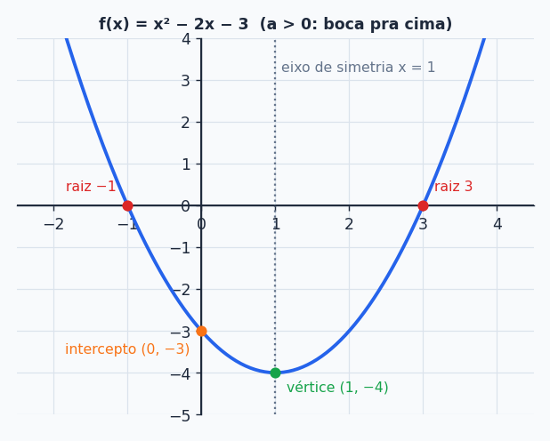
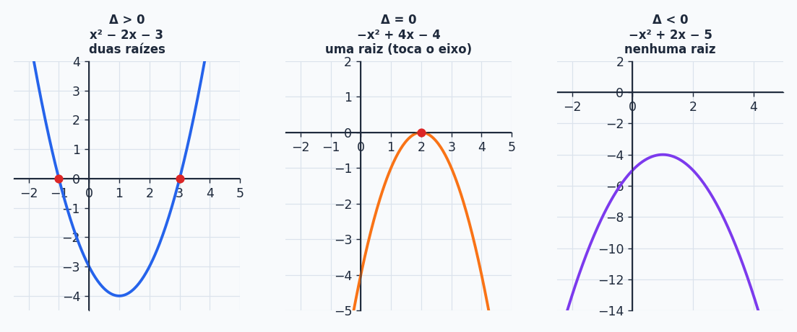
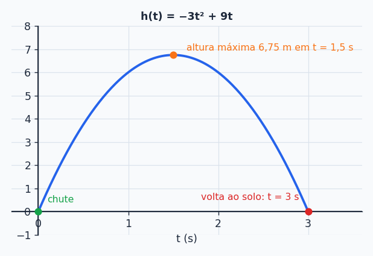

## Sobre

Chutou uma bola? Jogou um item em um jogo 3D? Passou por uma ponte pênsil? Então você já viu uma **parábola**. A função do 2º grau é a "função da curva" e é, sem exagero, uma das mais úteis que existem. Neste tópico você aprende a **desenhar** qualquer parábola em quatro passos e a fazer o **estudo do sinal**.

## Por que isso aparece em Computação?

- **Jogos e animações:** o pulo do personagem, uma granada e uma flecha seguem trajetórias parabólicas. Motores como Unity e Unreal usam isso o tempo todo.
- **Modelagem e otimização:** custo, lucro e uso de recursos muitas vezes viram uma quadrática, e o *vértice* é o ponto ótimo (menor custo, maior lucro).
- **Análise de algoritmos:** laços aninhados em um *bubble sort* ou numa busca ingênua dão tempo $T(n)=an^2+bn+c$. Entender a curva ajuda a prever o que acontece quando $n$ cresce.
- **Machine Learning:** funções de custo quadráticas (erro quadrático médio) e regressões usam parábolas.

## A função e a parábola

Uma **função do 2º grau** (ou **quadrática**) é toda função que pode ser escrita assim:

$$
\boxed{f(x)=ax^2+bx+c}\qquad a,b,c\in\mathbb R,\ a\ne0
$$

- $f(x)=3x^2+4x-4$ é do 2º grau.
- $g(x)=-x^2+2$ também (aqui $b=0$).
- $h(x)=x^{-2}+3x+1$ **não é**: o expoente do $x$ não é $2$ (é $-2$).

O gráfico é **sempre uma parábola**. Para desenhar uma parábola direito você precisa de quatro informações:

1. **Concavidade** (pra cima ou pra baixo)
2. **Raízes** (onde corta o eixo $x$)
3. **Vértice** (o ponto mais alto ou mais baixo)
4. **Intercepto** (onde corta o eixo $y$)

## Os quatro elementos

### 1. Concavidade

Olhe só para o **sinal de $a$**:

- $a>0$: concavidade **para cima** (formato de sorriso, tem um *mínimo*).
- $a<0$: concavidade **para baixo** (formato de tristeza, tem um *máximo*).

Exemplos: $f(x)=-3x^2+x+4$ abre para baixo e $f(x)=x^2-2x-4$ abre para cima.

### 2. Raízes (fórmula de Bhaskara)

São os $x$ onde $f(x)=0$, os pontos em que a parábola toca o eixo $x$. Primeiro calcule o **discriminante** $\Delta$:

$$
\Delta=b^2-4ac
$$

e ele diz **quantas** raízes reais existem:

| $\Delta$ | Raízes reais |
| --- | --- |
| $\Delta>0$ | duas, diferentes |
| $\Delta=0$ | uma só (a parábola só "encosta" no eixo) |
| $\Delta<0$ | nenhuma (a parábola nem chega no eixo) |

E o valor delas vem de

$$
x=\frac{-b\pm\sqrt{\Delta}}{2a}
$$

> [!TIP]
> **Atalhos para equações incompletas** (nem precisa de Bhaskara):
> - Se $c=0$ ($ax^2+bx=0$): evidencie o $x$. $x(ax+b)=0$ dá $x=0$ ou $x=-b/a$.
> - Se $b=0$ ($ax^2+c=0$): isole o $x^2$. $x^2=-c/a$ e tire a raiz (se der positivo, são duas raízes opostas).

**Bônus: soma e produto das raízes.** Se $x_1$ e $x_2$ são as raízes, então

$$
x_1+x_2=-\frac ba\qquad x_1\cdot x_2=\frac ca\qquad f(x)=a\,(x-x_1)(x-x_2)
$$

Serve para conferir a conta (no exemplo abaixo, raízes $3$ e $-1$: soma $2=-\frac{-2}{1}$ e produto $-3=\frac{-3}{1}$ ✓) e, no próximo tópico, para montar a função a partir das raízes.

### 3. Vértice

É o ponto extremo da parábola, o "bico" da curva. As coordenadas são:

$$
x_v=\frac{-b}{2a}\qquad y_v=\frac{-\Delta}{4a}
\qquad\Rightarrow\qquad V=(x_v,\,y_v)
$$

- Se $a>0$, o vértice é o **valor mínimo** da função.
- Se $a<0$, o vértice é o **valor máximo**.

A parábola é **simétrica** em relação à reta vertical $x=x_v$ (o *eixo de simetria*). Por isso o $x_v$ fica sempre bem no meio das raízes: $x_v=\frac{x_1+x_2}{2}$.

> [!NOTE]
> Se você tem pressa, calcule só o $x_v$ e depois jogue ele na função: $y_v=f(x_v)$. Dá exatamente o mesmo valor que $\frac{-\Delta}{4a}$ e costuma ser menos sujeito a erro de sinal.

### 4. Intercepto

É onde a parábola corta o eixo $y$, isto é, em $x=0$:

$$
I=(0,\,f(0))=(0,\,c)
$$

O intercepto é sempre o **coeficiente $c$**. Zero esforço.

## Construindo o gráfico: três exemplos completos

### Exemplo 1: $f(x)=x^2-2x-3$ (duas raízes)

- **Concavidade:** $a=1>0$, para cima.
- **Raízes:** $\Delta=(-2)^2-4\cdot1\cdot(-3)=4+12=16$. Então $x=\frac{2\pm4}{2}$, ou seja, $x_1=3$ e $x_2=-1$.
- **Vértice:** $x_v=\frac{-(-2)}{2}=1$ e $y_v=\frac{-16}{4}=-4$. $V=(1,-4)$.
- **Intercepto:** $f(0)=-3$, ponto $(0,-3)$.

Marque os quatro pontos e a parábola aparece sozinha (é a figura lá de cima).

### Exemplo 2: $f(x)=-x^2+4x-4$ (uma raiz)

- **Concavidade:** $a=-1<0$, para baixo.
- **Raízes:** $\Delta=4^2-4(-1)(-4)=16-16=0$, uma única raiz: $x=\frac{-4}{2(-1)}=2$.
- **Vértice:** $x_v=\frac{-4}{-2}=2$ e $y_v=\frac{0}{-4}=0$. $V=(2,0)$, bem em cima do eixo $x$ (a raiz *é* o vértice).
- **Intercepto:** $f(0)=-4$.

### Exemplo 3: $f(x)=-x^2+2x-5$ (nenhuma raiz)

- **Concavidade:** $a=-1<0$, **para baixo**.
- **Raízes:** $\Delta=2^2-4(-1)(-5)=4-20=-16<0$. Nenhuma raiz real.
- **Vértice:** $x_v=\frac{-2}{-2}=1$ e $y_v=\frac{-(-16)}{4(-1)}=-4$. $V=(1,-4)$.
- **Intercepto:** $f(0)=-5$.

> [!WARNING]
> Repare no sentido da parábola do Exemplo 3. Como $a=-1<0$ ela abre **para baixo** e o vértice $(1,-4)$ é o ponto **mais alto**. A parábola inteira fica abaixo do eixo $x$, o que bate com $\Delta<0$. Se você desenhar para cima, vai achar uma parábola que cruza o eixo, contradizendo a falta de raízes.

## Estudo do sinal

Descobrir **onde** $f(x)>0$, $f(x)<0$ e $f(x)=0$. O raciocínio é puramente visual: onde a parábola está **acima** do eixo $x$, a função é positiva; **abaixo**, negativa.

O que você precisa é de **concavidade + raízes**:

| Situação | Sinal de $f(x)$ |
| --- | --- |
| $a>0$, $\Delta>0$ | $+$ fora das raízes, $-$ entre elas |
| $a<0$, $\Delta>0$ | $-$ fora das raízes, $+$ entre elas |
| $\Delta=0$ | zero na raiz; em todo o resto, tem o sinal de $a$ |
| $\Delta<0$ | sempre o sinal de $a$ (nunca cruza o eixo) |

**Exemplo 1: $f(x)=x^2+2x-8$.** $a>0$, $\Delta=4+32=36$, raízes $x_1=-4$ e $x_2=2$.

- $f(x)<0$ se $x\in\,]-4,2[$
- $f(x)>0$ se $x<-4$ ou $x>2$
- $f(x)=0$ se $x=-4$ ou $x=2$

**Exemplo 2: $f(x)=-2x^2+18$.** $a<0$. Raízes: $-2x^2+18=0\Rightarrow x^2=9\Rightarrow x=\pm3$.

- $f(x)>0$ se $x\in\,]-3,3[$
- $f(x)<0$ se $x<-3$ ou $x>3$
- $f(x)=0$ se $x=\pm3$

**Exemplo 3: $f(x)=-x^2+2x-5$.** $a<0$ e $\Delta=-16<0$: **sempre negativa**, $f(x)<0$ para todo $x\in\mathbb R$.

> [!TIP]
> Vai fazer inequação como $x^2-4\ge0$ ou $-x^2+4x\le 0$? É exatamente o estudo do sinal, só que ao contrário: você já sabe a pergunta, falta olhar onde a parábola está acima/abaixo.

## Primeira aplicação: a bola chutada

Uma bola chutada tem trajetória $h(t)=-3t^2+9t$, com $t$ em segundos e $h$ em metros.

**a) Quando a bola volta ao solo?** No solo $h=0$:

$$
-3t^2+9t=0\;\Rightarrow\;t(-3t+9)=0\;\Rightarrow\;t=0\ \text{ou}\ t=3
$$

$t=0$ é o instante do chute, então a bola volta ao solo em **$t=3$ s**.

**b) Quando atinge a altura máxima?** Isso é o vértice: $t_v=\frac{-9}{2(-3)}=1{,}5$ s. A altura máxima é $h(1{,}5)=-3(2{,}25)+13{,}5=6{,}75$ m.

Perceba que $t_v=1{,}5$ é exatamente o ponto médio entre $0$ e $3$. É a simetria da parábola funcionando.

## Resumão

| Elemento | Como achar |
| --- | --- |
| Concavidade | sinal de $a$ |
| $\Delta$ | $b^2-4ac$ |
| Raízes | $\dfrac{-b\pm\sqrt\Delta}{2a}$ |
| Vértice | $x_v=\dfrac{-b}{2a}$, $y_v=\dfrac{-\Delta}{4a}$ |
| Intercepto | $(0,c)$ |
| Sinal | concavidade + raízes |
| Máx/mín | é o vértice ($a<0$: máximo; $a>0$: mínimo) |

## Exercícios

**E1.** Construa os gráficos de $f(x)=x^2-3x-4$, $f(x)=x^2-4x+4$ e $f(x)=x^2+4x+5$.


- $x^2-3x-4$: para cima, $\Delta=25$, raízes $-1$ e $4$, vértice $(1{,}5;\,-6{,}25)$, intercepto $(0,-4)$.
- $x^2-4x+4$: para cima, $\Delta=0$, raiz única $2$, vértice $(2,0)$, intercepto $(0,4)$.
- $x^2+4x+5$: para cima, $\Delta=-4$ (sem raízes), vértice $(-2,1)$, intercepto $(0,5)$.


**E2.** Faça o estudo do sinal de $f(x)=x^2-5x+6$ e de $f(x)=x^2+4x+5$.


$x^2-5x+6$: raízes $2$ e $3$, para cima. $f<0$ se $x\in\,]2,3[$; $f>0$ se $x<2$ ou $x>3$; $f=0$ se $x=2$ ou $x=3$.
$x^2+4x+5$: $\Delta=-4<0$ e $a>0$, logo $f(x)>0$ para todo $x$.


### Teste rápido




O vértice de $f(x)=2x^2-8x+3$ é:

- [ ] $(4,\,3)$
- [x] $(2,\,-5)$
- [ ] $(-2,\,27)$
- [ ] $(2,\,3)$
---
$x_v=\frac{8}{4}=2$ e $y_v=f(2)=8-16+3=-5$. Como $a>0$, esse é o valor mínimo da função.



Se $\Delta<0$ e $a>0$, o que se pode dizer de $f(x)=ax^2+bx+c$?

- [ ] Tem duas raízes reais.
- [ ] É sempre negativa.
- [x] É sempre positiva.
- [ ] Muda de sinal uma vez.
---
Sem raízes, a parábola nunca cruza o eixo $x$. Com $a>0$ ela abre para cima e fica toda acima do eixo.



O intercepto de $f(x)=-x^2+7x-12$ com o eixo $y$ é:

- [ ] $(0,\,7)$
- [ ] $(0,\,12)$
- [x] $(0,\,-12)$
- [ ] $(-12,\,0)$
---
$f(0)=c=-12$. O intercepto está sempre em $(0,c)$.



