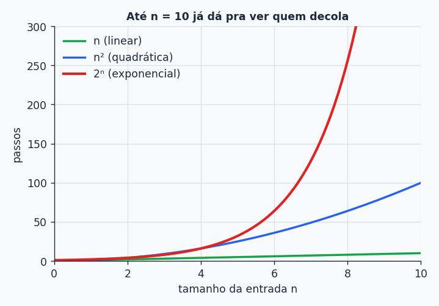
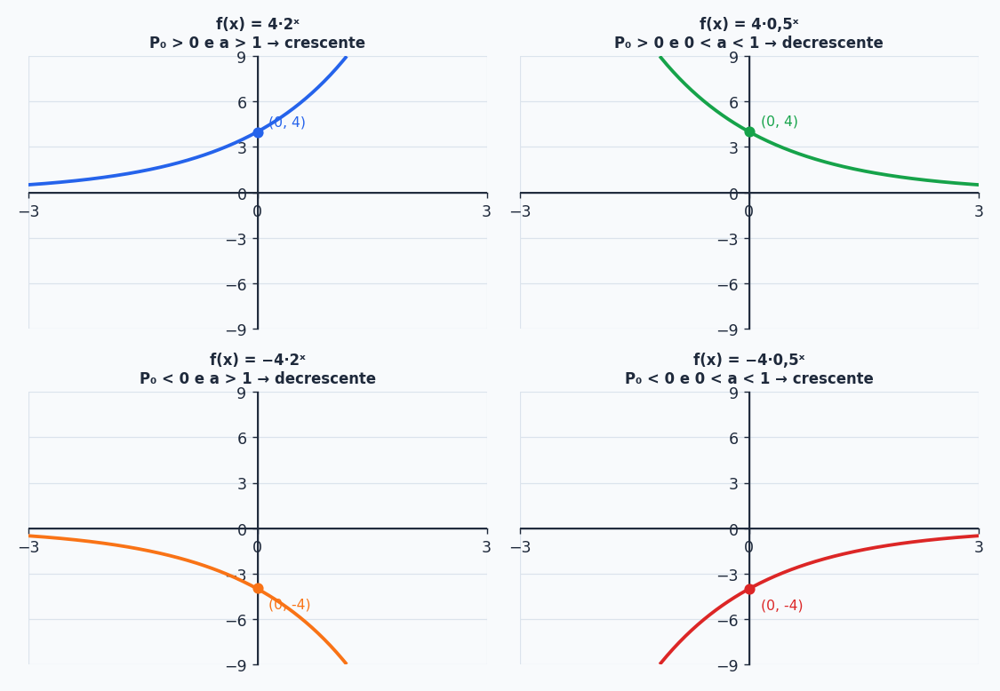

## Sobre

Dobrar um número é fácil. Dobrar de novo também. Agora dobre **cinquenta vezes**: você acabou de passar de um quatrilhão. É isso que a função exponencial faz: ela começa comportada e, de repente, **explode**. Entender esse comportamento é essencial para Computação, porque é exatamente a fronteira entre um algoritmo viável e um que não termina nunca.

## Por que isso importa em Computação

A **complexidade** de um algoritmo diz quanto tempo (ou espaço) ele gasta em função do tamanho $n$ da entrada:

| Tipo | Notação | Crescimento |
| --- | --- | --- |
| Constante | $O(1)$ | fixo, não muda |
| Linear | $O(n)$ | cresce junto com a entrada |
| Quadrático | $O(n^2)$ | cresce mais rápido |
| Exponencial | $O(2^n)$ | cresce **muito** rápido |

**O exemplo das senhas.** Você quer adivinhar uma senha de $n$ dígitos binários (cada dígito é 0 ou 1). No pior caso, são $2^n$ tentativas:

- 1 dígito: $2^1=2$ tentativas
- 2 dígitos: $2^2=4$
- 10 dígitos: $2^{10}=1024$
- 50 dígitos: $2^{50}\approx1{,}1\times10^{15}$ (mais de um quatrilhão!)

É por isso que quebrar senha por força bruta é inviável: cada dígito a mais **dobra** o trabalho. Onde mais isso aparece:

- **Criptografia:** a segurança vem do número de combinações explodir.
- **Problemas NP-completos:** como o Caixeiro Viajante (rota ótima entre várias cidades), para os quais não se conhece solução eficiente.
- **Recursão ingênua:** o clássico `fib(n)` que chama `fib(n-1)` e `fib(n-2)` sem memorizar nada gasta tempo exponencial.

## Definição

Uma **função exponencial** é toda função que pode ser escrita assim:

$$
\boxed{f(x)=P_0\cdot a^{x}}\qquad P_0,a\in\mathbb R,\ P_0\ne0,\ a>0,\ a\ne1
$$

A **variável está no expoente**. O $P_0$ é o valor inicial (a razão do nome: em $x=0$, $a^0=1$ e $f(0)=P_0$) e o $a$ é o **fator** de crescimento ou de decaimento.

Por que $a>0$ e $a\ne1$? Se $a=1$, $1^x$ é sempre $1$ (vira função constante, sem graça). Se $a<0$, expoentes fracionários dariam resultado que nem existe nos reais (pense em $(-2)^{1/2}$).

**Exemplos:** $f(x)=2^x$, $g(x)=5\cdot0{,}1^x$ e $h(x)=-4\cdot\left(\frac13\right)^x$ são exponenciais. Já $i(x)=x^2+3x+1$ **não é**: o $x$ está na base, não no expoente.

## O gráfico: quatro casos

O comportamento depende de **dois** sinais: o de $P_0$ (para cima ou para baixo do eixo $x$) e o tamanho de $a$ (maior ou menor que 1).

| $P_0$ | $a$ | Comportamento | Exemplo |
| --- | --- | --- | --- |
| $P_0>0$ | $a>1$ | **crescente** | $4\cdot2^x$ |
| $P_0>0$ | $0<a<1$ | **decrescente** | $4\cdot0{,}5^x$ |
| $P_0<0$ | $a>1$ | **decrescente** | $-4\cdot2^x$ |
| $P_0<0$ | $0<a<1$ | **crescente** | $-4\cdot0{,}5^x$ |

Para montar o gráfico é só uma tabelinha:

| $x$ | $4\cdot2^x$ | $4\cdot0{,}5^x$ | $-4\cdot2^x$ | $-4\cdot0{,}5^x$ |
| --- | --- | --- | --- | --- |
| $-2$ | $1$ | $16$ | $-1$ | $-16$ |
| $-1$ | $2$ | $8$ | $-2$ | $-8$ |
| $0$ | $4$ | $4$ | $-4$ | $-4$ |
| $1$ | $8$ | $2$ | $-8$ | $-2$ |
| $2$ | $16$ | $1$ | $-16$ | $-1$ |

Duas observações valem para **todas**:

- Em $x=0$ o gráfico passa em $(0,P_0)$.
- O gráfico **nunca corta o eixo $x$**. A equação $P_0\cdot a^x=0$ não tem solução, porque $a^x$ é sempre positivo. O eixo $x$ é uma **assíntota horizontal**: a curva se aproxima dele sem nunca encostar.

> [!NOTE]
> Em Cálculo, você vai identificar o *tipo* da função "pela cara" para escolher o método certo de derivar ou integrar. Já vá acostumando o olho: exponencial = curva que se cola num eixo de um lado e dispara do outro.

### Exemplo: $f(x)=-3\cdot2^x$

- **$f(0)$:** $-3\cdot1=-3$.
- **Crescente ou decrescente?** $P_0<0$ e $a>1$: **decrescente**.
- **$x\to+\infty$:** $2^x$ cresce sem limite, então $f(x)\to-\infty$.
- **$x\to-\infty$:** $2^x\to0$, então $f(x)\to0^-$ (se aproxima de zero **por baixo**, já que é negativa).

## Equação exponencial

É uma equação com a incógnita **no expoente**. Estratégia: escreva os dois lados como potências da **mesma base** e depois iguale os expoentes (porque, com base $a>0$, $a\ne1$, $a^m=a^n\Rightarrow m=n$).

$$
2^x=8\;\Rightarrow\;2^x=2^3\;\Rightarrow\;x=3
$$

$$
3^x=\frac19\;\Rightarrow\;3^x=3^{-2}\;\Rightarrow\;x=-2
$$

$$
7^x=\sqrt[3]{7^5}\;\Rightarrow\;7^x=7^{5/3}\;\Rightarrow\;x=\frac53
$$

Quando as bases são diferentes mas parentes (potências do mesmo número), converta:

$$
2^{6x-1}=4^{2x}\;\Rightarrow\;2^{6x-1}=(2^2)^{2x}=2^{4x}\;\Rightarrow\;6x-1=4x\;\Rightarrow\;x=\frac12
$$

**Casos de base 1:**

- $1^x=5$: base 1 vale sempre 1, então $1\ne5$. **Sem solução.**
- $1^x=1^{2x+3}$: os dois lados valem 1 para qualquer $x$. A solução é **todo $\mathbb R$**.

> [!WARNING]
> O método da "mesma base" só funciona quando dá para reescrever os dois lados. Em $5^x=200$ você não consegue (200 não é potência "bonita" de 5). Para isso existe o **logaritmo**, assunto dos próximos tópicos.

## Inequação exponencial

O método é o mesmo (mesma base), mas agora tem uma **regra de ouro** sobre o sinal da desigualdade, que depende da base:

| Base | A função é... | A desigualdade... |
| --- | --- | --- |
| $a>1$ | crescente | **se mantém** |
| $0<a<1$ | decrescente | **se inverte** |

**Exemplos:**

$$
2^x<8\;\Rightarrow\;2^x<2^3\;\Rightarrow\;x<3
\qquad(\text{base }2>1,\ \text{mantém})
$$

$$
0{,}5^x<0{,}5^3\;\Rightarrow\;x>3
\qquad(\text{base }0{,}5<1,\ \text{inverte})
$$

$$
\left(\tfrac13\right)^x<\tfrac19=\left(\tfrac13\right)^2\;\Rightarrow\;x>2
\qquad(\text{inverte})
$$

$$
5^{2x}\le\frac{1}{\sqrt[4]{125}}=5^{-3/4}\;\Rightarrow\;2x\le-\frac34\;\Rightarrow\;x\le-\frac38
\qquad(\text{mantém})
$$

> [!TIP]
> Dica visual para lembrar: base maior que 1 é uma subida (quanto maior o $x$, maior o resultado), então a ordem entre os expoentes é a mesma ordem entre as potências. Base entre 0 e 1 é uma descida, e a ordem **inverte**.

Assim como na equação, $2^x<5$ não se resolve só com bases iguais. Fica para os logaritmos.

## Problemas com exponencial

A receita é sempre:

$$
f(t)=P_0\cdot a^t
$$

- $P_0$ = valor inicial.
- $a=1+i$ se **cresce** a uma taxa $i$ por período.
- $a=1-i$ se **diminui** a uma taxa $i$ por período.
- $a=2$ se **dobra**, $a=\frac12$ se **cai pela metade**.

> [!IMPORTANT]
> Atenção à **unidade do tempo**: se a taxa é "por hora", o $t$ é em horas. Se o enunciado muda a unidade ("meia-vida de 10 anos, e $t$ em décadas"), você tem que converter antes de substituir.

### Bactérias

Uma colônia com 2000 bactérias dobra a cada hora.

a) $f(t)=2000\cdot2^t$.
b) Após 5 horas: $f(5)=2000\cdot2^5=2000\cdot32=64\,000$ bactérias.

### Material radioativo

Massa inicial de 500 g e **meia-vida de 10 anos** (a cada 10 anos, a massa cai pela metade).

a) Medindo $t$ em **décadas**: $f(t)=500\cdot0{,}5^t$.
b) Após 25 anos, $t=2{,}5$ décadas:

$$
f(2{,}5)=500\cdot0{,}5^{2}\cdot0{,}5^{0{,}5}=500\cdot0{,}25\cdot0{,}7071\approx88{,}39\ \text{g}
$$

### Desvalorização de um carro

Carina comprou um carro por 80 mil reais, e o modelo desvaloriza 8% ao ano.

a) $a=1-0{,}08=0{,}92$, então $f(t)=80\,000\cdot0{,}92^t$.
b) Em 5 anos: $f(5)=80\,000\cdot0{,}92^5\approx52\,726{,}52$ reais.

### Dados em servidores

O volume de dados de uma empresa cresce **40% por semana** e hoje é de 1000 GB.

a) $a=1+0{,}4=1{,}4$ e $D(t)=1000\cdot1{,}4^t$.
b) Em 4 semanas: $D(4)=1000\cdot1{,}4^4=1000\cdot3{,}8416\approx3\,842$ GB.
c) Quando passa de 1 000 000 GB? Precisamos resolver $1000\cdot1{,}4^t=1\,000\,000$, isto é, $1{,}4^t=1000$. Não dá para pôr 1000 como potência "limpa" de 1,4. É aqui que o **logaritmo** entra, e é o tema da próxima parte.

## Resumão

| Conceito | Resumo |
| --- | --- |
| Forma | $f(x)=P_0\cdot a^x$ com $a>0$, $a\ne1$ |
| Ponto fixo | passa em $(0,P_0)$ |
| Assíntota | eixo $x$ (nunca corta) |
| Crescente | $P_0>0$ e $a>1$, ou $P_0<0$ e $0<a<1$ |
| Decrescente | $P_0>0$ e $0<a<1$, ou $P_0<0$ e $a>1$ |
| Equação | mesma base, iguala expoentes |
| Inequação | $a>1$ mantém, $0<a<1$ inverte |
| Taxa | $a=1\pm i$ |

## Exercícios

**E1.** Dada $f(x)=-3\cdot2^x$: a) esboce o gráfico; b) $f(0)$; c) crescente ou decrescente?; d) comportamento com $x\to+\infty$; e) comportamento com $x\to-\infty$.


a) Curva sempre negativa, passando por $(0,-3)$, que se cola ao eixo $x$ pela esquerda e despenca para a direita. b) $-3$. c) decrescente. d) $f(x)\to-\infty$. e) $f(x)\to0^-$.


**E2.** Resolva: a) $5^{x+1}=125$; b) $3^{x-1}\le9$; c) $\left(\frac12\right)^x<\frac1{16}$.


a) $5^{x+1}=5^3\Rightarrow x=2$.
b) $3^{x-1}\le3^2$, base maior que 1 mantém: $x-1\le2\Rightarrow x\le3$.
c) $\left(\frac12\right)^x<\left(\frac12\right)^4$, base menor que 1 inverte: $x>4$.


**E3.** Uma população de 300 animais dobra a cada 3 anos. Quantos animais depois de 9 anos?


Em 9 anos há três "dobras": $300\cdot2^3=2400$ animais. (Com $t$ em anos, $f(t)=300\cdot2^{t/3}$ e $f(9)=300\cdot2^3$.)


### Teste rápido




Qual dessas funções é **decrescente**?

- [ ] $f(x)=3\cdot2^x$
- [x] $f(x)=3\cdot\left(\frac12\right)^x$
- [ ] $f(x)=-3\cdot\left(\frac12\right)^x$
- [ ] $f(x)=x^2$
---
Com $P_0>0$ e base entre $0$ e $1$ a função decresce. A terceira ($P_0<0$ e $a<1$) é crescente, e a quarta nem é exponencial.



A solução de $4^x=\dfrac{1}{8}$ é:

- [ ] $x=-2$
- [x] $x=-\dfrac32$
- [ ] $x=\dfrac32$
- [ ] $x=-3$
---
$4^x=2^{2x}$ e $\frac18=2^{-3}$, então $2x=-3$ e $x=-\frac32$.



O conjunto solução de $\left(\dfrac13\right)^{x}>\dfrac{1}{27}$ é:

- [ ] $x>3$
- [x] $x<3$
- [ ] $x<-3$
- [ ] $x>-3$
---
$\frac1{27}=\left(\frac13\right)^3$. Como a base está entre $0$ e $1$, a desigualdade inverte: $x<3$.



