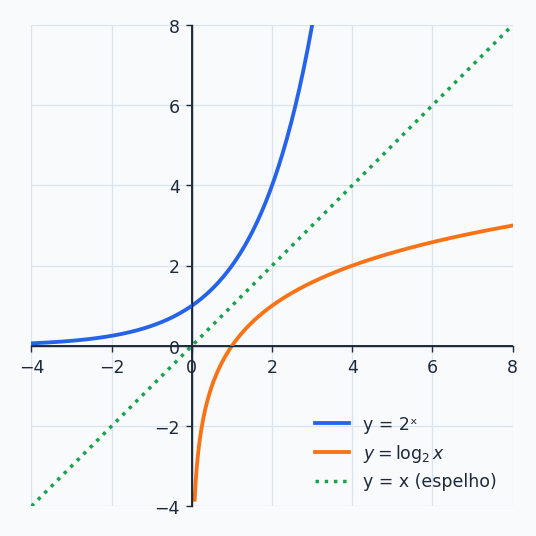
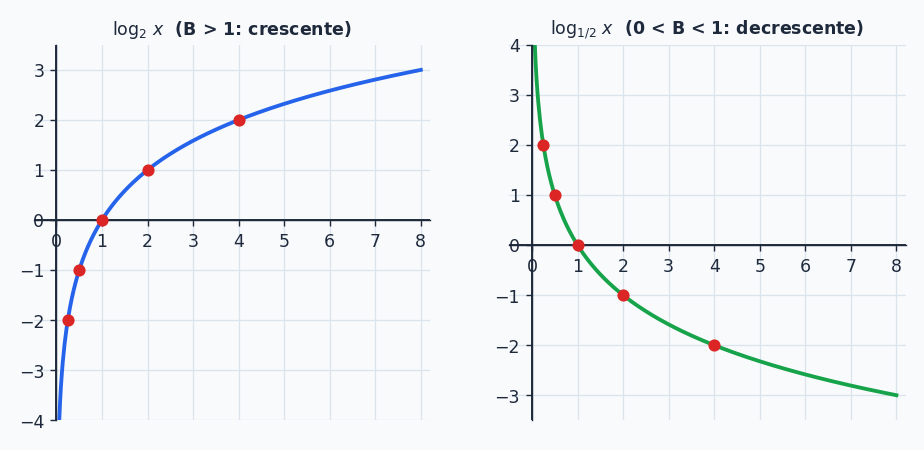
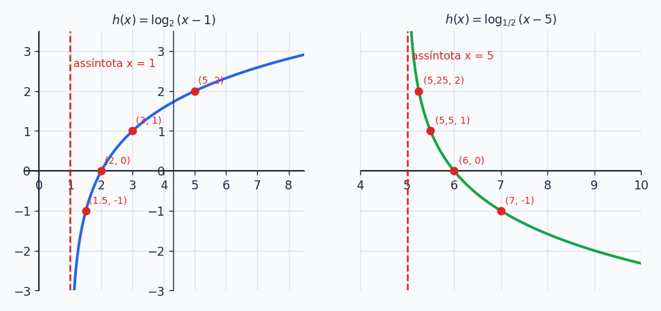

## Sobre

Agora que você sabe o que é um logaritmo, vamos colocá-lo para **trabalhar como função**. A boa notícia: a função logarítmica é a **exponencial vista no espelho**. Tudo que você aprendeu lá (crescente, decrescente, assíntota) volta aqui, só que de lado. A parte nova e cheia de pegadinhas é o **domínio**: o que está dentro do log tem que ser positivo, e isso muda totalmente como você resolve equações e inequações.

## Definição

Uma **função logarítmica** é uma função escrita como

$$
\boxed{f(x)=\log_B(x)}\qquad B\in\mathbb R,\ B>0,\ B\ne1
$$

Existe uma **condição de existência**: o logaritmando precisa ser **positivo**, isto é, $x>0$.

**Exemplos:** $f(x)=\log_7(x)$, $f(x)=\log(x)$ (base 10), $f(x)=\ln(x)$ (base $e$) e $f(x)=3\cdot\log_3(2x-4)$ são funções logarítmicas.

E a função $f(x)=e^x$? **Não** é logarítmica: é uma **função exponencial** (variável no expoente). Aparece na lista só para pegar o desatento.

## A relação com a exponencial: funções inversas

Toda exponencial $f(x)=b^x$ tem uma **inversa**, que é a logarítmica $f(x)=\log_bx$. Uma desfaz a outra:

$$
\log_b(b^x)=x\qquad\text{e}\qquad b^{\log_bx}=x
$$

Graficamente, os dois gráficos são **espelhos** um do outro em relação à reta $y=x$ (a diagonal):

Isso explica as diferenças de domínio e imagem (o que era entrada vira saída e vice-versa):

| | Domínio | Imagem |
| --- | --- | --- |
| $b^x$ | $\mathbb R$ | $]0,\infty[$ |
| $\log_bx$ | $]0,\infty[$ | $\mathbb R$ |

> [!TIP]
> O eixo $x$ era a assíntota da exponencial. No espelho, o **eixo $y$** (a reta $x=0$) vira a **assíntota vertical** da logarítmica. O gráfico se cola nele sem nunca tocar.

## O gráfico

Montando uma tabelinha para $f(x)=\log_2x$ (escolhemos $x$ que são potências de 2 para a conta sair redonda):

| $x$ | $\frac14$ | $\frac12$ | $1$ | $2$ | $4$ |
| --- | --- | --- | --- | --- | --- |
| $\log_2x$ | $-2$ | $-1$ | $0$ | $1$ | $2$ |

Agora para $f(x)=\log_{1/2}x$:

| $x$ | $\frac14$ | $\frac12$ | $1$ | $2$ | $4$ |
| --- | --- | --- | --- | --- | --- |
| $\log_{1/2}x$ | $2$ | $1$ | $0$ | $-1$ | $-2$ |

O que o gráfico conta:

- **$B>1$:** função **crescente** (a de base 2 sobe devagar, mas sobe sempre).
- **$0<B<1$:** função **decrescente**.
- Em **qualquer base**, $\log_B1=0$: o gráfico **sempre passa por $(1,0)$**.
- Só existe para $x>0$ (o gráfico fica todo à direita do eixo $y$).

> [!NOTE]
> Repare como o $\log_2x$ cresce **lentamente**: para chegar em $y=10$ já precisa de $x=1024$. É a mesma razão pela qual $O(\log n)$ é tão rápido: mesmo com $n$ gigante, o valor quase não sobe.

## Domínio: a condição de existência em ação

O domínio de uma função com logaritmo é o conjunto de $x$ que deixam **tudo que está dentro do log estritamente positivo**. Procedimento:

1. Escreva a desigualdade "(logaritmando) $>0$".
2. Resolva.
3. O resultado é o domínio.

**Exemplos:**

- $f(x)=\log_7(x)$: $x>0$, então $Dom=]0,\infty[$.
- $f(x)=\ln(2x+1)$: $2x+1>0\Rightarrow x>-\frac12$, então $Dom=\left]-\frac12,\infty\right[$.
- $f(x)=\log(-x^2+4)$: precisa $-x^2+4>0$. As raízes são $x=\pm2$ e, como $a<0$ (parábola para baixo), a expressão é positiva **entre** as raízes. $Dom=]-2,2[$.

> [!WARNING]
> Se a função tem **mais de um** log (ou um log junto com fração e raiz), cada um gera uma condição, e o domínio é a **interseção** de todas. Por exemplo, em $\log(2x)+\log(x+1)$ precisa de $x>0$ **e** $x>-1$, o que dá só $x>0$.

## Exemplo: construindo $h(x)=\log_2(x-1)$

1. **Condição de existência:** $x-1>0\Rightarrow x>1$. $Dom=]1,\infty[$.
2. **Base 2:** maior que 1, logo **crescente**.
3. **Alguns pontos** (escolhendo $x-1$ potência de 2):

| $x$ | $\frac32$ | $2$ | $3$ | $5$ |
| --- | --- | --- | --- | --- |
| $\log_2(x-1)$ | $-1$ | $0$ | $1$ | $2$ |

A assíntota vertical é a reta $x=1$ (a mesma curva do $\log_2x$, **deslocada uma unidade para a direita**).

### Esboçando $h(x)=\log_{1/2}(x-5)$

- Condição: $x-5>0\Rightarrow x>5$, assíntota $x=5$.
- Base $\frac12$ entre 0 e 1: **decrescente**.
- Pontos: $h(5{,}25)=2$, $h(5{,}5)=1$, $h(6)=0$, $h(7)=-1$ (é só escolher $x-5$ como potência de $\frac12$).

Também vale **calcular valor**: $h(x)=\log_2(x-1)$, então $h(9)=\log_28=3$.

## Equação logarítmica

Uma equação com a incógnita **dentro do logaritmo**. O roteiro tem três etapas, e a segunda nunca pode ser esquecida:

1. **Condição de existência:** para cada log, o logaritmando $>0$. Anote o domínio (interseção).
2. **Resolva** a equação usando propriedades.
3. **Confira:** toda solução precisa estar no domínio. Se não estiver, é **descartada**.

A ferramenta principal: se as bases são iguais, $\log_Ba=\log_Bb\Rightarrow a=b$ (porque o logaritmo é crescente ou decrescente, nunca repete valores).

### Exemplo 1: $\log(2x)=\log(x+1)$

- CE: $2x>0\Rightarrow x>0$, e $x+1>0\Rightarrow x>-1$. Interseção: $Dom=]0,\infty[$.
- Mesma base, iguala os logaritmandos: $2x=x+1\Rightarrow x=1$.
- $1\in]0,\infty[$ ✓. **Solução: $x=1$.**

### Exemplo 2: $2\cdot\log_3(x)=1+\log_3(27)$

- CE: $x>0$.
- Leve tudo para um log só. $2\log_3x=\log_3x^2$, $1=\log_33$ e $\log_3 3+\log_327=\log_3(3\cdot27)=\log_381$:

$$
\log_3(x^2)=\log_3(81)\;\Rightarrow\;x^2=81\;\Rightarrow\;x=\pm9
$$

- Confere o domínio: $x=-9$ **não** serve (não é $>0$). **Solução: $x=9$.**

> [!CAUTION]
> Esse é o motivo de a etapa 3 existir. Ao passar por $x^2$ o sinal de menos entrou "de graça" e a raiz $-9$ é falsa. Sem checar o domínio você erra a questão.

### Exemplo 3: $(\log_7x)^2-3\log_7x+2=0$

- CE: $x>0$.
- Repare que $\log_7x$ **se repete**. Troque por uma letra: $y=\log_7x$.

$$
y^2-3y+2=0\;\Rightarrow\;\Delta=1\;\Rightarrow\;y=2\ \text{ou}\ y=1
$$

- Volta para $x$: $\log_7x=2\Rightarrow x=7^2=49$. E $\log_7x=1\Rightarrow x=7$.
- Os dois são positivos ✓. **Solução: $x=7$ ou $x=49$.**

## Inequação logarítmica

Aqui entra a mesma regra de ouro da exponencial, porque tudo depende de a função ser crescente ou decrescente:

| Base | A função é... | Ao tirar o log, a desigualdade... |
| --- | --- | --- |
| $B>1$ | crescente | **se mantém** |
| $0<B<1$ | decrescente | **se inverte** |

E, de novo, a resposta final é a **interseção** entre a solução e a condição de existência.

### Exemplo 1 (base maior que 1): $\log_4(3x-4)>\log_4(5)$

- CE: $3x-4>0\Rightarrow x>\frac43$.
- Base $4>1$, mantém: $3x-4>5\Rightarrow x>3$.
- Interseção de $x>\frac43$ com $x>3$: $x>3$. **Resposta: $]3,\infty[$.**

### Exemplo 2 (base entre 0 e 1): $\log_{0{,}5}(2x+1)\ge\log_{0{,}5}(3)$

- CE: $2x+1>0\Rightarrow x>-\frac12$.
- Base $0{,}5<1$, **inverte**: $2x+1\le3\Rightarrow x\le1$.
- Interseção de $x>-\frac12$ com $x\le1$: **Resposta: $\left]-\frac12,\,1\right]$.**

> [!TIP]
> Desenhe as duas retas numéricas (uma para a CE, outra para a solução) e marque onde elas se sobrepõem. Quem faz isso quase nunca esquece a condição de existência.

## Aplicações

### Investimento com juros contínuos

Um investidor aplica 10 mil reais em um fundo que cresce à taxa contínua de 8% ao ano: $M(t)=10000\,e^{0{,}08t}$. Depois de quantos anos o montante passa de 50 mil?

$$
10000\,e^{0{,}08t}>50000\;\Rightarrow\;e^{0{,}08t}>5
$$

A base $e>1$ mantém a desigualdade. Passando para logaritmo (natural, claro):

$$
0{,}08t>\ln5\;\Rightarrow\;t>\frac{\ln5}{0{,}08}\approx\frac{1{,}609}{0{,}08}\approx20{,}12\ \text{anos}
$$

### Terremotos: a escala Richter

A magnitude é $M=\log\!\left(\dfrac{I}{I_0}\right)$, onde $I$ é a intensidade medida e $I_0$ a intensidade mínima detectável. Um terremoto de magnitude $6$, com $I_0=1$:

$$
6=\log\!\left(\frac I1\right)\;\Rightarrow\;I=10^6
$$

A intensidade foi **1 milhão de vezes** a mínima detectável.

> [!NOTE]
> Isso é o logaritmo mostrando sua utilidade: ele **comprime** números gigantescos numa escala pequena. Aumentar **1 ponto** de magnitude significa multiplicar a intensidade por **10**. Um terremoto 7 é dez vezes mais intenso que um 6, não "só um pouquinho" maior. Decibéis (som) e pH (acidez) funcionam do mesmo jeito.

## Resumão

| Conceito | Resumo |
| --- | --- |
| Forma | $f(x)=\log_Bx$, $B>0$, $B\ne1$ |
| Domínio | logaritmando $>0$ |
| Passa por | $(1,0)$ sempre |
| Assíntota | vertical ($x=0$ no caso mais simples) |
| $B>1$ | crescente |
| $0<B<1$ | decrescente |
| Inversa de | $b^x$ (gráficos espelhados em $y=x$) |
| Equação | CE, resolve, confere domínio |
| Inequação | base $>1$ mantém, base $<1$ inverte; interseção com a CE |

## Exercícios

**E1.** Calcule $h(9)$ sabendo que $h(x)=\log_2(x-1)$.


$h(9)=\log_28=3$.


**E2.** Esboce o gráfico de $h(x)=\log_{1/2}(x-5)$.


Domínio $]5,\infty[$, assíntota $x=5$, decrescente, passando por $(6,0)$, $(5{,}5;\,1)$, $(5{,}25;\,2)$ e $(7,-1)$.


**E3.** Resolva $\log(3x-2)\ge\log(7)$.


CE: $3x-2>0\Rightarrow x>\frac23$. Base $10>1$ mantém: $3x-2\ge7\Rightarrow x\ge3$. Interseção: $[3,\infty[$.


**E4.** A magnitude de um terremoto é $M=\log\!\left(\frac I{I_0}\right)$. Se $M=6$ e $I_0=1$, qual a intensidade $I$?


$I=10^6$, ou seja, 1 000 000 de vezes a intensidade mínima detectável.


### Teste rápido




O domínio de $f(x)=\log(5-x)$ é:

- [ ] $x>5$
- [x] $x<5$
- [ ] $x\ne5$
- [ ] $x\ge0$
---
Precisa $5-x>0\Rightarrow x<5$. Cuidado com a inversão de sinal ao isolar o $x$.



Qual afirmação é verdadeira para qualquer função $f(x)=\log_Bx$?

- [ ] Passa pela origem $(0,0)$.
- [x] Passa pelo ponto $(1,0)$.
- [ ] Corta o eixo $y$.
- [ ] É sempre crescente.
---
$\log_B1=0$ em qualquer base. A função não existe para $x\le0$ (não corta o eixo $y$) e é decrescente quando $0<B<1$.



Resolvendo $\log_2(x)+\log_2(x-2)=3$, as soluções do produto $x(x-2)=8$ são $x=4$ e $x=-2$. A solução da equação logarítmica é:

- [ ] $x=-2$
- [ ] $x=-2$ e $x=4$
- [x] $x=4$
- [ ] não há solução
---
A condição de existência pede $x>0$ e $x-2>0$, isto é, $x>2$. O valor $-2$ está fora do domínio e é descartado.



