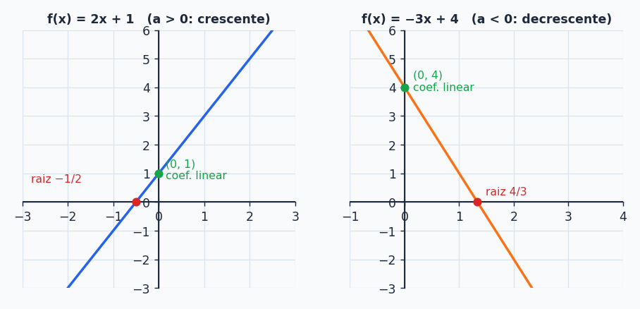
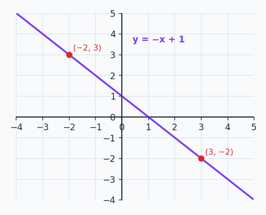

## Sobre

Agora que a gente sabe o que é uma função, vamos conhecer a **família**. Tudo neste tópico é parente: a **potência** é o tijolo, a **polinomial** é a casa feita de tijolos, e a **função do 1º grau** (a reta) é o primeiro cômodo dessa casa. Quando você entender a reta direitinho, a parábola do próximo tópico vai ficar bem mais fácil.

## Função potência

Uma **função potência** tem a forma

$$
f(x)=k\cdot x^{a}\qquad\text{com } k,\,a\in\mathbb R^*
$$

(ou seja, $k$ e $a$ são reais **diferentes de zero**). Ela é importante no cálculo porque é muito fácil de derivar e de integrar.

**Quem é e quem não é:**

- $f(x)=2x^2$ é potência ($k=2$, $a=2$).
- $g(x)=-3x^{2/5}$ é potência ($k=-3$, $a=\frac25$).
- $h(x)=x^{-2}$ é potência ($k=1$, $a=-2$).
- $j(x)=2^x$ **não é** potência. A variável está no **expoente**, não na base. Isso é uma **função exponencial** (tem um tópico só para ela).

> [!CAUTION]
> Para saber quem é quem, pergunte: *onde está o $x$?* Na **base** ($x^2$), é potência. No **expoente** ($2^x$), é exponencial. Confundir as duas é um clássico.

### Disfarçando funções de potência

Muita função "feia" é uma potência vestida de outra coisa. Use as propriedades de raiz e potência para chegar na forma $k\cdot x^a$:

$$
f(x)=\sqrt[5]{x^3}=x^{3/5}
\qquad
g(x)=\frac{2}{x^4}=2x^{-4}
\qquad
h(x)=\frac{-3}{2\sqrt x}=\frac{-3}{2x^{1/2}}=-\frac32\,x^{-1/2}
$$

As ferramentas por trás disso: $\sqrt[n]{x^m}=x^{m/n}$ e $\dfrac1{x^n}=x^{-n}$.

## Função polinomial

Uma **função polinomial** é uma **soma de funções potência com expoentes naturais** (0, 1, 2, 3...):

$$
f(x)=a_nx^n+a_{n-1}x^{n-1}+\cdots+a_2x^2+a_1x+a_0
$$

Os $a_i$ são os **coeficientes** (números reais) e o **grau** é o maior expoente $n$. Exemplos: $f(x)=2x^2+x-1$ (grau 2) e $g(x)=-5x^4+2x^3+x-10$ (grau 4).

É o mesmo polinômio do tópico anterior, só que agora com cara de função: você pode **enfiar um valor** no $x$ e ver o que sai.

### Quais *não* são polinomiais?

Pegue as cinco funções e fique de olho nos "intrusos": expoente negativo ou fracionário, variável no expoente, ou raiz que "pega" o polinômio inteiro.

| Função | Polinomial? | Por quê |
| --- | --- | --- |
| $2x+1$ | sim | grau 1 |
| $2^x+x^2-3$ | **não** | $2^x$ é exponencial |
| $4x^{-6}+\sqrt[3]{x}+x^{1/2}+\sqrt5$ | **não** | expoentes $-6$, $\frac13$ e $\frac12$ (note que $\sqrt5$ é só um número) |
| $\sqrt{5x^2+x-1}$ | **não** | é a raiz de um polinômio, não um polinômio |
| $5x^2+x-1$ | sim | grau 2 |

### Calculando valores (e o famoso $f(a+h)$)

Dada $f(x)=x^2+3x+1$, o jeito é **substituir** o $x$ por tudo que vier entre parênteses:

$$
f(0)=0^2+3\cdot0+1=1
\qquad
f(-2)=(-2)^2+3(-2)+1=4-6+1=-1
$$

$$
f(h)=h^2+3h+1
$$

$$
f(a+h)=(a+h)^2+3(a+h)+1=a^2+2ah+h^2+3a+3h+1
$$

> [!NOTE]
> O $f(a+h)$ parece um exercício chato, mas é exatamente a conta que você vai fazer para **definir derivada** em Cálculo. Treine o desenvolvimento do $(a+h)^2$ (lembra do produto notável?).

## Função do 1º grau (função afim)

Chegou a mais simples e mais usada de todas:

$$
\boxed{f(x)=ax+b}\qquad a,\,b\in\mathbb R,\ a\ne0
$$

- $a$ é o **coeficiente angular** (a "inclinação" da reta).
- $b$ é o **coeficiente linear** (onde a reta corta o eixo $y$).
- Quando $b=0$, a função é chamada de **linear** ($f(x)=-3x$, por exemplo).

| Função | Coef. angular | Coef. linear |
| --- | --- | --- |
| $f(x)=2x-5$ | $2$ | $-5$ |
| $g(x)=-3x$ | $-3$ | $0$ |

> [!TIP]
> Em computação você usa isso o tempo todo: o custo de um algoritmo do tipo "faz um trabalho fixo $b$ e mais $a$ por item" é $T(n)=an+b$. Isso é uma função afim, e a gente diz que é $O(n)$.

### O gráfico é sempre uma reta

Para $f(x)=2x+1$, uma tabela rápida resolve:

| $x$ | $y=2x+1$ |
| --- | --- |
| $0$ | $1$ |
| $1$ | $3$ |
| $-1$ | $-1$ |
| $0{,}5$ | $2$ |

Marque os pontos e ligue: sai uma **reta**. Duas coisas definem a cara dela:

- **$a>0$:** reta **crescente** (sobe da esquerda para a direita).
- **$a<0$:** reta **decrescente** (desce).

> [!WARNING]
> Nem toda reta é função do 1º grau! Uma reta **horizontal**, como $f(x)=2$, é uma função **constante** (aqui $a=0$, e por isso ela não conta como afim). Toda reta **inclinada** (não horizontal e não vertical) é afim. E a reta vertical? Ela nem é função (lembra do teste da reta vertical?).

### Raiz da função

A **raiz** (ou *zero*) de uma função é o valor de $x$ em que $f(x)=0$, isto é, onde o gráfico **toca o eixo $x$**. Para achar, é só igualar a zero e resolver:

$$
2x+1=0\;\Rightarrow\;2x=-1\;\Rightarrow\;x=-\frac12
$$

Dois lembretes: o **coeficiente linear** é um conceito só da função de 1º grau, mas **raiz** existe para qualquer função.

### Traçando o gráfico em 2 passos

Uma reta fica definida por **dois pontos**. Os mais fáceis são a **raiz** e o **coeficiente linear**:

**Exemplo:** $f(x)=-3x+4$.

- Coeficiente linear: $f(0)=4$, ponto $(0,4)$.
- Raiz: $0=-3x+4\Rightarrow x=\frac43\approx1{,}33$, ponto $(1{,}33;\,0)$.
- Liga os dois e prolonga. Pronto.

**Outro:** $f(x)=2x+3$.

- Coef. linear: ponto $(0,3)$.
- Raiz: $2x=-3\Rightarrow x=-1{,}5$, ponto $(-1{,}5;\,0)$.

## Descobrindo a função a partir de pontos

Se alguém te dá dois pontos de uma reta, você consegue descobrir a função. A ferramenta é a **equação ponto-inclinação**:

$$
y-y_0=m\,(x-x_0)
\qquad\text{onde}\qquad
m=\frac{y_1-y_0}{x_1-x_0}
$$

O $m$ é o coeficiente angular (a razão "quanto sobe em $y$ para cada unidade em $x$"). Passo a passo:

1. Calcule $m$ com os dois pontos.
2. Escolha **um** dos pontos como $(x_0,y_0)$.
3. Monte $y-y_0=m(x-x_0)$.
4. Isole $y$.

**Exemplo 1.** Pontos $(-2,3)$ e $(3,-2)$.

$$
m=\frac{-2-3}{3-(-2)}=\frac{-5}{5}=-1
\qquad
y-(-2)=-1\,(x-3)\;\Rightarrow\;y+2=-x+3\;\Rightarrow\;f(x)=-x+1
$$

**Exemplo 2.** Pontos $(-2,4)$ e $(2,-4)$.

$$
m=\frac{-4-4}{2-(-2)}=\frac{-8}{4}=-2
\qquad
y-4=-2\,(x+2)\;\Rightarrow\;y-4=-2x-4\;\Rightarrow\;f(x)=-2x
$$

> [!TIP]
> **Prova real:** a função encontrada precisa passar pelos **dois** pontos. No exemplo 1: $f(-2)=2+1=3$ ✓ e $f(3)=-3+1=-2$ ✓. Se escolher o outro ponto como $(x_0,y_0)$ o resultado é o mesmo.

## Estudo do sinal

**Estudar o sinal** é descobrir em que valores de $x$ a função é positiva, negativa ou zero. Para a função afim é só juntar duas informações: a **raiz** (onde troca de sinal) e o **coeficiente angular** (para que lado cresce).

**Exemplo 1: $f(x)=2x-4$.**

- Raiz: $2x-4=0\Rightarrow x=2$.
- $a=2>0$ (crescente): à esquerda da raiz está embaixo do eixo, à direita está em cima.

| | $x<2$ | $x=2$ | $x>2$ |
| --- | --- | --- | --- |
| $f(x)$ | negativa | zero | positiva |

**Exemplo 2: $f(x)=-3x+9$.**

- Raiz: $x=3$.
- $a=-3<0$ (decrescente): é o contrário.

| | $x<3$ | $x=3$ | $x>3$ |
| --- | --- | --- | --- |
| $f(x)$ | positiva | zero | negativa |

> [!IMPORTANT]
> **Regra de bolso:** à **direita** da raiz, a função tem o **mesmo sinal de $a$**. À esquerda, o sinal oposto. É só lembrar disso e nem precisa desenhar.

## Resumão

| Conceito | Fórmula / ideia |
| --- | --- |
| Potência | $f(x)=kx^a$ (variável na base!) |
| Polinomial | soma de potências com expoentes naturais |
| Afim | $f(x)=ax+b$, $a\ne0$, gráfico é reta |
| $a>0$ / $a<0$ | crescente / decrescente |
| Raiz | $x=-\frac{b}{a}$ |
| Reta por 2 pontos | $m=\frac{y_1-y_0}{x_1-x_0}$ e $y-y_0=m(x-x_0)$ |
| Sinal | mesmo sinal de $a$ à direita da raiz |

## Exercícios

**E1.** Quais não são polinomiais? $f(x)=2x+1$; $f(x)=2^x+x^2-3$; $f(x)=4x^{-6}+\sqrt[3]{x}+x^{1/2}+\sqrt5$; $f(x)=\sqrt{5x^2+x-1}$; $f(x)=5x^2+x-1$.


Não são polinomiais a 2ª, a 3ª e a 4ª.


**E2.** Para $f(x)=x^2+3x+1$, calcule $f(0)$, $f(-2)$, $f(h)$ e $f(a+h)$.


$f(0)=1$, $f(-2)=-1$, $f(h)=h^2+3h+1$ e $f(a+h)=a^2+2ah+h^2+3a+3h+1$.


**E3.** Construa os gráficos de $f(x)=3x+1$ e de $f(x)=-10x+5$.


$3x+1$: pontos $(0,1)$ e raiz $(-\frac13,0)$, reta crescente. $-10x+5$: pontos $(0,5)$ e raiz $(\frac12,0)$, reta bem inclinada decrescente.


**E4.** Ache a equação da função que passa por: a) $(3,0)$ e $(0,-6)$; b) $(0,5)$ e $(4,1)$.


a) $m=\frac{-6-0}{0-3}=2$, $f(x)=2x-6$. b) $m=\frac{1-5}{4-0}=-1$, $f(x)=-x+5$.


**E5.** Em qual intervalo $f(x)=3x-6$ é negativa?


A raiz é $x=2$ e $a=3>0$. Fica negativa à esquerda: $]-\infty,2[$.


**E6.** Determine o sinal de $f(x)=-x-1$ para $x>1$.


A raiz é $x=-1$ e $a=-1<0$ (decrescente), então $f$ é negativa para todo $x>-1$. Como $x>1$ está dentro disso, $f(x)<0$ sempre.


### Teste rápido




Qual das funções **é** uma função potência?

- [ ] $f(x)=3^x$
- [x] $f(x)=\dfrac{5}{x^2}$
- [ ] $f(x)=x^2+x$
- [ ] $f(x)=\log x$
---
$\frac{5}{x^2}=5x^{-2}$, na forma $kx^a$. $3^x$ tem variável no expoente. $x^2+x$ é soma de duas potências (polinomial, não potência).



A reta que passa por $(0,4)$ e $(2,0)$ é:

- [ ] $f(x)=2x+4$
- [x] $f(x)=-2x+4$
- [ ] $f(x)=-2x+2$
- [ ] $f(x)=x+4$
---
$m=\frac{0-4}{2-0}=-2$ e o coeficiente linear é $4$ (ponto em $x=0$).



Se $f(x)=-5x+10$, então $f(x)>0$ quando:

- [ ] $x>2$
- [x] $x<2$
- [ ] $x>-2$
- [ ] $x<-2$
---
A raiz é $x=2$. Como $a=-5<0$, a função é decrescente: positiva à esquerda da raiz.



