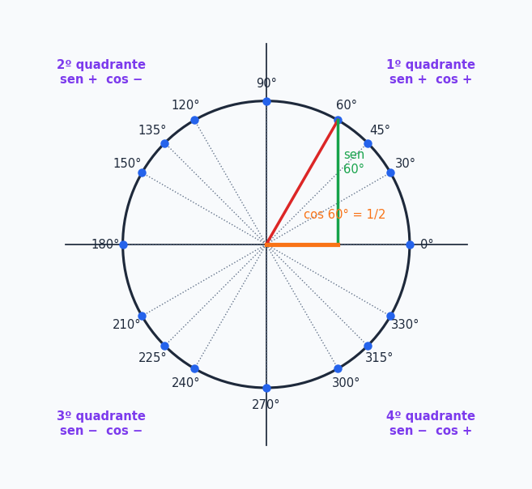
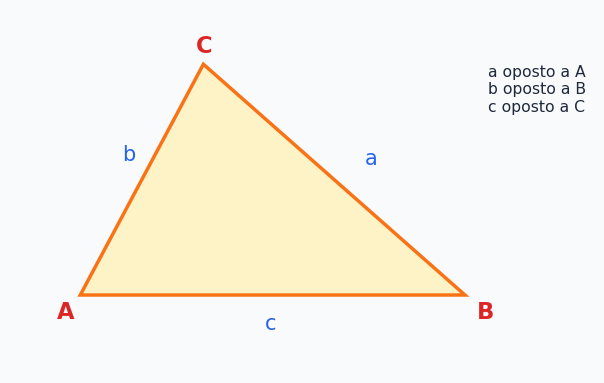
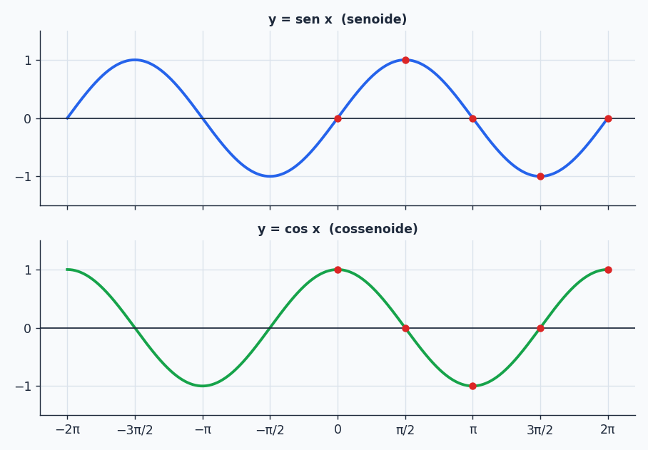
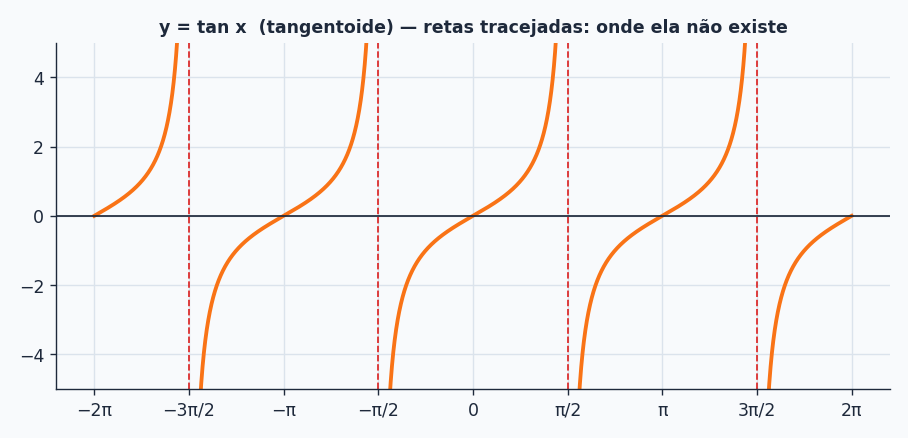
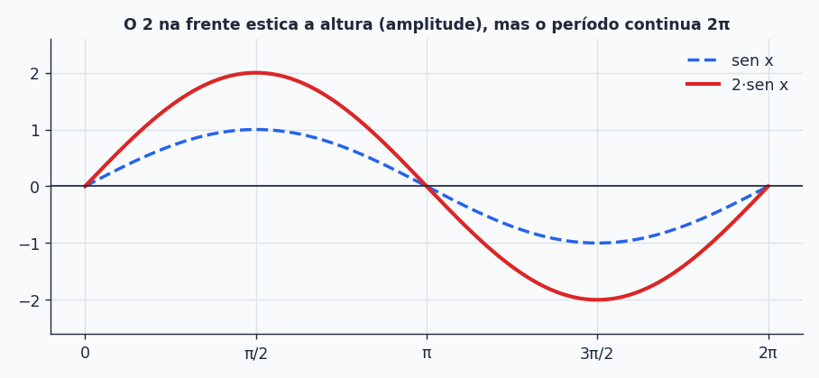

## Sobre

No tópico anterior, seno e cosseno só existiam dentro de triângulos retângulos (ângulos entre $0^\circ$ e $90^\circ$). Mas e o $\operatorname{sen}(200^\circ)$? E o $\cos(-30^\circ)$? Para ir além precisamos de um palco maior: o **ciclo trigonométrico**. E quando você olha o seno "rodando" nesse círculo, surge uma das curvas mais importantes de toda a ciência: a **senoide**. Este é o tópico que conecta triângulos com ondas.

## O ciclo trigonométrico

É uma circunferência de **raio 1** centrada na origem do plano. Com raio 1, tudo fica simples: um ponto da circunferência é descrito por um ângulo $\theta$, medido a partir do eixo $x$ positivo.

### Arcos

Um **arco** é o "caminho" percorrido sobre o círculo:

- **Positivo:** medido no sentido **anti-horário**. Ex.: $60^\circ$ ou $\frac\pi3$ rad.
- **Negativo:** medido no sentido **horário**. Ex.: $-60^\circ$ (que cai no mesmo ponto que $300^\circ$, ou $\frac{5\pi}{3}$ rad).
- **Maior que uma volta** ($360^\circ$ ou $2\pi$): dá mais de uma volta. Ex.: $420^\circ=360^\circ+60^\circ$, ou $\frac{7\pi}{3}$ rad, que termina no mesmo ponto que $60^\circ$.

Para saber onde um arco "termina", **tire as voltas completas**: some ou subtraia $360^\circ$ (ou $2\pi$) até cair entre $0^\circ$ e $360^\circ$.

### Seno, cosseno e tangente para qualquer ângulo

Para o ponto $P=(x,y)$ do ciclo associado ao ângulo $\theta$ (e como o raio é 1):

$$
\cos\theta=\text{valor no eixo }x\qquad
\operatorname{sen}\theta=\text{valor no eixo }y\qquad
\tan\theta=\frac{\operatorname{sen}\theta}{\cos\theta}
$$

Ou seja, **o cosseno é a "sombra" do ponto no eixo $x$ e o seno é a sombra no eixo $y$**. Esse é o mesmo triângulo retângulo de antes, só que agora a hipotenusa é 1 (então $\operatorname{sen}=CO/1$ e $\cos=CA/1$).

> [!NOTE]
> Em computação gráfica, é exatamente isto: para posicionar algo a distância $r$ do centro e ângulo $\theta$, use $x=r\cos\theta$ e $y=r\operatorname{sen}\theta$. É assim que um personagem "orbita" ou que um ponteiro de relógio gira. Lembre-se de que as funções da linguagem esperam **radianos**.

### Ângulos notáveis

| $\theta$ (graus) | $0^\circ$ | $30^\circ$ | $45^\circ$ | $60^\circ$ | $90^\circ$ | $180^\circ$ | $270^\circ$ | $360^\circ$ |
| --- | --- | --- | --- | --- | --- | --- | --- | --- |
| $\theta$ (rad) | $0$ | $\frac\pi6$ | $\frac\pi4$ | $\frac\pi3$ | $\frac\pi2$ | $\pi$ | $\frac{3\pi}2$ | $2\pi$ |
| $\operatorname{sen}\theta$ | $0$ | $\frac12$ | $\frac{\sqrt2}2$ | $\frac{\sqrt3}2$ | $1$ | $0$ | $-1$ | $0$ |
| $\cos\theta$ | $1$ | $\frac{\sqrt3}2$ | $\frac{\sqrt2}2$ | $\frac12$ | $0$ | $-1$ | $0$ | $1$ |
| $\tan\theta$ | $0$ | $\frac{\sqrt3}3$ | $1$ | $\sqrt3$ | não existe | $0$ | não existe | $0$ |

A tangente **não existe** em $90^\circ$ e $270^\circ$ porque $\cos=0$ e não se divide por zero.

## Simetrias e sinais: reduzindo ao 1º quadrante

Você não precisa decorar uma tabela para cada ângulo. Basta saber os do 1º quadrante e usar a **simetria** do círculo.

**Sinais por quadrante:**

| Quadrante | Ângulos | $\operatorname{sen}$ | $\cos$ | $\tan$ |
| --- | --- | --- | --- | --- |
| 1º | $0^\circ$ a $90^\circ$ | $+$ | $+$ | $+$ |
| 2º | $90^\circ$ a $180^\circ$ | $+$ | $-$ | $-$ |
| 3º | $180^\circ$ a $270^\circ$ | $-$ | $-$ | $+$ |
| 4º | $270^\circ$ a $360^\circ$ | $-$ | $+$ | $-$ |

**Propriedades de simetria:**

$$
\cos(-x)=\cos x\qquad
\operatorname{sen}(-x)=-\operatorname{sen}x\qquad
\operatorname{sen}(\pi-x)=\operatorname{sen}x\qquad
\cos(\pi-x)=-\cos x
$$

Isto diz que o cosseno é "par" (espelhado em torno do eixo $y$) e o seno é "ímpar". E também que, para refletir um ângulo do 2º quadrante, o seno **mantém** o valor e o cosseno **troca de sinal**.

> [!TIP]
> **Receita de redução:** (1) tire as voltas até cair entre $0^\circ$ e $360^\circ$; (2) ache o ângulo "parente" do 1º quadrante (a distância até o eixo $x$ mais próximo); (3) calcule o valor do parente; (4) aplique o **sinal do quadrante**.

**Exemplos:**

- $\cos(-30^\circ)=\cos30^\circ=\dfrac{\sqrt3}2$ e $\operatorname{sen}(-30^\circ)=-\operatorname{sen}30^\circ=-\dfrac12$.
- $\operatorname{sen}(150^\circ)=\operatorname{sen}(180^\circ-150^\circ)=\operatorname{sen}30^\circ=\dfrac12$ (2º quadrante, seno positivo).
- $\operatorname{sen}(225^\circ)$: está no 3º quadrante, parente de $45^\circ$ (pois $225-180=45$), seno negativo: $-\dfrac{\sqrt2}2$.
- $\cos(300^\circ)$: 4º quadrante, parente de $60^\circ$ ($360-300=60$), cosseno positivo: $\dfrac12$.
- $\tan(300^\circ)$: 4º quadrante, tangente negativa: $-\tan60^\circ=-\sqrt3$.

## Soma e diferença de arcos

Quer o seno de $75^\circ$? Não está na tabela, mas $75^\circ=45^\circ+30^\circ$, e ambos estão. As fórmulas:

$$
\begin{aligned}
\operatorname{sen}(a+b)&=\operatorname{sen}a\cos b+\operatorname{sen}b\cos a\\
\cos(a+b)&=\cos a\cos b-\operatorname{sen}a\operatorname{sen}b\\
\tan(a+b)&=\frac{\tan a+\tan b}{1-\tan a\tan b}
\end{aligned}
$$

e para a **diferença** (é só trocar o $b$ por $-b$ e usar a paridade):

$$
\begin{aligned}
\operatorname{sen}(a-b)&=\operatorname{sen}a\cos b-\operatorname{sen}b\cos a\\
\cos(a-b)&=\cos a\cos b+\operatorname{sen}a\operatorname{sen}b\\
\tan(a-b)&=\frac{\tan a-\tan b}{1+\tan a\tan b}
\end{aligned}
$$

> [!WARNING]
> Repare no **sinal trocado** do cosseno: na soma é $-$ e na diferença é $+$. E lembre que $\operatorname{sen}(a+b)\ne\operatorname{sen}a+\operatorname{sen}b$ (a função seno não "distribui").

**Exemplo 1: $\cos15^\circ$.** Escreva $15^\circ=60^\circ-45^\circ$:

$$
\cos(60^\circ-45^\circ)=\cos60^\circ\cos45^\circ+\operatorname{sen}60^\circ\operatorname{sen}45^\circ
=\frac12\cdot\frac{\sqrt2}2+\frac{\sqrt3}2\cdot\frac{\sqrt2}2=\frac{\sqrt2+\sqrt6}{4}
$$

**Exemplo 2: $\operatorname{sen}75^\circ$.** Escreva $75^\circ=45^\circ+30^\circ$:

$$
\operatorname{sen}45^\circ\cos30^\circ+\operatorname{sen}30^\circ\cos45^\circ
=\frac{\sqrt2}2\cdot\frac{\sqrt3}2+\frac12\cdot\frac{\sqrt2}2=\frac{\sqrt6+\sqrt2}{4}
$$

**Exemplo 3: $\tan75^\circ$.**

$$
\tan(45^\circ+30^\circ)=\frac{1+\frac{\sqrt3}3}{1-1\cdot\frac{\sqrt3}3}
=\frac{3+\sqrt3}{3-\sqrt3}\cdot\frac{3+\sqrt3}{3+\sqrt3}
=\frac{9+6\sqrt3+3}{9-3}=\frac{12+6\sqrt3}{6}=2+\sqrt3
$$

(O segundo passo é racionalizar o denominador, do primeiro tópico!)

## Lei dos Senos e Lei dos Cossenos

Pitágoras e SOH-CAH-TOA só funcionam em triângulo **retângulo**. Para um triângulo **qualquer**, entram duas leis. Use a notação padrão: o lado $a$ é **oposto** ao ângulo $A$, $b$ ao $B$ e $c$ ao $C$.

### Lei dos Senos

$$
\frac{a}{\operatorname{sen}A}=\frac{b}{\operatorname{sen}B}=\frac{c}{\operatorname{sen}C}
$$

**Quando usar:** você conhece **um lado e o ângulo oposto** a ele (um "par") e mais um dado qualquer do segundo par.

**Exemplo:** num triângulo, o lado $10$ está oposto a $30^\circ$ e o lado $x$ está oposto a $45^\circ$:

$$
\frac{x}{\operatorname{sen}45^\circ}=\frac{10}{\operatorname{sen}30^\circ}\;\Rightarrow\;
\frac{x}{\frac{\sqrt2}2}=\frac{10}{\frac12}=20\;\Rightarrow\;x=10\sqrt2
$$

### Lei dos Cossenos

$$
a^2=b^2+c^2-2bc\cos A
$$

(vale também com as letras trocadas: $b^2=a^2+c^2-2ac\cos B$ e $c^2=a^2+b^2-2ab\cos C$). É o **Teorema de Pitágoras com um termo de correção**: se $A=90^\circ$, o $\cos A=0$ e volta Pitágoras.

**Quando usar:** (1) dois lados e o ângulo **entre** eles (para achar o terceiro lado), ou (2) os **três lados** (para achar um ângulo).

**Exemplo 1 (achar um lado):** lados $4$ e $3$ com ângulo de $30^\circ$ entre eles.

$$
x^2=4^2+3^2-2\cdot4\cdot3\cdot\cos30^\circ=25-24\cdot\frac{\sqrt3}2=25-12\sqrt3\;\Rightarrow\;x=\sqrt{25-12\sqrt3}\approx2{,}05
$$

**Exemplo 2 (achar um ângulo):** em um triângulo, $a=5$, $b=7$, $c=8$. Qual o cosseno de $C$?

$$
c^2=a^2+b^2-2ab\cos C\;\Rightarrow\;64=25+49-70\cos C\;\Rightarrow\;\cos C=\frac{10}{70}=\frac17\approx0{,}143
$$

## Funções periódicas

Uma função é **periódica** quando se **repete** a intervalos regulares. Formalmente, $f:A\to B$ é periódica se existe um número real positivo $p$ tal que

$$
f(x)=f(x+p)\qquad\text{para todo }x\in A
$$

O menor $p$ positivo que serve é o **período**. Exemplos do dia a dia: o ponteiro de um relógio (volta a cada 12 h), as fases da lua, o batimento do coração, o ciclo de um semáforo... e, claro, as funções trigonométricas.

## Função seno

A **função seno** é $f(x)=\operatorname{sen}x$, com $x$ em radianos.

- **Domínio:** $\mathbb R$ (qualquer ângulo vale).
- **Imagem:** $[-1,1]$ (o ponto do ciclo nunca passa de altura 1).
- **Período:** $2\pi$, ou seja, $\operatorname{sen}x=\operatorname{sen}(x+2k\pi)$ para todo inteiro $k$.

O gráfico se chama **senoide**. Para montá-lo, use a tabela dos notáveis:

| $x$ | $0$ | $\frac\pi6$ | $\frac\pi4$ | $\frac\pi3$ | $\frac\pi2$ | $\pi$ | $\frac{3\pi}2$ | $2\pi$ |
| --- | --- | --- | --- | --- | --- | --- | --- | --- |
| $\operatorname{sen}x$ | $0$ | $\frac12$ | $\frac{\sqrt2}2$ | $\frac{\sqrt3}2$ | $1$ | $0$ | $-1$ | $0$ |

## Função cosseno

A **função cosseno** é $f(x)=\cos x$.

- **Domínio:** $\mathbb R$. **Imagem:** $[-1,1]$. **Período:** $2\pi$.

O gráfico é a **cossenoide**:

| $x$ | $0$ | $\frac\pi6$ | $\frac\pi4$ | $\frac\pi3$ | $\frac\pi2$ | $\pi$ | $\frac{3\pi}2$ | $2\pi$ |
| --- | --- | --- | --- | --- | --- | --- | --- | --- |
| $\cos x$ | $1$ | $\frac{\sqrt3}2$ | $\frac{\sqrt2}2$ | $\frac12$ | $0$ | $-1$ | $0$ | $1$ |

> [!NOTE]
> **A cossenoide não é uma curva nova:** é a senoide **deslocada** (translação horizontal). Como $\cos x=\operatorname{sen}\!\left(x+\frac\pi2\right)$, o cosseno é o seno adiantado em $\frac\pi2$, ou seja, a senoide empurrada $\frac\pi2$ **para a esquerda**. (Olhando o gráfico: o seno começa em $0$ subindo, e o cosseno começa em $1$, no topo.)
> Alguns materiais descrevem o deslocamento como "para a direita": isso vale para ir do cosseno para o seno, $\operatorname{sen}x=\cos\!\left(x-\frac\pi2\right)$. A ideia é a mesma, só muda o ponto de vista.

## Função tangente

A **função tangente** é $f(x)=\tan x=\dfrac{\operatorname{sen}x}{\cos x}$.

- **Domínio:** $D=\left\{x\in\mathbb R\mid x\ne\frac\pi2+k\pi,\ k\in\mathbb Z\right\}$ (onde o cosseno vale zero, a tangente não existe).
- **Imagem:** todo $\mathbb R$ (perto de $\pm\frac\pi2$ ela vai para $\pm\infty$).
- **Período:** $\pi$ (e **não** $2\pi$): $\tan x=\tan(x+k\pi)$.

Os pontos de $\tan x=\dfrac{\operatorname{sen}x}{\cos x}$ nos ângulos notáveis: $\tan0=0$, $\tan\frac\pi6=\frac{\sqrt3}3$, $\tan\frac\pi4=1$, $\tan\frac\pi3=\sqrt3$, $\tan\frac{2\pi}3=-\sqrt3$, $\tan\frac{3\pi}4=-1$, $\tan\frac{5\pi}6=-\frac{\sqrt3}3$, $\tan\pi=0$. Em $\frac\pi2$ e $\frac{3\pi}2$: **não existe** (retas tracejadas).

## Mexendo na amplitude: $f(x)=2\operatorname{sen}x$

**Determine o período, a imagem e o gráfico de um período completo de $f(x)=2\operatorname{sen}x$.**

Multiplicar por $2$ **estica** a curva na vertical, **sem** mexer na horizontal:

- **Período:** continua $2\pi$ (o $2$ não está dentro do seno).
- **Imagem:** como $-1\le\operatorname{sen}x\le1$, multiplicando por 2: $-2\le f(x)\le2$, ou seja, $Im=[-2,2]$.
- **Gráfico:** a senoide, mas com o dobro da altura (essa altura se chama **amplitude**).

> [!TIP]
> **Generalizando** (um bônus útil): para $f(x)=A\operatorname{sen}(Bx)$, a **amplitude** é $|A|$ e o **período** é $\dfrac{2\pi}{|B|}$. O $A$ mexe na altura da onda, o $B$ na frequência dela. É a base de som digital: uma nota musical é uma senoide, onde $B$ define o quão aguda ela é.

## Outras funções trigonométricas

Existem três "irmãs" que são só inversos multiplicativos:

$$
\sec x=\frac1{\cos x}\qquad
\csc x=\frac1{\operatorname{sen}x}\qquad
\cot x=\frac1{\tan x}=\frac{\cos x}{\operatorname{sen}x}
$$

(secante, cossecante e cotangente). Elas existem apenas onde o denominador não é zero.

## Resumão

| Assunto | Resumo |
| --- | --- |
| Ciclo trigonométrico | raio 1, $\cos=$ eixo $x$, $\operatorname{sen}=$ eixo $y$ |
| Arco | anti-horário $+$, horário $-$; some/subtraia voltas de $2\pi$ |
| Simetrias | $\cos(-x)=\cos x$, $\operatorname{sen}(-x)=-\operatorname{sen}x$ |
| Reduzir ao 1º quadrante | ângulo parente + sinal do quadrante |
| Soma de arcos | $\operatorname{sen}(a+b)=\operatorname{sen}a\cos b+\operatorname{sen}b\cos a$, $\cos(a+b)=\cos a\cos b-\operatorname{sen}a\operatorname{sen}b$ |
| Lei dos Senos | $\frac a{\operatorname{sen}A}=\frac b{\operatorname{sen}B}=\frac c{\operatorname{sen}C}$ |
| Lei dos Cossenos | $a^2=b^2+c^2-2bc\cos A$ |
| Seno / cosseno | domínio $\mathbb R$, imagem $[-1,1]$, período $2\pi$ |
| Tangente | domínio sem $\frac\pi2+k\pi$, imagem $\mathbb R$, período $\pi$ |

## Exercícios

**E1.** Determine: a) $\operatorname{sen}120^\circ$; b) $\cos135^\circ$; c) $\tan210^\circ$; d) $\cos75^\circ$; e) $\tan105^\circ$.


a) $\dfrac{\sqrt3}2$ (parente de $60^\circ$, 2º quadrante).
b) $-\dfrac{\sqrt2}2$ (parente de $45^\circ$, cosseno negativo).
c) $\dfrac{\sqrt3}3$ (3º quadrante, tangente positiva, parente de $30^\circ$).
d) $\cos(45^\circ+30^\circ)=\dfrac{\sqrt2}2\cdot\dfrac{\sqrt3}2-\dfrac{\sqrt2}2\cdot\dfrac12=\dfrac{\sqrt6-\sqrt2}{4}$.
e) $\tan(60^\circ+45^\circ)=\dfrac{\sqrt3+1}{1-\sqrt3}=-2-\sqrt3$.


**E2.** Em um triângulo, $a=10$, $b=8$ e $A=45^\circ$. Determine $\operatorname{sen}B$.


Lei dos Senos: $\dfrac{10}{\operatorname{sen}45^\circ}=\dfrac{8}{\operatorname{sen}B}\Rightarrow\operatorname{sen}B=\dfrac{8\cdot\frac{\sqrt2}2}{10}=\dfrac{4\sqrt2}{10}=\dfrac{2\sqrt2}5$.


**E3.** Em um triângulo $ABC$, $a=6$, $b=8$ e $C=60^\circ$. Determine o lado $c$.


$c^2=36+64-2\cdot6\cdot8\cdot\frac12=100-48=52\Rightarrow c=\sqrt{52}=2\sqrt{13}$.


**E4.** Dê o domínio, a imagem e o período de $f(x)=3\operatorname{sen}x$.


Domínio $\mathbb R$, imagem $[-3,3]$ e período $2\pi$.


### Teste rápido




Qual o valor de $\operatorname{sen}(210^\circ)$?

- [ ] $\dfrac{\sqrt3}{2}$
- [ ] $\dfrac12$
- [x] $-\dfrac12$
- [ ] $-\dfrac{\sqrt3}{2}$
---
$210^\circ$ está no 3º quadrante (seno negativo) e seu parente é $30^\circ$ (pois $210-180=30$), com $\operatorname{sen}30^\circ=\frac12$. Logo $-\frac12$.



Qual é o período da função tangente?

- [ ] $\dfrac\pi2$
- [x] $\pi$
- [ ] $2\pi$
- [ ] $4\pi$
---
A tangente se repete a cada $\pi$. Seno e cosseno é que têm período $2\pi$.



A imagem de $f(x)=5\cos x$ é:

- [ ] $[-1,1]$
- [x] $[-5,5]$
- [ ] $[0,5]$
- [ ] $\mathbb R$
---
Como $-1\le\cos x\le1$, multiplicando por $5$ obtemos $-5\le f(x)\le5$.



Num triângulo com lados $a=3$, $b=4$ e ângulo $C=90^\circ$ entre eles, a Lei dos Cossenos dá $c^2=$:

- [ ] $9+16-24=1$
- [x] $9+16=25$
- [ ] $9+16+24=49$
- [ ] $24$
---
Com $C=90^\circ$, $\cos C=0$ e o termo de correção some, voltando ao Teorema de Pitágoras: $c^2=25$.



