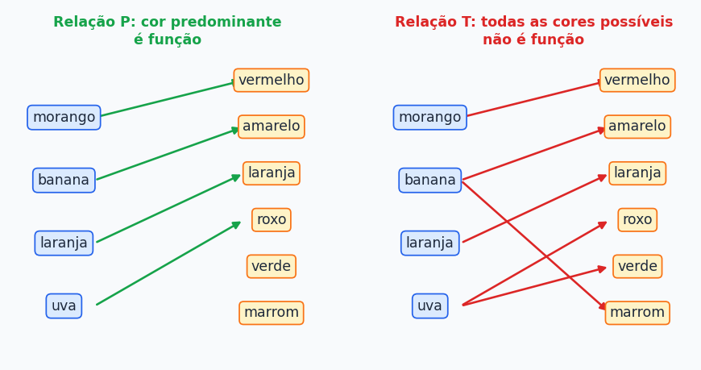
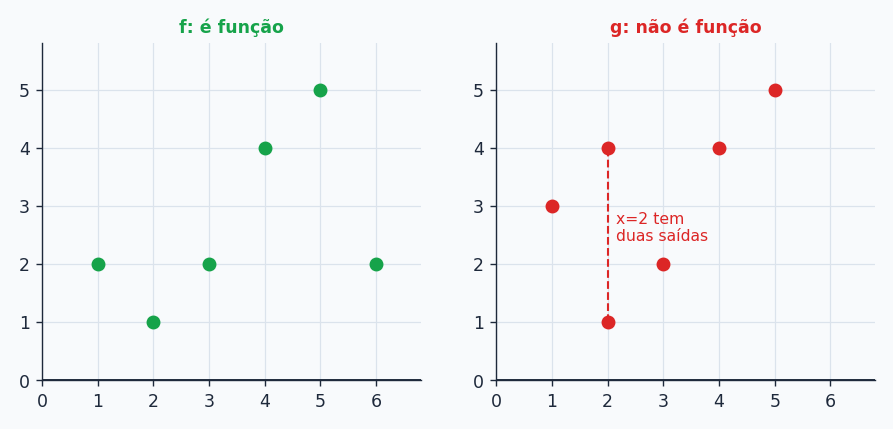
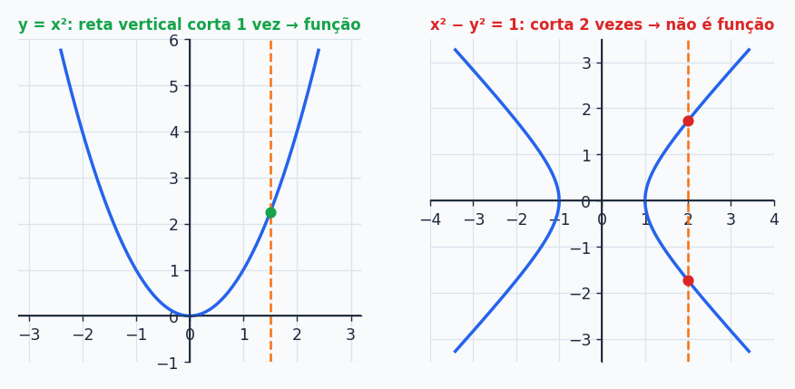

## Sobre

Se existe **uma** ideia de matemática que vai te acompanhar o curso inteiro, é a de **função**. Ela está em todo `def` e em todo `return` que você escrever. Quando você escreve `def area(base, altura)`, está definindo uma função: entra um par de números, sai um número. Neste tópico a gente deixa essa ideia bem redonda, com os nomes certos, para os próximos tópicos (reta, parábola, exponencial, log, seno) serem só "mais uma função".

## Relação: o ponto de partida

Uma **relação** é uma regra que diz se dois objetos estão (ou não) ligados. Exemplo: "a cor de uma fruta".

Pense em dois conjuntos: as **frutas** $F=\{\text{morango, banana, laranja, uva}\}$ e as **cores** $C=\{\text{vermelho, amarelo, laranja, roxo, verde, marrom}\}$. Dá para criar duas relações bem diferentes:

- **P: cor predominante da fruta.** Cada fruta liga a uma cor só.
- **T: todas as cores que a fruta pode ter.** Uva pode ser roxa ou verde, banana pode ser amarela ou (passada) marrom.

Repare no que muda: em P, **cada fruta sai com exatamente uma seta**. Em T, algumas frutas saem com duas. Essa diferença é a definição de função.

## O que é uma função

Uma **função** de um conjunto $A$ (o **domínio**) em um conjunto $B$ (o **contradomínio**) é uma relação que associa **todo** elemento de $A$ a **um único** elemento de $B$. Isso dá duas exigências:

1. **Ninguém fica sem par:** todo elemento de $A$ tem que estar ligado a algum elemento de $B$.
2. **Ninguém tem dois pares:** cada elemento de $A$ liga a *um só* elemento de $B$.

Em símbolos: $\forall x\in A,\ \exists!\,y\in B$ tal que $f(x)=y$ (lê-se "para todo $x$ em $A$, existe um único $y$ em $B$...").

Vocabulário que você precisa saber de cabeça:

| Termo | O que é |
| --- | --- |
| **Domínio** ($D$) | conjunto de todas as **entradas** permitidas |
| **Contradomínio** ($CD$) | conjunto onde as saídas **podem** cair |
| **Imagem** ($Im$) | as saídas que **realmente** acontecem (subconjunto do contradomínio) |
| **Variável independente** | o $x$, que você escolhe |
| **Variável dependente** | o $y=f(x)$, que depende do $x$ escolhido |

Voltando às frutas:

- **P é função.** Domínio: as frutas. Contradomínio: as 6 cores. Imagem: $\{\text{vermelho, amarelo, laranja, roxo}\}$ (verde e marrom existem no contradomínio, mas ninguém liga a elas, e **isso é permitido**).
- **T não é função**, porque uva sai com duas setas.

> [!IMPORTANT]
> Duas entradas **diferentes** podem dar a **mesma** saída (duas frutas diferentes com a mesma cor predominante, por exemplo). O proibido é **uma** entrada dar **duas** saídas diferentes. Sobrar elemento no contradomínio sem seta também pode.

### Pense na função como uma máquina

Você coloca um valor, aperta um botão e sai uma resposta. O único compromisso é a **consistência**: se você colocar o mesmo valor mil vezes, sai a mesma resposta mil vezes.

E a máquina **não precisa ser uma fórmula**. Para modelar uma função basta dizer com cuidado (1) quais entradas são permitidas (dois números, um triângulo, um conjunto de tijolos) e (2) qual a saída de cada uma (o MDC, a área do triângulo, um cômodo de uma casa).

> [!NOTE]
> Quem programa sente isso na pele: uma função "de verdade" devolve sempre o mesmo resultado para a mesma entrada. Um `random()` ou uma função que lê a hora do relógio **não** é função no sentido matemático (mesma entrada, saídas diferentes). Por isso programadores gostam tanto de "funções puras".

## Exemplos para fixar

### Conferindo se uma relação é função

Em cada caso, olhe se algum $x$ aparece com duas saídas diferentes:

- $A=\{(1,2),(2,3),(3,4),(4,5)\}$ **é função**: cada $x$ aparece uma vez.
- $B=\{(1,2),(1,3),(2,4),(3,5)\}$ **não é função**: o $x=1$ aparece com saídas 2 e 3.
- $C=\{(x,x^2)\mid x\in\{-2,-1,0,1,2\}\}$ **é função**: $x=-2$ e $x=2$ têm a mesma saída (4), e isso não é problema. O que importa é cada entrada ter **uma** saída.

### Domínio, contradomínio e imagem de uma função com fórmula

Seja $A=\{-3,-2,-1,0\}$, $B=\{0,1,2,\dots,9\}$ e $f:A\to B$ dada por $f(x)=x^2$.

- $Dom=A$ e $CD=B$.
- Calculando: $f(-3)=9$, $f(-2)=4$, $f(-1)=1$, $f(0)=0$.
- $Im=\{0,1,4,9\}$. Os outros números de $B$ (2, 3, 5...) ninguém alcança.

## Domínio: quem pode entrar na máquina?

Quando só dão a fórmula (sem dizer o conjunto), considera-se o **maior subconjunto de $\mathbb R$** em que a conta faz sentido. É o chamado **domínio máximo**. Procure os "pontos de explosão" da fórmula:

| Se aparece... | Condição |
| --- | --- |
| fração, com $x$ no denominador | denominador $\ne 0$ |
| raiz de índice **par** ($\sqrt{\ }$, $\sqrt[4]{\ }$) | radicando $\ge 0$ |
| raiz par **no denominador** | radicando $>0$ (precisa ser $\ge0$ e $\ne0$) |
| logaritmo | logaritmando $>0$ (veremos adiante) |

**Exemplos:**

- $f(x)=x^2$: aceita qualquer real. $D=\mathbb R$.
- $f(x)=\dfrac1x$: o $x=0$ daria $\frac10$, que não existe. $D=\{x\in\mathbb R\mid x\ne0\}=\mathbb R^*$.
- $f(x)=\dfrac{-3}{x+4}$: o problema é $x+4=0$, ou seja $x=-4$. $D=\mathbb R-\{-4\}$.

**Exercícios de domínio (E2):**

- $f(x)=\dfrac3x$: $D=\{x\in\mathbb R\mid x\ne0\}$.
- $g(x)=\dfrac{5}{x^2-9}$: precisa $x^2-9\ne0$, isto é, $x\ne3$ e $x\ne-3$.
- $h(x)=\sqrt{3x-6}$: precisa $3x-6\ge0$, logo $x\ge2$. $D=[2,\infty[$.
- $i(x)=\dfrac{3}{\sqrt{2-x}}$: raiz no denominador, então $2-x>0$ e $x<2$. $D=]-\infty,2[$.

> [!TIP]
> Notação de intervalo: colchete **virado para dentro** (ou fechado) inclui a ponta, **virado para fora** (ou parêntese) não inclui. Assim, $[2,\infty[$ inclui o 2 e $]-\infty,2[$ não inclui. O infinito nunca é incluído.

## Gráfico de uma função

Quando entradas e saídas são números reais, dá para **desenhar** a função. O gráfico é o conjunto de todos os pontos $(x,y)$ com $y=f(x)$. Na prática, o gráfico **é** a função, só que em versão geométrica, e é a melhor forma de entender o comportamento dela: onde cresce, onde cai, onde passa pelo zero.

Exemplo: $A=\{1,\dots,6\}$, $B=\{1,\dots,5\}$ e $f=\{(1,2),(2,1),(3,2),(4,4),(5,5),(6,2)\}$. Já $g=\{(1,3),(2,1),(2,4),(3,2),(4,4),(5,5)\}$:

Em $g$, a coluna $x=2$ tem **dois** pontos: não é função. Em $f$, imagem $=\{1,2,4,5\}$.

### Teste da reta vertical

Um jeito rápido de olhar um gráfico e decidir: imagine uma **reta vertical** passando em qualquer $x$ do domínio. Se ela **sempre** corta o gráfico em **um só ponto**, é função. Se em algum lugar corta em 2 ou mais, não é.

- A parábola $y=x^2$ passa no teste: é função.
- A hipérbole $x^2-y^2=1$ não passa: em $x=2$, tanto $y=\sqrt3$ quanto $y=-\sqrt3$ servem. Não é função de $x$.

## Resumão

| Conceito | Resumo em uma linha |
| --- | --- |
| Função | todo $x$ do domínio tem **uma e só uma** saída |
| Domínio | entradas permitidas |
| Contradomínio | onde as saídas *podem* cair |
| Imagem | onde elas *realmente* caem |
| Domínio máximo | evite: denominador zero, raiz par de negativo, log de $\le 0$ |
| Teste da reta vertical | corta em 1 ponto → função |

## Exercícios

**E1.** Diga se cada relação é função: $A=\{(1,2),(2,3),(3,4),(4,5)\}$, $B=\{(1,2),(1,3),(2,4),(3,5)\}$, $C=\{(x,x^2)\mid x\in\{-2,-1,0,1,2\}\}$.


$A$ é função. $B$ não é (o $1$ tem duas saídas). $C$ é função (entradas diferentes com a mesma saída são permitidas).


**E2.** Determine o domínio máximo de: $f(x)=\dfrac3x$, $g(x)=\dfrac{5}{x^2-9}$, $h(x)=\sqrt{3x-6}$, $i(x)=\dfrac{3}{\sqrt{2-x}}$.


$D_f=\mathbb R^*$. $D_g=\mathbb R-\{-3,3\}$. $D_h=[2,\infty[$. $D_i=]-\infty,2[$.


**E3.** Sejam $C=\{a,b,c\}$, $D=\{1,2,3,4\}$ e $h=\{(a,1),(b,2),(c,1)\}$. $h:C\to D$ é função? Qual o contradomínio? E a imagem?


É função: cada elemento de $C$ tem exatamente uma saída. O contradomínio é $D=\{1,2,3,4\}$ e a imagem é $\{1,2\}$.


**E4.** O gráfico de uma parábola voltada para cima, com vértice na origem ($y=x^2$), representa uma função?


Sim. Qualquer reta vertical corta a parábola em um único ponto, ou seja, cada $x$ real tem um único $y$.


**E5.** A hipérbole $x^2-y^2=1$ é uma função?


Não. Para $x=2$ há dois valores de $y$ ($\pm\sqrt3$). Uma função precisa de uma única saída por entrada.


### Teste rápido




Qual afirmação **não** é exigida de uma função $f:A\to B$?

- [ ] Todo elemento de $A$ tem imagem em $B$.
- [ ] Cada elemento de $A$ tem uma única imagem.
- [x] Todo elemento de $B$ precisa ser imagem de algum elemento de $A$.
- [ ] Elementos diferentes de $A$ podem ter a mesma imagem.
---
Se todo elemento de $B$ fosse alcançado, a função seria *sobrejetora*, o que é uma propriedade extra. Para ser função só se exige que cada elemento de $A$ tenha **uma** saída.



O domínio máximo de $f(x)=\dfrac{1}{\sqrt{x-3}}$ é:

- [ ] $x\ge3$
- [ ] $x\ne3$
- [x] $x>3$
- [ ] $x<3$
---
A raiz exige $x-3\ge0$, e como ela está no denominador também não pode dar zero. Logo $x-3>0$.



Um gráfico em que uma reta vertical corta a curva em 3 pontos:

- [ ] é função, desde que os pontos estejam alinhados
- [x] não é função
- [ ] é função injetora
- [ ] depende do contradomínio
---
Três pontos na mesma vertical significam três saídas para a mesma entrada. Não é função.



