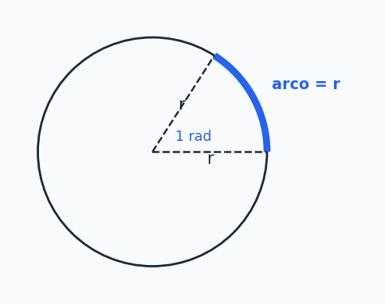
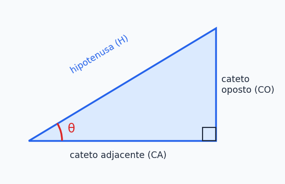
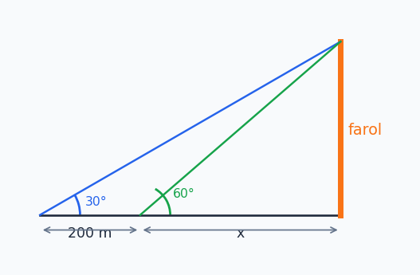

## Sobre

A palavra **trigonometria** vem do grego: *tri* (três) + *gonía* (ângulo) + *métron* (medida). Literalmente, **"medida dos triângulos"**. Parece restrito, mas é uma das ideias mais versáteis da matemática: dos antigos navegadores achando o rumo no mar até o seu personagem girando num jogo 3D, tudo passa por ângulos e triângulos.

## Onde isso aparece na vida (e no seu curso)

- **Arquitetura e engenharia:** calcular a altura de um prédio sem subir nele, projetar rampas, telhados e pontes.
- **Astronomia e navegação:** medir distâncias entre planetas e estrelas, localizar-se no mar antes do GPS (com o astrolábio).
- **Física e ciências naturais:** pêndulos, molas, ondas sonoras, ondas de rádio, corrente elétrica alternada (que é uma senoide).
- **Computação gráfica e jogos:** movimento em jogos 3D, rotação de objetos, animações, câmeras.

## Ângulo

Um **ângulo** é formado por **duas semirretas com a mesma origem** (o *vértice*). Ele mede a **abertura** entre essas semirretas. Um **triângulo**, por sua vez, é a figura de **três ângulos** (e três lados).

### Classificação dos ângulos

| Medida $\alpha$ | Nome |
| --- | --- |
| $\alpha=90^\circ$ | ângulo **reto** |
| $\alpha<90^\circ$ | ângulo **agudo** |
| $\alpha>90^\circ$ (e menor que $180^\circ$) | ângulo **obtuso** |

### Unidades de medida

| Unidade | Como é definida | Onde se usa |
| --- | --- | --- |
| **Grau** ($^\circ$) | circunferência dividida em **360** partes iguais | dia a dia |
| **Radiano** (rad) | baseado no **comprimento do arco** da circunferência | Matemática e Física |
| **Grado** (grad) | circunferência dividida em **400** partes iguais ($1\ \text{grado}=0{,}9^\circ$) | topografia e engenharia |

O **radiano** merece uma explicação especial, porque é a unidade "natural" da matemática (e a que as linguagens de programação usam). **1 radiano** é o ângulo que "abre" um arco **do tamanho do raio**:

**Quantos radianos cabem numa volta?** O perímetro da circunferência é $P=2\pi r$. Como cada "pedaço" de comprimento $r$ vale 1 radiano, cabem $\dfrac{2\pi r}{r}=2\pi$ radianos. Logo:

$$
\boxed{2\pi\ \text{rad}=360^\circ}\qquad\text{e}\qquad\pi\ \text{rad}=180^\circ
$$

Isso quer dizer que **1 rad $\approx57{,}3^\circ$**.

> [!WARNING]
> **Pegadinha de programador:** `math.sin`, `math.cos` e `math.tan` (Python, Java, C, JavaScript...) esperam o ângulo em **radianos**, não em graus. `math.sin(90)` **não** dá 1. Converta antes com `math.radians(90)`.

## Conversão de ângulos

Para passar de uma unidade para outra, é só **regra de três** a partir de $180^\circ\leftrightarrow\pi$ rad.

**Transforme $72^\circ$ em radianos:**

$$
\begin{array}{ccc}180^\circ&\longrightarrow&\pi\ \text{rad}\\72^\circ&\longrightarrow&x\end{array}
\;\Rightarrow\;
180\,x=72\pi
\;\Rightarrow\;
x=\frac{72\pi}{180}=\frac{2\pi}{5}\ \text{rad}
$$

**Transforme $\dfrac{5\pi}{6}$ rad em graus:**

$$
\begin{array}{ccc}180^\circ&\longrightarrow&\pi\ \text{rad}\\x&\longrightarrow&\frac{5\pi}{6}\ \text{rad}\end{array}
\;\Rightarrow\;
\pi x=180\cdot\frac{5\pi}{6}=150\pi
\;\Rightarrow\;
x=150^\circ
$$

> [!TIP]
> Atalho: **graus $\to$ rad:** multiplique por $\dfrac{\pi}{180}$. **rad $\to$ graus:** multiplique por $\dfrac{180}{\pi}$. Ou, mais rápido ainda, **troque $\pi$ por $180^\circ$** direto: $\frac{5\pi}{6}=\frac{5\cdot180^\circ}{6}=150^\circ$.

Valores que valem decorar (você vai usar *muito*):

| Graus | $0^\circ$ | $30^\circ$ | $45^\circ$ | $60^\circ$ | $90^\circ$ | $180^\circ$ | $270^\circ$ | $360^\circ$ |
| --- | --- | --- | --- | --- | --- | --- | --- | --- |
| Radianos | $0$ | $\frac\pi6$ | $\frac\pi4$ | $\frac\pi3$ | $\frac\pi2$ | $\pi$ | $\frac{3\pi}2$ | $2\pi$ |

## Propriedades básicas dos triângulos

Duas regras que valem para **qualquer** triângulo:

1. A soma dos ângulos internos é sempre $180^\circ$: $\hat A+\hat B+\hat C=180^\circ$.
2. A soma de dois lados é sempre **maior** que o terceiro lado (a *desigualdade triangular*): $a<b+c$, $b<a+c$ e $c<a+b$. É por isso que não dá para fechar um triângulo com lados $2$, $3$ e $10$.

### Classificação pelos ângulos

- **Acutângulo:** os três ângulos são menores que $90^\circ$.
- **Retângulo:** tem um ângulo de $90^\circ$.
- **Obtusângulo:** tem um ângulo maior que $90^\circ$.

### Classificação pelos lados

- **Equilátero:** os três lados iguais (e os três ângulos valem $60^\circ$).
- **Isósceles:** dois lados iguais.
- **Escaleno:** os três lados diferentes.

### Exemplos

**1) Ache o ângulo que falta e classifique** um triângulo com ângulos $71^\circ$, $68^\circ$ e $x$, e lados $10$ cm, $14{,}13$ cm e $14{,}41$ cm:

$$
x+71+68=180\;\Rightarrow\;x=41^\circ
$$

Todos os ângulos são menores que $90^\circ$: **acutângulo**. Os três lados são diferentes: **escaleno**.

**2) O triângulo com ângulos $A=x$, $B=x+10$ e o ângulo externo em $C$ valendo $100^\circ$.** O ângulo interno em $C$ é o que **completa** o externo até $180^\circ$ (são suplementares): $C=180-100=80^\circ$. Então:

$$
x+(x+10)+80=180\;\Rightarrow\;2x=90\;\Rightarrow\;x=45^\circ
$$

Logo $A=45^\circ$, $B=55^\circ$ e $C=80^\circ$.

## Triângulo retângulo

Aqui mora o coração da trigonometria. Num triângulo com um ângulo reto, os lados têm nomes especiais:

- **Hipotenusa (H):** o lado **oposto ao ângulo reto** (é sempre o maior).
- **Catetos:** os outros dois lados. Eles mudam de nome conforme o ângulo de referência $\theta$ que você escolheu:
  - **Cateto oposto (CO):** o que está do lado de **frente** para $\theta$.
  - **Cateto adjacente (CA):** o que está **encostado** em $\theta$ (junto com a hipotenusa).

> [!IMPORTANT]
> "Oposto" e "adjacente" **dependem do ângulo escolhido**. Se você mudar de ângulo, os catetos trocam de papel. Antes de qualquer conta, marque qual é o seu $\theta$.

### Teorema de Pitágoras

Num triângulo retângulo, **a hipotenusa ao quadrado é a soma dos quadrados dos catetos**:

$$
\boxed{H^2=CA^2+CO^2}
$$

**Exemplo (o avião):** um avião percorreu 5000 m em linha inclinada e, em relação ao solo, avançou 3000 m. Qual a altura dele?

$$
5000^2=a^2+3000^2\;\Rightarrow\;a^2=25\,000\,000-9\,000\,000=16\,000\,000\;\Rightarrow\;a=4000\ \text{m}
$$

(É a terna pitagórica $3,4,5$ vezes $1000$.)

> [!NOTE]
> Em jogos, essa é exatamente a conta da **distância entre dois pontos**: $d=\sqrt{(x_2-x_1)^2+(y_2-y_1)^2}$. Quase todo teste de colisão e de alcance de ataque começa com Pitágoras (em Python, `math.hypot`).

## Seno, cosseno e tangente

Para um ângulo agudo $\theta$ de um triângulo retângulo, definimos três **razões** entre os lados:

$$
\begin{aligned}
\operatorname{sen}(\theta)&=\frac{\text{cateto oposto}}{\text{hipotenusa}}=\frac{CO}{H}\\[4pt]
\cos(\theta)&=\frac{\text{cateto adjacente}}{\text{hipotenusa}}=\frac{CA}{H}\\[4pt]
\tan(\theta)&=\frac{\operatorname{sen}(\theta)}{\cos(\theta)}=\frac{\text{cateto oposto}}{\text{cateto adjacente}}=\frac{CO}{CA}
\end{aligned}
$$

> [!TIP]
> Macete clássico: **"SOH-CAH-TOA"**: **S**eno = **O**posto / **H**ipotenusa, **C**osseno = **A**djacente / **H**ipotenusa, **T**angente = **O**posto / **A**djacente.

Duas consequências importantes:

- **Teorema de Pitágoras** em forma de razões. Dividindo $H^2=CA^2+CO^2$ por $H^2$ chega-se à **Relação Fundamental da Trigonometria**:

$$
\boxed{\cos^2(\theta)+\operatorname{sen}^2(\theta)=1}
$$

- Como $CO$ e $CA$ são sempre menores que $H$ num triângulo retângulo, seno e cosseno de ângulos agudos ficam **entre 0 e 1**.

### Exemplo 1: catetos 6 e 8

Um triângulo retângulo tem catetos $6$ e $8$. Calcule $\operatorname{sen}(\theta)$ e $\cos(\theta)$, sendo $\theta$ o ângulo oposto ao cateto $6$.

Hipotenusa: $H^2=6^2+8^2=100\Rightarrow H=10$. Então:

$$
\operatorname{sen}(\theta)=\frac{CO}{H}=\frac{6}{10}=0{,}6
\qquad
\cos(\theta)=\frac{CA}{H}=\frac{8}{10}=0{,}8
$$

### Exemplo 2: do seno para o cosseno

Um triângulo retângulo tem $\operatorname{sen}(\theta)=\frac35$. Determine $\cos(\theta)$ usando a relação fundamental:

$$
\cos^2\theta+\left(\tfrac35\right)^2=1\;\Rightarrow\;\cos^2\theta=1-\frac9{25}=\frac{16}{25}\;\Rightarrow\;\cos\theta=\frac45
$$

(Como o ângulo é agudo, escolhemos a raiz positiva.)

### Valores notáveis

Estes três ângulos aparecem tanto que vale decorar a tabela (ela volta na página seguinte, no círculo trigonométrico):

| $\theta$ | $30^\circ$ | $45^\circ$ | $60^\circ$ |
| --- | --- | --- | --- |
| $\operatorname{sen}\theta$ | $\dfrac12$ | $\dfrac{\sqrt2}{2}$ | $\dfrac{\sqrt3}{2}$ |
| $\cos\theta$ | $\dfrac{\sqrt3}{2}$ | $\dfrac{\sqrt2}{2}$ | $\dfrac12$ |
| $\tan\theta$ | $\dfrac{\sqrt3}{3}$ | $1$ | $\sqrt3$ |

> [!TIP]
> Nota mnemônica: o seno de $30^\circ,45^\circ,60^\circ$ vale $\frac{\sqrt1}2,\frac{\sqrt2}2,\frac{\sqrt3}2$ (a raiz vai subindo), e o cosseno é a mesma lista **de trás para frente**.

### Exemplo 3: a altura do farol

Um barco avista um farol numa ilha. O ângulo de elevação do topo é $30^\circ$. Depois de se aproximar $200$ m em linha reta, o ângulo passa a $60^\circ$. Qual a altura do farol? (Use $\tan30^\circ=\frac{\sqrt3}3$ e $\tan60^\circ=\sqrt3$.)

Chame de $x$ a distância final do barco até o farol e de $h$ a altura. Duas tangentes, uma de cada posição:

$$
\tan60^\circ=\frac hx\;\Rightarrow\;h=\sqrt3\,x
\qquad\qquad
\tan30^\circ=\frac{h}{200+x}\;\Rightarrow\;h=\frac{\sqrt3}{3}(200+x)
$$

Igualando as duas expressões de $h$:

$$
\sqrt3\,x=\frac{\sqrt3}{3}(200+x)\;\Rightarrow\;3x=200+x\;\Rightarrow\;x=100\ \text{m}
$$

Então $h=\sqrt3\cdot100\approx173\ \text{m}$.

## Resumão

| Assunto | Fórmula / ideia |
| --- | --- |
| Volta completa | $360^\circ=2\pi$ rad |
| Converter | $\times\frac{\pi}{180}$ (graus $\to$ rad), $\times\frac{180}{\pi}$ (rad $\to$ graus) |
| Soma dos ângulos de um triângulo | $180^\circ$ |
| Pitágoras | $H^2=CA^2+CO^2$ |
| Seno | $CO/H$ |
| Cosseno | $CA/H$ |
| Tangente | $CO/CA=\operatorname{sen}/\cos$ |
| Relação fundamental | $\cos^2\theta+\operatorname{sen}^2\theta=1$ |

## Exercícios

**E1.** Converta para graus: a) $\theta=\frac\pi4$ rad; b) $\theta=\frac{2\pi}{5}$ rad.


a) $45^\circ$. b) $72^\circ$.


**E2.** Converta para radianos: a) $\theta=50^\circ$; b) $\theta=265^\circ$.


a) $\dfrac{50\pi}{180}=\dfrac{5\pi}{18}$ rad. b) $\dfrac{265\pi}{180}=\dfrac{53\pi}{36}$ rad.


**E3.** Um triângulo tem ângulos $2x$, $3x$ e $x$. Ache os valores dos ângulos e classifique o triângulo.


$6x=180\Rightarrow x=30$. Ângulos: $60^\circ$, $90^\circ$ e $30^\circ$. Como tem um ângulo reto e os ângulos são todos diferentes (logo os lados também), é **retângulo e escaleno**.


**E4.** Um triângulo retângulo tem hipotenusa $13$ e um cateto de $5$. a) Ache o outro cateto. b) Calcule $\cos\theta$, sendo $\theta$ o ângulo oposto ao cateto de $5$.


a) $13^2-5^2=144$, então o outro cateto é $12$. b) O cateto adjacente a $\theta$ é o $12$, então $\cos\theta=\frac{12}{13}$.


**E5.** Uma escada de $4$ m está apoiada numa parede formando $60^\circ$ com o chão. Sabendo que $\operatorname{sen}60^\circ=\frac{\sqrt3}2$, qual a altura que ela alcança na parede?


$\operatorname{sen}60^\circ=\frac{h}{4}\Rightarrow h=4\cdot\frac{\sqrt3}2=2\sqrt3\approx3{,}46$ m.


### Teste rápido




$\dfrac{3\pi}{4}$ radianos equivale a:

- [ ] $60^\circ$
- [ ] $90^\circ$
- [x] $135^\circ$
- [ ] $150^\circ$
---
Trocando $\pi$ por $180^\circ$: $\frac{3\cdot180^\circ}{4}=135^\circ$.



Num triângulo retângulo com catetos $5$ e $12$ e hipotenusa $13$, o seno do ângulo oposto ao cateto $5$ é:

- [x] $\dfrac{5}{13}$
- [ ] $\dfrac{12}{13}$
- [ ] $\dfrac{5}{12}$
- [ ] $\dfrac{13}{5}$
---
$\operatorname{sen}=\frac{CO}{H}=\frac{5}{13}$. A razão $\frac5{12}$ seria a tangente.



Se $\cos\theta=\dfrac{3}{5}$ e $\theta$ é agudo, então $\operatorname{sen}\theta$ vale:

- [ ] $\dfrac35$
- [ ] $\dfrac25$
- [x] $\dfrac45$
- [ ] $\dfrac{5}{4}$
---
$\operatorname{sen}^2\theta=1-\frac{9}{25}=\frac{16}{25}$, então $\operatorname{sen}\theta=\frac45$ (um seno nunca passa de 1, o que elimina $\frac54$).



