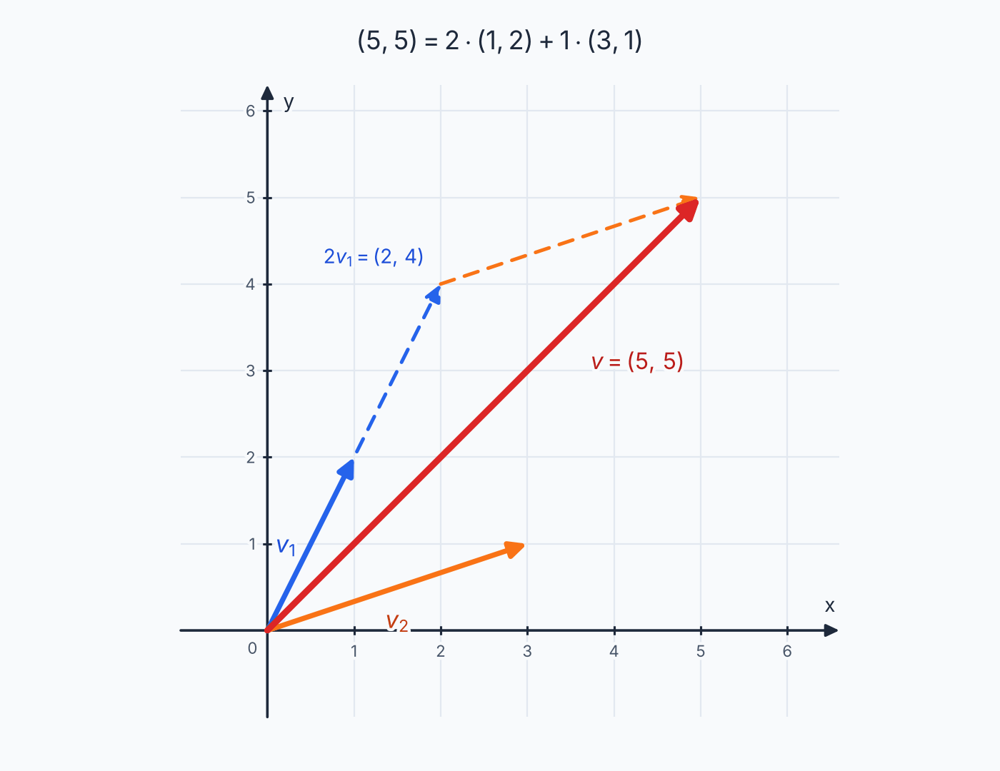
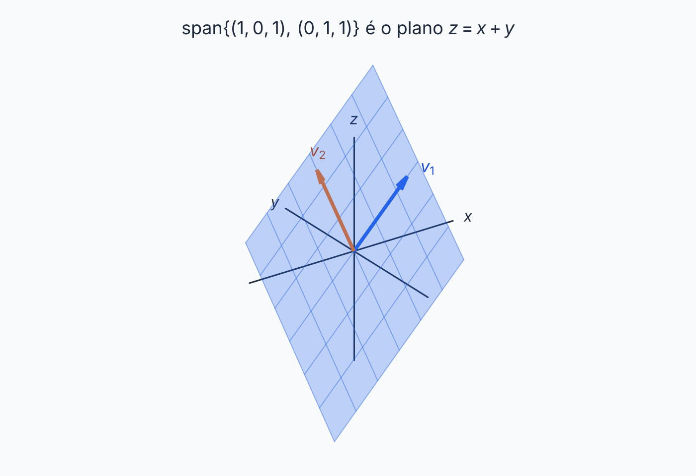

## Sobre

Imagine que você tem **dois vetores** e só pode fazer duas coisas com eles: esticar e somar. A pergunta desta página é: **que vetores dá para fabricar assim?**

A resposta chama-se **subespaço gerado**, e a pergunta "este vetor dá para fabricar?" vira, em toda questão, a mesma coisa: **montar e resolver um sistema linear**.

## Combinação linear

Uma **combinação linear** de \(v_1, v_2, \ldots, v_n\) é qualquer vetor da forma

$$
a_1 v_1 + a_2 v_2 + \cdots + a_n v_n,
$$

em que \(a_1, \ldots, a_n\) são números reais (os **coeficientes**). É uma "receita": \(a_1\) porções de \(v_1\), \(a_2\) porções de \(v_2\), e assim por diante. Os coeficientes podem ser negativos (porção negativa é andar no sentido contrário) e podem ser zero.

**Exemplo 1.** O vetor \((5, 5)\) é combinação linear de \((1, 2)\) e \((3, 1)\), porque

$$
2 \cdot (1, 2) + 1 \cdot (3, 1) = (2 + 3,\; 4 + 1) = (5, 5).
$$

## A pergunta de todo exercício

"\(v\) é combinação linear de \(u_1, \ldots, u_n\)?" significa: **existem números \(a_1, \ldots, a_n\) com \(v = a_1u_1 + \cdots + a_nu_n\)?**

Os \(a_i\) são as incógnitas. Igualando as coordenadas, sai um sistema linear. Se o sistema tem solução, a resposta é **sim** (e a solução são os coeficientes). Se é impossível, a resposta é **não**.

**Exemplo 2: com solução.** Escreva \(v = (4, -1, 7)\) como combinação linear de \(u_1 = (1, 0, 0)\), \(u_2 = (1, 1, 0)\) e \(u_3 = (1, 2, 1)\).

Queremos \(a, b, c\) com \(a(1,0,0) + b(1,1,0) + c(1,2,1) = (4, -1, 7)\). Coordenada por coordenada:

$$
\begin{cases}
a + b + c = 4 \\
b + 2c = -1 \\
c = 7
\end{cases}
$$

Este sistema já está escalonado, então resolve de baixo para cima: \(c = 7\), depois \(b = -1 - 14 = -15\), depois \(a = 4 + 15 - 7 = 12\). Conferindo:

$$
12(1,0,0) - 15(1,1,0) + 7(1,2,1) = (12 - 15 + 7,\; -15 + 14,\; 7) = (4, -1, 7). \;✓
$$

> [!TIP]
> Sempre que der, **confira a resposta** substituindo os coeficientes na combinação. Leva 20 segundos e evita perder a questão por um erro de sinal.

## Mostrar que NÃO é combinação linear

Mostrar que \(v\) **não** é combinação linear é mostrar que o sistema é **impossível**. Isso costuma acontecer quando há **mais equações do que incógnitas**.

**Exemplo 3.** Mostre que \(w = (3, 4, 5)\) não é combinação linear de \(v_1 = (1, 2, 0)\) e \(v_2 = (2, 1, 3)\).

Supondo \(a v_1 + b v_2 = w\), temos três equações e duas incógnitas:

$$
\begin{cases}
a + 2b = 3 \\
2a + b = 4 \\
3b = 5
\end{cases}
$$

**Método:** resolva **duas** equações e teste o resultado na **que sobrou**.

Das duas primeiras: \(a = 3 - 2b\), então \(2(3 - 2b) + b = 4\), ou seja, \(6 - 3b = 4\), logo \(b = 2/3\) e \(a = 5/3\).

Testando na terceira: \(3b = 3 \cdot \tfrac{2}{3} = 2\), mas ela exige \(5\). Como \(2 \neq 5\), **o sistema é impossível**: \(w\) não é combinação linear de \(v_1\) e \(v_2\). ∎

Uma forma equivalente de ver a mesma coisa: com \(a = \tfrac53\) e \(b = \tfrac23\), a combinação dá \(\tfrac53 v_1 + \tfrac23 v_2 = (3, 4, 2)\). As duas primeiras coordenadas batem com \(w\) e a terceira não (\(2 \neq 5\)).

> [!NOTE]
> Qualquer par de equações serve para começar. Se você usar outro par e achar outros valores de \(a\) e \(b\), **não é erro**. É justamente o sintoma de sistema impossível: cada par tem a sua solução, mas nenhuma serve para as três. Se o sistema tivesse solução, qualquer par daria os mesmos valores.

**Pelo escalonamento.** A matriz aumentada do sistema acima é \(\left[\begin{array}{cc|c} 1 & 2 & 3 \\ 2 & 1 & 4 \\ 0 & 3 & 5 \end{array}\right]\). Depois de escalonar, aparece uma linha da forma \(\left[\begin{array}{cc|c} 0 & 0 & \text{número} \neq 0 \end{array}\right]\). Esse é o sinal de sistema impossível, e é o que você escreve na justificativa.

**Intuição.** Dois vetores que não são paralelos geram, em \(\mathbb{R}^3\), um **plano** pela origem. "Combinação linear" é estar **em cima desse plano**. O vetor \(w\) está fora dele, então nenhuma receita chega lá.

## A condição para pertencer ao gerado

Uma variação comum é: *"determine uma condição em \(x\), \(y\) e \(z\) para que \((x, y, z)\) seja combinação linear de \(v_1\) e \(v_2\)"*. É o mesmo exercício, com **letras** no lado direito do sistema. Em vez de testar um vetor, você descobre **todos** os que passam.

**Exemplo 4.** Com \(v_1 = (1, 2, 0)\) e \(v_2 = (2, 1, 3)\): quando \((x, y, z) = a v_1 + b v_2\)?

$$
\begin{cases}
a + 2b = x \\
2a + b = y \\
3b = z
\end{cases}
$$

Resolva duas equações em função de \(x, y, z\) e **exija que a restante funcione**. Da terceira, \(b = z/3\). Da primeira, \(a = x - 2z/3\). Substituindo na segunda:

$$
2\left(x - \tfrac{2z}{3}\right) + \tfrac{z}{3} = y
\;\Longrightarrow\;
2x - \tfrac{4z}{3} + \tfrac{z}{3} = y
\;\Longrightarrow\;
2x - z = y.
$$

A condição é **\(2x - y - z = 0\)**. Isso é a equação do plano gerado por \(v_1\) e \(v_2\).

*Conferindo:* \(v_1 = (1, 2, 0)\) dá \(2 - 2 - 0 = 0\) ✓; \(v_2 = (2, 1, 3)\) dá \(4 - 1 - 3 = 0\) ✓; e \(w = (3, 4, 5)\) dá \(6 - 4 - 5 = -3 \neq 0\), de acordo com o Exemplo 3. ✓

> [!TIP]
> **Escalonando, a condição aparece sozinha.** Escalone a matriz aumentada com \(x, y, z\) na última coluna. A linha que fica \(\left[0 \;\; 0 \mid \text{expressão em } x,y,z\right]\) dá a condição: **expressão = 0**.

### Descobrindo um valor desconhecido

Se o vetor tem um parâmetro \(k\), basta aplicar a condição. Por exemplo, para que \((3, k, 2)\) seja combinação linear de \(v_1\) e \(v_2\), é preciso \(2 \cdot 3 - k - 2 = 0\), ou seja, **\(k = 4\)**. Conferindo: \(b = 2/3\), \(a = 3 - 4/3 = 5/3\), e \(2a + b = 10/3 + 2/3 = 4 = k\). ✓

## Polinômios e matrizes: traduza para lista

Nada de novo: **iguale os coeficientes**. Dois polinômios são iguais quando têm os mesmos coeficientes em cada potência de \(t\). Duas matrizes são iguais quando têm as mesmas entradas.

**Exemplo 5.** O polinômio \(p(t) = 2 + 3t + 5t^2\) pertence ao gerado por \(1 + t\), \(t + t^2\) e \(1 + t^2\)?

Queremos \(a(1 + t) + b(t + t^2) + c(1 + t^2) = 2 + 3t + 5t^2\). Agrupando o lado esquerdo por potência, fica \((a + c) + (a + b)t + (b + c)t^2\). Comparando:

$$
\begin{cases}
a + c = 2 \\
a + b = 3 \\
b + c = 5
\end{cases}
$$

Somando as três: \(2(a + b + c) = 10\), então \(a + b + c = 5\). Subtraindo cada equação desta, \(b = 3\), \(c = 2\) e \(a = 0\). Conferindo: \(0 + 3(t + t^2) + 2(1 + t^2) = 2 + 3t + 5t^2\). ✓ **Sim**, pertence.

**Exemplo 6: matrizes.** \(\begin{bmatrix} 3 & 1 \\ 1 & 0 \end{bmatrix}\) é combinação linear de \(\begin{bmatrix} 1 & 0 \\ 0 & 0 \end{bmatrix}\) e \(\begin{bmatrix} 0 & 1 \\ 1 & 0 \end{bmatrix}\)? Sim: \(3 \begin{bmatrix} 1 & 0 \\ 0 & 0 \end{bmatrix} + 1 \begin{bmatrix} 0 & 1 \\ 1 & 0 \end{bmatrix}\). Já \(\begin{bmatrix} 1 & 2 \\ 0 & 0 \end{bmatrix}\) não é, porque as entradas \((1,2)\) e \((2,1)\) precisariam ser iguais.

## O subespaço gerado

O conjunto de **todas** as combinações lineares de \(v_1, \ldots, v_n\) chama-se **subespaço gerado** por eles, e se escreve \([v_1, \ldots, v_n]\):

$$
[v_1, \ldots, v_n] = \{\, a_1v_1 + \cdots + a_nv_n \;\mid\; a_i \in \mathbb{R} \,\}.
$$

Ele é sempre um subespaço (a soma de duas combinações é uma combinação e o escalar também), e é o **menor** subespaço que contém os \(v_i\).

Em \(\mathbb{R}^3\):

- \([v]\), com \(v \neq 0\), é uma **reta** pela origem;
- \([v_1, v_2]\), com \(v_1, v_2\) não paralelos, é um **plano** pela origem;
- três vetores "independentes" geram \(\mathbb{R}^3\) inteiro.

Por exemplo, o plano \(z = x + y\) em \(\mathbb{R}^3\) é gerado por \((1, 0, 1)\) e \((0, 1, 1)\).

> [!WARNING]
> **Dois vetores nunca geram \(\mathbb{R}^3\).** No máximo geram um plano. Para gerar \(\mathbb{R}^3\) são necessários pelo menos 3 vetores. Isso responde rápido a perguntas do tipo "todo vetor de \(\mathbb{R}^3\) é combinação linear destes dois?" (a resposta é **não**).

## Conjunto gerador

Dizemos que \(\{v_1, \ldots, v_n\}\) **gera** o espaço \(V\) (ou que é um **conjunto gerador** de \(V\)) quando \([v_1, \ldots, v_n] = V\). Para provar, é preciso mostrar que **todo** vetor de \(V\) é combinação linear de \(v_1, \ldots, v_n\). Isso se faz com um vetor **genérico**.

**Exemplo 7.** Mostre que \(P_2 = [1 + t,\; 1 - t,\; t^2]\).

Seja \(p(t) = a + bt + ct^2\) um polinômio qualquer de \(P_2\). Queremos \(x, y, z\) com

$$
a + bt + ct^2 = x(1 + t) + y(1 - t) + zt^2 = (x + y) + (x - y)t + zt^2.
$$

Comparando coeficientes: \(x + y = a\), \(x - y = b\), \(z = c\). Somando as duas primeiras, \(2x = a + b\); subtraindo, \(2y = a - b\). Então

$$
x = \frac{a + b}{2}, \qquad y = \frac{a - b}{2}, \qquad z = c.
$$

Para **qualquer** \(a, b, c\) existe solução, então todo polinômio de \(P_2\) é combinação desses três. ∎

Aplicando a fórmula a \(p(t) = 2 - t + 3t^2\) (\(a = 2\), \(b = -1\), \(c = 3\)) sai \(x = \tfrac12\), \(y = \tfrac32\), \(z = 3\), ou seja, \(2 - t + 3t^2 = \tfrac12(1 + t) + \tfrac32(1 - t) + 3t^2\).

> [!NOTE]
> Dá para provar o mesmo por outro caminho: se os três polinômios forem LI e \(\dim P_2 = 3\), eles formam uma base, e toda base gera o espaço (veja as páginas seguintes). Os dois caminhos valem.

## A habilidade mais cobrada: achar geradores

Quando o subespaço vem por **equações**, a pergunta "ache geradores" tem uma receita fixa: **isole as variáveis e separe por variável livre**.

**Exemplo 8.** \(W = \{(x, y, z) \in \mathbb{R}^3 \mid x + 2y - z = 0\}\).

1. A equação diz \(z = x + 2y\). As variáveis \(x\) e \(y\) são **livres** (podem ter qualquer valor) e \(z\) é **determinada**.
2. Todo vetor de \(W\) é \((x, y, x + 2y)\).
3. Separe uma parcela por variável livre:

$$
(x, y, x + 2y) = x\,(1, 0, 1) + y\,(0, 1, 2).
$$

Então \(W = [(1, 0, 1), (0, 1, 2)]\). Conferindo: \((1,0,1)\) dá \(1 + 0 - 1 = 0\) ✓ e \((0,1,2)\) dá \(0 + 2 - 2 = 0\) ✓.

**Exemplo 9: duas equações.** \(W = \{(x, y, z) \in \mathbb{R}^3 \mid x - y = 0 \text{ e } y + z = 0\}\). Da primeira, \(x = y\); da segunda, \(z = -y\). Só \(y\) é livre:

$$
(y, y, -y) = y\,(1, 1, -1) \quad\Longrightarrow\quad W = [(1, 1, -1)].
$$

**Exemplo 10: matrizes simétricas.** \(\begin{bmatrix} a & b \\ b & d \end{bmatrix} = a\begin{bmatrix} 1 & 0 \\ 0 & 0 \end{bmatrix} + b\begin{bmatrix} 0 & 1 \\ 1 & 0 \end{bmatrix} + d\begin{bmatrix} 0 & 0 \\ 0 & 1 \end{bmatrix}\). Os três do lado direito geram as simétricas \(2 \times 2\).

> [!TIP]
> O número de geradores obtidos por esse método é o número de **variáveis livres** (no Exemplo 8, 2; no Exemplo 9, 1). Esse mesmo número será a **dimensão** do subespaço, na página de Base e Dimensão.

## Exercícios

**Exercício 1.** Escreva \((1, -3, 10)\) como combinação linear de \(u = (1, 0, 0)\), \(v = (1, 1, 0)\) e \(w = (2, -3, 5)\).


Queremos \(a u + b v + c w\). O sistema é \(a + b + 2c = 1\), \(b - 3c = -3\), \(5c = 10\). Então \(c = 2\), \(b = -3 + 6 = 3\) e \(a = 1 - 3 - 4 = -6\). Conferindo: \(-6(1,0,0) + 3(1,1,0) + 2(2,-3,5) = (-6 + 3 + 4,\; 3 - 6,\; 10) = (1, -3, 10)\). ✓


**Exercício 2.** Com \(v_1 = (1, -3, 2)\) e \(v_2 = (2, 4, -1)\): (a) escreva \(u = (-4, -18, 7)\) como combinação linear de \(v_1\) e \(v_2\); (b) mostre que \(v = (4, 3, -6)\) não é; (c) dê a condição para \((x, y, z)\) ser combinação linear.


**(a)** O sistema é \(a + 2b = -4\), \(-3a + 4b = -18\), \(2a - b = 7\). Das duas primeiras, \(a = -4 - 2b\) e \(-3(-4 - 2b) + 4b = -18\), logo \(12 + 10b = -18\), \(b = -3\) e \(a = 2\). Na terceira: \(2 \cdot 2 + 3 = 7\) ✓. Então \(u = 2v_1 - 3v_2\).

**(b)** O sistema é \(a + 2b = 4\), \(-3a + 4b = 3\), \(2a - b = -6\). Das duas primeiras: \(a = 4 - 2b\), \(-12 + 10b = 3\), \(b = 3/2\), \(a = 1\). Na terceira: \(2 \cdot 1 - 3/2 = 1/2 \neq -6\). O sistema é impossível.

**(c)** Com \(a + 2b = x\), \(-3a + 4b = y\), \(2a - b = z\): da primeira \(a = x - 2b\), da segunda \(10b = y + 3x\), da terceira \(2x - 5b = z\). Substituindo \(b = (y + 3x)/10\) na terceira: \(2x - (y + 3x)/2 = z\), e multiplicando por 2, \(4x - y - 3x = 2z\), ou seja, \(x - y - 2z = 0\).

*Teste:* \(u\) dá \(-4 + 18 - 14 = 0\) ✓ e \(v\) dá \(4 - 3 + 12 = 13 \neq 0\) ✓.


**Exercício 3.** Quais destes vetores são combinação linear de \(u = (0, -2, 2)\) e \(v = (1, 3, -1)\)? (a) \((2, 2, 2)\) (b) \((3, 1, 5)\) (c) \((0, 4, 5)\) (d) \((0, 0, 0)\)


Primeiro ache a condição do plano: \((x, y, z) = a u + b v\) dá \(x = b\), \(y = -2a + 3b\), \(z = 2a - b\). Somando as duas últimas, \(y + z = 2b = 2x\), então a condição é \(2x - y - z = 0\).

(a) \(4 - 2 - 2 = 0\) ✓ sim. (b) \(6 - 1 - 5 = 0\) ✓ sim. (c) \(0 - 4 - 5 = -9\) não. (d) o vetor nulo é sempre combinação linear (todos os coeficientes zero) ✓ sim.


**Exercício 4.** Para que valor de \(k\) o vetor \((-1, k, -7)\) é combinação linear de \((1, -3, 2)\) e \((2, 4, -1)\)?


Pela condição \(x - y - 2z = 0\) do Exercício 2(c): \(-1 - k - 2(-7) = 0\), logo \(13 - k = 0\) e \(k = 13\).


**Exercício 5.** O polinômio \(3 + 4t + 10t^2\) pertence ao subespaço gerado por \(t\), \(1 - t\) e \(4 + t^2\)?


Queremos \(a t + b(1 - t) + c(4 + t^2) = (b + 4c) + (a - b)t + ct^2\). Comparando com \(3 + 4t + 10t^2\): \(b + 4c = 3\), \(a - b = 4\), \(c = 10\). Então \(c = 10\), \(b = -37\), \(a = -33\). Sim, pertence: \(-33t - 37(1 - t) + 10(4 + t^2) = 3 + 4t + 10t^2\).


**Exercício 6.** Encontre geradores de \(W = \{(x, y, z) \in \mathbb{R}^3 \mid x + y + z = 0\}\).


\(z = -x - y\), então \((x, y, -x - y) = x(1, 0, -1) + y(0, 1, -1)\). Geradores: \((1, 0, -1)\) e \((0, 1, -1)\).


## Teste rápido




Qual é a pergunta que você resolve para decidir se \(v\) é combinação linear de \(u_1, u_2\)?

- [ ] Se \(v = u_1 + u_2\)
- [x] Se existem números \(a, b\) com \(v = a u_1 + b u_2\)
- [ ] Se \(v\) é paralelo a \(u_1\)
- [ ] Se \(\det(u_1, u_2) \neq 0\)
---
Combinação linear é "uma receita com porções \(a\) e \(b\)". Isso vira um sistema nas incógnitas \(a\) e \(b\).



Você resolveu duas equações de um sistema de três e o resultado **não** serve na terceira. Isso significa que...

- [ ] você errou a conta
- [x] o sistema é impossível e \(v\) não é combinação linear
- [ ] \(v\) é combinação linear com coeficientes diferentes
- [ ] os vetores são LI
---
Se o sistema tivesse solução, ela serviria nas três equações. Valores que funcionam em duas e falham na terceira mostram que o sistema não tem solução.



Dois vetores de \(\mathbb{R}^3\) podem gerar \(\mathbb{R}^3\)?

- [ ] Sim, se forem LI
- [ ] Sim, se não forem paralelos
- [x] Não: no máximo geram um plano
- [ ] Só se um deles for o vetor nulo
---
\(\mathbb{R}^3\) tem dimensão 3, e precisa de pelo menos 3 vetores para ser gerado. Dois vetores LI geram um plano.



Em \(W = \{(x, y, z) \mid x + y - z = 0\}\), quais são geradores?

- [ ] \((1, 1, -1)\) e \((1, 0, 0)\)
- [x] \((1, 0, 1)\) e \((0, 1, 1)\)
- [ ] \((1, 1, 1)\) e \((0, 0, 1)\)
- [ ] \((1, 0, -1)\) e \((0, 1, -1)\)
---
Como \(z = x + y\), temos \((x, y, x + y) = x(1, 0, 1) + y(0, 1, 1)\). As outras opções têm vetores que não satisfazem a equação.



