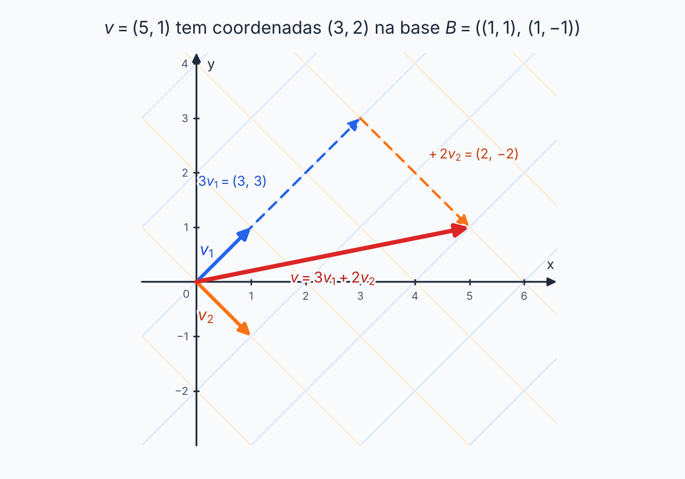

## Sobre

Ao dizer "o ponto \((3, 2)\)", você já usou **coordenadas** sem perceber: "3 passos para a direita e 2 para cima". Os "passos" são medidos com as réguas \((1, 0)\) e \((0, 1)\), a base canônica.

A ideia desta página: **nada obriga a usar essas réguas**. Dá para medir o mesmo ponto com outras réguas (outra base), e as coordenadas mudam, mas o ponto continua o mesmo. Mudança de base é a ferramenta que traduz um endereço no outro.

## Coordenadas numa base

Uma base **ordenada** é uma base em que a **ordem dos vetores importa**. Escrevemos \(B = (b_1, \ldots, b_n)\).

Como vimos, todo vetor \(v\) se escreve de **um único jeito** como combinação dos vetores da base:

$$
v = a_1 b_1 + a_2 b_2 + \cdots + a_n b_n.
$$

Os números \(a_1, \ldots, a_n\) são as **coordenadas de \(v\) na base \(B\)**, e formam o **vetor coordenado**, escrito como coluna:

$$
[v]_B = \begin{bmatrix} a_1 \\ a_2 \\ \vdots \\ a_n \end{bmatrix}.
$$

**Como calcular:** é só o problema de combinação linear. Monte o sistema \(v = a_1b_1 + \cdots + a_nb_n\) e resolva.

**Exemplo 1.** Em \(\mathbb{R}^2\), seja \(B = ((1, 1), (1, -1))\) e \(v = (5, 1)\). Queremos \(a(1,1) + b(1,-1) = (5, 1)\):

$$
\begin{cases} a + b = 5 \\ a - b = 1 \end{cases}
\;\Longrightarrow\; a = 3,\; b = 2.
$$

Então \([v]_B = \begin{bmatrix} 3 \\ 2 \end{bmatrix}\). Ou seja, \((5, 1) = 3(1,1) + 2(1,-1)\).

> [!NOTE]
> Na base canônica, as coordenadas são os próprios números do vetor: \([(5, 1)]_{\text{can}} = (5, 1)\). Por isso "coordenadas" parecem não fazer nada nessa base: o endereço e o vetor são a mesma lista.

**Exemplo 2.** Em \(\mathbb{R}^2\), \(B = ((2, 1), (1, -1))\) e \(v = (5, 1)\):

$$
\begin{cases} 2a + b = 5 \\ a - b = 1 \end{cases}
\;\Longrightarrow\; 3a = 6,\; a = 2,\; b = 1.
$$

Logo \([v]_B = (2, 1)\). Confira: \(2(2,1) + 1(1,-1) = (5, 1)\). ✓ (O mesmo \(v\) do Exemplo 1 tem outro endereço em outra base.)

**Exemplo 3: em \(\mathbb{R}^3\).** \(B = ((1, 2, 3), (0, 1, 2), (0, 0, 1))\) e \(v = (1, 3, 5)\).

$$
\begin{cases} a = 1 \\ 2a + b = 3 \\ 3a + 2b + c = 5 \end{cases}
\;\Longrightarrow\; a = 1,\; b = 1,\; c = 5 - 3 - 2 = 0.
$$

Então \([v]_B = (1, 1, 0)\).

**Antes de calcular: \(B\) precisa ser base.** Neste exemplo, a matriz com esses vetores é triangular com 1 na diagonal, determinante 1. Os três vetores são LI e, como \(\dim \mathbb{R}^3 = 3\), formam uma base.

### O caminho de volta

Se você tem as coordenadas e quer o vetor, é só **montar a combinação**:

$$
[v]_B = \begin{bmatrix} 1 \\ -2 \\ 3 \end{bmatrix}
\;\Longrightarrow\;
v = 1(1,2,3) - 2(0,1,2) + 3(0,0,1) = (1,\; 2 - 2,\; 3 - 4 + 3) = (1, 0, 2).
$$

Esse sentido não precisa de sistema: é só uma conta.

## Polinômios e matrizes

Nada muda: as coordenadas são os coeficientes da combinação.

**Exemplo 4: polinômios.** Em \(P_2\), seja \(B = (1,\; t + 1,\; t^2)\). Ache \([p]_B\) para \(p(t) = 3 + 2t\):

\(3 + 2t = a \cdot 1 + b(t + 1) + c\,t^2 = (a + b) + bt + ct^2\). Comparando: \(b = 2\), \(a + b = 3 \Rightarrow a = 1\), \(c = 0\). Então \([p]_B = (1, 2, 0)\).

**Exemplo 5: matrizes.** Em \(M(2,2)\), seja

$$
B = \left( \begin{bmatrix} 1 & 0 \\ 0 & 0 \end{bmatrix},\;
\begin{bmatrix} 1 & 1 \\ 0 & 0 \end{bmatrix},\;
\begin{bmatrix} 1 & 1 \\ 1 & 0 \end{bmatrix},\;
\begin{bmatrix} 1 & 1 \\ 1 & 1 \end{bmatrix} \right)
$$

e \(A = \begin{bmatrix} 2 & 1 \\ 0 & 3 \end{bmatrix}\). Escrevendo \(A = a B_1 + b B_2 + c B_3 + d B_4\) e igualando entrada por entrada:

$$
\begin{cases}
a + b + c + d = 2 & (\text{entrada } 1,1) \\
b + c + d = 1 & (1,2) \\
c + d = 0 & (2,1) \\
d = 3 & (2,2)
\end{cases}
$$

De baixo para cima: \(d = 3\), \(c = -3\), \(b = 1\), \(a = 1\). Então \([A]_B = (1, 1, -3, 3)\).

**Exemplo 6: simétricas.** O espaço \(S_2\) das matrizes simétricas \(2 \times 2\) tem base \(\alpha = \left(\begin{bmatrix} 1 & 0 \\ 0 & 0 \end{bmatrix}, \begin{bmatrix} 0 & 1 \\ 1 & 0 \end{bmatrix}, \begin{bmatrix} 0 & 0 \\ 0 & 1 \end{bmatrix}\right)\), de dimensão **3**. Para \(\begin{bmatrix} a & b \\ b & d \end{bmatrix}\), as coordenadas são \((a, b, d)\).

## Por que coordenadas importam

Escolhida uma base \(B\) de \(V\) (com \(\dim V = n\)), a operação "pegar as coordenadas" respeita soma e esticar:

$$
[u + v]_B = [u]_B + [v]_B
\qquad\text{e}\qquad
[\alpha v]_B = \alpha\,[v]_B.
$$

Isso significa que **qualquer espaço de dimensão \(n\) se comporta como \(\mathbb{R}^n\)**. Questões sobre polinômios ou matrizes podem ser resolvidas nas coordenadas, com as contas que você já conhece (escalonamento, determinantes). Essa é a justificativa para o truque "traduza para lista" que usamos o estágio inteiro.

## Mudança de base

Agora a pergunta central: se eu conheço as coordenadas de \(v\) numa base \(B\), como descubro as coordenadas dele em outra base \(C\)?

A resposta é uma **matriz**, a **matriz de mudança de base de \(B\) para \(C\)**, que vamos escrever como \(M_{B \to C}\):

$$
[v]_C = M_{B \to C}\,[v]_B.
$$

Pense nela como um **tradutor**: entra o endereço na língua \(B\), sai o endereço na língua \(C\).

> [!WARNING]
> **A notação muda de livro para livro e de professor para professor.** Você vai ver \([I]_B^C\), \([I]_{BC}\), \(P_{B \to C}\) e outras, e a posição dos índices (em cima ou embaixo) não é padronizada. Não decore a notação: **confira o sentido pelo exemplo do enunciado**. Se a matriz dada, multiplicada por \([v]_\beta\), deve resultar em \([v]_\alpha\), ela leva \(\beta\) para \(\alpha\). Se o enunciado dá a matriz no sentido contrário ao que você quer, **use a inversa**.

### Como montar a matriz

Se \(B = (b_1, \ldots, b_n)\), as **colunas** de \(M_{B \to C}\) são as coordenadas dos vetores de \(B\) escritas **na base \(C\)**:

$$
M_{B \to C} = \Big[\; [b_1]_C \;\; [b_2]_C \;\; \cdots \;\; [b_n]_C \;\Big].
$$

Em palavras: **pegue cada vetor da base de partida, descubra o endereço dele na base de chegada, e coloque como coluna.**

**Por que funciona?** Se \([v]_B = (a_1, \ldots, a_n)\), então \(v = a_1 b_1 + \cdots + a_n b_n\). Tirando as coordenadas na base \(C\) dos dois lados e usando que elas respeitam soma e esticar:

$$
[v]_C = a_1 [b_1]_C + \cdots + a_n [b_n]_C = M_{B \to C} \begin{bmatrix} a_1 \\ \vdots \\ a_n \end{bmatrix}.
$$

**Exemplo 7.** Em \(\mathbb{R}^2\), \(B\) é a base canônica e \(C = ((1, 1), (1, -1))\). Escrevemos os vetores de \(B\) na base \(C\):

$$
(1, 0) = \tfrac{1}{2}(1, 1) + \tfrac{1}{2}(1, -1)
\qquad\text{e}\qquad
(0, 1) = \tfrac{1}{2}(1, 1) - \tfrac{1}{2}(1, -1).
$$

Então

$$
M_{B \to C} = \begin{bmatrix} 1/2 & 1/2 \\ 1/2 & -1/2 \end{bmatrix}.
$$

Teste com \(v = (5, 1)\), que tem \([v]_B = (5, 1)\):

$$
[v]_C = \begin{bmatrix} 1/2 & 1/2 \\ 1/2 & -1/2 \end{bmatrix} \begin{bmatrix} 5 \\ 1 \end{bmatrix} = \begin{bmatrix} 3 \\ 2 \end{bmatrix},
$$

exatamente o que achamos no Exemplo 1. ✓

### Atalho quando uma das bases é a canônica

- **Da base \(C\) para a canônica:** as colunas são os **próprios vetores de \(C\)**, porque um vetor já está escrito na canônica. Nenhuma conta.
- **Da canônica para a base \(C\):** é a **inversa** da matriz anterior.

No Exemplo 7, \(M_{C \to B} = \begin{bmatrix} 1 & 1 \\ 1 & -1 \end{bmatrix}\), e de fato

$$
\begin{bmatrix} 1/2 & 1/2 \\ 1/2 & -1/2 \end{bmatrix} \begin{bmatrix} 1 & 1 \\ 1 & -1 \end{bmatrix} = \begin{bmatrix} 1 & 0 \\ 0 & 1 \end{bmatrix}. \;✓
$$

### O sentido contrário: use a inversa

A matriz de \(C\) para \(B\) desfaz a de \(B\) para \(C\):

$$
M_{C \to B} = (M_{B \to C})^{-1}.
$$

Se for só uma conta numérica (poucas coordenadas), muitas vezes é mais rápido **resolver o sistema** do que inverter.

**Exemplo 8.** O enunciado dá \(M = \begin{bmatrix} 1 & 2 \\ 0 & 1 \end{bmatrix}\), que leva \(\alpha\) para \(\beta\) (isto é, \([v]_\beta = M[v]_\alpha\)), e \([v]_\beta = (5, 3)\). Quanto vale \([v]_\alpha\)?

Precisamos do sentido contrário. Em vez de inverter, resolva \(M[v]_\alpha = (5, 3)\): com \([v]_\alpha = (a, b)\), \(a + 2b = 5\) e \(b = 3\), então \(a = -1\). Logo \([v]_\alpha = (-1, 3)\). (Com a inversa \(\begin{bmatrix} 1 & -2 \\ 0 & 1 \end{bmatrix}\) dá o mesmo.)

### Entre duas bases quaisquer

Quando nenhuma das bases é a canônica, existe um método direto: escalonar a matriz aumentada

$$
\big[\; C \;\big|\; B \;\big] \;\longrightarrow\; \big[\; I \;\big|\; M_{B \to C} \;\big],
$$

em que \(C\) e \(B\) são as matrizes com os vetores das bases nas **colunas**. É o mesmo método da inversa.

**Exemplo 9.** \(B = ((1, 0), (1, 1))\) e \(C = ((2, 1), (1, 1))\). Montamos \([\,C \mid B\,]\) e escalonamos:

$$
\left[\begin{array}{cc|cc} 2 & 1 & 1 & 1 \\ 1 & 1 & 0 & 1 \end{array}\right]
\xrightarrow{L_1 \leftrightarrow L_2}
\left[\begin{array}{cc|cc} 1 & 1 & 0 & 1 \\ 2 & 1 & 1 & 1 \end{array}\right]
\xrightarrow{L_2 \to L_2 - 2L_1}
\left[\begin{array}{cc|cc} 1 & 1 & 0 & 1 \\ 0 & -1 & 1 & -1 \end{array}\right]
$$

$$
\xrightarrow{L_2 \to -L_2}
\left[\begin{array}{cc|cc} 1 & 1 & 0 & 1 \\ 0 & 1 & -1 & 1 \end{array}\right]
\xrightarrow{L_1 \to L_1 - L_2}
\left[\begin{array}{cc|cc} 1 & 0 & 1 & 0 \\ 0 & 1 & -1 & 1 \end{array}\right]
$$

Logo \(M_{B \to C} = \begin{bmatrix} 1 & 0 \\ -1 & 1 \end{bmatrix}\).

Teste com \(v = (3, 2)\). Na base \(B\): \(a(1,0) + b(1,1) = (3,2)\) dá \(b = 2\) e \(a = 1\), então \([v]_B = (1, 2)\). Aplicando a matriz: \([v]_C = (1, -1 + 2) = (1, 1)\). Confira: \(1(2,1) + 1(1,1) = (3, 2)\). ✓

### Mudando por etapas

Se você sabe ir de \(B\) para \(C\) e de \(C\) para \(D\), vai de \(B\) para \(D\) **multiplicando**, com a **primeira etapa à direita**:

$$
M_{B \to D} = M_{C \to D}\,M_{B \to C}.
$$

Isso é útil quando a canônica serve de ponte: \(M_{B \to C} = M_{\text{can} \to C}\,M_{B \to \text{can}}\).

### Descobrindo uma base a partir da matriz

Se você sabe \(M_{\alpha \to \beta}\) e \(\beta\), e quer \(\alpha\): as **colunas** da matriz são os vetores de \(\alpha\) escritos na base \(\beta\). Basta "desfazer" as coordenadas.

**Exemplo 10.** \(\beta = ((1, 1), (0, 2))\) e \(M_{\alpha \to \beta} = \begin{bmatrix} 2 & 1 \\ 0 & 3 \end{bmatrix}\).

- 1º vetor de \(\alpha\): coordenadas \((2, 0)\) em \(\beta\), logo \(2(1,1) + 0(0,2) = (2, 2)\).
- 2º vetor de \(\alpha\): coordenadas \((1, 3)\), logo \(1(1,1) + 3(0,2) = (1, 7)\).

Então \(\alpha = ((2, 2), (1, 7))\).

### Polinômios: mudança de base

\(\alpha = (1, t, t^2)\) e \(\beta = (1, t + 1, t^2)\). Para \(M_{\beta \to \alpha}\), escrevemos cada vetor de \(\beta\) na base \(\alpha\):

$$
1 = (1, 0, 0), \qquad t + 1 = (1, 1, 0), \qquad t^2 = (0, 0, 1)
\quad\Longrightarrow\quad
M_{\beta \to \alpha} = \begin{bmatrix} 1 & 1 & 0 \\ 0 & 1 & 0 \\ 0 & 0 & 1 \end{bmatrix}.
$$

Com \(p = 3 + 2t\): \([p]_\alpha = (3, 2, 0)\) e, como visto no Exemplo 4, \([p]_\beta = (1, 2, 0)\). Conferindo: \(M_{\beta \to \alpha}(1, 2, 0) = (1 + 2, 2, 0) = (3, 2, 0)\). ✓

## Resumo

| Quero... | Faço... |
| --- | --- |
| \([v]_B\) | resolver \(v = a_1b_1 + \cdots + a_nb_n\) |
| \(v\) a partir de \([v]_B\) | montar a combinação \(a_1b_1 + \cdots + a_nb_n\) |
| \(M_{B \to C}\) | colunas = \([b_i]_C\) (cada vetor de \(B\) escrito em \(C\)) |
| \(M_{C \to B}\) | inversa de \(M_{B \to C}\) |
| passar de \(B\) para \(D\) por \(C\) | \(M_{C \to D}\,M_{B \to C}\) |
| a base \(\alpha\), dada \(M_{\alpha \to \beta}\) | desfazer as coordenadas das colunas usando \(\beta\) |

## Exercícios

**Exercício 1.** Em \(\mathbb{R}^2\), \(B = ((2, 1), (1, -1))\). Mostre que \(B\) é base e calcule \([(4, -1)]_B\).


**Passo 1: mostrar que é base.**

São 2 vetores em \(\mathbb{R}^2\), então basta o determinante:

$$
\det \begin{bmatrix} 2 & 1 \\ 1 & -1 \end{bmatrix} = 2 \cdot (-1) - 1 \cdot 1 = -3 \neq 0.
$$

São LI, então formam uma base.

**Passo 2: montar o sistema.**

\(a(2, 1) + b(1, -1) = (4, -1)\):

$$
\begin{cases}
2a + b = 4 \\
a - b = -1
\end{cases}
$$

**Passo 3: resolver.**

Somando as equações: \(3a = 3\), então \(a = 1\). Depois \(b = a + 1 = 2\).

**Resposta:** \([(4, -1)]_B = (1, 2)\).


**Exercício 2.** Com \(B = ((1, 2, 3), (0, 1, 2), (0, 0, 1))\): (a) as coordenadas de \(u = (5, 4, 2)\); (b) o vetor \(v\) com \([v]_B = (2, -3, 4)\).


**Item (a)**

**Passo 1: o sistema.**

$$
\begin{cases}
a = 5 \\
2a + b = 4 \\
3a + 2b + c = 2
\end{cases}
$$

**Passo 2: resolver de cima para baixo.**

$$
a = 5
$$

$$
b = 4 - 2a = 4 - 10 = -6
$$

$$
c = 2 - 3a - 2b = 2 - 15 + 12 = -1
$$

**Resposta:** \([u]_B = (5, -6, -1)\).

**Item (b)**

**Passo 1: montar a combinação.**

$$
v = 2(1, 2, 3) - 3(0, 1, 2) + 4(0, 0, 1)
$$

**Passo 2: somar coordenada a coordenada.**

$$
v = \big(2,\; 4 - 3,\; 6 - 6 + 4\big)
$$

**Resposta:** \(v = (2, 1, 4)\).


**Exercício 3.** \(\alpha = ((1, 0), (0, 1))\), \(\beta = ((-1, 1), (1, 1))\) e \(\gamma = ((2, 0), (0, 2))\). Se \([v]_\beta = (2, 1)\), ache \([v]_\alpha\) e \([v]_\gamma\).


**Passo 1: achar o vetor \(v\).**

$$
v = 2(-1, 1) + 1(1, 1) = (-2 + 1,\; 2 + 1) = (-1, 3).
$$

**Passo 2: coordenadas em \(\alpha\) (canônica).**

São os próprios números: \([v]_\alpha = (-1, 3)\).

**Passo 3: coordenadas em \(\gamma\).**

\(a(2, 0) + b(0, 2) = (-1, 3)\) dá

$$
2a = -1 \Rightarrow a = -\tfrac{1}{2}, \qquad 2b = 3 \Rightarrow b = \tfrac{3}{2}.
$$

**Resposta:** \([v]_\alpha = (-1, 3)\) e \([v]_\gamma = \left(-\tfrac{1}{2}, \tfrac{3}{2}\right)\).


**Exercício 4.** Ache \(M_{\beta \to \alpha}\) e \(M_{\alpha \to \beta}\) para \(\alpha\) canônica e \(\beta = ((-1, 1), (1, 1))\).


**Passo 1: \(M_{\beta \to \alpha}\).**

Como \(\alpha\) é a canônica, as colunas são os próprios vetores de \(\beta\):

$$
M_{\beta \to \alpha} = \begin{bmatrix} -1 & 1 \\ 1 & 1 \end{bmatrix}.
$$

**Passo 2: \(M_{\alpha \to \beta}\) é a inversa.**

O determinante é \(-1 \cdot 1 - 1 \cdot 1 = -2\). Trocando os elementos da diagonal, mudando o sinal dos outros e dividindo pelo determinante:

$$
M_{\alpha \to \beta} = \frac{1}{-2}\begin{bmatrix} 1 & -1 \\ -1 & -1 \end{bmatrix} = \begin{bmatrix} -\tfrac{1}{2} & \tfrac{1}{2} \\ \tfrac{1}{2} & \tfrac{1}{2} \end{bmatrix}.
$$

**Conferindo:** o produto das duas dá a identidade.

$$
\begin{bmatrix} -\tfrac12 & \tfrac12 \\ \tfrac12 & \tfrac12 \end{bmatrix}\begin{bmatrix} -1 & 1 \\ 1 & 1 \end{bmatrix} = \begin{bmatrix} 1 & 0 \\ 0 & 1 \end{bmatrix}. \;✓
$$


**Exercício 5.** Em \(P_2\), com \(\alpha = (1, t, t^2)\) e \(\beta = (1, 2t + 1, t^2)\): ache \(M_{\beta \to \alpha}\) e \([3 + 2t]_\beta\).


**Passo 1: escrever cada vetor de \(\beta\) na base \(\alpha\).**

$$
1 \to (1, 0, 0), \qquad 2t + 1 \to (1, 2, 0), \qquad t^2 \to (0, 0, 1)
$$

**Passo 2: colocar como colunas.**

$$
M_{\beta \to \alpha} = \begin{bmatrix} 1 & 1 & 0 \\ 0 & 2 & 0 \\ 0 & 0 & 1 \end{bmatrix}
$$

**Passo 3: \([3 + 2t]_\beta\).**

$$
3 + 2t = a + b(2t + 1) + c\,t^2 = (a + b) + 2b\,t + c\,t^2.
$$

Comparando os coeficientes:

$$
2b = 2 \Rightarrow b = 1, \qquad a + b = 3 \Rightarrow a = 2, \qquad c = 0.
$$

**Resposta:** \([3 + 2t]_\beta = (2, 1, 0)\).


**Exercício 6.** Em \(S_2\) (matrizes simétricas \(2 \times 2\)) com a base \(\alpha\) do Exemplo 6, ache \([A]_\alpha\) para \(A = \begin{bmatrix} 3 & -1 \\ -1 & 2 \end{bmatrix}\).


**Passo 1: escrever como combinação da base.**

$$
\begin{bmatrix} 3 & -1 \\ -1 & 2 \end{bmatrix}
= 3\begin{bmatrix} 1 & 0 \\ 0 & 0 \end{bmatrix} -
1\begin{bmatrix} 0 & 1 \\ 1 & 0 \end{bmatrix} +
2\begin{bmatrix} 0 & 0 \\ 0 & 1 \end{bmatrix}
$$

**Passo 2: ler os coeficientes.**

**Resposta:** \([A]_\alpha = (3, -1, 2)\).


## Teste rápido




Em \(\mathbb{R}^2\), \(B = ((1, 1), (1, -1))\). Quanto vale \([(5, 1)]_B\)?

- [ ] \((5, 1)\)
- [ ] \((2, 3)\)
- [x] \((3, 2)\)
- [ ] \((1, 5)\)
---
\(3(1,1) + 2(1,-1) = (5, 1)\). As coordenadas na base \(B\) são \((3, 2)\).



As colunas de \(M_{B \to C}\) são...

- [ ] os vetores de \(C\) escritos na base \(B\)
- [x] os vetores de \(B\) escritos na base \(C\)
- [ ] os vetores de \(B\) escritos na base canônica
- [ ] os vetores de \(C\) escritos na base canônica
---
Cada coluna é o endereço, na base de **chegada** (\(C\)), de um vetor da base de **partida** (\(B\)).



Se \(M_{B \to C}\) é conhecida e você precisa de \(M_{C \to B}\), basta...

- [ ] transpor a matriz
- [x] inverter a matriz
- [ ] trocar as linhas pelas colunas
- [ ] multiplicar por \(-1\)
---
Ir e voltar desfaz uma mudança com a outra, então as duas são inversas uma da outra.



Qual é a dimensão de \(M(2,2)\), e quantas coordenadas tem uma matriz em uma base de \(M(2,2)\)?

- [ ] 2 e 2
- [ ] 3 e 3
- [x] 4 e 4
- [ ] 4 e 2
---
\(\dim M(2,2) = 4\), então qualquer base tem 4 matrizes e o vetor coordenado tem 4 números.



