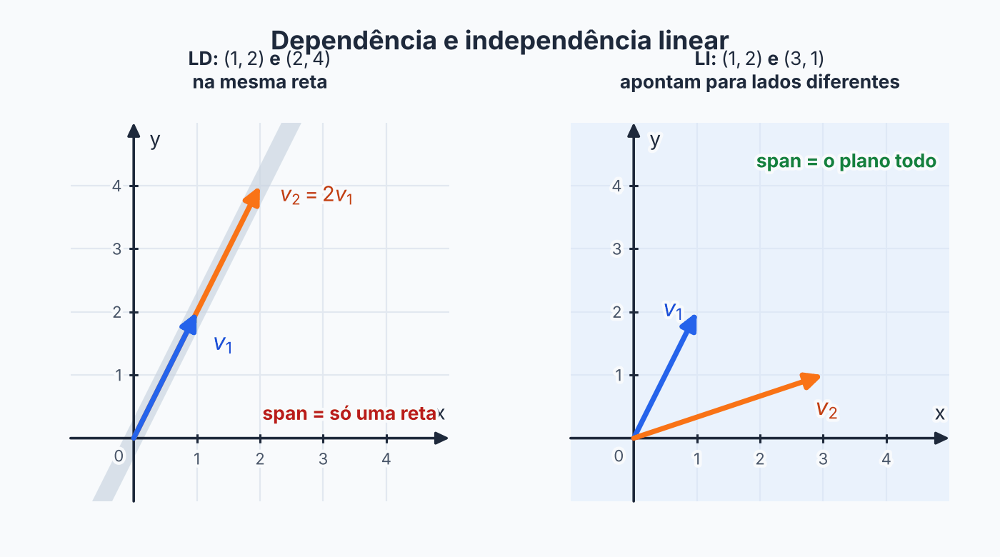

## Sobre

Imagine que você tem uma lista de vetores e quer saber se **algum deles está sobrando**. "Sobrando" quer dizer que dá para fabricá-lo usando os outros. Por exemplo, na lista \(\{(1, 0), (0, 1), (3, 5)\}\), o terceiro vetor sobra, porque \((3, 5) = 3(1, 0) + 5(0, 1)\).

Uma lista **sem nenhum vetor sobrando** é **linearmente independente (LI)**. Uma lista **com pelo menos um vetor sobrando** é **linearmente dependente (LD)**.

## A definição

Os vetores \(v_1, \ldots, v_n\) são **LI** se a única solução de

$$
a_1v_1 + a_2v_2 + \cdots + a_nv_n = 0
$$

é a **trivial**: \(a_1 = a_2 = \cdots = a_n = 0\). Se existir alguma solução com algum \(a_i \neq 0\), são **LD**.

**Por que isso quer dizer "ninguém sobra"?** Suponha uma solução com \(a_1 \neq 0\). Passando os outros termos para o outro lado e dividindo por \(a_1\), você escreve \(v_1\) como combinação dos demais, ou seja, \(v_1\) sobra. Reciprocamente, se um vetor sobra, a relação entre ele e os outros é uma solução com algum coeficiente diferente de zero.

> [!NOTE]
> A solução trivial (todos zero) **sempre existe**. A pergunta é se existe **outra** além dela.

## Como testar na prática

Este é o procedimento para qualquer lista:

1. Monte a equação \(a_1v_1 + \cdots + a_nv_n = 0\).
2. Iguale coordenada a coordenada: sai um **sistema homogêneo** (lado direito zero).
3. Resolva (escalone):
   - só a solução nula → **LI**;
   - tem variável livre (infinitas soluções) → **LD**.

**Exemplo 1: LI.** \(\{(1, 2), (3, -1)\}\) em \(\mathbb{R}^2\).

$$
a(1, 2) + b(3, -1) = (0, 0)
\;\Longrightarrow\;
\begin{cases} a + 3b = 0 \\ 2a - b = 0 \end{cases}
$$

Da segunda, \(b = 2a\). Na primeira: \(a + 6a = 0\), então \(a = 0\) e \(b = 0\). Só a solução trivial: **LI**.

**Exemplo 2: LD.** \(\{(1, 0, 1), (1, 1, 0), (0, 1, -1)\}\) em \(\mathbb{R}^3\).

O sistema é \(a + b = 0\), \(b + c = 0\), \(a - c = 0\). Da primeira, \(b = -a\); da segunda, \(c = -b = a\); a terceira vira \(a - a = 0\), sempre verdadeira. A variável \(a\) fica **livre**: com \(a = 1\) sai \(b = -1\) e \(c = 1\), e de fato

$$
1\cdot(1, 0, 1) - 1\cdot(1, 1, 0) + 1\cdot(0, 1, -1) = (0, 0, 0).
$$

Há solução não trivial: **LD**. (O vetor \((1, 0, 1)\) sobra: é igual a \((1, 1, 0) - (0, 1, -1)\).)

## Atalho: o determinante

Quando a lista tem **\(n\) vetores em \(\mathbb{R}^n\)** (a matriz é quadrada), monte a matriz com os vetores como linhas (ou colunas) e calcule o determinante:

- \(\det \neq 0\) → **LI**;
- \(\det = 0\) → **LD**.

No Exemplo 2: \(\det \begin{bmatrix} 1 & 0 & 1 \\ 1 & 1 & 0 \\ 0 & 1 & -1 \end{bmatrix} = 1(-1 - 0) - 0 + 1(1 - 0) = 0\). ✓ (LD)

O determinante só vale para matriz **quadrada**. Se o número de vetores é diferente da dimensão, escalone ou use os casos rápidos abaixo.

## Casos que se resolvem de cabeça

- **Lista que contém o vetor nulo** → LD (\(1 \cdot 0 = 0\) é uma solução não trivial).
- **Um vetor sozinho** \(\{v\}\) → LI se \(v \neq 0\).
- **Dois vetores** → LD se um é múltiplo do outro (paralelos), LI caso contrário.
- **Mais vetores do que a dimensão** (por exemplo, 3 vetores em \(\mathbb{R}^2\), ou 4 em \(P_2\)) → **sempre LD**.
- **Vetores repetidos** → LD.

## Polinômios e matrizes: traduza para lista

Para decidir LI em \(P_2\) ou \(M(2,2)\), **troque cada objeto pela sua lista de coeficientes** (veja Espaços Vetoriais) e use as ferramentas de \(\mathbb{R}^n\).

**Exemplo 3: polinômios.** \(\{1 + t,\; 1 - t,\; t^2\}\) em \(P_2\). As listas são \((1, 1, 0)\), \((1, -1, 0)\), \((0, 0, 1)\). O determinante é

$$
\det \begin{bmatrix} 1 & 1 & 0 \\ 1 & -1 & 0 \\ 0 & 0 & 1 \end{bmatrix} = 1 \cdot (-1 - 1) = -2 \neq 0,
$$

então **LI**.

**Exemplo 4: matrizes.** \(\left\{\begin{bmatrix} 1 & 0 \\ 0 & 1 \end{bmatrix}, \begin{bmatrix} 0 & 1 \\ 1 & 0 \end{bmatrix}, \begin{bmatrix} 1 & 1 \\ 1 & 1 \end{bmatrix}\right\}\) em \(M(2,2)\). Repare que a terceira é a soma das duas primeiras, então \(I + \begin{bmatrix} 0 & 1 \\ 1 & 0 \end{bmatrix} - \begin{bmatrix} 1 & 1 \\ 1 & 1 \end{bmatrix} = 0\). **LD**.

**Exemplo 5: quatro matrizes.** Para \(\left\{\begin{bmatrix} 1 & 0 \\ 0 & 1 \end{bmatrix}, \begin{bmatrix} 0 & 1 \\ 1 & 0 \end{bmatrix}, \begin{bmatrix} 1 & 1 \\ 0 & 1 \end{bmatrix}, \begin{bmatrix} 1 & 0 \\ 1 & 1 \end{bmatrix}\right\}\), as listas \((1,0,0,1)\), \((0,1,1,0)\), \((1,1,0,1)\), \((1,0,1,1)\) formam uma matriz \(4 \times 4\) de determinante \(0\). **LD**. De fato, a soma das duas últimas é \(2\cdot I + \begin{bmatrix} 0 & 1 \\ 1 & 0 \end{bmatrix}\).

**Exemplo 5b: três matrizes (a conta não é quadrada).** \(\left\{\begin{bmatrix} 1 & 1 \\ 0 & -1 \end{bmatrix}, \begin{bmatrix} 1 & -1 \\ 1 & 0 \end{bmatrix}, \begin{bmatrix} 1 & 0 \\ 3 & 2 \end{bmatrix}\right\}\) em \(M(2,2)\).

São 3 matrizes e \(\dim M(2,2) = 4\), então **não dá para usar determinante** (a matriz seria \(3 \times 4\)). Vá pelo sistema homogêneo, entrada por entrada:

$$
\alpha \begin{bmatrix} 1 & 1 \\ 0 & -1 \end{bmatrix} + \beta \begin{bmatrix} 1 & -1 \\ 1 & 0 \end{bmatrix} + \gamma \begin{bmatrix} 1 & 0 \\ 3 & 2 \end{bmatrix} = 0
\;\Longrightarrow\;
\begin{cases}
\alpha + \beta + \gamma = 0 \\
\alpha - \beta = 0 \\
\beta + 3\gamma = 0 \\
-\alpha + 2\gamma = 0
\end{cases}
$$

Da segunda, \(\alpha = \beta\). Da terceira, \(\beta = -3\gamma\). Da quarta, \(\alpha = 2\gamma\). Então \(2\gamma = -3\gamma\), ou seja, \(\gamma = 0\), e com isso \(\alpha = \beta = 0\). Só a solução trivial: **LI**.

**Exemplo 5c: o mesmo tipo, mas LD.** \(\left\{\begin{bmatrix} 1 & -1 \\ 3 & 3 \end{bmatrix}, \begin{bmatrix} -1 & 3 \\ 1 & 5 \end{bmatrix}, \begin{bmatrix} 2 & -3 \\ 4 & 2 \end{bmatrix}\right\}\). Escreva as listas **como linhas** e escalone:

$$
\begin{bmatrix} 1 & -1 & 3 & 3 \\ -1 & 3 & 1 & 5 \\ 2 & -3 & 4 & 2 \end{bmatrix}
\xrightarrow{\substack{L_2 \to L_2 + L_1 \\ L_3 \to L_3 - 2L_1}}
\begin{bmatrix} 1 & -1 & 3 & 3 \\ 0 & 2 & 4 & 8 \\ 0 & -1 & -2 & -4 \end{bmatrix}
\xrightarrow{L_3 \to L_3 + \frac12 L_2}
\begin{bmatrix} 1 & -1 & 3 & 3 \\ 0 & 2 & 4 & 8 \\ 0 & 0 & 0 & 0 \end{bmatrix}
$$

Uma linha zerou: **LD**. (A relação é \(3A - B - 2C = 0\).) **Regra prática:** com os vetores nas linhas, \(n\) vetores são LI quando **nenhuma linha zera** no escalonamento.

## Valores de k que tornam o conjunto LI

Quando o enunciado traz um parâmetro \(k\), o determinante vira uma expressão em \(k\), e a pergunta é **quando ele é diferente de zero**.

**Exemplo 6.** Para que valores de \(k\) o conjunto \(\{(1, 0, k), (0, 1, k), (1, 1, k^2)\}\) é LI?

$$
\det \begin{bmatrix} 1 & 0 & k \\ 0 & 1 & k \\ 1 & 1 & k^2 \end{bmatrix}
= 1 \cdot (k^2 - k) - 0 + k \cdot (0 - 1) = k^2 - 2k = k(k - 2).
$$

O determinante é diferente de zero quando \(k \neq 0\) e \(k \neq 2\). Então o conjunto é **LI para todo \(k \in \mathbb{R}\) com \(k \neq 0\) e \(k \neq 2\)**, e LD para \(k = 0\) ou \(k = 2\).

**Exemplo 7.** Para \(\{(1, 1, 0), (0, 1, k), (k, 0, 1)\}\), o determinante é \(1 \cdot (1 - 0) - 1 \cdot (0 - k^2) = 1 + k^2\), que é sempre positivo. Então é **LI para todo \(k\)**. (Pode acontecer de nenhum valor de \(k\) quebrar a independência.)

**Exemplo 8: \(k\) ao quadrado.** Para que valores de \(k\) o conjunto \(\{(1, 0, -3), (0, 2, 4), (1, k^2, 5)\}\) é LD?

$$
\det \begin{bmatrix} 1 & 0 & -3 \\ 0 & 2 & 4 \\ 1 & k^2 & 5 \end{bmatrix}
= 1\,(10 - 4k^2) - 0 + (-3)(0 - 2) = 16 - 4k^2.
$$

LD é \(\det = 0\): \(16 - 4k^2 = 0 \Rightarrow k^2 = 4\). Logo **\(k = 2\) ou \(k = -2\)**, os dois valores. Quando o \(k\) aparece ao quadrado, não esqueça a raiz negativa.

> [!TIP]
> "**Base de \(\mathbb{R}^3\)**" para três vetores é a mesma coisa que "**LI**", porque \(\dim \mathbb{R}^3 = 3\). Então os exercícios do tipo "para que \(k\) é base" e "para que \(k\) é LI" se resolvem do mesmo jeito: \(\det \neq 0\).

## LI e geradores: a ponte

- Dois vetores LI em \(\mathbb{R}^3\) geram um **plano**, não o \(\mathbb{R}^3\) inteiro.
- Se um vetor é combinação dos outros, **tirá-lo não muda o gerado**: ele não acrescentava nada.
- Uma lista LI que **também gera** o espaço é chamada de **base** (próxima página).

## Erros comuns

- **Usar determinante com matriz não quadrada.** Só vale quando o número de vetores é igual à dimensão.
- **Achar que a solução trivial prova LD.** Ela sempre existe; o que importa é existir outra.
- **Esquecer de "traduzir" polinômios e matrizes para listas** antes de montar a matriz.
- **Perder uma raiz.** Se o determinante tem \(k^2\), resolva a equação inteira: \(k^2 = 4\) dá \(k = 2\) **e** \(k = -2\).
- **Cortar valores de \(k\) sem conferir.** Se \(\det = k(k - 2)\), os valores problemáticos são os que **zeram** o determinante (\(k = 0\) e \(k = 2\)).

## Exercícios

**Exercício 1.** \(\{(1, 2), (2, 4)\}\) é LI?


**Passo 1: olhar a relação entre os vetores.**

$$
(2, 4) = 2 \cdot (1, 2)
$$

Um é múltiplo do outro, então são paralelos.

**Passo 2: achar a combinação não trivial.**

$$
2 \cdot (1, 2) - 1 \cdot (2, 4) = (0, 0).
$$

**Resposta:** LD.


**Exercício 2.** \(\{(1, 1, 0), (1, -1, 1)\}\) é LI em \(\mathbb{R}^3\)?


**Passo 1: montar o sistema homogêneo.**

\(a(1, 1, 0) + b(1, -1, 1) = (0, 0, 0)\), ou seja,

$$
\begin{cases}
a + b = 0 \\
a - b = 0 \\
b = 0
\end{cases}
$$

**Passo 2: resolver.**

Da terceira, \(b = 0\). Na primeira, \(a = 0\).

**Resposta:** só a solução trivial, então são LI.

*Atalho:* dois vetores que não são múltiplos um do outro já são LI.


**Exercício 3.** \(\{t + 1,\; t - 1\}\) é LI em \(P_1\)?


**Passo 1: traduzir para listas** (coeficientes de \(1\) e \(t\)).

$$
t + 1 \to (1, 1), \qquad t - 1 \to (-1, 1)
$$

**Passo 2: determinante.**

$$
\det \begin{bmatrix} 1 & 1 \\ -1 & 1 \end{bmatrix} = 1 \cdot 1 - 1 \cdot (-1) = 2 \neq 0.
$$

**Resposta:** LI.


**Exercício 4.** \(\{t + 1,\; 1 + t^2,\; 1 - t + t^2\}\) é LI em \(P_2\)?


**Passo 1: traduzir para listas** (coeficientes de \(1\), \(t\), \(t^2\)).

$$
t + 1 \to (1, 1, 0), \qquad 1 + t^2 \to (1, 0, 1), \qquad 1 - t + t^2 \to (1, -1, 1)
$$

**Passo 2: determinante.**

$$
\det \begin{bmatrix} 1 & 1 & 0 \\ 1 & 0 & 1 \\ 1 & -1 & 1 \end{bmatrix}
= 1(0 \cdot 1 - 1 \cdot (-1)) - 1(1 \cdot 1 - 1 \cdot 1) + 0
= 1 \cdot 1 - 1 \cdot 0 = 1.
$$

**Resposta:** \(1 \neq 0\), então são LI.


**Exercício 5.** Para que \(k\) o conjunto \(\{(1, 0, 1), (1, 1, 0), (k, 1, -1)\}\) é LI?


**Passo 1: determinante em função de \(k\).**

$$
\det \begin{bmatrix} 1 & 0 & 1 \\ 1 & 1 & 0 \\ k & 1 & -1 \end{bmatrix}
= 1(1 \cdot (-1) - 0 \cdot 1) - 0 + 1(1 \cdot 1 - 1 \cdot k)
$$

**Passo 2: simplificar.**

$$
= -1 + 1 - k = -k.
$$

**Passo 3: quando é diferente de zero.**

\(-k \neq 0\) quando \(k \neq 0\).

**Resposta:** LI para todo \(k \neq 0\) (e LD para \(k = 0\)).


**Exercício 6.** Os vetores \((-5, 3, 2)\) e \((3, -1, 3)\) podem gerar todo \(\mathbb{R}^3\)? Justifique.


**Ideia.** Contar vetores.

- \(\dim \mathbb{R}^3 = 3\), então gerar \(\mathbb{R}^3\) exige pelo menos 3 vetores.
- Dois vetores geram, no máximo, um plano pela origem.

**Resposta:** **não** geram.


**Exercício 7.** Para que \(k\) o conjunto \(\{(1, 0, -1), (1, 1, 0), (k, 1, -1)\}\) é LI?


**Passo 1: determinante em função de \(k\).**

$$
\det \begin{bmatrix} 1 & 0 & -1 \\ 1 & 1 & 0 \\ k & 1 & -1 \end{bmatrix}
= 1\,(-1 - 0) - 0 + (-1)(1 - k) = -1 - 1 + k = k - 2.
$$

**Passo 2: quando é diferente de zero.** \(k - 2 \neq 0\) quando \(k \neq 2\).

**Resposta:** LI para todo \(k \neq 2\) (e LD para \(k = 2\)). Como são 3 vetores em \(\mathbb{R}^3\), isso também diz quando eles formam base.


**Exercício 8.** Decida se \(\{(1, 2, 3, 4),\; (0, 1, 2, 3),\; (0, 0, 1, 2)\}\) é LI em \(\mathbb{R}^4\). Dá para usar determinante?


**Passo 1: o determinante não serve.** São 3 vetores em \(\mathbb{R}^4\): a matriz é \(3 \times 4\), e determinante só existe em matriz quadrada.

**Passo 2: olhar o escalonamento.** Com os vetores nas linhas, a matriz já está escalonada (pivôs nas colunas 1, 2 e 3) e **nenhuma linha é nula**.

**Resposta:** são **LI**. (Equivalente: \(\alpha(1,2,3,4) + \beta(0,1,2,3) + \gamma(0,0,1,2) = 0\) dá \(\alpha = 0\) pela 1ª coordenada, depois \(\beta = 0\), depois \(\gamma = 0\).)


## Teste rápido




Quais vetores \(\{v_1, v_2, v_3\}\) são LD?

- [ ] Quando a única solução de \(a_1v_1 + a_2v_2 + a_3v_3 = 0\) é a trivial
- [x] Quando existe solução com algum \(a_i \neq 0\)
- [ ] Quando \(\det \neq 0\)
- [ ] Quando os três são diferentes de zero
---
LD é existir uma relação não trivial entre os vetores. Se só a solução nula serve, são LI.



Quatro polinômios de \(P_2\) formam um conjunto...

- [ ] sempre LI
- [x] sempre LD
- [ ] LI se nenhum for nulo
- [ ] LI se o grau for 2
---
\(\dim P_2 = 3\), e mais vetores do que a dimensão são sempre LD.



O conjunto \(\{(1, 2, 3), (0, 0, 0), (4, 5, 6)\}\) é...

- [ ] LI, pois \((1,2,3)\) e \((4,5,6)\) não são paralelos
- [x] LD, pois contém o vetor nulo
- [ ] LI, pois são 3 vetores em \(\mathbb{R}^3\)
- [ ] Não dá para decidir
---
Com o vetor nulo na lista, \(0\cdot v_1 + 1 \cdot 0 + 0 \cdot v_3 = 0\) é uma solução não trivial.



Se \(\det\) da matriz com os vetores é \(k(k - 2)\), para quais \(k\) o conjunto é LD?

- [ ] \(k \neq 0\) e \(k \neq 2\)
- [x] \(k = 0\) ou \(k = 2\)
- [ ] Somente \(k = 2\)
- [ ] Todos os \(k\)
---
LD é \(\det = 0\), que acontece quando \(k = 0\) ou \(k = 2\).



