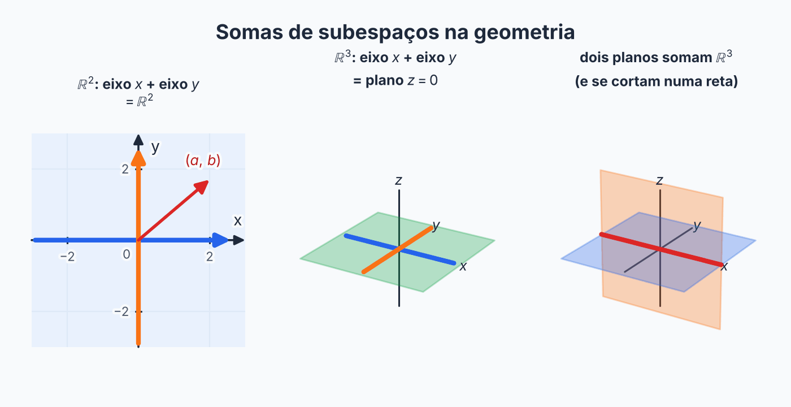

## Sobre

Se \(W_1\) e \(W_2\) são subespaços de \(V\), dá para criar dois subespaços novos a partir deles:

- a **interseção** \(W_1 \cap W_2\): os vetores que estão **nos dois** ao mesmo tempo;
- a **soma** \(W_1 + W_2\): tudo o que dá para formar **pegando um vetor de cada** e somando.

Aqui aparece a primeira pergunta "de engenharia" do curso: *dado \(W_1\) e \(W_2\), qual é uma base da interseção e da soma?* A resposta depende de **como** os subespaços foram dados (por equações ou por geradores), e a página mostra as duas situações.

## A soma

$$
W_1 + W_2 = \{\, w_1 + w_2 \;\mid\; w_1 \in W_1 \text{ e } w_2 \in W_2 \,\}.
$$

Leia: "os vetores que se escrevem como (um vetor de \(W_1\)) + (um vetor de \(W_2\))".

**Por que não usar a união?** A união \(W_1 \cup W_2\) em geral não é subespaço (página anterior). A soma é o **menor subespaço que contém os dois**: ela é a "união já consertada", acrescentando todas as somas que faltavam.

A soma sempre é subespaço: se \(u = w_1 + w_2\) e \(u' = w'_1 + w'_2\), então \(u + u' = (w_1 + w'_1) + (w_2 + w'_2)\), com a primeira parte em \(W_1\) e a segunda em \(W_2\). O escalar é parecido.

## Exemplos para enxergar

**Exemplo 1.** Em \(\mathbb{R}^2\), sejam \(W_1\) o eixo \(x\) (vetores \((a, 0)\)) e \(W_2\) o eixo \(y\) (vetores \((0, b)\)). Então \((a, 0) + (0, b) = (a, b)\), que é qualquer vetor de \(\mathbb{R}^2\). Logo \(W_1 + W_2 = \mathbb{R}^2\).

**Exemplo 2.** Em \(\mathbb{R}^3\), sejam \(W_1\) o eixo \(x\) e \(W_2\) o eixo \(y\). A soma é o plano \(z = 0\) (todos os \((a, b, 0)\)).

**Exemplo 3.** Em \(\mathbb{R}^3\), dois planos diferentes pela origem. Eles se encontram numa reta (a interseção), e a soma é o \(\mathbb{R}^3\) inteiro.

## Como calcular na prática

### Interseção: junte as equações

A interseção são os vetores que passam em **todos os filtros dos dois subespaços ao mesmo tempo**. Então, se \(W_1\) e \(W_2\) vêm por equações, **junte as equações** e resolva o sistema.

**Exemplo 4.** Em \(\mathbb{R}^3\), \(W_1 = \{x + y + z = 0\}\) e \(W_2 = \{x = y\}\).

Juntando: \(x + y + z = 0\) e \(x = y\). Substituindo \(y = x\) na primeira: \(2x + z = 0\), então \(z = -2x\). Os vetores são

$$
(x, x, -2x) = x \cdot (1, 1, -2).
$$

Uma base de \(W_1 \cap W_2\) é \(\{(1, 1, -2)\}\), e \(\dim(W_1 \cap W_2) = 1\).

### Interseção quando um subespaço vem por parâmetros

Nas provas é muito comum um subespaço vir por **equações** e o outro por uma **fórmula com letras**, como \(W_2 = \{(a + b,\; a,\; a - b,\; b)\}\). Juntar equações não funciona, porque \(W_2\) não tem equações. A saída é **substituir**:

1. Pegue o **vetor genérico** do subespaço dado por parâmetros.
2. **Substitua** as coordenadas dele nas equações do outro subespaço.
3. Resolva em função dos parâmetros: sai uma condição (ou mais).
4. Escreva o vetor genérico **com a condição aplicada** e separe por parâmetro livre.

**Exemplo 4b.** Em \(\mathbb{R}^4\), \(W_1 = \{(x, y, z, t) \mid x = z + t\}\) e \(W_2 = \{(a + b,\; a,\; a - b,\; b) \mid a, b \in \mathbb{R}\}\).

O vetor genérico de \(W_2\) tem \(x = a + b\), \(y = a\), \(z = a - b\), \(t = b\). A equação de \(W_1\) pede \(x = z + t\):

$$
a + b = (a - b) + b = a \;\Longrightarrow\; b = 0.
$$

Com \(b = 0\), o vetor fica \((a, a, a, 0) = a\,(1, 1, 1, 0)\). Então

$$
W_1 \cap W_2 = [(1, 1, 1, 0)], \qquad \dim(W_1 \cap W_2) = 1.
$$

Para a soma, falta contar as dimensões: \(W_1\) tem uma equação em \(\mathbb{R}^4\), então \(\dim W_1 = 3\); \(W_2\) tem geradores \((1,1,1,0)\) e \((1,0,-1,1)\), que não são múltiplos, então \(\dim W_2 = 2\). Pela fórmula,

$$
\dim(W_1 + W_2) = 3 + 2 - 1 = 4,
$$

então \(W_1 + W_2 = \mathbb{R}^4\), mas **não é soma direta**, porque a interseção não é \(\{0\}\).

**Quando os dois vêm por parâmetros.** Se \(W_1 = [u_1, u_2]\) e \(W_2 = [w_1, w_2]\), um vetor da interseção satisfaz

$$
a\,u_1 + b\,u_2 = c\,w_1 + d\,w_2,
$$

que é um sistema homogêneo em \(a, b, c, d\). Resolva e escreva o vetor \(a\,u_1 + b\,u_2\) com os valores achados. Se os geradores de cada subespaço são LI, o número de variáveis livres do sistema é a dimensão da interseção.

> [!TIP]
> **Base da soma por parâmetros:** junte todos os geradores como **colunas**, escalone e use as colunas com pivô (veja "Base contida no conjunto dado", na página de Base e Dimensão). A quantidade de pivôs é \(\dim(W_1 + W_2)\) e serve para conferir a fórmula.

> [!TIP]
> **Propriedades também são equações.** Um subespaço descrito por uma palavra, como "matrizes simétricas", entra na conta depois de traduzido. Em \(\begin{bmatrix} x & y \\ z & t \end{bmatrix}\), simétrica quer dizer \(A = A^T\), ou seja, **\(y = z\)**. A partir daí é "juntar as equações" com as do outro subespaço (veja a Prova da Tarde, Questão 4, em [Provas Resolvidas](../provas-resolvidas/)).

### Soma: junte os geradores

A soma é formada por \(w_1 + w_2\). Se \(W_1 = [a_1, \ldots, a_p]\) e \(W_2 = [b_1, \ldots, b_q]\), então todo elemento da soma é combinação de \(a_1, \ldots, a_p, b_1, \ldots, b_q\). Então **junte os geradores**: \(W_1 + W_2 = [a_1, \ldots, a_p, b_1, \ldots, b_q]\).

Esse conjunto gera, mas pode ter vetores a mais. Para tirar os que sobram, **escalone**: coloque os vetores como **linhas** de uma matriz, escalone e as linhas **não nulas** que restarem formam uma base (e a quantidade delas é a dimensão).

**Exemplo 5.** Continuando o Exemplo 4. Primeiro ache geradores de cada um (isolando variáveis):

- \(W_1\): \(z = -x - y\), então \((x, y, -x - y) = x(1, 0, -1) + y(0, 1, -1)\).
- \(W_2\): \((x, x, z) = x(1, 1, 0) + z(0, 0, 1)\).

Juntando e escalonando as linhas:

$$
\begin{bmatrix} 1 & 0 & -1 \\ 0 & 1 & -1 \\ 1 & 1 & 0 \\ 0 & 0 & 1 \end{bmatrix}
\;\xrightarrow{L_3 \to L_3 - L_1 - L_2}\;
\begin{bmatrix} 1 & 0 & -1 \\ 0 & 1 & -1 \\ 0 & 0 & 2 \\ 0 & 0 & 1 \end{bmatrix}
\;\xrightarrow{L_3 \to L_3 - 2L_4}\;
\begin{bmatrix} 1 & 0 & -1 \\ 0 & 1 & -1 \\ 0 & 0 & 0 \\ 0 & 0 & 1 \end{bmatrix}.
$$

Sobram 3 linhas não nulas, então \(\dim(W_1 + W_2) = 3\) e \(W_1 + W_2 = \mathbb{R}^3\).

### A fórmula da dimensão

Em vez de escalonar, muitas vezes dá para usar:

$$
\dim(W_1 + W_2) = \dim W_1 + \dim W_2 - \dim(W_1 \cap W_2).
$$

No Exemplo 5: \(2 + 2 - 1 = 3\). ✓

O que a fórmula diz em palavras: ao somar as dimensões, a interseção foi contada duas vezes, então tira-se uma vez.

> [!TIP]
> **Ordem de ataque** quando o enunciado pede base e dimensão de \(W_1 \cap W_2\) e \(W_1 + W_2\): (1) ache a **interseção** juntando equações; (2) ache as dimensões de \(W_1\) e \(W_2\); (3) use a **fórmula** para a soma; (4) se precisar de uma base da soma, junte geradores e escalone.

## Soma direta

Às vezes, **cada vetor da soma se escreve de um único jeito** como \(w_1 + w_2\). Nesse caso a soma é chamada de **soma direta**, e se escreve \(W_1 \oplus W_2\).

**Teorema.** \(W_1 + W_2\) é soma direta se, e somente se, \(W_1 \cap W_2 = \{0\}\).

**Por quê?** Se existisse um vetor \(z \neq 0\) na interseção, o vetor \(0\) poderia ser escrito de dois jeitos: \(0 = 0 + 0\) e \(0 = z + (-z)\). Perder a unicidade é exatamente ter interseção maior que \(\{0\}\). E se a interseção é só \(\{0\}\), duas escritas \(w_1 + w_2 = w'_1 + w'_2\) dão \(w_1 - w'_1 = w'_2 - w_2\), que está nos dois subespaços, então vale \(0\), e as duas escritas coincidem.

**Quando \(V = W_1 \oplus W_2\)?** Quando duas coisas acontecem:

1. \(W_1 + W_2 = V\) (juntos eles geram tudo);
2. \(W_1 \cap W_2 = \{0\}\) (sem sobreposição).

Em dimensão, isso é o mesmo que \(\dim W_1 + \dim W_2 = \dim V\) com interseção \(\{0\}\).

## Exemplos de soma direta

**Exemplo 6.** Em \(\mathbb{R}^3\), \(W_1 = [(1, 0, 0)]\) e \(W_2 = [(1, 1, 0), (0, 1, 1)]\).

Os três vetores \((1,0,0)\), \((1,1,0)\) e \((0,1,1)\) formam a matriz de linhas

$$
\begin{bmatrix} 1 & 0 & 0 \\ 1 & 1 & 0 \\ 0 & 1 & 1 \end{bmatrix}
\quad\text{com determinante } 1 \cdot (1 \cdot 1 - 0 \cdot 1) = 1 \neq 0.
$$

Determinante diferente de zero quer dizer que os três são LI, então geram \(\mathbb{R}^3\) (dimensão 3). Logo \(W_1 + W_2 = \mathbb{R}^3\). Pela fórmula, \(3 = 1 + 2 - \dim(W_1 \cap W_2)\), então \(\dim(W_1 \cap W_2) = 0\), ou seja, a interseção é \(\{0\}\). Portanto \(\mathbb{R}^3 = W_1 \oplus W_2\).

**A unicidade na prática.** Qualquer \(v = (a, b, c)\) se escreve como \(x(1,0,0) + s(1,1,0) + r(0,1,1)\), com

$$
r = c, \qquad s = b - c, \qquad x = a - b + c.
$$

Por exemplo, \((4, 3, 1) = 2(1,0,0) + 2(1,1,0) + 1(0,1,1)\), ou seja, \(w_1 = (2, 0, 0)\) e \(w_2 = (2, 3, 1)\). Essa decomposição é a **única**.

**Exemplo 7.** Em \(\mathbb{R}^4\), \(W_1 = \{(x, y, z, t) \mid x + y = 0 \text{ e } z = t\}\) e \(W_2 = \{(x, y, z, t) \mid x = y \text{ e } z + t = 0\}\).

*Interseção:* juntando as quatro equações, \(x + y = 0\) e \(x = y\) dão \(x = y = 0\); \(z = t\) e \(z + t = 0\) dão \(z = t = 0\). Só sobra o vetor nulo, então \(W_1 \cap W_2 = \{0\}\).

*Dimensões:* \(W_1 = [(1,-1,0,0), (0,0,1,1)]\) e \(W_2 = [(1,1,0,0), (0,0,1,-1)]\), ambos de dimensão 2.

*Soma:* \(\dim(W_1 + W_2) = 2 + 2 - 0 = 4 = \dim \mathbb{R}^4\). Logo \(\mathbb{R}^4 = W_1 \oplus W_2\).

**Exemplo 8: soma que não é direta.** No Exemplo 4, \(W_1 \cap W_2 = [(1, 1, -2)] \neq \{0\}\). A soma é \(\mathbb{R}^3\), mas **não** é direta. Por exemplo, o vetor \((1, 1, -2)\) se escreve como \((1, 1, -2) + 0\) e também como \(0 + (1, 1, -2)\).

> [!NOTE]
> Se \(W_1 + W_2 = V\) mas a interseção não é \(\{0\}\), você pode escrever **\(V = W_1 + W_2\)**, e não \(V = W_1 \oplus W_2\). O símbolo \(\oplus\) só pode ser usado quando a interseção é \(\{0\}\).

## Resumo

| Quero... | Faço... |
| --- | --- |
| \(W_1 \cap W_2\) (subespaços por equações) | juntar as equações e resolver |
| \(W_1 \cap W_2\) (um deles por parâmetros) | substituir o vetor genérico nas equações do outro |
| \(W_1 + W_2\) (subespaços por geradores) | juntar os geradores e escalonar |
| \(\dim(W_1 + W_2)\) | \(\dim W_1 + \dim W_2 - \dim(W_1 \cap W_2)\) |
| saber se \(V = W_1 + W_2\) | ver se \(\dim(W_1 + W_2) = \dim V\) |
| saber se a soma é direta | ver se \(W_1 \cap W_2 = \{0\}\) |
| saber se \(V = W_1 \oplus W_2\) | as duas condições acima |

## Exercícios

**Exercício 1.** Em \(\mathbb{R}^3\), \(W_1 = \{(x, y, z) \mid x + y - z = 0\}\) e \(W_2 = \{(x, y, z) \mid x = y\}\). Ache uma base e a dimensão de \(W_1 \cap W_2\) e de \(W_1 + W_2\). \(\mathbb{R}^3 = W_1 \oplus W_2\)?


**Passo 1: a interseção (juntar as equações).**

$$
\begin{cases} x + y - z = 0 \\ x = y \end{cases}
$$

Com \(y = x\), a primeira vira \(2x - z = 0\), ou seja, \(z = 2x\). Os vetores da interseção são

$$
(x, x, 2x) = x\,(1, 1, 2).
$$

**Base de \(W_1 \cap W_2\):** \(\{(1, 1, 2)\}\), e \(\dim(W_1 \cap W_2) = 1\).

**Passo 2: as dimensões de \(W_1\) e \(W_2\).**

Cada um tem uma equação em \(\mathbb{R}^3\), então 2 variáveis livres:

$$
\dim W_1 = 2, \qquad \dim W_2 = 2.
$$

**Passo 3: a soma (fórmula).**

$$
\dim(W_1 + W_2) = 2 + 2 - 1 = 3.
$$

Como \(\dim \mathbb{R}^3 = 3\), temos \(W_1 + W_2 = \mathbb{R}^3\).

**Base de \(W_1 + W_2\):** qualquer 3 vetores LI. Por exemplo, juntando geradores de \(W_1\) (\((1,0,1)\), \((0,1,1)\)) e de \(W_2\) (\((1,1,0)\)):

$$
\{(1, 0, 1),\; (0, 1, 1),\; (1, 1, 0)\}.
$$

**Passo 4: soma direta?**

A interseção tem dimensão 1, então não é \(\{0\}\).

**Conclusão.** \(\mathbb{R}^3 = W_1 + W_2\), mas **não** é soma direta.


**Exercício 2.** Em \(\mathbb{R}^3\), \(W_1 = [(1, 0, 0)]\) e \(W_2 = [(0, 1, 0), (0, 0, 1)]\). Mostre que \(\mathbb{R}^3 = W_1 \oplus W_2\).


**Passo 1: a soma gera tudo.**

Juntando os geradores, sai a base canônica de \(\mathbb{R}^3\):

$$
(1,0,0),\; (0,1,0),\; (0,0,1).
$$

Logo \(W_1 + W_2 = \mathbb{R}^3\).

**Passo 2: a interseção é só o zero.**

$$
\dim(W_1 \cap W_2) = \dim W_1 + \dim W_2 - \dim(W_1 + W_2) = 1 + 2 - 3 = 0.
$$

**Conclusão.** A soma é \(\mathbb{R}^3\) e a interseção é \(\{0\}\), então \(\mathbb{R}^3 = W_1 \oplus W_2\). ∎


**Exercício 3.** Em \(M(2,2)\), seja \(S\) o subespaço das matrizes simétricas e \(A\) o das antissimétricas. Mostre que \(M(2,2) = S \oplus A\).


**Passo 1: a interseção é só o zero.**

Se \(M\) está nos dois, vale \(M^T = M\) e \(M^T = -M\). Então

$$
M = -M \;\Longrightarrow\; 2M = 0 \;\Longrightarrow\; M = 0.
$$

**Passo 2: a soma é tudo.**

Toda matriz \(M\) se escreve como

$$
M = \underbrace{\frac{M + M^T}{2}}_{\text{simétrica}} + \underbrace{\frac{M - M^T}{2}}_{\text{antissimétrica}}.
$$

**Conclusão.** \(S + A = M(2,2)\) e \(S \cap A = \{0\}\), então a soma é direta. ∎


**Exercício 4.** Em \(\mathbb{R}^2\), \(W_1 = [(1, 0)]\) e \(W_2 = [(2, 0)]\). Qual é \(W_1 + W_2\)? A soma é direta?


**Passo 1: o que são \(W_1\) e \(W_2\).**

\((2, 0) = 2(1, 0)\), então os dois são o **mesmo eixo \(x\)**.

**Passo 2: a soma.**

$$
W_1 + W_2 = \text{eixo } x, \qquad \dim = 1 \;(\text{não é } \mathbb{R}^2).
$$

**Passo 3: a interseção.**

\(W_1 \cap W_2\) é o eixo \(x\) inteiro, que não é \(\{0\}\).

**Conclusão.** A soma é o eixo \(x\) e **não** é direta.


**Exercício 5.** Em \(M(2,2)\), \(W_1 = \left\{\begin{bmatrix} x & y \\ z & t \end{bmatrix} \;\mid\; x = t \text{ e } y = z\right\}\) e \(W_2 = \left\{\begin{bmatrix} a & a + b \\ 0 & b \end{bmatrix} \;\mid\; a, b \in \mathbb{R}\right\}\). Determine \(W_1 \cap W_2\), \(\dim(W_1 + W_2)\) e diga se a soma é direta.


**Passo 1: substituir o vetor genérico de \(W_2\) nas equações de \(W_1\).**

Em \(W_2\): \(x = a\), \(y = a + b\), \(z = 0\), \(t = b\).

- \(x = t\) vira \(a = b\);
- \(y = z\) vira \(a + b = 0\).

Da segunda, \(b = -a\). Juntando com \(a = b\): \(a = -a\), então \(a = 0\) e \(b = 0\).

**Passo 2: a interseção.** Só sobra a matriz nula, então \(W_1 \cap W_2 = \{0\}\).

**Passo 3: as dimensões.**

- \(W_1\): \(\begin{bmatrix} x & y \\ y & x \end{bmatrix} = x\begin{bmatrix} 1 & 0 \\ 0 & 1 \end{bmatrix} + y\begin{bmatrix} 0 & 1 \\ 1 & 0 \end{bmatrix}\), então \(\dim W_1 = 2\).
- \(W_2\): \(a\begin{bmatrix} 1 & 1 \\ 0 & 0 \end{bmatrix} + b\begin{bmatrix} 0 & 1 \\ 0 & 1 \end{bmatrix}\); os dois geradores não são múltiplos, então \(\dim W_2 = 2\).

**Passo 4: a soma.**

$$
\dim(W_1 + W_2) = 2 + 2 - 0 = 4 = \dim M(2,2).
$$

**Conclusão.** \(W_1 + W_2 = M(2,2)\) e a interseção é \(\{0\}\), então a soma **é direta**: \(M(2,2) = W_1 \oplus W_2\).


## Teste rápido




Se \(\dim W_1 = 3\), \(\dim W_2 = 2\) e \(\dim(W_1 \cap W_2) = 1\), quanto vale \(\dim(W_1 + W_2)\)?

- [ ] 6
- [ ] 5
- [x] 4
- [ ] 3
---
\(\dim(W_1 + W_2) = 3 + 2 - 1 = 4\). A interseção foi contada duas vezes, então tira-se uma vez.



Para \(V = W_1 \oplus W_2\), precisa valer:

- [ ] \(W_1 \cap W_2 = V\)
- [ ] \(W_1 + W_2 = \{0\}\)
- [x] \(W_1 + W_2 = V\) e \(W_1 \cap W_2 = \{0\}\)
- [ ] \(\dim W_1 = \dim W_2\)
---
A soma direta exige as duas coisas: juntos geram tudo e não têm nada em comum além do zero.



Para achar \(W_1 \cap W_2\) quando os dois são dados por equações, você...

- [ ] soma os geradores
- [x] junta todas as equações e resolve o sistema
- [ ] subtrai as dimensões
- [ ] testa só o vetor nulo
---
Estar na interseção é passar nos filtros dos dois subespaços ao mesmo tempo, então basta juntar as equações.



\(W_1\) é dado por equações e \(W_2\) por parâmetros \((a, b)\). Para achar \(W_1 \cap W_2\), você...

- [ ] soma os geradores dos dois
- [x] substitui o vetor genérico de \(W_2\) nas equações de \(W_1\) e resolve em função de \(a\) e \(b\)
- [ ] subtrai as dimensões
- [ ] junta as equações dos dois, que \(W_2\) já tem
---
\(W_2\) não tem equações. Um vetor está na interseção quando é da forma de \(W_2\) **e** passa nas equações de \(W_1\), então se substitui.



