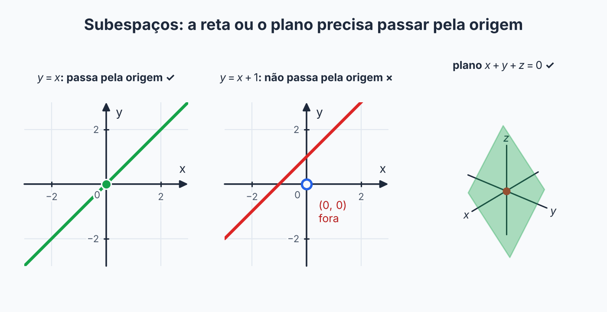

## Sobre

Conferir as 8 regras toda vez que aparece um conjunto novo seria cansativo. Existe um atalho: se o conjunto que você quer estudar **está dentro de um espaço vetorial que você já conhece**, as contas herdam quase tudo do espaço maior. Sobram só **três verificações**.

Um **subespaço** de \(V\) é um subconjunto \(W \subset V\) que, com as mesmas operações de \(V\), também é um espaço vetorial. É um "espaço vetorial morando dentro de outro".

## O teste dos 3 passos

Seja \(V\) um espaço vetorial e \(W \subset V\). Então \(W\) é subespaço de \(V\) se, e somente se:

1. \(0 \in W\) (o vetor nulo está em \(W\));
2. se \(u, v \in W\), então \(u + v \in W\) (**fecha na soma**);
3. se \(u \in W\) e \(\alpha \in \mathbb{R}\), então \(\alpha u \in W\) (**fecha no escalar**).

**Por que só isso basta?** As regras 1, 2, 5, 6, 7 e 8 são só igualdades de contas, e elas já valem em \(V\), logo valem também dentro de \(W\). As regras 3 e 4 (vetor nulo e oposto) vêm dos passos acima: o nulo está pelo passo 1 e o oposto \(-u = (-1)u\) está pelo passo 3.

> [!TIP]
> **Comece sempre pelo passo 1.** Se \(0 \notin W\), acabou: \(W\) não é subespaço, sem precisar de mais nada. É o jeito mais rápido de descartar um conjunto. (Se \(0 \in W\), ainda falta conferir os passos 2 e 3.)

Todo espaço vetorial \(V\) tem pelo menos dois subespaços, chamados **triviais**: o próprio \(V\) e o conjunto \(\{0\}\).

## Entendendo o que vem depois da barra

A dificuldade mais comum nesse assunto não é a prova em si, é **ler o enunciado**. Releia a notação:

$$
W = \{\,(x, y, z) \in \mathbb{R}^3 \;\mid\; x - 3z = 0\,\}
$$

A barra \(\mid\) lê-se "tais que". O que vem depois dela é o **filtro**. Então:

> **Pertencer a \(W\) = estar no espaço grande (\(\mathbb{R}^3\)) + passar no filtro (\(x - 3z = 0\)).**

Por exemplo, \((6, 5, 2)\) está em \(W\) porque \(6 - 3 \cdot 2 = 0\). Já \((1, 1, 1)\) não está, porque \(1 - 3 = -2 \neq 0\).

Toda prova de subespaço se resume a **jogar vetores no filtro**:

- **Passo 1:** o vetor nulo passa no filtro?
- **Passo 2:** se \(u\) e \(v\) passam, \(u + v\) passa?
- **Passo 3:** se \(u\) passa, \(\alpha u\) passa?

## Dois tipos de justificativa

O erro mais comum é usar números quando deveria usar letras, ou o contrário. A regra é:

| Você quer mostrar que... | Use | Por quê |
| --- | --- | --- |
| **é** subespaço | **letras genéricas**, nunca números | precisa valer para **todos** os elementos |
| **não é** subespaço | **um exemplo com números** (contraexemplo) | basta **um** caso que falha |

Testar com números e ver que funcionou **não prova** que é subespaço: o próximo número pode falhar. E, ao contrário, um único número que falha **derruba** o conjunto.

## Provando que É subespaço

Receita fixa, sempre igual. Anote este esquema de três linhas:

> **Hipótese:** escreva o que \(u\) e \(v\) satisfazem (eles estão em \(W\), então passam no filtro).
> **Vetor:** escreva o vetor que você quer testar (\(u + v\) ou \(\alpha u\)).
> **Conferindo o filtro:** substitua no filtro e **use a hipótese** para concluir.

**Exemplo 1.** \(W = \{(x, y, z) \in \mathbb{R}^3 \mid 2x - y + z = 0\}\).

*Passo 1.* \((0, 0, 0)\): \(2 \cdot 0 - 0 + 0 = 0\). ✓

*Passo 2.* Sejam \(u = (x_1, y_1, z_1)\) e \(v = (x_2, y_2, z_2)\) em \(W\).

- Hipótese: \(2x_1 - y_1 + z_1 = 0\) e \(2x_2 - y_2 + z_2 = 0\).
- Vetor: \(u + v = (x_1 + x_2,\; y_1 + y_2,\; z_1 + z_2)\).
- Conferindo o filtro:

$$
2(x_1 + x_2) - (y_1 + y_2) + (z_1 + z_2) = \underbrace{(2x_1 - y_1 + z_1)}_{0} + \underbrace{(2x_2 - y_2 + z_2)}_{0} = 0. \;✓
$$

*Passo 3.* Sejam \(u = (x_1, y_1, z_1) \in W\) e \(\alpha \in \mathbb{R}\). Então \(\alpha u = (\alpha x_1, \alpha y_1, \alpha z_1)\) e

$$
2(\alpha x_1) - (\alpha y_1) + (\alpha z_1) = \alpha \underbrace{(2x_1 - y_1 + z_1)}_{0} = 0. \;✓
$$

O truque de toda a prova é **agrupar os termos até reconhecer a expressão do filtro, que você já sabe que vale 0**.

**Exemplo 2: filtro com duas condições.** \(W = \{(x, y, z, t) \in \mathbb{R}^4 \mid x - y = 0 \text{ e } z + t = 0\}\).

O vetor tem que passar nas **duas** condições, então você confere as duas em cada passo.

*Passo 1.* \((0,0,0,0)\): \(0 - 0 = 0\) e \(0 + 0 = 0\). ✓

*Passo 2.* Hipótese: \(x_1 = y_1\), \(z_1 + t_1 = 0\), \(x_2 = y_2\), \(z_2 + t_2 = 0\). O vetor \(u + v\) tem coordenadas \((x_1 + x_2,\; y_1 + y_2,\; z_1 + z_2,\; t_1 + t_2)\). Conferindo:

- \((x_1 + x_2) - (y_1 + y_2) = (x_1 - y_1) + (x_2 - y_2) = 0 + 0 = 0\). ✓
- \((z_1 + z_2) + (t_1 + t_2) = (z_1 + t_1) + (z_2 + t_2) = 0 + 0 = 0\). ✓

*Passo 3.* Para \(\alpha u = (\alpha x_1, \alpha y_1, \alpha z_1, \alpha t_1)\): \(\alpha x_1 - \alpha y_1 = \alpha(x_1 - y_1) = 0\) e \(\alpha z_1 + \alpha t_1 = \alpha(z_1 + t_1) = 0\). ✓

**Exemplo 3: matrizes.** \(W = \left\{\begin{bmatrix} a & b \\ c & d \end{bmatrix} \in M(2,2) \;\mid\; a = d \text{ e } b = -c\right\}\).

Sejam \(u = \begin{bmatrix} a_1 & b_1 \\ c_1 & d_1 \end{bmatrix}\) e \(v = \begin{bmatrix} a_2 & b_2 \\ c_2 & d_2 \end{bmatrix}\) em \(W\). Hipótese: \(a_1 = d_1\), \(b_1 = -c_1\), \(a_2 = d_2\), \(b_2 = -c_2\).

Em \(u + v\), os "novos" \(a\), \(b\), \(c\), \(d\) são \(a_1 + a_2\), \(b_1 + b_2\), \(c_1 + c_2\), \(d_1 + d_2\). Conferindo:

- \(a_1 + a_2 = d_1 + d_2\), somando duas igualdades. ✓
- \(b_1 + b_2 = -c_1 - c_2 = -(c_1 + c_2)\). ✓

O escalar é igual: multiplique as duas igualdades por \(\alpha\). O vetor nulo (matriz de zeros) passa. Logo \(W\) é subespaço.

**Exemplo 4: simétricas.** \(W = \{A \in M(2,2) \mid A = A^T\}\). Se \(A^T = A\) e \(B^T = B\), então \((A + B)^T = A^T + B^T = A + B\) e \((\alpha A)^T = \alpha A^T = \alpha A\). A matriz nula também é simétrica. ✓

### Atalho: o teorema do "igual a zero"

Repare que nos Exemplos 1 e 2 a conta foi sempre a mesma. Dá para provar **uma vez só** o caso geral:

> Todo conjunto definido por equações do tipo **(combinação linear das coordenadas) = 0** é um subespaço.

Prova: se \(c_1x_1 + \cdots + c_nx_n = 0\) vale para \(u = (x_1, \ldots, x_n)\) e para \(v = (x'_1, \ldots, x'_n)\), então

$$
c_1(x_1 + x'_1) + \cdots + c_n(x_n + x'_n) = 0 + 0 = 0
\qquad\text{e}\qquad
c_1(\alpha x_1) + \cdots + c_n(\alpha x_n) = \alpha \cdot 0 = 0.
$$

Quando o seu professor aceitar esse argumento, uma justificativa de duas linhas basta. Quando pedir a prova completa, use o esquema de três linhas acima.

## Polinômios: p(0), p(1) e p(t) não são a mesma coisa

Em \(P_2\), os vetores são polinômios. A confusão mais comum é não saber o que o filtro está pedindo.

- **\(p\)** (ou \(p(t)\)) é o polinômio inteiro: é o **vetor**.
- **\(p(0)\)** e **\(p(1)\)** são **números**: o valor do polinômio quando você troca \(t\) por 0 ou por 1.

Você **não escolhe** \(p(0)\) e \(p(1)\). Eles vêm do polinômio \(p\) que você pegou. A forma mais segura é escrever \(p(t) = a + bt + ct^2\). Então:

$$
p(0) = a
\qquad
p(1) = a + b + c
\qquad
p(2) = a + 2b + 4c.
$$

**Exemplo 5.** \(W = \{p \in P_2 \mid p(1) = 2p(0)\}\).

Em coeficientes, o filtro \(p(1) = 2p(0)\) vira \(a + b + c = 2a\), ou seja, \(-a + b + c = 0\). É uma equação linear igual a zero nas coordenadas \((a, b, c)\), então **é subespaço**, pelo teorema acima.

Sem coeficientes, a prova também sai: se \(p(1) = 2p(0)\) e \(q(1) = 2q(0)\), então \((p + q)(1) = p(1) + q(1) = 2p(0) + 2q(0) = 2(p+q)(0)\) ✓ e \((\alpha p)(1) = \alpha p(1) = 2\alpha p(0) = 2(\alpha p)(0)\) ✓. O que sustenta a conta é a definição da soma de funções: \((p + q)(x) = p(x) + q(x)\).

### Quando a condição vale em um ponto e quando vale sempre

| Condição | Significa | Como traduzir |
| --- | --- | --- |
| \(p(0) = 0\), \(p(1) = 2p(0)\) | vale **só nesses pontos** | trocar \(t\) pelos pontos e usar \(a, b, c\) |
| \(p(t) = t\,p'(t)\) | vale **para todo \(t\)** | comparar coeficiente a coeficiente |

**Exemplo 6.** \(W = \{p \in P_2 \mid p(t) = t \cdot p'(t) \text{ para todo } t\}\).

Com \(p = a + bt + ct^2\) temos \(p' = b + 2ct\) e \(t\,p' = bt + 2ct^2\). Dois polinômios são iguais quando têm os **mesmos coeficientes**:

$$
a + bt + ct^2 = 0 + bt + 2ct^2
\;\Longrightarrow\;
a = 0,\quad b = b,\quad c = 2c \Rightarrow c = 0.
$$

Logo \(p = bt\): \(W\) é o conjunto dos múltiplos de \(t\), que é subespaço. (Ele é uma reta dentro de \(P_2\).)

**Exemplo 6b: o polinômio e a derivada juntos.** \(W = \{p \in P_2 \mid p(t) + p'(t) = 0 \text{ para todo } t\}\).

Com \(p = a + bt + ct^2\) e \(p' = b + 2ct\):

$$
p + p' = (a + b) + (b + 2c)\,t + c\,t^2 = 0
\;\Longrightarrow\;
c = 0,\quad b + 2c = 0,\quad a + b = 0
\;\Longrightarrow\;
a = b = c = 0.
$$

Só o polinômio nulo passa no filtro, então \(W = \{0\}\), que é subespaço (o menor de todos). Dá para concluir **sem calcular nada**: a derivada respeita soma e escalar, \((p + q)' = p' + q'\) e \((\alpha p)' = \alpha p'\). Então, se \(p + p' = 0\) e \(q + q' = 0\), também \((p + q) + (p + q)' = 0\) e \(\alpha p + (\alpha p)' = 0\). ✓

## Enxergando no plano e no espaço

Subespaço tem cara de coisa "reta e que passa pela origem":

- Os subespaços de \(\mathbb{R}^2\) são: \(\{0\}\), as **retas que passam pela origem** e o próprio \(\mathbb{R}^2\).
- Os subespaços de \(\mathbb{R}^3\) são: \(\{0\}\), as **retas pela origem**, os **planos pela origem** e o próprio \(\mathbb{R}^3\).

Uma reta como \(y = x + 1\) **não** é subespaço, porque não passa pela origem (o ponto \((0, 0)\) não satisfaz a equação). Uma parábola não é subespaço, porque é curva e não fecha na soma.

## Provando que NÃO é subespaço

Aqui basta **um** contraexemplo, e ele usa números. A estratégia:

> Pegue o elemento **mais simples** que pertence a \(W\) e pergunte: *"que operação estraga este filtro?"* Depois aplique essa operação.

| O filtro tem... | O que estraga | Contraexemplo típico |
| --- | --- | --- |
| número solto (\(x + y = 1\), \(p(0) = 1\)) | o **zero** | mostrar que \((0,0,\ldots)\) não passa |
| desigualdade (\(x \geq y\), \(a + d \leq b + c\)) | esticar por **número negativo** | elemento com folga, vezes \(-1\) |
| "\(x \in \mathbb{Z}\)" | esticar por **fração** | elemento inteiro, vezes \(\tfrac12\) |
| produto (\(xy = 0\), \(\det A = 0\)) ou quadrado (\(y = x^2\)) | **somar** dois elementos | dois elementos cuja soma sai |

**Exemplo 7: número solto.** \(W = \{(x, y, z) \mid x + y = 1\}\). O vetor nulo dá \(0 + 0 = 0 \neq 1\), então \(0 \notin W\). **Não é subespaço.**

**Exemplo 8: desigualdade.** \(W = \{(x, y, z) \mid x \geq y\}\). Tome \(u = (2, 1, 0) \in W\), pois \(2 \geq 1\). Então \((-1) \cdot u = (-2, -1, 0)\), e \(-2 \geq -1\) é falso, então \((-1)u \notin W\). **Não é subespaço.**

> [!WARNING]
> **Multiplicar por número negativo inverte a desigualdade.** Por isso desigualdades quebram, **mas só se o elemento tiver "folga"**. Se você escolher \(u = (0, 0, 0)\), que satisfaz \(0 \geq 0\), o \(-u\) continua em \(W\) e você não acha o problema. O elemento precisa ter um lado **estritamente** maior que o outro (\(2 > 1\)).

**Exemplo 9: igualdade não quebra com escalar negativo.** Em \(W = \{(x, y, z) \mid x = y\}\), multiplicar por \(-3\) mantém \(x = y\), porque você multiplica os **dois lados** pelo mesmo número. Por isso **igualdade** com número negativo não derruba nada. O que você precisa conferir é a soma e, aqui, ela fecha (\(x_1 + x_2 = y_1 + y_2\)). **É subespaço.**

**Exemplo 10: produto.** \(W = \{(x, y) \mid xy = 0\}\) (os dois eixos). \((1, 0) \in W\) e \((0, 1) \in W\), mas \((1, 0) + (0, 1) = (1, 1)\) e \(1 \cdot 1 = 1 \neq 0\). **Não é subespaço** (não fecha na soma).

**Exemplo 11: determinante.** \(W = \{A \in M(2,2) \mid \det A = 0\}\). As matrizes \(\begin{bmatrix} 1 & 0 \\ 0 & 0 \end{bmatrix}\) e \(\begin{bmatrix} 0 & 0 \\ 0 & 1 \end{bmatrix}\) têm determinante 0, mas a soma é a identidade, com determinante 1. **Não é subespaço.**

**Exemplo 12: desigualdade em matrizes.** \(W = \left\{\begin{bmatrix} a & b \\ c & d \end{bmatrix} \mid a + d \leq b + c\right\}\). Escolha uma matriz com folga: \(a = 0, b = 1, c = 0, d = 0\) satisfaz \(0 \leq 1\). Multiplicando por \(-1\): \(b = -1\), e fica \(0 \leq -1\), que é falso. **Não é subespaço.**

**Exemplo 13: o zero passa, e mesmo assim não é.** \(U = \{(x, y, z, t) \in \mathbb{R}^4 \mid t = xz\}\).

O vetor nulo passa (\(0 = 0 \cdot 0\)), então esse teste não derruba nada. Mas o filtro tem um **produto** de coordenadas, e produto costuma quebrar. Pegue um elemento simples, \(u = (1, 0, 1, 1)\) (vale, pois \(1 = 1 \cdot 1\)), e multiplique por 2:

$$
2u = (2, 0, 2, 2), \qquad xz = 2 \cdot 2 = 4 \neq 2 = t.
$$

\(2u \notin U\): não fecha no escalar. **Não é subespaço.** (A soma também falha: \((1, 0, 0, 0)\) e \((0, 0, 1, 0)\) estão em \(U\), mas a soma \((1, 0, 1, 0)\) tem \(xz = 1 \neq 0 = t\).)

> [!WARNING]
> Passar no teste do zero **não prova** que é subespaço. Ele só serve para derrubar quando **falha**. O mesmo vale para qualquer filtro com quadrado, como \(z = x^2 + y\): o zero passa, mas \(u = (1, 0, 1)\) está no conjunto e \(2u = (2, 0, 2)\) não (\(4 \neq 2\)).

**Exemplo 14: número solto em matrizes.** \(W = \left\{\begin{bmatrix} a & b \\ c & d \end{bmatrix} \mid b = c + 1\right\}\).

A matriz nula tem \(b = 0\) e \(c + 1 = 1\), e \(0 \neq 1\). Então \(0 \notin W\). **Não é subespaço.** Repare na diferença para \(b = c\) (matrizes simétricas), que **é** subespaço: o \(+1\) é o que tira o zero do conjunto.

## Receita para decidir

1. **Teste o zero.** Se não passa, acabou: não é subespaço.
2. Olhe o filtro:
   - **Só igualdades lineares "= 0"** (\(x - 3z = 0\), \(A = A^T\), \(p(0) = 0\)): provavelmente **é**. Prove com letras.
   - **Desigualdade, "\(\in \mathbb{Z}\)", número solto, produto ou quadrado**: provavelmente **não é**. Ache o contraexemplo.

## Interseção e união

- A **interseção** de dois subespaços é sempre um subespaço. Quem passa nos dois filtros passa no filtro "junto", e as contas de soma e escalar continuam valendo.
- A **união** de dois subespaços **em geral não é** subespaço. Os eixos \(x\) e \(y\) são subespaços de \(\mathbb{R}^2\), mas \((1, 0) + (0, 1) = (1, 1)\) não está em nenhum dos dois.

A união ser subespaço só acontece quando um dos dois está dentro do outro.

## Erros comuns

- **Provar com números que "é" subespaço.** Não prova nada. Use letras.
- **Esquecer de usar a hipótese.** Na soma, você precisa dizer que \(u\) e \(v\) estão em \(W\), e usar isso na conta. Sem isso, a prova não fecha.
- **Conferir só uma das condições** quando o filtro tem "e" (duas condições).
- **Achar que "multiplicar por \(-1\)" derruba qualquer conjunto.** Só derruba quando há desigualdade com folga.
- **Confundir \(p(0)\) com o polinômio.** \(p(0)\) é um número; \(p\) é o vetor.
- **Parar no teste do zero.** Se o zero passa, ainda falta provar a soma e o escalar (ou achar o contraexemplo).

## Exercícios

**Exercício 1.** Prove que \(W = \{(x, y, z) \in \mathbb{R}^3 \mid x = 2y\}\) é subespaço.


**Passo 1: o filtro.** Um vetor \((x, y, z)\) está em \(W\) quando \(x = 2y\).

**Passo 2: o vetor nulo.**

$$
(0, 0, 0): \quad 0 = 2 \cdot 0. \;✓
$$

**Passo 3: a soma.**

- Hipótese: \(x_1 = 2y_1\) e \(x_2 = 2y_2\).
- Vetor: \(u + v = (x_1 + x_2,\; y_1 + y_2,\; z_1 + z_2)\).
- Conferindo o filtro:

$$
x_1 + x_2 = 2y_1 + 2y_2 = 2(y_1 + y_2). \;✓
$$

**Passo 4: o escalar.**

- Hipótese: \(x_1 = 2y_1\).
- Vetor: \(\alpha u = (\alpha x_1,\; \alpha y_1,\; \alpha z_1)\).
- Conferindo o filtro:

$$
\alpha x_1 = \alpha(2y_1) = 2(\alpha y_1). \;✓
$$

**Conclusão.** Os três passos valem, então \(W\) é subespaço.


**Exercício 2.** \(W = \{(x, y, z) \in \mathbb{R}^3 \mid x + y + z = 1\}\) é subespaço?


**Passo 1: testar o vetor nulo.**

$$
(0, 0, 0): \quad 0 + 0 + 0 = 0
$$

**Passo 2: comparar com o filtro.**

O filtro exige \(x + y + z = 1\), e o resultado foi \(0 \neq 1\).

**Conclusão.** \((0, 0, 0) \notin W\), então \(W\) **não** é subespaço.


**Exercício 3.** Prove que as matrizes antissimétricas \(W = \{A \in M(2,2) \mid A^T = -A\}\) formam subespaço.


**Passo 1: o vetor nulo.**

$$
0^T = 0 = -0. \;✓
$$

**Passo 2: a soma.**

- Hipótese: \(A^T = -A\) e \(B^T = -B\).
- Conferindo o filtro em \(A + B\):

$$
(A + B)^T = A^T + B^T = -A - B = -(A + B). \;✓
$$

**Passo 3: o escalar.**

- Hipótese: \(A^T = -A\).
- Conferindo o filtro em \(\alpha A\):

$$
(\alpha A)^T = \alpha A^T = \alpha(-A) = -(\alpha A). \;✓
$$

**Conclusão.** \(W\) é subespaço.


**Exercício 4.** Prove que \(W = \{p \in P_2 \mid p(2) = 0\}\) é subespaço.


**Passo 1: o vetor nulo.**

O polinômio nulo vale 0 em qualquer ponto, então \(0(2) = 0\). ✓

**Passo 2: a soma.**

- Hipótese: \(p(2) = 0\) e \(q(2) = 0\).
- Conferindo o filtro em \(p + q\):

$$
(p + q)(2) = p(2) + q(2) = 0 + 0 = 0. \;✓
$$

**Passo 3: o escalar.**

$$
(\alpha p)(2) = \alpha \cdot p(2) = \alpha \cdot 0 = 0. \;✓
$$

**Conclusão.** \(W\) é subespaço.

*Outro jeito:* com \(p = a + bt + ct^2\), o filtro vira \(a + 2b + 4c = 0\), uma equação linear igual a zero.


**Exercício 5.** \(W = \{(x, y) \in \mathbb{R}^2 \mid |x| = |y|\}\) é subespaço?


**Passo 1: o zero passa?** \(|0| = |0|\). Sim, então é preciso olhar a soma e o escalar.

**Passo 2: dois elementos de \(W\).**

$$
(1, 1) \in W \text{ (pois } |1| = |1|\text{)}
\qquad
(1, -1) \in W \text{ (pois } |1| = |-1|\text{)}
$$

**Passo 3: somar e testar.**

$$
(1, 1) + (1, -1) = (2, 0), \qquad |2| = 2 \neq 0 = |0|.
$$

**Conclusão.** A soma saiu de \(W\), então **não** é subespaço.


**Exercício 6.** \(W = \{p \in P_2 \mid p(0) \geq 0\}\) é subespaço?


**Passo 1: o filtro é uma desigualdade.** Desconfie do escalar negativo.

**Passo 2: elemento com folga.** \(p(t) = 1\) está em \(W\), pois \(p(0) = 1 > 0\).

**Passo 3: multiplicar por \(-1\).**

$$
(-1) \cdot p = -1, \qquad (-1 \cdot p)(0) = -1 \not\geq 0.
$$

**Conclusão.** \((-1)p \notin W\), então **não** é subespaço (não fecha no escalar).


## Teste rápido




Qual destes é um subespaço de \(\mathbb{R}^3\)?

- [ ] \(\{(x, y, z) \mid x + y + z = 2\}\)
- [ ] \(\{(x, y, z) \mid x \geq 0\}\)
- [x] \(\{(x, y, z) \mid x = y = z\}\)
- [ ] \(\{(x, y, z) \mid xyz = 0\}\)
---
\(x = y = z\) é a reta de direção \((1, 1, 1)\) pela origem. O primeiro não contém o zero; o segundo não fecha no escalar negativo; o quarto não fecha na soma (\((1,0,0) + (0,1,1) = (1,1,1)\) tem \(xyz = 1\)).



Para provar que um conjunto **é** subespaço, você usa...

- [ ] um exemplo numérico que funciona
- [x] letras genéricas e a hipótese de que os vetores estão no conjunto
- [ ] só o teste do vetor nulo
- [ ] o contraexemplo mais simples
---
Para provar que algo vale para todos os elementos é preciso usar elementos genéricos. Exemplos numéricos servem para **derrubar** um conjunto, não para aprová-lo.



Por que \(\{(x, y) \mid x \geq y\}\) não é subespaço?

- [ ] Porque não contém o vetor nulo
- [ ] Porque não fecha na soma
- [x] Porque multiplicar \((2, 1)\) por \(-1\) inverte a desigualdade e sai do conjunto
- [ ] Porque é uma reta
---
O zero passa (\(0 \geq 0\)), e a soma fecha. O que falha é o escalar negativo: \((2, 1) \in W\), mas \((-2, -1) \notin W\), pois \(-2 \geq -1\) é falso.



Em \(P_2\), o que significa \(p(0)\) para \(p(t) = a + bt + ct^2\)?

- [ ] o polinômio nulo
- [x] o número \(a\)
- [ ] o número \(a + b + c\)
- [ ] o vetor \((a, b, c)\)
---
\(p(0)\) é o valor do polinômio quando \(t = 0\): só sobra o termo constante, \(a\). Já \(a + b + c\) é \(p(1)\).



