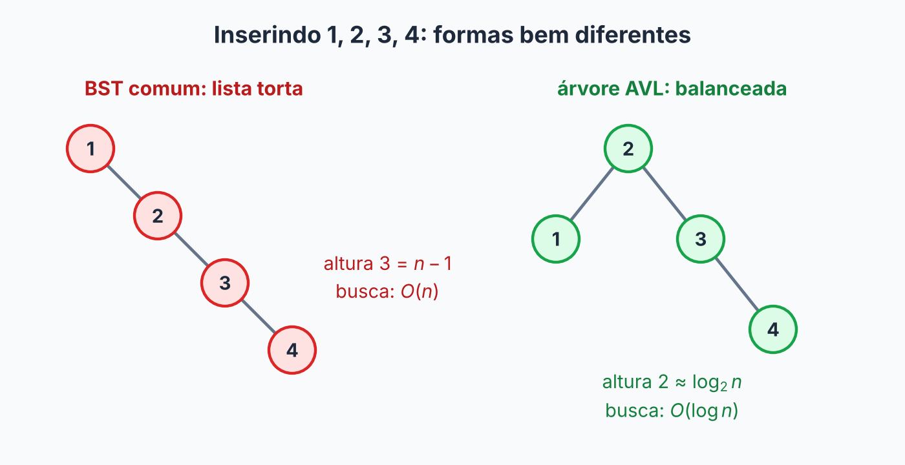
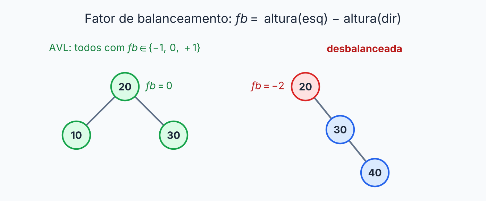
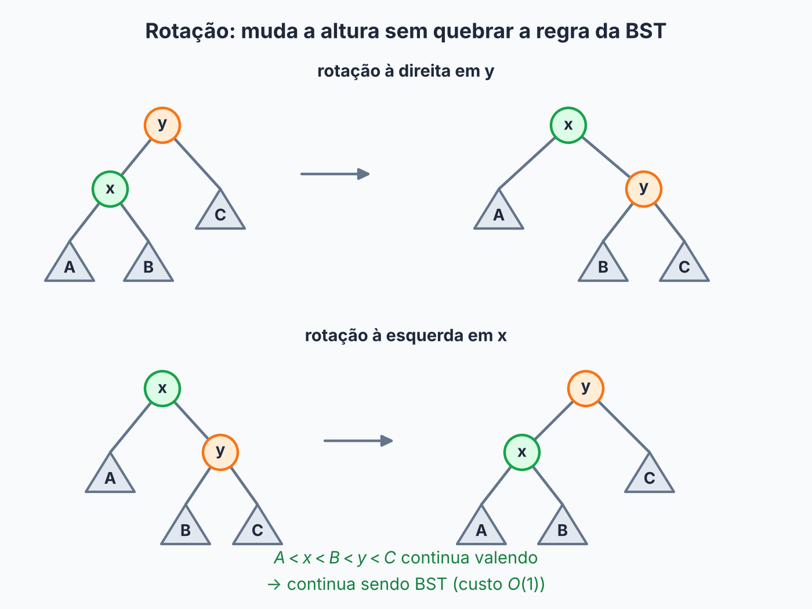
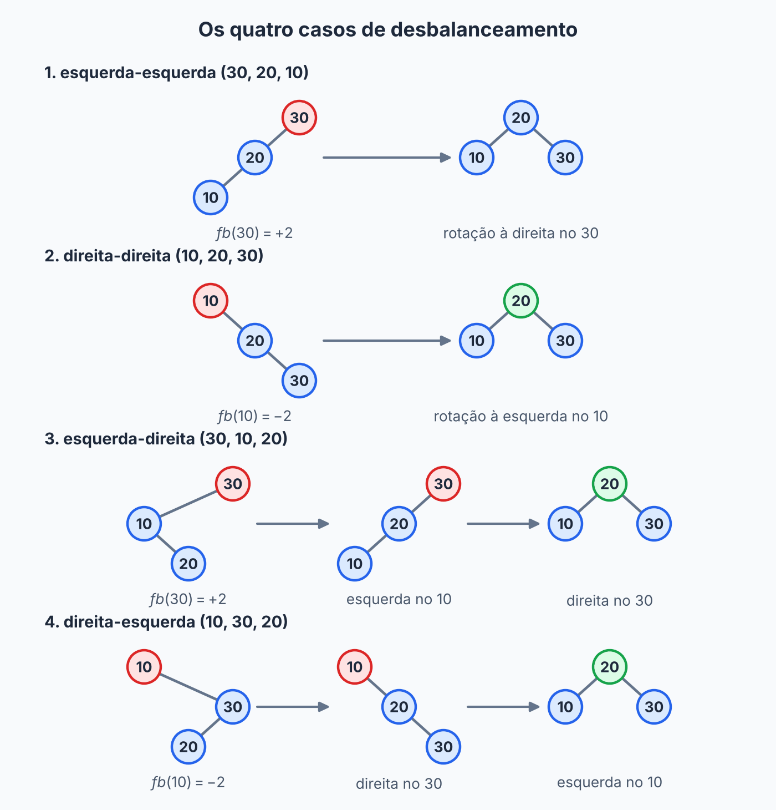

## Sobre

Na [árvore binária de busca](../arvore-binaria-de-busca/), a gente descobriu o calcanhar de Aquiles: tudo custa \(O(h)\), e inserir valores em ordem crescente transforma a árvore numa lista torta, com \(h = n - 1\). Para ter \(O(\log n)\) **de verdade**, e não "na sorte", a árvore precisa **manter a própria altura pequena**.

Inserindo `1, 2, 3, 4` numa BST comum, o que acontece:



A **árvore AVL** (de Adelson-Velsky e Landis, os dois autores de 1962) faz exatamente isso. Depois de cada inserção ou remoção, ela confere se ficou torta e, se ficou, **se endireita** com umas manobras chamadas **rotações**. Foi a primeira árvore de busca autobalanceada já inventada.

É a diferença entre uma pilha de livros que ninguém arruma e uma estante que se reorganiza sempre que algum livro entra ou sai.

## A regra da AVL

O **fator de balanceamento** de um nó é a diferença de altura entre as suas duas subárvores:

$$
fb(no) = altura(esquerda) - altura(direita)
$$

Uma árvore é AVL se for uma BST e **todo nó** tiver \(fb \in \{-1, 0, +1\}\). Em português: as duas subárvores de qualquer nó diferem em, no máximo, 1 de altura. Usamos a convenção de que subárvore vazia tem altura \(-1\).



## Por que isso garante \(O(\log n)\)?

Pergunta: qual o **menor** número de nós \(N(h)\) que uma AVL de altura \(h\) pode ter? Para ser a mais "magra" possível, a raiz tem uma subárvore de altura \(h-1\) e outra de altura \(h-2\) (a diferença máxima que a regra permite), e as duas também são as mais magras possíveis:

$$
N(h) = 1 + N(h-1) + N(h-2)
$$

| \(h\) | 0 | 1 | 2 | 3 | 4 |
|---|---|---|---|---|---|
| \(N(h)\) | 1 | 2 | 4 | 7 | 12 |

Isso cresce igual a Fibonacci: **exponencialmente** em \(h\). Virando de cabeça para baixo: com \(n\) nós, a altura só pode crescer de forma logarítmica. O resultado conhecido é \(h \le 1{,}44 \log_2(n + 2)\), ou seja, no máximo uns 44% acima do melhor caso possível. Logo, busca, inserção e remoção custam \(O(\log n)\) **no pior caso**. Garantia de verdade.

## A ferramenta: rotações

Uma **rotação** reorganiza alguns nós para mudar a altura **sem quebrar a regra da BST**. Mexe em poucas referências, então custa \(O(1)\).

**Rotação à direita** em `y` (quando o lado esquerdo está pesado): o filho esquerdo `x` sobe, `y` desce para a direita de `x`, e a subárvore `B`, que estava no meio dos dois, vira filho esquerdo de `y`.



A ordem dos valores é preservada (\(A < x < B < y < C\)), então continua sendo uma BST. Imagina um galho pesado de um lado: você gira o ponto de apoio e o peso se redistribui. A **rotação à esquerda** é o espelho, na parte de baixo da figura.

## Construindo a AVL

### Passo 1: nó com altura

Para calcular o fator de balanceamento sem percorrer a árvore toda a cada vez, cada nó **guarda a própria altura**.

```java
public class ArvoreAVL {

    private static class No {
        int valor;
        int altura;     // altura do nó: folha = 0
        No esq;
        No dir;

        No(int valor) {
            this.valor = valor;
        }
    }

    private No raiz;
    private int tamanho;

    public int size() { return tamanho; }

    public int altura() { return altura(raiz); }

    private int altura(No no) {
        return no == null ? -1 : no.altura;
    }

    private void atualizaAltura(No no) {
        no.altura = 1 + Math.max(altura(no.esq), altura(no.dir));
    }

    private int fatorBalanceamento(No no) {
        return altura(no.esq) - altura(no.dir);
    }
}
```

Um nó recém-criado tem `altura = 0`, que é o valor padrão do `int`, e é justamente a altura de uma folha. Convenientemente.

### Passo 2: as rotações

Cada rotação devolve a **nova raiz** da subárvore, para o pai poder religar. Depois de rodar, as alturas de dois nós mudaram, e precisam ser recalculadas **na ordem certa**: primeiro o que desceu, depois o que subiu, porque a altura do que subiu depende da do que desceu.

```java
private No rotacaoDireita(No y) {
    No x = y.esq;
    y.esq = x.dir;
    x.dir = y;
    atualizaAltura(y);   // y desceu: atualiza primeiro
    atualizaAltura(x);
    return x;
}

private No rotacaoEsquerda(No x) {
    No y = x.dir;
    x.dir = y.esq;
    y.esq = x;
    atualizaAltura(x);
    atualizaAltura(y);
    return y;
}
```

### Passo 3: os quatro casos de desbalanceamento

Quando um nó chega a \(fb = +2\) ou \(fb = -2\), olhamos **por onde o excesso de altura entrou**. São quatro situações, e em cada desenho abaixo o nó desbalanceado é o do topo.



**Caso 1: esquerda-esquerda.** O peso está no filho esquerdo, e esse filho também pende para a esquerda. Acontece, por exemplo, ao inserir `30, 20, 10`. A correção é uma **rotação à direita** no nó desbalanceado.

**Caso 2: direita-direita.** É o espelho: inserir `10, 20, 30`. A correção é uma **rotação à esquerda** no nó.

**Caso 3: esquerda-direita.** O peso está no filho esquerdo, mas esse filho pende para a **direita**: inserir `30, 10, 20`. Aqui uma rotação simples não resolve, porque só **muda o problema de lugar**, como empurrar um tapete amassado e a dobra aparecer do outro lado. Então primeiro endireitamos o filho com uma rotação à esquerda (o que transforma o caso em esquerda-esquerda) e só depois rodamos o nó à direita. É uma **rotação dupla**.

**Caso 4: direita-esquerda.** O espelho do anterior: inserir `10, 30, 20`. Rotação à direita no filho direito e depois rotação à esquerda no nó.

Para reconhecer o caso, basta olhar o `fb` do nó e o `fb` do filho pesado:

| Caso | `fb` do nó | `fb` do filho pesado | Correção |
|---|---|---|---|
| esquerda-esquerda | +2 | \(\ge 0\) | rotação à direita no nó |
| direita-direita | -2 | \(\le 0\) | rotação à esquerda no nó |
| esquerda-direita | +2 | -1 | rotação à esquerda no filho esquerdo, **depois** à direita no nó |
| direita-esquerda | -2 | +1 | rotação à direita no filho direito, **depois** à esquerda no nó |

Tudo cabe num método só, o `balancear`: atualiza a altura do nó, olha o fator e aplica a correção se precisar. Cada `if` abaixo é uma linha da tabela. Ele devolve a nova raiz da subárvore (que é o próprio `no`, se já estava ok).

```java
private No balancear(No no) {
    atualizaAltura(no);
    int fb = fatorBalanceamento(no);

    if (fb > 1 && fatorBalanceamento(no.esq) >= 0) {     // caso 1: esquerda-esquerda
        return rotacaoDireita(no);
    }
    if (fb < -1 && fatorBalanceamento(no.dir) <= 0) {    // caso 2: direita-direita
        return rotacaoEsquerda(no);
    }
    if (fb > 1) {                                        // caso 3: esquerda-direita
        no.esq = rotacaoEsquerda(no.esq);
        return rotacaoDireita(no);
    }
    if (fb < -1) {                                       // caso 4: direita-esquerda
        no.dir = rotacaoDireita(no.dir);
        return rotacaoEsquerda(no);
    }
    return no;                                           // já estava balanceado
}
```

### Passo 4: inserir

É a inserção da BST com **uma linha a mais**: na volta da recursão, cada nó do caminho **se rebalanceia**. Assim a conferência acontece de baixo para cima, do ponto mais fundo até a raiz.

```java
public void add(int valor) {
    raiz = add(raiz, valor);
}

private No add(No no, int valor) {
    if (no == null) {
        tamanho++;
        return new No(valor);
    }
    if (valor < no.valor) {
        no.esq = add(no.esq, valor);
    } else if (valor > no.valor) {
        no.dir = add(no.dir, valor);
    } else {
        return no;                      // duplicado: nada muda
    }
    return balancear(no);
}
```

Agora o teste de fogo: insira `10, 20, 30, 40, 50, 60, 70`, que é exatamente a entrada que destruiria uma BST comum:

```text
add(10), add(20)   sem desbalanceamento
add(30)            o 10 fica com fb = -2 (direita-direita): rotação à esquerda
add(40)            sem desbalanceamento
add(50)            o 30 fica com fb = -2: rotação à esquerda
add(60)            a raiz (20) fica com fb = -2: rotação à esquerda
add(70)            o 50 fica com fb = -2: rotação à esquerda
```

E o resultado é uma árvore perfeita:

```text
        40
      /    \
    20      60
   /  \    /  \
  10  30  50  70
```

A BST comum teria altura 6 para essa entrada. A AVL tem altura 2.

### Passo 5: remover

É a remoção da BST (os três casos, com o sucessor) mais o mesmo `balancear` na volta da recursão:

```java
public void remove(int valor) {
    raiz = remove(raiz, valor);
}

private No remove(No no, int valor) {
    if (no == null) return null;
    if (valor < no.valor) {
        no.esq = remove(no.esq, valor);
    } else if (valor > no.valor) {
        no.dir = remove(no.dir, valor);
    } else {
        if (no.esq == null) { tamanho--; return no.dir; }
        if (no.dir == null) { tamanho--; return no.esq; }
        No sucessor = no.dir;
        while (sucessor.esq != null) sucessor = sucessor.esq;
        no.valor = sucessor.valor;
        no.dir = remove(no.dir, sucessor.valor);
    }
    return balancear(no);
}
```

Um detalhe que surpreende: remover de um lado deixa o **outro** lado pesado. Na árvore abaixo, `remove(5)` esvazia a esquerda do `10`, mas quem desbalanceia é a **raiz**, por excesso à direita:

```text
        20                        30
       /  \                      /  \
     10    30        ->        20    40
    /     /  \                /  \     \
   5    25    40            10   25     50
                \
                 50
```

A raiz `20` fica com \(fb = -2\), e o filho pesado (`30`) tem \(fb = -1\): caso direita-direita, uma rotação à esquerda resolve.

Outra diferença: ao **inserir**, uma rotação (simples ou dupla) basta para consertar tudo. Ao **remover**, a rotação pode diminuir a altura da subárvore e desbalancear um ancestral mais acima, que também precisa girar, e assim até a raiz. O `balancear` já roda em todo nó do caminho de volta, então o código cobre isso sozinho (no máximo \(O(\log n)\) rotações).

### Passo 6: buscar

Idêntica à da BST. A diferença está no custo, porque agora a altura é garantida.

```java
public boolean contains(int valor) {
    No atual = raiz;
    while (atual != null) {
        if (valor == atual.valor) return true;
        atual = valor < atual.valor ? atual.esq : atual.dir;
    }
    return false;
}
```

## Quanto custa?

| Operação | AVL | BST comum (pior caso) |
|---|---|---|
| `contains` | \(O(\log n)\) | \(O(n)\) |
| `add` | \(O(\log n)\) | \(O(n)\) |
| `remove` | \(O(\log n)\) | \(O(n)\) |

A inserção desce \(O(\log n)\) níveis e cada `balancear` custa \(O(1)\), então o total é \(O(\log n)\). Mesma coisa na remoção. O preço é o espaço de uma altura extra por nó e as contas do rebalanceamento, um custo constante pequeno por uma garantia gigante.

Nos meus testes, inserir `1..100000` em ordem crescente produziu uma AVL de altura 16 (o \(\log_2\) de 100000 é cerca de 16,6). A BST comum, com míseros 5000 elementos na mesma ordem, já tinha altura 4999.

## Exercícios

1. Insira, nessa ordem, `5, 2, 8, 1, 3, 4` em uma AVL. Onde ocorre o desbalanceamento, de qual caso é, e como fica a pré-ordem final?
2. Qual a altura de uma AVL obtida inserindo `1, 2, ..., 15` em ordem?
3. Por que, ao final de uma rotação, atualizamos primeiro a altura do nó que **desceu**?
4. Uma AVL de altura 3 pode ter quantos nós, no mínimo? E no máximo?


1. As inserções `5, 2, 8, 1, 3` não desbalanceiam. Ao inserir o `4` (filho direito do `3`), a raiz `5` fica com a esquerda de altura 2 e a direita de altura 0: \(fb = +2\). O filho pesado (`2`) tem \(fb = -1\), então é o caso **esquerda-direita**: rotação à esquerda em `2` (o `3` sobe) e depois rotação à direita em `5`. Pré-ordem final: `[3, 2, 1, 5, 4, 8]`.
2. Altura 3. Com \(n = 2^k - 1\) inserções em ordem, a AVL termina perfeita, com altura \(k - 1\); para 15 nós, 3. A raiz é o 8.
3. Porque a altura do que subiu depende da altura do que desceu (agora ele é filho do outro). Na ordem inversa, usaríamos a altura antiga e desatualizada.
4. Mínimo \(N(3) = 7\) nós (pela recorrência \(N(h) = 1 + N(h-1) + N(h-2)\)). Máximo: \(2^{4} - 1 = 15\) nós (árvore perfeita).





Um nó tem \(fb = +2\) e o filho esquerdo dele tem \(fb = -1\). Qual a correção?

- [ ] Rotação simples à direita no nó.
- [ ] Rotação simples à esquerda no nó.
- [x] Rotação à esquerda no filho esquerdo e depois rotação à direita no nó.
- [ ] Nenhuma: o nó está dentro do limite.
---
É o caso esquerda-direita. Uma rotação simples só deslocaria o problema; é preciso primeiro endireitar o filho.



Qual o custo de `add` em uma AVL com \(n\) nós, no pior caso?

- [ ] \(O(1)\)
- [x] \(O(\log n)\)
- [ ] \(O(n)\)
- [ ] \(O(n \log n)\)
---
A altura é sempre \(O(\log n)\), e o rebalanceamento custa \(O(1)\) por nível visitado.



Qual afirmação sobre a remoção em uma AVL é verdadeira?

- [ ] Nunca exige rotações.
- [ ] Exige no máximo uma rotação.
- [x] Pode exigir uma rotação em vários ancestrais do nó removido.
- [ ] Só exige rotação quando o nó removido é folha.
---
Rotacionar após uma remoção pode diminuir a altura da subárvore, o que pode desbalancear um ancestral mais acima.




## Resumo

- Na AVL, todo nó tem \(fb = altura(esq) - altura(dir) \in \{-1, 0, 1\}\).
- Isso força a altura a ser \(O(\log n)\) (no máximo cerca de \(1{,}44 \log_2 n\)).
- **Rotações** (\(O(1)\)) reorganizam os nós sem quebrar a ordem da BST. Quatro casos: esquerda-esquerda e direita-direita (simples), esquerda-direita e direita-esquerda (dupla).
- Cada nó guarda a própria altura. `add` e `remove` rebalanceiam todos os nós do caminho, de baixo para cima.
- Busca, inserção e remoção: \(O(\log n)\) no pior caso.

## Para estudar mais

- [Árvores Balanceadas (AVL)](https://joaoarthurbm.github.io/eda/posts/avl/) — João Arthur Brunet (2019)
