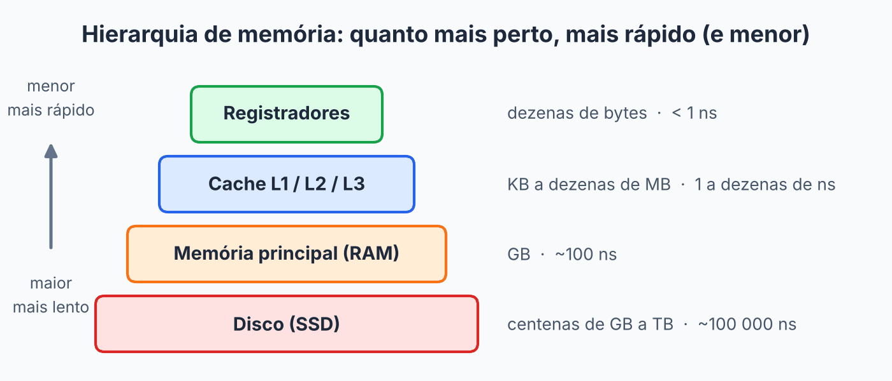
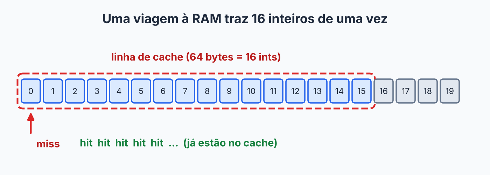

## Sobre

Existe uma pegadinha que ninguém conta no começo de EDA: dois algoritmos com **a mesma complexidade** podem ter tempos de execução muito diferentes. Se \(O(n)\) é \(O(n)\), por que um código leva um tempo e o outro leva várias vezes mais?

Boa parte da resposta se chama **cache**. E a palavra aparece em dois lugares que parecem diferentes, mas têm a mesma alma:

- **Cache de hardware**: uma memória minúscula e velocíssima dentro do processador. Você não controla, mas pode escrever código que ajuda ou atrapalha ela.
- **Cache de software**: uma estrutura que **você** escreve para guardar resultados caros e reaproveitar.

A alma comum é: *guardar por perto aquilo que provavelmente vai ser usado de novo*. Igual deixar o carregador do celular na mesa de trabalho, em vez de ir buscar no quarto toda vez.

## A hierarquia de memória (ou: o problema da distância)

Memória rápida é cara e pequena; memória grande é barata e lenta. Então os computadores empilham camadas, da mais rápida (e menor) para a mais lenta (e maior):

| Camada | Tamanho típico | Velocidade (ordem de grandeza) |
|---|---|---|
| Registradores | dezenas de bytes | menos de 1 ns |
| Cache L1 / L2 / L3 | KB a dezenas de MB | de 1 ns a dezenas de ns |
| Memória principal (RAM) | GB | ~100 ns |
| Disco (SSD) | centenas de GB ou TB | ~100 000 ns |

> [!NOTE]
> Esses números mudam de máquina para máquina. O que importa é a **proporção**: buscar na RAM custa dezenas de vezes mais do que ficar no cache, e ir ao disco custa ordens de grandeza a mais. É a diferença entre pegar algo na sua mesa, ir ao armário do corredor ou pedir uma encomenda pelo correio.

Quando o processador precisa de um dado, ele olha primeiro no cache. Achou? **Cache hit**, rapidinho. Não achou? **Cache miss**, e lá vai ele buscar na RAM, devagar.



## O truque do cache: ele traz o vizinho junto

Aqui está o detalhe que explica tudo. O cache **não busca um byte por vez**. Quando você pede um dado, ele traz um bloco inteiro dos vizinhos, a **linha de cache**, normalmente de 64 bytes. Um `int` tem 4 bytes, então uma única viagem à RAM traz **16 inteiros consecutivos** de um array.

É como ir ao mercado: se você já vai até lá, não compra só um ovo. Traz a caixa.

Isso funciona porque os programas costumam seguir duas regras, e o cache aposta nelas:

- **Localidade espacial**: quem acessou um endereço provavelmente vai acessar os vizinhos logo em seguida.
- **Localidade temporal**: quem acessou um dado agora provavelmente vai acessar o mesmo de novo daqui a pouco.

Um laço que percorre um array em ordem é o sonho do cache: o primeiro acesso dá *miss* e traz 16 inteiros; os 15 seguintes já estão lá, de graça.



## Experimento: linhas ou colunas?

Uma matriz `int[n][n]` em Java é um array de arrays, em que cada **linha** é um bloco contínuo na memória. Olha duas formas de somar tudo. As duas fazem exatamente as mesmas \(n^2\) somas.

```java
int n = 4096;
int[][] m = new int[n][n];

// A: linha por linha
long soma = 0;
for (int i = 0; i < n; i++) {
    for (int j = 0; j < n; j++) {
        soma += m[i][j];
    }
}

// B: coluna por coluna
long soma2 = 0;
for (int j = 0; j < n; j++) {
    for (int i = 0; i < n; i++) {
        soma2 += m[i][j];
    }
}
```

No código **A**, `m[i][j]` e `m[i][j+1]` são vizinhos na memória: o cache traz 16 e usa os 16. No código **B**, cada acesso pula para outra linha, a milhares de bytes de distância, e quase todo acesso vira um *miss*. É ir ao mercado comprar um ovo, voltar, ir de novo comprar outro ovo...

Na minha máquina de teste, o B demorou várias vezes mais que o A. O valor exato depende do seu processador e da JVM, então **rode você mesmo**, e repita umas vezes (a primeira execução inclui o aquecimento da JVM). O que não muda é a lição: a complexidade é a mesma, \(\Theta(n^2)\), mas o **padrão de acesso** à memória, não.

## Array contra lista encadeada

Esse mesmo raciocínio explica uma coisa que parece injusta na teoria:

- Os elementos de um **array** ficam lado a lado. Percorrer é o melhor cenário possível para o cache.
- Os nós de uma **lista encadeada** são alocados um a um e podem estar espalhados pela memória. Cada `proximo` pode mandar você para um endereço distante: quase todo passo é um *miss*.

Percorrer um array de \(n\) elementos e percorrer uma lista de \(n\) elementos são os dois \(O(n)\), mas na prática o array costuma ganhar de lavada por causa do cache. É também parte do motivo de o quick sort vencer o merge sort no mundo real, como comentei na [página do quick sort](../quick-sort/): ele varre o array de forma sequencial.

> [!TIP]
> Isso **não** quer dizer "nunca use lista encadeada". Quer dizer que a notação assintótica compara *crescimento*, não *tempo real*. Quando duas estruturas empatam no \(O(\cdot)\), a diferença mora nas constantes, e o cache é uma delas.

## Agora o outro cache: o de software

Mesma ideia, outro cenário. Imagine uma função cara que sempre devolve o mesmo resultado para a mesma entrada. Para que refazer a conta toda vez? A gente guarda o resultado numa estrutura e consulta antes.

O exemplo clássico é o Fibonacci recursivo, que é um desperdício: recalcula os mesmos valores um monte de vezes.

```java
static long fib(int n) {
    return n < 2 ? n : fib(n - 1) + fib(n - 2);
}
```

Guardando o que já foi calculado (isso tem nome: **memoização**):

```java
static long[] memo = new long[91];

static long fibMemo(int n) {
    if (n < 2) return n;
    if (memo[n] != 0) return memo[n];      // hit: já calculei
    memo[n] = fibMemo(n - 1) + fibMemo(n - 2);
    return memo[n];
}
```

Conta as chamadas: `fib(30)` faz **2 692 537** chamadas. `fibMemo(30)` faz **59**. Passamos de exponencial para \(O(n)\) só porque cada valor passou a ser calculado uma única vez. Quase um truque de mágica, mas é só uma anotação num caderninho.

## O problema do espaço: quem sai?

Um cache de software não pode crescer para sempre, a memória é finita. Quando enche e precisa guardar algo novo, alguém tem que sair. A regra que decide quem sai é a **política de substituição**.

A mais popular é a **LRU** (*Least Recently Used*, "menos recentemente usado"): sai quem está há mais tempo sem ser usado. É a regra da sua gaveta de roupas: o que você não veste há um ano é o primeiro a ir para a doação. Ela aposta na localidade temporal.

## Construindo um cache LRU

Para o LRU, precisamos de duas coisas ao mesmo tempo: achar um item pela chave rapidamente **e** saber a ordem de uso. O Java já tem uma estrutura que faz as duas, o `LinkedHashMap`. Com o terceiro parâmetro do construtor em `true`, ela ordena as entradas pelo **último acesso** (e não pela inserção). Aí é só sobrescrever `removeEldestEntry` para descartar a mais antiga quando passar do limite:

```java
import java.util.LinkedHashMap;
import java.util.Map;

public class CacheLRU<K, V> extends LinkedHashMap<K, V> {
    private final int capacidade;

    public CacheLRU(int capacidade) {
        super(16, 0.75f, true);          // true = ordem de acesso
        this.capacidade = capacidade;
    }

    @Override
    protected boolean removeEldestEntry(Map.Entry<K, V> maisAntiga) {
        return size() > capacidade;      // passou do limite: descarta a menos usada
    }
}
```

Usando, com capacidade 3:

```java
CacheLRU<String, Integer> cache = new CacheLRU<>(3);
cache.put("a", 1);
cache.put("b", 2);
cache.put("c", 3);
System.out.println(cache.keySet());   // [a, b, c]

cache.get("a");                       // "a" foi usada: vira a mais recente
System.out.println(cache.keySet());   // [b, c, a]

cache.put("d", 4);                    // estourou 3: sai a menos recente ("b")
System.out.println(cache.keySet());   // [c, a, d]
```

Repara que saiu o `"b"`, e não o `"a"`, mesmo `"a"` tendo entrado primeiro. O `get("a")` renovou o "último uso" dela, e é isso que o LRU respeita.

### E por dentro?

O `LinkedHashMap` junta duas estruturas que você vai ver neste conteúdo: uma **tabela hash** (achar a entrada pela chave em \(O(1)\)) e uma **lista duplamente encadeada** (manter a ordem de uso, movendo um nó para o fim em \(O(1)\) a cada acesso). Por isso `get` e `put` do LRU saem \(O(1)\) em média. Duas estruturas simples, juntas, virando uma esperta.

## Exercícios

1. Por que percorrer uma matriz por linhas costuma ser mais rápido que por colunas, se o número de somas é o mesmo?
2. Um cache LRU de capacidade 3 recebe, em ordem: `put(a)`, `put(b)`, `put(c)`, `get(b)`, `put(d)`, `get(a)`, `put(e)`. Qual o conteúdo final, do menos para o mais recente? (`get` de uma chave ausente não altera nada.)
3. Depois de estudar a [tabela hash](../tabela-hash/) e a [lista encadeada](../lista-encadeada/), monte um LRU "na mão" com uma tabela hash de `chave -> nó` e uma lista duplamente encadeada. Quais operações precisam ser \(O(1)\), e por que a lista precisa ser **duplamente** encadeada?


1. Localidade espacial: em um array de arrays, elementos da mesma linha são vizinhos na memória, e cada linha de cache traz vários de uma vez. Por colunas, cada acesso cai em outra linha da matriz, longe do anterior, gerando muito mais *cache misses*.
2. Do menos para o mais recente: `[a]`, `[a, b]`, `[a, b, c]`, `get(b)` → `[a, c, b]`, `put(d)` (estoura, sai `a`) → `[c, b, d]`, `get(a)` (ausente, nada muda) → `[c, b, d]`, `put(e)` (estoura, sai `c`) → `[b, d, e]`. Final: `[b, d, e]`.
3. Precisamos de \(O(1)\) para achar o nó pela chave (tabela hash), mover um nó para o fim a cada `get`/`put` e remover o nó do início quando estourar. A lista precisa ser **duplamente** encadeada porque, para tirar um nó do **meio** em \(O(1)\), é preciso conhecer o anterior dele, e numa lista simples só chegaríamos lá percorrendo desde o início.


## Resumo

- O cache de hardware traz **blocos** de bytes vizinhos (linhas de cache). Acesso sequencial aproveita; acesso saltado desperdiça.
- **Localidade espacial** (vizinhos) e **temporal** (reuso) explicam por que arrays costumam vencer listas encadeadas na prática, mesmo com a mesma complexidade.
- Cache de software guarda resultados caros. A memoização transforma o Fibonacci recursivo de exponencial em \(O(n)\).
- Como o espaço é limitado, precisa de uma política de substituição. A **LRU** descarta quem está há mais tempo sem uso.
- Um LRU eficiente combina tabela hash e lista duplamente encadeada.

## Para estudar mais

- [Cache](https://joaoarthurbm.github.io/eda/posts/eda-cache/) — João Arthur Brunet (2019)
