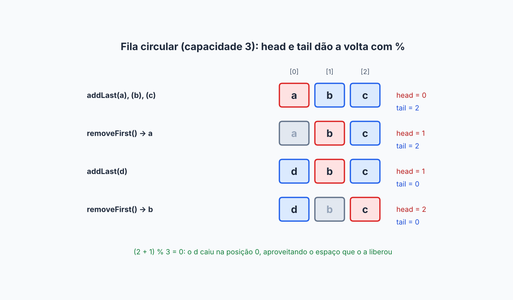

## Direto ao ponto

Fila de banco, fila de impressão, fila de espera: quem chegou primeiro é atendido primeiro. Esse comportamento se chama **FIFO**, do inglês *First In, First Out*, e é o oposto da pilha, que é LIFO.

O que define a fila é a **política de acesso**: toda adição é feita no final (`addLast`) e toda remoção é feita no início (`removeFirst`). Só isso. Essas duas operações implementam a política FIFO.

> **FIFO.** O primeiro elemento a entrar na fila é o primeiro a sair. O final da fila é o **tail** e o início é o **head**.

Se você leu a [Pilha](../pilha/) e o [ArrayList](../arraylist/), vai perceber bastante coisa em comum: estamos de novo usando um array para resolver um problema de armazenamento e acesso. A diferença é a decisão que tomamos quando o array **enche**. No ArrayList a gente cresce o array. Na pilha a gente lança exceção. Aqui vamos **manter o tamanho fixo e sobrescrever o elemento mais antigo**. Não é uma característica de fila, é só uma escolha de design para explorarmos as três saídas possíveis.

## Onde pode ser usado?

Impressoras guardam os documentos numa fila. Servidores web enfileiram requisições quando estão ocupados. O sistema operacional mantém filas de processos esperando a CPU. E a busca em largura (BFS), um algoritmo clássico de grafos, usa uma fila para visitar os vértices por camadas. Fila de tamanho fixo que joga fora o mais antigo também é a ideia por trás de um cache simples com política FIFO.

## Organização interna: atributos e construtor

Para ficar didático, vamos montar uma fila baseada em um array que guarda `String`.

```java
public class FIFOArray {

    private String[] fila;
    private int head;
    private int tail;
    private int size;

    public FIFOArray(int capacidade) {
        this.fila = new String[capacidade];
        this.head = -1;
        this.tail = -1;
        this.size = 0;
    }
}
```

Repara nos dois atributos `head` e `tail`. Eles são os **índices do array que delimitam a fila**, e os dois estão incluídos. Quando criamos um array de `String`, todas as posições são `null`, e isso ainda não é a nossa fila. A fila é uma **abstração em cima do array**: ela é o trecho que vai de `head` até `tail`. Como os dois começam em `-1` (um índice que não existe), a fila começa vazia. O `size` conta quantos elementos há na fila.

## Operações

Temos só duas operações principais: `addLast(String element)` e `removeFirst()`. Vamos simular várias delas numa fila de 3 posições. Em cada desenho abaixo, as caixas **preenchidas** são os elementos **dentro** da fila (de `head` até `tail`) e as **tracejadas** são as posições **fora** dela.

Fila vazia:



`addLast("a")`:



Agora o início e o fim apontam para o mesmo índice: a fila só tem o `"a"`.

`addLast("b")`:



O `head` continua no `0`, mas o `tail` andou uma posição. O `"a"` está no início e o `"b"` está no fim.

`addLast("c")`:



Adição já entendemos. Agora, como a política é clara, remover significa tirar o primeiro que entrou: o `"a"`.

### Primeira tentativa: remover com shift

A abordagem mais direta é fazer o **shiftLeft**: puxar todo mundo uma casa para a esquerda (o `"b"` ocupa o lugar do `"a"`, o `"c"` o lugar do `"b"`) e diminuir o `tail`, já que a fila encolheu. Depois de um `removeFirst`:



Preste atenção: a fila **não** é `"b", "c", "c"`. A fila é `"b"` e `"c"`, porque quem manda são `head` e `tail`. O último `"c"` ficou ali por simplicidade, mas está fora dos limites. Poderíamos ter colocado `null`, só que não precisava: bastou mover o `tail`. Pense assim: se eu tiver que imprimir a fila, imprimo o que está entre `head` e `tail`, inclusive.

O código do `shiftLeft` fica assim. Vamos por partes:

```java
// lembre de diminuir o tail depois de chamar este método
// (isso é feito no removeFirst)
private void shiftLeft(int index) {
    for (int i = index; i < this.tail; i++) {
        this.fila[i] = this.fila[i + 1];
    }
}
```

1. Começamos em `index`. Na fila, a remoção é sempre do início, então chamamos com `index = 0`.
2. A cada volta, o elemento da frente (`i + 1`) é copiado para a posição atual (`i`). É o "puxar para a esquerda".
3. Paramos em `i < tail` para que `i + 1` nunca passe do último elemento da fila.

Mais uma remoção:



Só sobrou o `"c"`, porque `head` e `tail` apontam para o índice `0`. E se removermos mais uma vez, a fila fica vazia e os dois voltam para `-1`:



---

**Para fixar.** Considere uma fila vazia de capacidade 4 que usa remoção com shift. Desenhe o array, o `head` e o `tail` depois de cada operação:

`addLast("a")`, `removeFirst()`, `addLast("b")`, `addLast("c")`, `addLast("d")`, `addLast("e")`, `removeFirst()`, `removeFirst()`, `removeFirst()`, `removeFirst()`.

---

### E se a fila estiver cheia?

Olha esta fila:



Ela está cheia. O que deve fazer `addLast("d")`? Existem três saídas:

1. **Lançar uma exceção** avisando que a fila está cheia.
2. **Crescer** o array, copiar todo mundo e continuar. Foi a decisão que tomamos no [ArrayList](../arraylist/).
3. **Sobrescrever** algum elemento. Como é uma fila, o escolhido é o primeiro que entrou, o mais antigo.

Vamos de 3. Essa solução é muito usada quando o tamanho da estrutura é limitado e fixo, como acontece em cenários de cache. E já sabemos fazer: `shiftLeft` e depois adicionar no final.

Primeiro o shift:



E agora sim o novo elemento:



### Análise de custo (com shift)

- `addLast`: normalmente só anda com o `tail`. Mas se a fila estiver cheia, precisamos do `shiftLeft`, então no pior caso é \(O(n)\).
- `removeFirst`: sempre faz o shift de todo mundo, então é \(O(n)\).

Remover do início de uma fila custando \(O(n)\) é ruim, justo a operação que define a fila. Dá para melhorar.

## Fila circular: removendo em O(1)

E se eu disser que dá para adicionar no final e remover do início **sem fazer o shift**? É um pouquinho mais complicado, mas a gente entende.

Remover o início deveria ser só `head = head + 1`, certo? \(O(1)\). O problema é que, ao fazer isso, sobra uma posição livre **antes** do `head`, e ela poderia receber um novo elemento. Como fazer o `tail` ir parar lá? Com o **resto da divisão** (`%`) pelo tamanho do array.

Vamos de novo encher a fila:



`removeFirst()` agora é só `head = head + 1`:



A fila vai do índice `1` ao `2`: ela é `"b"` e `"c"`. O índice `0` está livre.

Agora vem o pulo do gato. Para adicionar o `"d"`, a próxima posição é `(tail + 1) % fila.length`, ou seja, \((2 + 1) \bmod 3 = 0\). Quando a conta passa do fim do array, o `%` faz a posição **voltar para o começo**:



O `head` está no índice `1` (`"b"`) e o `tail` está no índice `0` (`"d"`). A fila é `"b"`, `"c"`, `"d"`, nessa ordem. O `tail` pode ficar "antes" do `head` no array e a fila continua correta.

Mais um `removeFirst()`: o `head` vai para `(1 + 1) % 3 = 2`.



A fila é `"c"` e `"d"`. Estamos tratando o array de forma **circular**: nenhum shift, só o cuidado de usar `% fila.length` sempre que andarmos com `head` ou `tail`.



### Implementação

Começamos pelas verificações, porque as duas operações dependem delas:

```java
public boolean isEmpty() {
    return this.size == 0;
}

public boolean isFull() {
    return this.size >= this.fila.length;
}
```

Agora o `addLast`. Leia os comentários como um passo a passo:

```java
public void addLast(String element) {
    // 1) se ainda há espaço, a fila ganha um elemento.
    //    Se estiver cheia, o tamanho não muda (vamos sobrescrever).
    if (!isFull())
        this.size += 1;
    else
        // 2) cheia: o mais antigo (head) vai ser sobrescrito,
        //    então o head anda uma casa para liberar o lugar.
        this.head = (this.head + 1) % this.fila.length;

    // 3) primeira adição: head sai do -1 e vai para o índice 0.
    if (this.head == -1)
        this.head = 0;

    // 4) tail anda (com a volta) e recebe o novo elemento.
    this.tail = (this.tail + 1) % this.fila.length;
    this.fila[this.tail] = element;
}
```

E o `removeFirst`:

```java
public String removeFirst() {
    // 1) fila vazia: não há o que remover.
    if (isEmpty()) throw new NoSuchElementException();

    // 2) guarda o elemento do início para devolver.
    String value = this.fila[this.head];

    if (this.head == this.tail) {
        // 3) era o único elemento: a fila volta ao estado vazio.
        this.head = -1;
        this.tail = -1;
    } else {
        // 4) senão, só anda com o head (com a volta).
        this.head = (this.head + 1) % this.fila.length;
    }

    this.size -= 1;
    return value;
}
```

> **Importante.** Quando você remover o último elemento (`head == tail`), lembre de colocar `head` e `tail` de volta em `-1`. Sem isso, o próximo `addLast` não sabe que a fila estava vazia.

Para usar `NoSuchElementException`, o arquivo precisa deste import:

```java
import java.util.NoSuchElementException;
```

### Análise de custo (fila circular)

- `addLast`: algumas verificações \(O(1)\) e a conta `(tail + 1) % fila.length`. Custa \(O(1)\).
- `removeFirst`: algumas verificações \(O(1)\) e `head = (head + 1) % fila.length`, sem shift. Custa \(O(1)\).

A memória é \(O(c)\), em que `c` é a capacidade. Esse é o motivo de a fila circular ser a forma "de verdade" de fazer fila com array.

## Onde encontro isso na biblioteca padrão?

Em Java, a fila baseada em array é a classe [`ArrayDeque`](https://docs.oracle.com/javase/8/docs/api/java/util/ArrayDeque.html). Dois detalhes: ela é *resizable* (ao encher, cresce em vez de lançar exceção ou sobrescrever) e serve tanto de fila quanto de pilha. Se você olhar a API, todos os métodos estão lá: `addFirst`, `addLast`, `removeFirst`, `removeLast`. Dependendo de como você usa, ela é uma fila ou uma pilha.

## Exercícios

1. Considere uma fila vazia de capacidade 4 com remoção por shift. Acompanhe array, `head` e `tail` em: `addLast("a")`, `removeFirst()`, `addLast("b")`, `addLast("c")`, `addLast("d")`, `addLast("e")`, `removeFirst()`, `removeFirst()`, `removeFirst()`, `removeFirst()`.
2. Agora uma fila **circular** vazia de capacidade 3: `addLast("a")`, `addLast("b")`, `addLast("c")`, `removeFirst()`, `removeFirst()`, `addLast("d")`, `addLast("e")`, `addLast("f")`. Qual é a fila no final e quem foi sobrescrito?
3. Por que a remoção com shift custa \(O(n)\) e a circular custa \(O(1)\)?
4. Como usar duas pilhas para simular uma fila?


1. `addLast("a")`: `["a", ·, ·, ·]`, `head = 0`, `tail = 0`. `removeFirst()`: fila vazia, `head = -1`, `tail = -1`. `addLast("b")`: `["b", ·, ·, ·]`, `head = 0`, `tail = 0`. Depois `"c"`, `"d"` e `"e"` enchem a fila: `["b", "c", "d", "e"]`, `head = 0`, `tail = 3`. Cada `removeFirst()` faz o shift: `["c", "d", "e", "e"]` com `tail = 2`, depois `["d", "e", "e", "e"]` com `tail = 1`, depois `["e", "e", "e", "e"]` com `tail = 0` e, no último, a fila fica vazia (`head = -1`, `tail = -1`). Os valores repetidos que sobram no array estão fora da fila.
2. Depois dos três `addLast`: `["a", "b", "c"]`, `head = 0`, `tail = 2`. Os dois `removeFirst()` levam o `head` para `2` (fila só com `"c"`). `addLast("d")` vai para \((2 + 1) \bmod 3 = 0\): `["d", "b", "c"]`, `head = 2`, `tail = 0`. `addLast("e")` vai para a posição `1`: `["d", "e", "c"]`, `tail = 1`. Agora a fila está cheia (`"c"`, `"d"`, `"e"`). `addLast("f")` sobrescreve o mais antigo: o `head` vai para \((2 + 1) \bmod 3 = 0\), o `tail` para `2` e o `"f"` substitui o `"c"`: `["d", "e", "f"]`, `head = 0`, `tail = 2`. A fila final é `"d"`, `"e"`, `"f"` e quem foi sobrescrito foi o `"c"`.
3. No shift, cada remoção copia todos os elementos que sobram. Na circular, a remoção só atualiza o `head`, sem copiar ninguém.
4. Uma pilha de entrada recebe os `addLast`. Quando for preciso remover e a pilha de saída estiver vazia, despejamos a de entrada na de saída (a ordem se inverte) e fazemos `pop` na de saída. Cada elemento é movido no máximo uma vez, então o custo amortizado por operação é \(O(1)\).


## Resumo

- Fila segue FIFO: adiciona no final (`addLast`, `tail`) e remove do início (`removeFirst`, `head`).
- A fila é uma abstração sobre o array: ela é o trecho entre `head` e `tail`; `-1` nos dois representa fila vazia.
- Remover com shift custa \(O(n)\).
- Com o array tratado como circular (`% fila.length`), `addLast` e `removeFirst` custam \(O(1)\).
- Quando enche, há três saídas: exceção, crescer o array ou sobrescrever o mais antigo. Aqui escolhemos sobrescrever.
- Ao remover o último elemento, `head` e `tail` voltam para `-1`.

## Notas

- [Filas (FIFO) baseadas em Arrays](https://joaoarthurbm.github.io/eda/posts/fifoarray/) — João Arthur Brunet
- [Introduction to Algorithms](https://mitpress.mit.edu/9780262046305/) — Cormen et al. (2022)
