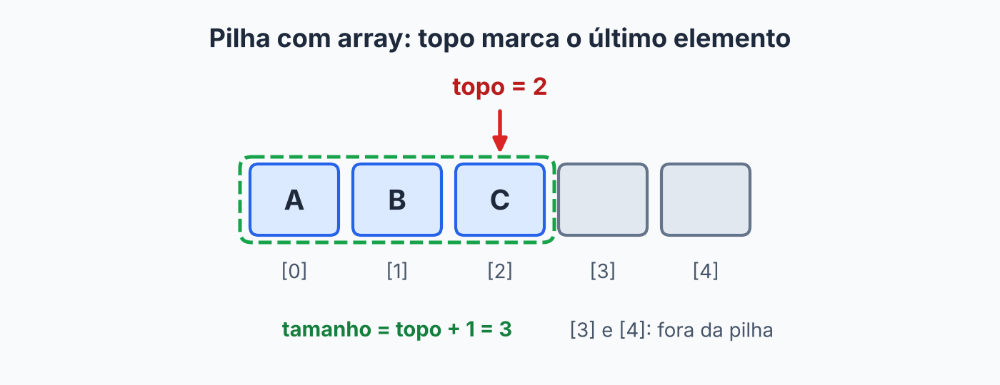

## Direto ao ponto

Pensa numa pilha de pratos: você coloca um prato em cima e, quando vai pegar um, pega justamente o que está no topo. O último que entrou é o primeiro que sai. Esse comportamento é chamado **LIFO**, do inglês *Last In, First Out*.

Ao final você deve conseguir:

- explicar o contrato LIFO;
- implementar uma pilha com array e lidar com a pilha cheia;
- usar a pilha como cliente e analisar o custo.

> [!NOTE]
> **Antes de começar, ajuda ter à mão:**
>
> - a página de [ArrayList](../arraylist/).

Na estrutura de dados é a mesma ideia: a gente adiciona e remove pelo **topo**. As operações principais são `push`, para colocar um elemento, e `pop`, para remover e devolver o elemento que está no topo. Não dá para tirar direto um elemento do meio.

## Onde pode ser usado?

Um exemplo fácil é o desfazer de um editor: cada ação fica guardada, e o `Ctrl + Z` desfaz primeiro a ação mais recente. O botão de voltar do navegador segue uma lógica parecida. E quando uma função chama outra, o programa também usa uma pilha para saber qual chamada precisa terminar primeiro.

Já tomou um `StackOverflowError`? Isso costuma acontecer com algoritmo recursivo sem condição de parada. O Java usa uma pilha para controlar as chamadas; sem condição de parada, ela enche sem parar, e quando atinge o limite que o Java estabeleceu, ele lança `java.lang.StackOverflowError`. É a pilha cheia, na vida real.

## Representação com array

Vou montar uma pilha simples com um array de capacidade fixa, que guarda `String`. O array reserva o espaço; `topo` marca o índice do último elemento que realmente está na pilha.

```java
public class Pilha {
    private int topo;
    private final String[] elementos;

    public Pilha(int capacidade) {
        elementos = new String[capacidade];
        topo = -1;
    }
}
```

Começo com `topo = -1` porque ainda não tem nenhum elemento. Quando `topo` vale `0`, temos um elemento; quando vale `2`, temos três. Então o tamanho da pilha é `topo + 1`.

Repara também que o array e a pilha não são a mesma coisa. A pilha vai do índice `0` até `topo`; o que estiver depois disso não faz parte dela, mesmo que ainda tenha algum valor guardado no array.



## Operações

Vou mostrar cada método separado. Assim fica mais fácil acompanhar o que muda no array e no `topo`.

### Verificar se está vazia

Como o `topo` começa em `-1`, basta conferir se ele ainda está nesse valor. Esse método vai ser útil antes de remover ou consultar o topo.

```java
public boolean isEmpty() {
    return topo == -1;
}
```

Se retornar `true`, não tem nada para remover. Simples assim.

### Verificar se está cheia

Como o array tem capacidade fixa, também precisamos saber se ainda cabe algum elemento. O último índice disponível é `elementos.length - 1`.

```java
public boolean isFull() {
    return topo == elementos.length - 1;
}
```

Se `topo` chegou nesse último índice, não dá para fazer outro `push` nessa versão da pilha.

### Consultar o tamanho

O tamanho é o índice do topo mais um. O `+ 1` é necessário porque os índices começam em zero: topo `0` significa tamanho `1`.

```java
public int size() {
    return topo + 1;
}
```

### Push

O `push` coloca um elemento no topo. Primeiro verifico se a pilha está cheia; se não estiver, avanço o `topo` e guardo o elemento nessa posição.

```java
public void push(String elemento) {
    if (isFull()) {
        throw new IllegalStateException("Pilha cheia");
    }

    elementos[++topo] = elemento;
}
```

Esse `++topo` acontece antes de usar o índice. Como o topo começa em `-1`, o primeiro elemento vai para a posição `0`.

Com capacidade 3, por exemplo, fica assim:

```text
elementos = [null, null, null]   topo = -1   pilha vazia
push("a")
elementos = ["a", null, null]   topo = 0
push("b")
elementos = ["a", "b", null]   topo = 1
push("c")
elementos = ["a", "b", "c"]   topo = 2   pilha cheia
```

Se tentarmos adicionar um quarto elemento, o método lança uma exceção. Escolhi deixar a capacidade fixa aqui para a implementação ficar mais direta; depois dá para mudar o `push` para aumentar o array quando ele encher.

### Pop

O `pop` remove e devolve o elemento do topo. Primeiro guardo esse elemento, depois limpo a posição e diminuo o topo.

```java
public String pop() {
    if (isEmpty()) {
        throw new NoSuchElementException("Pilha vazia");
    }

    String elemento = elementos[topo];
    elementos[topo] = null;
    topo--;
    return elemento;
}
```

Se a pilha estiver vazia, não existe elemento para devolver, então o método lança uma exceção. Para usar `NoSuchElementException`, precisamos deste import no começo do arquivo:

```java
import java.util.NoSuchElementException;
```

Olha o que acontece ao remover `"c"`:

```text
antes:  elementos = ["a", "b", "c"]   topo = 2
pop() devolve "c"
depois: elementos = ["a", "b", null]   topo = 1
```

Mesmo que a gente não limpasse a posição, `"c"` já estaria fora da pilha porque o topo voltou para `1`. Eu limpo com `null` para deixar o array mais fácil de visualizar.

### Peek

Às vezes a gente só quer saber quem está no topo, sem remover. Para isso existe `peek`:

```java
public String peek() {
    if (isEmpty()) {
        throw new NoSuchElementException("Pilha vazia");
    }

    return elementos[topo];
}
```

Assim como no `pop`, confiro se está vazia. A diferença é que aqui só devolvo o valor: não altero o topo nem o array.

## Usando a pilha

```java
Pilha historico = new Pilha(3);
historico.push("abrir documento");
historico.push("escrever título");

System.out.println(historico.peek()); // escrever título
System.out.println(historico.pop());  // escrever título
System.out.println(historico.pop());  // abrir documento
System.out.println(historico.isEmpty()); // true
```

Cada `pop` desfaz a ação mais recente primeiro, que é exatamente a política LIFO.

## Lidando com a pilha cheia

Veja esta pilha:

```text
elementos = ["a", "b", "c"]   topo = 2   pilha cheia
```

O que deve fazer `push("d")`? Como na [Fila](../fila/), temos três saídas: lançar uma exceção, crescer o array (como no [ArrayList](../arraylist/)) ou sobrescrever alguém (o topo). Nesta implementação escolhi a primeira: está no código do `push`, que lança `IllegalStateException`. Eu faço assim porque gosto de explorar decisões de design diferentes enquanto a gente aprende.

**Desafio.** Que tal implementar a pilha das outras duas maneiras? Quando encher, faça o resize em vez de lançar exceção. E tente também sobrescrever o topo.

## Usando a pilha como cliente

Se você não tem acesso ao array interno, algumas operações ficam desafiadoras. Por exemplo: como saber se um elemento está na pilha tendo só `push`, `pop` e `peek`?

Se eu for removendo e comparando, quando achar, já terei desmontado a pilha, e preciso remontá-la. É preciso **desempilhar e empilhar de volta**, e para isso usamos uma **pilha auxiliar** para guardar o que está saindo:

```java
public static boolean contem(Pilha pilha, String alvo) {
    Pilha aux = new Pilha(pilha.size());
    boolean achou = false;

    // 1) desempilha até achar (ou esvaziar), guardando na auxiliar
    while (!pilha.isEmpty() && !achou) {
        String atual = pilha.pop();
        if (atual.equals(alvo)) achou = true;
        aux.push(atual);
    }

    // 2) devolve tudo para a pilha original, na ordem certa
    while (!aux.isEmpty()) {
        pilha.push(aux.pop());
    }

    return achou;
}
```

Como a auxiliar inverte a ordem ao receber, quando devolvemos ela inverte de novo e a pilha original volta exatamente como estava. O custo é \(O(n)\).

## Análise de custo

Esses métodos só leem ou alteram alguns valores, sem percorrer o array. Por isso, `push`, `pop`, `peek`, `isEmpty`, `isFull` e `size` custam \(O(1)\). O array ocupa \(O(c)\) de memória, em que `c` é a capacidade escolhida no construtor.

Só lembra que essa versão tem capacidade fixa: se encher, `push` lança uma exceção. Uma pilha que cresce automaticamente também é possível, mas aí precisamos redimensionar e copiar o array.

## Onde encontro isso na biblioteca padrão?

> Não use a classe `Stack` do Java.

Em Java, para uma pilha baseada em array, use a classe [`ArrayDeque`](https://docs.oracle.com/javase/8/docs/api/java/util/ArrayDeque.html). Dois detalhes: ela é *resizable* (ao encher, cresce em vez de lançar exceção) e serve tanto de pilha quanto de fila. Se você olhar a API, todos os métodos estão lá: `addFirst`, `addLast`, `removeFirst`, `removeLast`. Dependendo de como você usa, ela é uma pilha ou uma fila.

## Exercícios


Agora é com você. Resolva no papel, compare com o gabarito e, se o resultado não bater, procure o passo em que os caminhos se separaram. Refazer os que errou daqui a alguns dias ajuda a fixar.

1. Para uma pilha de capacidade 4, acompanhe o conteúdo e o valor de `topo` após cada operação: `push("a")`, `push("b")`, `pop()`, `push("c")`, `peek()`, `pop()`.
2. O que acontece se `pop()` ou `peek()` forem chamados em uma pilha vazia? E se `push` for chamado em uma pilha cheia?
3. Implemente um método `clear()` que remova todos os elementos da pilha.
4. Com uma pilha de capacidade 4, acompanhe `push("a")`, `pop()`, `push("b")`, `push("c")`, `push("d")`, `pop()`, `pop()`, `pop()`, `push("e")`, `push("f")`.


1. Os estados são: `["a", null, null, null]`, topo `0`; `["a", "b", null, null]`, topo `1`; depois do `pop`, topo `0`; depois do `push("c")`, `["a", "c", null, null]`, topo `1`; `peek()` devolve `"c"` sem mudar o estado; o último `pop()` devolve `"c"` e deixa topo `0`.
2. `pop` e `peek` lançam `NoSuchElementException`; `push` em uma pilha cheia lança `IllegalStateException`.
3. Uma solução é limpar as posições de `0` até `topo` e, ao final, definir `topo = -1`.
4. Depois de `push("a")` e `pop()`, a pilha volta a ficar vazia (`topo = -1`). Depois de `"b"`, `"c"`, `"d"`: `["b", "c", "d", null]`, `topo = 2`. Três `pop()` esvaziam a pilha (`topo = -1`). `push("e")` e `push("f")` deixam `["e", "f", null, null]`, `topo = 1`.


## Resumo

- Pilha segue LIFO: o último elemento inserido é o primeiro removido.
- `topo` delimita a região ocupada; `-1` representa a pilha vazia.
- `push` insere, `pop` remove e devolve, e `peek` consulta sem remover.
- Nesta implementação com array fixo, operações básicas custam \(O(1)\); inserir cheia ou remover/consultar vazia gera exceção.
- Quando enche, há três saídas: exceção, crescer o array ou sobrescrever o topo.
- Como cliente, só com `push`, `pop` e `peek`, use uma pilha auxiliar para desempilhar e empilhar de volta.

## Notas

- [Pilhas (LIFO) baseadas em Arrays](https://joaoarthurbm.github.io/eda/posts/lifoarray/) — João Arthur Brunet
