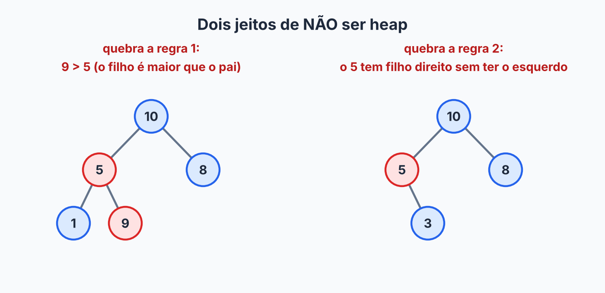
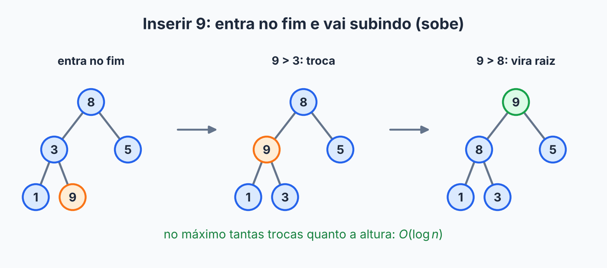
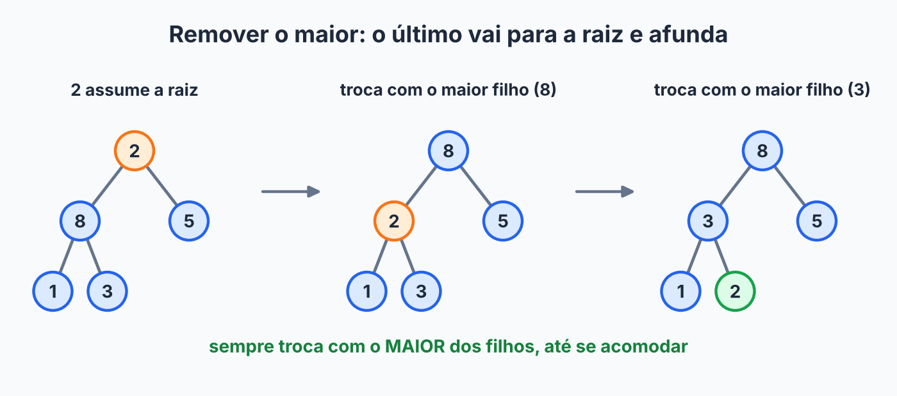

## Sobre

Na [página do heap sort](../heap-sort/) usamos o heap como ferramenta para ordenar. Agora vamos olhar para ele como o que ele realmente é: uma **estrutura de dados completa**, com inserção e remoção, e que sustenta a **fila de prioridade**.

Fila de prioridade é uma fila com um furo-fila **legalizado**. Não importa quem chegou primeiro: sai sempre o de **maior prioridade**. Pensa no pronto-socorro: quem chegou com um dedo cortado espera, quem chegou infartando passa na frente. O contrato:

| Operação | O que faz |
|---|---|
| `add(x)` | insere um elemento |
| `peek()` | espia o de maior prioridade, sem remover |
| `remove()` | remove e devolve o de maior prioridade |

Aparece no agendador de tarefas do sistema operacional, nos jogos (qual inimigo atacar primeiro?), no algoritmo de Dijkstra, e em todo lugar onde alguém precisa de "o melhor agora".

## Por que não usar o que já temos?

| Implementação | `add` | `remove` do maior |
|---|---|---|
| Array sem ordem | \(O(1)\) | \(O(n)\), precisa procurar o maior |
| Array ordenado | \(O(n)\), precisa abrir espaço | \(O(1)\), o maior está no fim |
| **Heap** | \(O(\log n)\) | \(O(\log n)\) |

Repara no padrão: nas duas primeiras, ou a inserção ou a remoção é lenta. O heap é o "meio-termo esperto": **nenhuma das duas fica lenta**, ele só paga um pouquinho em cada.

## O heap máximo, com calma

Um **heap máximo** é uma árvore binária que respeita **duas regras**:

1. **Pai maior ou igual aos filhos.** Consequência: o maior elemento está sempre na raiz, de graça.
2. **Árvore completa:** todos os níveis estão cheios, menos talvez o último, que é preenchido da esquerda para a direita, **sem buracos**.

Atenção: heap **não é** uma BST. Na BST, a esquerda é menor e a direita é maior. No heap, os dois filhos são menores ou iguais ao pai, e a ordem entre irmãos não importa. É uma ordem fraquinha de propósito, e é justamente por ser fraca que é barata de manter.

Este é um heap:

![Heap máximo com 10 na raiz e o array correspondente [10, 5, 8, 1, 3, 2]](heap-exemplo.png)

Já os dois abaixo não são, cada um quebrando uma regra:



### Por que completa?

Por duas razões. A primeira: uma árvore completa tem a **menor altura possível**, \(\lfloor \log_2 n \rfloor\), então tudo que depende da altura custa \(O(\log n)\). A segunda: sem buracos, a árvore cabe em um **array, sem nenhum ponteiro**.

### A árvore dentro de um array

Basta ler a árvore **nível por nível, da esquerda para a direita**. O heap de cima vira o array `[10, 5, 8, 1, 3, 2]`. Olhando as posições:

| Índice | Valor | Filho esquerdo | Filho direito | Pai |
|---|---|---|---|---|
| 0 | 10 | 1 (valor 5) | 2 (valor 8) | não tem |
| 1 | 5 | 3 (valor 1) | 4 (valor 3) | 0 (valor 10) |
| 2 | 8 | 5 (valor 2) | 6 (não existe) | 0 (valor 10) |

O padrão aparece. Para o índice \(i\) (começando em 0):

- filho da esquerda: \(2i + 1\)
- filho da direita: \(2i + 2\)
- pai: \(\lfloor (i - 1) / 2 \rfloor\)

Um índice maior ou igual a `tamanho` significa que aquele filho não existe (como o 6 acima, que está fora do heap).

## Construindo o heap

### Passo 1: a estrutura

Um array que cresce (como no [ArrayList](../arraylist/)) e a quantidade de elementos em uso. As contas de índice viram métodos pequenos, e a troca também, porque vamos usá-la bastante.

```java
import java.util.Arrays;
import java.util.NoSuchElementException;

public class HeapMaximo {
    private int[] elementos;
    private int tamanho;

    public HeapMaximo() {
        elementos = new int[8];
    }

    public int size() {
        return tamanho;
    }

    public boolean isEmpty() {
        return tamanho == 0;
    }

    private int pai(int i) { return (i - 1) / 2; }
    private int esq(int i) { return 2 * i + 1; }
    private int dir(int i) { return 2 * i + 2; }

    private void troca(int i, int j) {
        int temp = elementos[i];
        elementos[i] = elementos[j];
        elementos[j] = temp;
    }

    public int peek() {
        if (isEmpty()) throw new NoSuchElementException("Heap vazio");
        return elementos[0];
    }
}
```

O `peek` é \(O(1)\): o maior mora sempre na posição 0.

### Passo 2: inserir e o `sobe`

Onde colocar o novo elemento? O único lugar que mantém a árvore **completa** é a próxima posição livre do array, no fim. O problema: ele pode ser maior que o pai e quebrar a regra 1. A correção é um "VIP subindo na fila": enquanto for maior que o pai, **troca com ele**.

Inserindo `5, 3, 8, 1, 9, 2` num heap vazio:

```text
add(5)   [5]
add(3)   [5, 3]                  3 < 5, fica
add(8)   [8, 3, 5]               8 > pai (5): sobe e vira a raiz
add(1)   [8, 3, 5, 1]            1 < pai (3), fica
add(9)   [9, 8, 5, 1, 3]         9 sobe duas vezes: passa pelo 3 e pelo 8
add(2)   [9, 8, 5, 1, 3, 2]      2 < pai (5), fica
```



Olha o `9`: entrou lá no fim, passou pelo 3, passou pelo 8, e virou rei. Agora o código:

```java
public void add(int valor) {
    if (tamanho == elementos.length) {
        elementos = Arrays.copyOf(elementos, elementos.length * 2);
    }
    elementos[tamanho] = valor;
    sobe(tamanho);
    tamanho++;
}

private void sobe(int i) {
    while (i > 0 && elementos[i] > elementos[pai(i)]) {
        troca(i, pai(i));
        i = pai(i);
    }
}
```

Como o `sobe` anda sempre em direção à raiz, ele faz no máximo tantas trocas quanto a altura: \(O(\log n)\).

### Passo 3: remover o maior e o `afunda`

O maior é a raiz, mas não dá para só arrancá-la: sobraria um buraco no topo. O truque é elegante: **pega o último elemento do array, coloca na raiz** e diminui o tamanho. A árvore continua completa, mas a nova raiz provavelmente é pequena demais para o cargo. Então a gente a faz **afundar**, trocando sempre com o **maior** dos dois filhos, até ela se acomodar. É o estagiário que foi promovido a diretor por engano e vai sendo corrigido nível por nível.

Continuando do heap `[9, 8, 5, 1, 3, 2]`:

```text
remove()   devolve 9
           último (2) vai para a raiz:     [2, 8, 5, 1, 3]
           afunda: filhos 8 e 5, o maior é 8:   [8, 2, 5, 1, 3]
           afunda: filhos 1 e 3, o maior é 3:   [8, 3, 5, 1, 2]
           chegou ao fim.

remove()   devolve 8
           último (2) vai para a raiz:     [2, 3, 5, 1]
           afunda: filhos 3 e 5, o maior é 5:   [5, 3, 2, 1]
           2 não tem filhos: termina.
```



Por que trocar com o **maior** dos filhos? Porque quem subir vai virar pai do outro filho, e só o maior dos dois consegue ser maior ou igual ao irmão. Se subisse o menor, quebraria a regra do outro lado. Em código:

```java
public int remove() {
    if (isEmpty()) throw new NoSuchElementException("Heap vazio");
    int maior = elementos[0];
    tamanho--;
    elementos[0] = elementos[tamanho];
    afunda(0);
    return maior;
}

private void afunda(int i) {
    while (true) {
        int maior = i;
        if (esq(i) < tamanho && elementos[esq(i)] > elementos[maior]) maior = esq(i);
        if (dir(i) < tamanho && elementos[dir(i)] > elementos[maior]) maior = dir(i);
        if (maior == i) return;       // já respeita a regra
        troca(i, maior);
        i = maior;
    }
}
```

O `afunda`, como o `sobe`, anda numa direção só, então também custa \(O(\log n)\).

### Passo 4: construir um heap a partir de um array

Dado um array qualquer de \(n\) valores, dá para criar um heap vazio e chamar `add` \(n\) vezes: \(O(n \log n)\). Mas dá para fazer melhor, e aqui mora uma das ideias mais bonitas do assunto: **afundar de baixo para cima**, começando do último pai (índice \(n/2 - 1\)) até a raiz.

```java
public HeapMaximo(int[] valores) {
    elementos = Arrays.copyOf(valores, Math.max(valores.length, 1));
    tamanho = valores.length;
    for (int i = tamanho / 2 - 1; i >= 0; i--) {
        afunda(i);
    }
}
```

Com `[3, 9, 2, 7, 5, 1, 8]`:

```text
inicial          [3, 9, 2, 7, 5, 1, 8]
afunda(2)        o 2 troca com o maior filho (8):   [3, 9, 8, 7, 5, 1, 2]
afunda(1)        9 já é maior que 7 e 5: nada
afunda(0)        o 3 troca com o 9:                 [9, 3, 8, 7, 5, 1, 2]
                 continua: o 3 troca com o 7:       [9, 7, 8, 3, 5, 1, 2]
```

Por que isso é \(O(n)\) e não \(O(n \log n)\)? Porque nem todo mundo afunda a árvore inteira. A metade das posições são folhas e não fazem nada. Um quarto só pode descer uma vez. Um oitavo, duas. Quem pode descer muito é muito raro, e os muitos são os que quase não trabalham. Somando o trabalho de todos, o total é proporcional a \(n\).

## Usando

```java
HeapMaximo tarefas = new HeapMaximo();
tarefas.add(4);
tarefas.add(10);
tarefas.add(3);
tarefas.add(5);

System.out.println(tarefas.peek());    // 10
System.out.println(tarefas.remove());  // 10
System.out.println(tarefas.remove());  // 5
System.out.println(tarefas.size());    // 2
```

Na biblioteca do Java, a fila de prioridade é a `PriorityQueue`, implementada com heap. Ela é um heap **mínimo** por padrão (sai o menor primeiro). Para ter o maior primeiro, passe um comparador invertido:

```java
PriorityQueue<Integer> fila = new PriorityQueue<>(Collections.reverseOrder());
```

## Quanto custa?

| Operação | Custo |
|---|---|
| `peek` | \(O(1)\) |
| `add` | \(O(\log n)\) |
| `remove` | \(O(\log n)\) |
| construir a partir de um array | \(O(n)\) |

A altura de uma árvore completa com \(n\) nós é \(\lfloor \log_2 n \rfloor\), e `sobe` e `afunda` fazem no máximo uma troca por nível.

O heap é craque em "o maior (ou menor)", mas **não é bom em tudo**. Procurar um valor qualquer custa \(O(n)\), porque a regra só compara pai e filho, sem relação entre irmãos. E não dá para percorrer em ordem sem ir removendo um por um, o que, aliás, é exatamente o heap sort: \(n\) remoções de \(O(\log n)\), ou seja, \(O(n \log n)\).

## Exercícios

1. Insira em um heap máximo vazio, nessa ordem: `4, 10, 3, 5, 1`. Mostre o array após cada inserção. Depois faça um `remove()`.
2. Construa o heap máximo a partir de `[1, 2, 3, 4, 5, 6]` com o algoritmo de baixo para cima. Qual o array final?
3. Como adaptar `HeapMaximo` para virar um heap **mínimo**?
4. Por que procurar um valor qualquer em um heap é \(O(n)\)?


1. Após cada inserção: `[4]`, `[10, 4]` (o 10 sobe), `[10, 4, 3]`, `[10, 5, 3, 4]` (o 5 sobe uma vez, trocando com o 4) e `[10, 5, 3, 4, 1]`. No `remove()`, devolve 10; o último (1) vai para a raiz, `[1, 5, 3, 4]`, e afunda: troca com 5, `[5, 1, 3, 4]`, e depois com 4, `[5, 4, 3, 1]`.
2. O último pai é o índice 2: o 3 troca com o 6, `[1, 2, 6, 4, 5, 3]`. No índice 1: o 2 troca com o maior filho, o 5, `[1, 5, 6, 4, 2, 3]`. No índice 0: o 1 troca com o 6, `[6, 5, 1, 4, 2, 3]`, e continua afundando: troca com o 3, `[6, 5, 3, 4, 2, 1]`. Resultado: `[6, 5, 3, 4, 2, 1]`.
3. Inverta as comparações no `sobe` (sobe enquanto for **menor** que o pai) e no `afunda` (escolha o **menor** dos filhos).
4. O heap só garante a relação pai e filho. Entre irmãos, ou primos, não há ordem alguma, então não dá para descartar metade dos elementos como na BST. No pior caso, é preciso olhar todos.





No `remove()` de um heap máximo, qual o primeiro passo depois de guardar a raiz?

- [ ] Procurar o segundo maior elemento no array.
- [x] Mover o último elemento do array para a raiz e diminuir o tamanho.
- [ ] Deslocar todos os elementos uma casa para a esquerda.
- [ ] Ordenar o array.
---
Mover o último para a raiz mantém a árvore completa. Depois, `afunda` restaura a regra do heap em \(O(\log n)\).



Qual o custo de construir um heap a partir de um array de \(n\) elementos, afundando de baixo para cima?

- [ ] \(O(\log n)\)
- [x] \(O(n)\)
- [ ] \(O(n \log n)\)
- [ ] \(O(n^2)\)
---
A maior parte dos nós está perto das folhas e afunda pouco. A soma das alturas de todos os nós é \(O(n)\).




## Resumo

- Fila de prioridade: sempre sai o de maior prioridade. O **heap** é a implementação eficiente.
- Heap máximo = árvore binária completa, guardada em array, em que todo pai é \(\geq\) aos filhos.
- `add`: coloca no fim e **sobe**. `remove`: troca a raiz pelo último e **afunda**. Ambos \(O(\log n)\); `peek` é \(O(1)\).
- Construir de um array: afundar do último pai até a raiz, \(O(n)\).
- Não serve para buscar valores quaisquer nem para percorrer em ordem.

## Para estudar mais

- [Heap](https://joaoarthurbm.github.io/eda/posts/heap) — João Arthur Brunet (2019)
