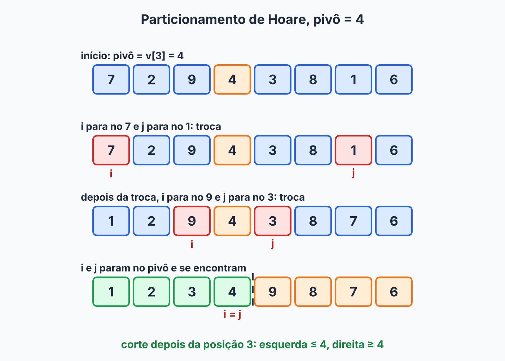

## Sobre

Na página do [quick sort](../quick-sort/), usamos o particionamento de **Lomuto**: um índice varre o trecho e outro marca a fronteira dos "menores que o pivô". É simples e dá para entender de primeira, mas tem um jeito meio trabalhoso de fazer as coisas: troca **muito**.

O **particionamento de Hoare** é o original, de Tony Hoare, criado junto com o próprio quick sort em 1959. A ideia é bem mais esperta, e parece uma cena de filme: **dois índices começam nas pontas e caminham um em direção ao outro**. Só trocam quando encontram um par fora do lugar. Quando se encontram no meio, acabou.

## A ideia

Escolhido o pivô, queremos que, no fim, tudo à esquerda de uma fronteira seja \(\le\) pivô e tudo à direita seja \(\ge\) pivô.

1. O índice `i` começa na esquerda e **avança** enquanto `v[i] < pivo`. Ele para no primeiro elemento que **não** é menor que o pivô: alguém que deveria estar na direita.
2. O índice `j` começa na direita e **recua** enquanto `v[j] > pivo`. Ele para no primeiro que **não** é maior que o pivô: alguém que deveria estar na esquerda.
3. Se `i` ainda está antes de `j`, os dois estão no lado errado. **Trocam de lugar** e a caminhada continua.
4. Se `i` alcançou ou passou `j`, as regiões se encontraram. Acabou.

É como dois fiscais de festa, um em cada ponta do salão: um procura gente do lado errado à esquerda, o outro faz o mesmo à direita. Quando cada um acha alguém, os dois trocam de lado, e os fiscais continuam caminhando até se cruzarem.

Cada elemento é visitado no máximo uma vez por um dos dois índices, então o custo é \(\Theta(n)\), e cada troca já coloca **dois** elementos no lado certo de uma vez. Eficiência de quem não gosta de desperdiçar viagem.

## Implementação

```java
static int particionaHoare(int[] v, int esq, int dir) {
    int pivo = v[esq + (dir - esq) / 2];   // elemento do meio
    int i = esq - 1;
    int j = dir + 1;

    while (true) {
        do { i++; } while (v[i] < pivo);
        do { j--; } while (v[j] > pivo);

        if (i >= j) {
            return j;
        }
        troca(v, i, j);
    }
}

static void troca(int[] v, int i, int j) {
    int temp = v[i];
    v[i] = v[j];
    v[j] = temp;
}
```

Alguns detalhes que merecem atenção:

- **`i` e `j` começam fora do trecho** (`esq - 1` e `dir + 1`) e usam `do ... while`: sempre andam um passo **antes** de testar. Isso evita olhar o mesmo elemento duas vezes.
- Os laços não saem do array. Na primeira rodada, o próprio pivô (que está no trecho) segura os dois índices; nas seguintes, os elementos que acabaram de ser trocados fazem esse papel.
- A comparação é **estrita** (`<` e `>`): os índices **param** em elementos iguais ao pivô. Parece estranho, mas é de propósito, e já já você vai ver por quê.
- Usei `esq + (dir - esq) / 2` para achar o meio sem risco de estourar o `int`.

### O que a função devolve (a parte que pega)

Aqui o Hoare **não** é como o Lomuto: o pivô não termina necessariamente na posição final. O retorno `j` é só um **ponto de corte**: tudo em `v[esq..j]` é \(\le\) pivô e tudo em `v[j+1..dir]` é \(\ge\) pivô. Por isso as chamadas recursivas mudam:

```java
static void quickSort(int[] v, int esq, int dir) {
    if (esq < dir) {
        int p = particionaHoare(v, esq, dir);
        quickSort(v, esq, p);        // note: inclui p
        quickSort(v, p + 1, dir);
    }
}
```

No Lomuto escrevíamos `(esq, p - 1)` e `(p + 1, dir)`, deixando o pivô de fora. Aqui o corte é entre `p` e `p + 1`, e ninguém fica de fora.

> [!WARNING]
> Esta versão **não funciona** com o último elemento como pivô (`pivo = v[dir]`). Tenta com `[1, 2]`: o pivô é 2, `i` para em 1, `j` para em 1, a função devolve `j = 1`, e a chamada recursiva `quickSort(v, 0, 1)` é **exatamente a mesma** de antes. Recursão infinita. Com o elemento do meio (que, por usar divisão inteira, nunca é o último de um trecho com 2 ou mais elementos) ou com o primeiro, o trecho sempre diminui.

## Acompanhando um exemplo

Para `[7, 2, 9, 4, 3, 8, 1, 6]`: `esq = 0`, `dir = 7`, pivô = `v[3] = 4`.



```text
início        [7, 2, 9, 4, 3, 8, 1, 6]    i = -1, j = 8

rodada 1      i para em 0 (7 não é < 4)
              j para em 6 (1 não é > 4)
              0 < 6: troca   ->  [1, 2, 9, 4, 3, 8, 7, 6]

rodada 2      i passa o 2 e para em 2 (9 não é < 4)
              j passa 8 e para em 4 (3 não é > 4)
              2 < 4: troca   ->  [1, 2, 3, 4, 9, 8, 7, 6]

rodada 3      i para em 3 (4 não é < 4)
              j recua até 3 (4 não é > 4)
              3 >= 3: devolve j = 3
```

Resultado: `[1, 2, 3, 4 | 9, 8, 7, 6]`. O corte é depois da posição 3: à esquerda, tudo \(\le 4\); à direita, tudo \(\ge 4\). O quick sort continua nos dois pedaços. Duas trocas só, e o array já ficou dividido.

## Por que a comparação estrita ajuda tanto

Considere um array em que **todos os elementos são iguais**, como `[4, 4, 4, 4]`. Na página do quick sort, vimos que o Lomuto com `<=` cai no pior caso, \(\Theta(n^2)\): todo mundo é "menor ou igual", e o pivô sempre acaba empurrado para uma ponta.

No Hoare, `i` e `j` **param em elementos iguais ao pivô** e trocam (trocar dois valores iguais não muda nada, mas os dois índices avançam). Resultado: eles se encontram **no meio**.

```text
[4, 4, 4, 4]   pivô = v[1] = 4
i para em 0, j para em 3: troca. Depois i = 1, j = 2: troca.
Em seguida i = 2, j = 1: i >= j, devolve j = 1.
Cortes: [0..1] e [2..3]  ->  dois pedaços iguais.
```

O trecho é partido ao meio a cada nível, como no melhor caso. Eu medi isso com um array de 16384 elementos iguais: a profundidade da recursão foi 14, que é \(\log_2 16384\). Com o elemento do meio como pivô, o mesmo vale para um array já ordenado, que costuma ser o pior pesadelo de quem escolhe o primeiro ou o último.

## Hoare ou Lomuto?

| | Lomuto | Hoare |
|---|---|---|
| Índices | um varre, outro marca a fronteira | dois, vindos das pontas |
| Devolve | posição final do pivô | ponto de corte (pivô pode estar em qualquer lado) |
| Recursão | `(esq, p-1)` e `(p+1, dir)` | `(esq, p)` e `(p+1, dir)` |
| Trocas | muitas | poucas |
| Elementos repetidos | pode ir a \(\Theta(n^2)\) | divide no meio |
| Código | mais simples | mais sutil |

Num teste meu, ordenando 1 milhão de inteiros aleatórios, o Lomuto (pivô no último, `<=`) fez cerca de **2,7 vezes mais trocas** que o Hoare. Faz sentido: cada elemento é movido no máximo uma vez pelos índices, então o Hoare faz cerca de \(n/2\) trocas por partição, no máximo; o Lomuto pode chegar a quase \(n\).

Muitas implementações práticas de quick sort usam variações do esquema de Hoare. Para estudar, vale conhecer os dois: o Lomuto, pela clareza; o Hoare, pela esperteza.

## Quanto custa?

O particionamento é \(\Theta(n)\), como no Lomuto. O resto da análise do quick sort não muda: melhor caso e caso médio \(\Theta(n \log n)\); o pior caso \(\Theta(n^2)\) existe, mas com pivô no meio (ou aleatório) é raro. Continua **não estável** e **in-place**.

## Exercícios

1. Particione `[5, 3, 8, 6, 2, 7, 1, 4]` com Hoare (pivô = elemento do meio). Qual o array final e o valor devolvido?
2. Faça o mesmo com `[4, 4, 4, 4]`. Em quantos pedaços ele é cortado?
3. Por que não podemos usar `pivo = v[dir]` com o retorno `j` e as chamadas `(esq, p)` e `(p + 1, dir)`?


1. `esq = 0`, `dir = 7`, pivô = `v[3] = 6`.
   - `i` para em 2 (8); `j` para em 7 (4). Troca: `[5, 3, 4, 6, 2, 7, 1, 8]`.
   - `i` para em 3 (6); `j` para em 6 (1). Troca: `[5, 3, 4, 1, 2, 7, 6, 8]`.
   - `i` avança até 5 (o 7 não é menor que 6). `j` recua: em 5 o 7 é maior que 6, então continua, e para em 4 (o 2 não é maior que 6). Como `i >= j`, devolve `j = 4`.

   Resultado: `[5, 3, 4, 1, 2 | 7, 6, 8]`, com corte depois da posição 4. À esquerda, tudo \(\le 6\); à direita, tudo \(\ge 6\).
2. O pivô é `v[1] = 4`. Ele troca (0, 3), depois (1, 2), e `i` e `j` se cruzam em `j = 1`. O array é cortado em `[0..1]` e `[2..3]`: dois pedaços de tamanho 2.
3. Porque, em casos como `[1, 2]`, o pivô é o maior elemento, `j` termina em `dir` e a chamada recursiva `(esq, p)` recebe o mesmo trecho de antes, sem diminuir: recursão infinita. Com o elemento do meio, `p` é sempre menor que `dir` quando há dois ou mais elementos, e o trecho diminui.





No particionamento de Hoare, o que a função devolve?

- [ ] A posição final e definitiva do pivô.
- [x] Um ponto de corte: tudo até ele é \(\le\) pivô e tudo depois é \(\ge\) pivô.
- [ ] O valor do pivô.
- [ ] O número de trocas feitas.
---
Por isso as chamadas recursivas são `(esq, p)` e `(p + 1, dir)`: o pivô pode estar em qualquer um dos dois lados.



Por que os índices `i` e `j` do Hoare **param** em elementos iguais ao pivô?

- [ ] É um erro de implementação que não afeta o resultado.
- [ ] Para garantir que o algoritmo seja estável.
- [x] Para que arrays com muitos elementos repetidos sejam divididos no meio, evitando o pior caso.
- [ ] Para fazer menos trocas.
---
Parar e trocar elementos iguais faz os índices se encontrarem no meio do trecho, mantendo a divisão equilibrada.




## Resumo

- Hoare usa dois índices vindos das pontas: `i` avança enquanto `v[i] < pivo`, `j` recua enquanto `v[j] > pivo`, e trocam se `i < j`.
- Devolve `j`, um ponto de corte. A recursão é em `(esq, p)` e `(p + 1, dir)`.
- Não pode usar o último elemento como pivô com este retorno: use o do meio (ou o primeiro).
- Faz bem menos trocas que o Lomuto e divide arrays com muitos repetidos no meio.
- \(\Theta(n)\) por partição; o quick sort segue \(\Theta(n \log n)\) em média, não estável e in-place.

## Para estudar mais

- [Particionamento Hoare](http://joaoarthurbm.github.io/eda/posts/particionamento-hoare) — João Arthur Brunet (2019)
- [Quick Sort](../quick-sort/): a versão com Lomuto.
