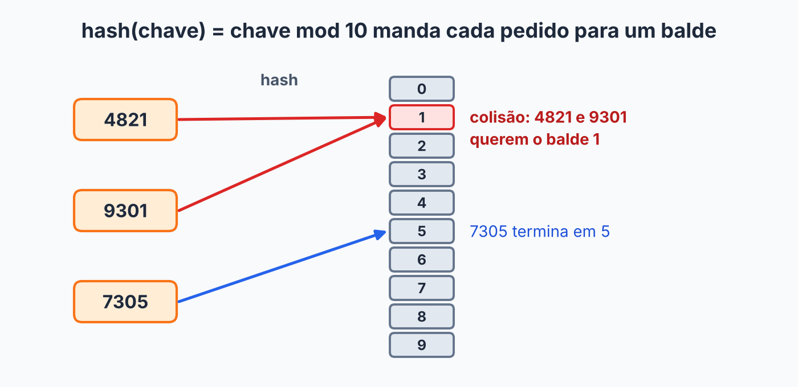
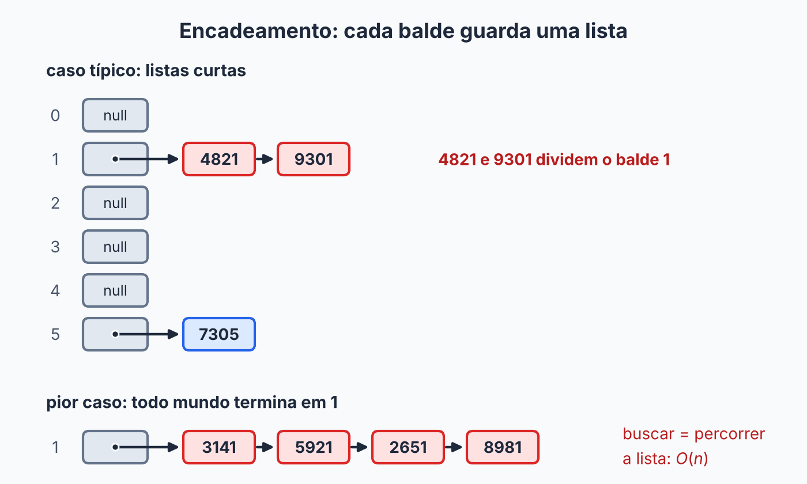
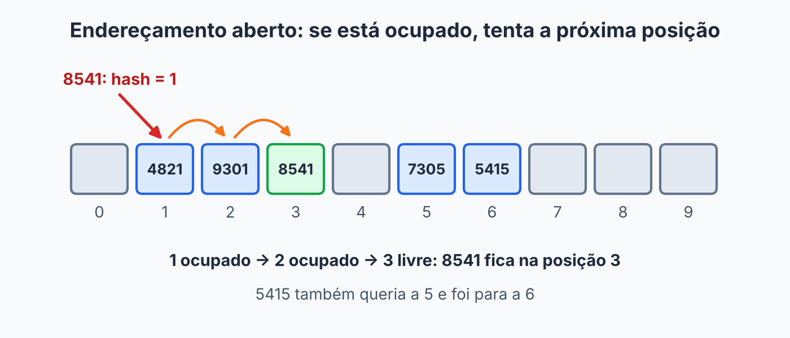

## Sobre

Imagina uma biblioteca sem catálogo e sem estantes organizadas. Você quer o livro "Dom Casmurro" e anda pelas prateleiras olhando lombada por lombada. É a busca em lista: \(O(n)\).

Agora imagina que, dado o **nome do livro**, alguém te dissesse **na hora** em qual prateleira ele está. Sem procurar, sem comparar. Essa é a **tabela hash**, a estrutura por trás de `HashMap`, `HashSet`, dos dicionários do Python e dos objetos do JavaScript. Buscar, inserir e remover em \(O(1)\) **em média**.

Em vez de começar pelo resultado, vamos construir a tabela hash por etapas: partimos de algo que você já conhece (o array), vemos exatamente onde ele deixa de servir e consertamos uma peça de cada vez.

## Começando pelo array

O array tem uma superpotência: se você sabe o **índice**, ler, escrever e apagar uma posição custa \(O(1)\). Será que dá para usar isso para guardar objetos?

Uma lojinha numera seus pedidos de 0 a 999. Cada pedido tem um número e o nome do cliente:

```java
public class Pedido {

    private int numero;
    private String cliente;

    public Pedido(int numero, String cliente) {
        this.numero = numero;
        this.cliente = cliente;
    }

    public int getNumero() {
        return numero;
    }

    public String getCliente() {
        return cliente;
    }
}
```

O número identifica o pedido de forma única: é a **chave**. Como a chave é um inteiro pequeno, dá para guardar cada pedido na posição do array igual ao seu número:

```java
Pedido[] pedidos = new Pedido[1000];
Pedido p = new Pedido(214, "Marta");

pedidos[p.getNumero()] = p;        // inserir: O(1)
Pedido achado = pedidos[214];      // buscar:  O(1)
pedidos[214] = null;               // remover: O(1)
```

Tudo em tempo constante, porque há uma **correspondência direta** entre a chave e o índice. Um array usado assim se chama **tabela de acesso direto**. É a mesma ideia do array de contagem do [counting sort](../counting-sort/).

## Quando o acesso direto quebra

Agora vamos ser realistas. A loja cresceu e os números dos pedidos passaram a ter 9 dígitos, como `483920157`. Para usar o número como índice, o array precisaria de um bilhão de posições para guardar alguns milhares de pedidos. Quase tudo ficaria vazio.

E pior: com um CPF (11 dígitos) o array precisaria de \(10^{11}\) posições, o que é inviável na prática. Para fechar, nem toda chave é um número. Uma placa de carro como `ABC1D23` não é índice de array nenhum.

Os problemas, então, são três: chaves **enormes**, poucas chaves **realmente usadas** (desperdício de memória) e chaves que **nem são números**.

O que a gente quer é um jeito de transformar **qualquer chave** em um **índice de um array pequeno**.

## A ideia: função de hash

Essa transformação é a **função de hash**: recebe a chave e devolve um índice válido do array. Na tabela guardamos pares **⟨chave, valor⟩**: a chave é o número do pedido, e o valor é o `Pedido`. Como a chave costuma ser um atributo do próprio valor, essa redundância é bem comum.

Uma boa função de hash tem quatro características:

1. **Determinística**: a mesma chave sempre dá o mesmo índice.
2. **Dentro dos limites**: o resultado está sempre entre \(0\) e \(m - 1\), em que \(m\) é o tamanho do array.
3. **Uniforme**: todos os índices têm mais ou menos a mesma chance de aparecer, para os objetos se espalharem.
4. **Rápida**: executa em \(O(1)\).

Você, aliás, já usou uma função de hash: na tabela de acesso direto, `hash(chave) = chave`. Funciona, mas só para chaves pequenas. Qual conta atende às duas primeiras características para **qualquer** chave? O **resto da divisão**. Ele é sempre o mesmo para a mesma chave e sempre cai entre \(0\) e \(m - 1\). Com um array de 10 posições:

```java
private int hash(int chave) {
    return chave % tabela.length;
}
```

Alguns pedidos de 4 dígitos ficam assim:

```text
4821 % 10 = 1
7305 % 10 = 5
1190 % 10 = 0
6013 % 10 = 3
```

```text
posição:  0     1     2    3     4    5     6    7    8    9
conteúdo: 1190  4821  -    6013  -    7305  -    -    -    -
```

Com isso já dá para montar a primeira versão da tabela. Repara que ela é o array de acesso direto com um passo a mais: calcular o `hash` antes de acessar a posição.

```java
public class TabelaHash {

    private Pedido[] tabela = new Pedido[10];

    private int hash(int chave) {
        return chave % tabela.length;
    }

    public void put(int chave, Pedido valor) {
        tabela[hash(chave)] = valor;
    }

    public Pedido get(int chave) {
        return tabela[hash(chave)];
    }

    public Pedido remove(int chave) {
        int i = hash(chave);
        Pedido removido = tabela[i];
        tabela[i] = null;
        return removido;
    }
}
```

Como `hash` é \(O(1)\), as três operações também são. Parece tudo resolvido. Mas...

## Colisões

**E se duas chaves diferentes caírem na mesma posição?**

O pedido `9301` também termina em 1, então `hash(9301) = 1`, a mesma posição do `4821`. Pelo nosso `put`, o `9301` **sobrescreve** o `4821` em silêncio: o pedido some. E o `get(4821)` passaria a devolver o pedido `9301`, porque só olhamos o índice e nunca conferimos a chave. Isso tem nome: **colisão**. Na verdade, toda chave que termina em 1 vai para a posição 1.



Temos três caminhos:

1. **Ignorar o problema.** Fora de cogitação: uma estrutura de dados não pode perder o que você guardou.
2. **Escolher uma função de hash que nunca colida.** Só é possível em casos raros. Existem muito mais chaves possíveis do que posições, e, pelo princípio da casa dos pombos, se há mais pombos que casinhas, dois acabam na mesma. Uma função melhor **reduz** as colisões (veremos como mais adiante), mas não as elimina.
3. **Tratar a colisão quando ela acontecer.**

Sobra o caminho 3. A pergunta que define uma tabela hash não é "como evitar colisões", e sim **"o que fazer quando elas acontecem?"**. Há duas respostas clássicas.

## Estratégia A: encadeamento

A ideia é simples: em vez de guardar **um** objeto em cada posição, guardamos uma **lista** de objetos. Quem colide entra na lista da posição. Cada posição do array é chamada de **balde**.

Inserindo `4821`, `9301`, `7305` e `5415` numa tabela de 10 baldes:

```text
0:
1: 4821 -> 9301
2:
3:
4:
5: 7305 -> 5415
6:
7:
8:
9:
```

Como `4821` e `9301` têm o mesmo **hash** (mas chaves diferentes), eles dividem a lista do balde 1. Por isso a lista guarda o objeto inteiro: é a **chave** que diferencia quem está no mesmo balde. E atenção, porque esse é um erro recorrente: **não existem duas chaves iguais numa tabela hash**. Se você faz `put` de uma chave que já existe, o valor é **atualizado**.

A tabela agora é um array de listas. Cada balde começa como `null` e só ganha uma lista quando alguém precisa dele:



```java
public class TabelaHash {

    private ArrayList<Pedido>[] tabela;

    @SuppressWarnings("unchecked")      // o Java não cria array de genéricos direto
    public TabelaHash(int capacidade) {
        tabela = new ArrayList[capacidade];
    }

    private int hash(int chave) {
        return chave % tabela.length;
    }
}
```

### get

Calcula o balde e, se existir uma lista ali, percorre comparando **as chaves**. Se o balde for `null` ou a chave não estiver na lista, devolve `null`.

```java
public Pedido get(int chave) {
    ArrayList<Pedido> lista = tabela[hash(chave)];

    if (lista == null) {
        return null;
    }
    for (Pedido p : lista) {
        if (p.getNumero() == chave) {
            return p;
        }
    }
    return null;
}
```

### put

Se o balde ainda é `null`, cria a lista. Depois percorre a lista procurando a chave: se achar, **atualiza**; se não achar, adiciona no fim.

```java
public void put(int chave, Pedido valor) {
    int hash = hash(chave);
    ArrayList<Pedido> lista = tabela[hash];

    if (lista == null) {
        lista = new ArrayList<>();
        tabela[hash] = lista;
    }
    for (int i = 0; i < lista.size(); i++) {
        if (lista.get(i).getNumero() == chave) {
            lista.set(i, valor);          // chave repetida: só atualiza
            return;
        }
    }
    lista.add(valor);
}
```

### remove

Acha o pedido no balde e tira da lista. O `remove(i)` do `ArrayList` já devolve o elemento removido.

```java
public Pedido remove(int chave) {
    ArrayList<Pedido> lista = tabela[hash(chave)];

    if (lista == null) {
        return null;
    }
    for (int i = 0; i < lista.size(); i++) {
        if (lista.get(i).getNumero() == chave) {
            return lista.remove(i);
        }
    }
    return null;
}
```

### Quanto custa?

Agora as operações percorrem uma lista, então deixaram de ser \(O(1)\) garantido. Imagina que chegam os pedidos `3141`, `5921`, `2651` e `8981`. Todos terminam em 1, então caem no **mesmo balde**:

```text
1: 3141 -> 5921 -> 2651 -> 8981
```

Buscar um deles obriga a percorrer a lista inteira. No pior caso, todas as chaves caem no mesmo balde e a tabela vira uma lista: \(O(n)\).

Como não queremos o pior caso, usamos uma função de hash que **espalha** os objetos. Se a tabela tem \(m\) baldes e guarda \(n\) objetos, o tamanho médio de cada lista é:

$$
\alpha = \frac{n}{m}
$$

Esse \(\alpha\) é o **fator de carga**: o quão cheia a tabela está. Uma operação paga \(1\) para calcular o hash e ir ao balde, mais \(\alpha\) para percorrer a lista em média, ou seja, \(O(1 + \alpha)\). Enquanto \(\alpha\) se mantém pequeno, o custo é constante.

## Estratégia B: endereçamento aberto

Resposta diferente para a mesma pergunta: **sem listas**. Tudo fica dentro do próprio array. Se a posição está ocupada, procuramos outra. Na **sondagem linear**, tentamos a posição seguinte, depois a outra, e assim por diante, voltando ao início quando passa do fim. É chegar ao estacionamento, ver sua vaga favorita ocupada e ir seguindo em frente até achar uma livre.

Para generalizar, usamos uma variável `sondagem` que começa em 0 e sobe 1 a cada colisão. A posição tentada é:

```text
indice = (hash(chave) + sondagem) % tamanho
```

Inserindo `4821`, `9301`, `7305`, `5415` e `8541` numa tabela de 10 posições:

1. `4821`: `(1 + 0) % 10 = 1`. Livre, ocupa a posição 1.
2. `9301`: `(1 + 0) % 10 = 1`. Ocupada. Com `sondagem = 1`, `(1 + 1) % 10 = 2`. Livre, ocupa a posição 2.
3. `7305`: `(5 + 0) % 10 = 5`. Livre, ocupa a posição 5.
4. `5415`: `(5 + 0) % 10 = 5`. Ocupada. Com `sondagem = 1`, vai para a posição 6. Livre, ocupa.
5. `8541`: `hash = 1`. Ocupadas a 1 e a 2. Com `sondagem = 2`, `(1 + 2) % 10 = 3`. Livre, ocupa a posição 3.



```text
posição:  0  1     2     3     4  5     6     7  8  9
conteúdo: -  4821  9301  8541  -  7305  5415  -  -  -
```

### Buscar

Começamos no índice da chave e andamos até achar a chave ou encontrar uma posição **vazia**. Vazia quer dizer "essa chave não está na tabela": se estivesse, teria estacionado aqui antes.

```java
private int indiceDe(int chave) {
    for (int sondagem = 0; sondagem < tabela.length; sondagem++) {
        int i = (hash(chave) + sondagem) % tabela.length;

        if (tabela[i] == null) {
            return -1;                          // posição vazia: a chave não está
        }
        if (tabela[i].getNumero() == chave) {
            return i;
        }
    }
    return -1;
}
```

### E a remoção?

Aqui mora a pegadinha. Na tabela de cima, remova o `9301` **esvaziando a posição 2**. Agora busque o `8541`: começa na posição 1 (é o `4821`, não é ele), vai para a 2... **vazia**. "Então o `8541` não existe." Errado. Ele está na posição 3, mas o buraco enganou a busca.

**Por quê?** Porque a busca usa a posição vazia como sinal de parada. Se removermos deixando um buraco no meio de uma sequência de colisões, quebramos o caminho que leva às chaves seguintes.

A solução é, em vez de `null`, colocar na posição um **objeto marcador** (uma "lápide"): um pedido especial que significa "já teve alguém aqui, mas agora está livre". Aqui ele tem número `Integer.MIN_VALUE` e cliente `"APAGADO"`. A busca **continua passando** por ele. Já a inserção pode **reaproveitá-lo**.

### A classe completa

```java
public class TabelaHashAberta {

    private static final Pedido APAGADO = new Pedido(Integer.MIN_VALUE, "APAGADO");

    private Pedido[] tabela = new Pedido[10];

    private int hash(int chave) {
        return chave % tabela.length;
    }

    private int indiceDe(int chave) {
        for (int sondagem = 0; sondagem < tabela.length; sondagem++) {
            int i = (hash(chave) + sondagem) % tabela.length;

            if (tabela[i] == null) {
                return -1;
            }
            if (tabela[i] != APAGADO && tabela[i].getNumero() == chave) {
                return i;
            }
        }
        return -1;
    }

    public Pedido get(int chave) {
        int i = indiceDe(chave);
        return i == -1 ? null : tabela[i];
    }

    public void put(int chave, Pedido valor) {
        int existente = indiceDe(chave);
        if (existente != -1) {
            tabela[existente] = valor;          // chave repetida: só atualiza
            return;
        }

        for (int sondagem = 0; sondagem < tabela.length; sondagem++) {
            int i = (hash(chave) + sondagem) % tabela.length;

            if (tabela[i] == null || tabela[i] == APAGADO) {
                tabela[i] = valor;
                return;
            }
        }
        throw new IllegalStateException("tabela cheia");
    }

    public Pedido remove(int chave) {
        int i = indiceDe(chave);
        if (i == -1) {
            return null;
        }
        Pedido removido = tabela[i];
        tabela[i] = APAGADO;                    // lápide: a busca continua passando
        return removido;
    }
}
```

O `put` primeiro confere se a chave já existe (`indiceDe`). Sem isso, poderíamos encher uma lápide e deixar uma cópia antiga da mesma chave mais à frente, e a tabela passaria a ter duas chaves iguais.

Perceba também que a tabela **não tem listas**, então não cabe mais do que o tamanho dela: o fator de carga \(\alpha\) nunca passa de 1. Por isso o `put` lança uma exceção quando não acha posição livre. Aqui isso é uma decisão didática: na prática, a tabela é redimensionada **antes** de encher, como veremos.

### O defeito da sondagem linear

Repara no que aconteceu no exemplo: as chaves que colidem vão ocupando posições **vizinhas** e formando um bloco compacto, o `4821 9301 8541`. Esse bloco é um problema, porque qualquer chave que caia **dentro** dele também precisa andar até o fim e acaba aumentando o bloco. É o **agrupamento primário**.

Quem analisou isso com rigor foi **Donald Knuth**, que deduziu a conta em 1962, e esse trabalho é lembrado como um dos marcos do início da análise de algoritmos. Para uma tabela com fator de carga \(\alpha\) e uma boa função de hash, o número médio de posições examinadas na sondagem linear é:

$$
\text{busca com sucesso} \approx \frac{1}{2}\left(1 + \frac{1}{1-\alpha}\right)
\qquad
\text{busca sem sucesso} \approx \frac{1}{2}\left(1 + \frac{1}{(1-\alpha)^2}\right)
$$

Com números:

| \(\alpha\) | Busca com sucesso | Busca sem sucesso |
|---|---|---|
| 0,50 | 1,5 | 2,5 |
| 0,75 | 2,5 | 8,5 |
| 0,90 | 5,5 | 50,5 |

Olha o que acontece na última coluna: de 0,75 para 0,90, procurar uma chave que **não está** passa de 8,5 para 50,5 posições. Quanto mais cheia a tabela, mais o agrupamento cobra o preço. Para comparar, o encadeamento paga \(1 + \alpha/2\) e \(1 + \alpha\), e continua razoável mesmo com \(\alpha = 1\).

Existem outras estratégias de sondagem. Na **sondagem quadrática**, em vez de andar 1, 2, 3 posições, andamos 1, 4, 9 (`sondagem * sondagem`); no **hash duplo**, o tamanho do passo vem de uma segunda função de hash. Ambas reduzem o agrupamento primário, mas trazem os seus próprios cuidados, e a linear continua sendo a melhor para entender a ideia.

## Funções de hash

Até aqui usamos tamanho 10, e `chave % 10` é só o **último dígito**. Qualquer padrão nos últimos dígitos vira colisão em massa. Vamos conhecer funções melhores. As duas clássicas, a **divisão** e a **multiplicação**, são discutidas por Knuth no volume 3 de *The Art of Computer Programming* (seção 6.4).

### Método da divisão

É o que já usamos: `hash(chave) = chave % m`. O segredo está na escolha de \(m\). Suponha pedidos em promoção, todos múltiplos de 25:

```text
100, 125, 150, 175, 200, 225, ..., 475      (16 chaves)
```

Com \(m = 100\), os restos só podem ser múltiplos de 25 (0, 25, 50 ou 75), porque 100 também é múltiplo de 25. São **16 chaves disputando 4 posições**: 12 colisões. Com \(m = 101\), um número **primo**, as 16 chaves caem em 16 posições diferentes. Nenhuma colisão.

A intuição é que, se \(m\) tem divisores em comum com o padrão das chaves, os restos ficam presos a poucos valores. Um primo quase não tem divisores, então embaralha melhor. Por isso o costume é escolher um tamanho **primo**, e evitar potências de 10 e de 2.

### Método da multiplicação

Aqui, em vez de dividir por um primo, fazemos quatro passos:

1. multiplicar a chave por uma constante \(A\), um número decimal entre 0 e 1;
2. ficar com a **parte fracionária** do resultado;
3. multiplicar essa fração pelo tamanho da tabela \(m\);
4. ficar com a parte inteira.

$$
hash(k) = \lfloor m \cdot ((k \cdot A) \bmod 1) \rfloor
$$

O "mod 1" é só um jeito de dizer "a parte fracionária". Um exemplo com a chave `2025`, \(A = 0{,}6180339887\) e \(m = 16\):

```text
1. 2025 * 0,6180339887 = 1251,5188...
2. parte fracionária:      0,5188...
3. 0,5188... * 16      =   8,3012...
4. parte inteira:          8
```

Então `hash(2025) = 8`. Em código:

```java
private int hash(int chave) {
    double A = 0.6180339887;               // (raiz de 5 - 1) / 2
    double fracao = (chave * A) % 1;       // parte fracionária de chave * A
    return (int) (tabela.length * fracao);
}
```

**Por que usar isso, se já temos a divisão?** Porque aqui o valor de \(m\) **não é crítico**: pode até ser uma potência de 2, que era justamente o que evitávamos. Veja as chaves `16, 32, 48, ..., 160` numa tabela de 16 posições:

```text
divisão:        todas caem na posição 0
multiplicação:  14 12 10 8 7 5 3 1 15 14        (9 posições para 10 chaves)
```

E de onde vem essa constante? Foi **Knuth** quem sugeriu usar o inverso da razão áurea, \(A = (\sqrt{5} - 1)/2 \approx 0{,}6180339887\). Com ela, chaves consecutivas (ou espaçadas por um passo fixo) se espalham pela tabela o mais uniformemente possível. Com as chaves `1, 2, ..., 10` e \(m = 16\), os hashes são `9 3 13 7 1 11 5 15 8 2`: dez posições diferentes.

> [!NOTE]
> Na prática, o cálculo não usa `double`. Com inteiros de 32 bits, \(A\) vira \(\lfloor 2^{32} \cdot 0{,}618\ldots \rfloor = 2654435769\) (em hexadecimal, `0x9E3779B9`), e, para uma tabela com \(m = 2^p\) posições, o hash é uma multiplicação e um deslocamento de bits: `(int) (((long) chave * 2654435769L & 0xFFFFFFFFL) >>> (32 - p))`. É a mesma conta, só que sem ponto flutuante.

### Dobramento

Quando a chave é muito longa, como um CPF de 11 dígitos, uma saída é **dobrar**: quebrar a chave em pedaços, somar os pedaços e aplicar a divisão ao resultado. Para o CPF `123.456.789-09`:

```text
123 + 456 + 789 + 09 = 1377
1377 % 11 = 2
```

Como toda soma, ele ignora a **ordem** dos pedaços, então vale como complemento e não como solução única.

### E chaves que não são números?

Lembra da placa `ABC1D23`? Antes da divisão ou da multiplicação, precisamos transformar a chave em **um inteiro**. No Java, todo objeto tem o método `hashCode()` para isso, e `String` já vem com um.

Uma ideia ingênua para strings seria somar os códigos dos caracteres, mas somar não liga para a ordem das letras:

```text
"amor" -> 97 + 109 + 111 + 114 = 431
"roma" -> 114 + 111 + 109 + 97 = 431
```

Todo anagrama cai no mesmo lugar. A saída é fazer a **posição** de cada letra pesar, multiplicando o acumulado por uma constante a cada passo (o `String.hashCode()` do Java usa 31):

```java
int h = 0;
for (int i = 0; i < chave.length(); i++) {
    h = 31 * h + chave.charAt(i);
}
```

Com isso, a função de hash fica em dois passos: objeto para inteiro com `hashCode()`, e inteiro para índice com o resto da divisão. Como `hashCode()` pode dar um número negativo, usamos `Math.floorMod`, que sempre devolve algo entre \(0\) e \(m - 1\):

```java
private int hash(String chave) {
    return Math.floorMod(chave.hashCode(), tabela.length);
}
```

## Fator de carga e redimensionamento

Nossas tabelas têm tamanho fixo. No encadeamento, as listas só crescem e as operações voltam a \(O(n)\). No endereçamento aberto, a tabela chega a ficar cheia. Em ambos os casos, a saída é a mesma: quando \(\alpha\) passa de um limite, **criar uma tabela maior e passar tudo para ela**. A biblioteca padrão do Java usa o limite de **0,75**.

Por que 0,75 e não 0,1 ou 0,95? Se o limite for baixo, o redimensionamento acontece o tempo todo, e ele custa \(O(n)\). Se for alto, as colisões se multiplicam. Lembra da tabela de Knuth: em \(\alpha = 0{,}9\), uma busca sem sucesso na sondagem linear já custa mais de 50 posições. O 0,75 é um equilíbrio que a teoria e a prática mostraram funcionar bem.

Há uma pegadinha que derruba muita gente: **não basta copiar** os objetos para o array novo. O índice depende do tamanho da tabela (`% tamanho`), então a mesma chave pode ir para outra posição. Por exemplo, `4815 % 10 = 5`, mas `4815 % 20 = 15`. É preciso calcular o `hash` de novo para cada objeto. Esse recálculo se chama **rehash**.

No encadeamento, a tabela precisa saber quantos pedidos tem (`tamanho`). O `put` e o `remove` mantêm essa conta, e o `put` confere o fator de carga ao final:

```java
private static final double FATOR_DE_CARGA = 0.75;
private int tamanho;   // novo atributo: quantos pedidos a tabela guarda

// no fim do put, depois de lista.add(valor):
tamanho++;
if ((double) tamanho / tabela.length > FATOR_DE_CARGA) {
    redimensiona();
}

// no remove, logo antes de return lista.remove(i):
tamanho--;
```

E o `redimensiona` cria um array com o dobro do tamanho e reinsere todo mundo com o `put`. Como o `hash` usa `tabela.length`, que já é o tamanho novo, o rehash acontece sozinho:

```java
@SuppressWarnings("unchecked")
private void redimensiona() {
    ArrayList<Pedido>[] antiga = tabela;
    tabela = new ArrayList[antiga.length * 2];
    tamanho = 0;

    for (ArrayList<Pedido> lista : antiga) {
        if (lista != null) {
            for (Pedido p : lista) {
                put(p.getNumero(), p);
            }
        }
    }
}
```

No endereçamento aberto é a mesma ideia, e o `put` só reinsere o que não é `null` nem `APAGADO`. Como as lápides não são reinseridas, elas desaparecem de bônus.

```java
private void redimensiona() {
    Pedido[] antiga = tabela;
    tabela = new Pedido[antiga.length * 2];
    tamanho = 0;

    for (Pedido p : antiga) {
        if (p != null && p != APAGADO) {
            put(p.getNumero(), p);
        }
    }
}
```

Repara que dobrar o tamanho (10, 20, 40...) faz a tabela deixar de ser prima. Para esta página, tudo bem: o importante é entender o rehash. Implementações reais resolvem isso de outras formas: algumas pulam para o próximo primo, e o `HashMap` do Java usa potências de 2 junto com uma função de hash que embaralha bem os bits.

O redimensionamento custa \(O(n)\), mas só acontece de vez em quando, depois de muitas inserções baratas. Como no [ArrayList](../arraylist/), o custo **médio** por inserção continua \(O(1)\).

## Na prática

Você raramente escreve uma tabela hash do zero: usa `HashMap` (que, como a nossa estratégia A, resolve colisões com encadeamento) ou `HashSet`. A API é a mesma que construímos, com `put`, `get` e `remove`, e mais três métodos para percorrer a tabela:

```java
Map<Integer, Pedido> pedidos = new HashMap<>();
pedidos.put(483920157, new Pedido(483920157, "Marta"));

for (int numero : pedidos.keySet()) { }                              // só as chaves
for (Pedido p : pedidos.values()) { }                                // só os valores
for (Map.Entry<Integer, Pedido> par : pedidos.entrySet()) { }        // os pares chave/valor
```

Lembre que **não há ordem**: o elemento da posição 3 da tabela não foi necessariamente inserido antes do da posição 4, então o `for` não segue a ordem de inserção.

> [!NOTE]
> Se você usar um objeto seu como chave, sobrescreva `equals` e `hashCode` **juntos**. Chaves iguais precisam ter o mesmo hash, senão a busca procura no balde errado e não acha. E não altere um objeto depois de usá-lo como chave: o hash dele muda e a tabela nunca mais o encontra.

## Qual estratégia escolher?

| | Encadeamento | Endereçamento aberto |
|---|---|---|
| Onde ficam as colisões | em listas fora do array | no próprio array |
| Fator de carga | pode passar de 1 | precisa ficar abaixo de 1 |
| Remoção | simples | exige o marcador de apagado |
| Busca sem sucesso (média) | \(1 + \alpha\) | \(\frac{1}{2}\left(1 + \frac{1}{(1-\alpha)^2}\right)\) na linear |

## Quanto custa?

| Operação | Caso médio | Pior caso |
|---|---|---|
| `get`, `put`, `remove` | \(O(1)\) | \(O(n)\) |

O pior caso é todas as chaves colidirem no mesmo balde (ou na mesma sequência de sondagem). Com uma boa função de hash e o fator de carga controlado, isso é raro.

E o que a gente paga pela velocidade? **A tabela não guarda ordem.** Não dá para pegar o menor elemento, o próximo maior ou percorrer em ordem crescente sem ordenar tudo. Para isso existem as árvores, que vêm logo depois.

## Exercícios

1. Uma tabela com 7 posições usa \(h(k) = k \bmod 7\) e **sondagem linear**. Insira, nessa ordem, as chaves 10, 17, 24, 3 e 8. Desenhe o array final.
2. Na tabela do exercício anterior, remova a chave 17 **apenas esvaziando a posição**. O que acontece ao buscar a chave 24? Como o marcador de apagado resolve?
3. Por que o `redimensiona` recalcula o `hash` de cada pedido, em vez de copiar cada balde para a mesma posição da tabela nova?
4. Por que somar os códigos dos caracteres é uma função de hash ruim para palavras?
5. Quantas colisões acontecem ao inserir as chaves 20, 40, 60, 80 e 100 numa tabela de 10 posições? E numa de 11?
6. Calcule `hash(100)` pelo método da multiplicação, com \(A = 0{,}6180339887\) e \(m = 20\).
7. Na sondagem linear, quantas posições uma busca **sem sucesso** examina, em média, com \(\alpha = 0{,}5\)? E com \(\alpha = 0{,}75\)? Use a fórmula de Knuth.


1. \(10 \bmod 7 = 3\): vai para a posição 3. \(17 \bmod 7 = 3\): ocupada, tenta 4. \(24 \bmod 7 = 3\): 3 e 4 ocupadas, vai para 5. \(3 \bmod 7 = 3\): 3, 4 e 5 ocupadas, vai para 6. \(8 \bmod 7 = 1\): posição 1 livre. Array final (posições 0 a 6): `[_, 8, _, 10, 17, 24, 3]`.
2. Ao buscar 24: começa na posição 3 (10, diferente), vai para 4 (agora vazia) e para, concluindo **errado** que 24 não está na tabela. Com o marcador de apagado, a posição 4 deixa de ser vazia, a busca atravessa e encontra 24 na posição 5.
3. Porque o índice é `hash % tamanho`: ao mudar o tamanho, a mesma chave tende a ir para outro balde. Copiar o balde para a mesma posição deixaria chaves onde a busca nunca as procuraria.
4. A soma ignora a ordem das letras, então todos os anagramas (`amor`, `roma`, `mora`) colidem. O hash polinomial, que multiplica o acumulado por 31 a cada letra, faz a posição pesar.
5. Com 10 posições, todas as chaves terminam em 0 e caem na posição 0: são 4 colisões (cada chave depois da primeira). Com 11 posições, os restos são 9, 7, 5, 3 e 1, todos diferentes: nenhuma colisão.
6. \(100 \cdot 0{,}6180339887 = 61{,}80339887\). A parte fracionária é \(0{,}80339887\). Multiplicando por 20, dá \(16{,}0679774\). A parte inteira é **16**.
7. Com \(\alpha = 0{,}5\): \(\frac{1}{2}\left(1 + \frac{1}{0{,}5^2}\right) = \frac{1}{2}(1 + 4) = 2{,}5\). Com \(\alpha = 0{,}75\): \(\frac{1}{2}\left(1 + \frac{1}{0{,}25^2}\right) = \frac{1}{2}(1 + 16) = 8{,}5\). Quase quatro vezes mais, só por deixar a tabela mais cheia.





O que acontece com o custo de uma tabela hash se **todas** as chaves caírem no mesmo balde?

- [ ] Continua \(O(1)\), porque a função de hash garante isso.
- [ ] Passa a ser \(O(\log n)\).
- [x] Passa a ser \(O(n)\): a tabela vira, na prática, uma lista.
- [ ] A tabela deixa de funcionar.
---
O \(O(1)\) é **médio** e depende de as chaves se espalharem. Com todas no mesmo balde, é preciso percorrer a lista inteira.



Por que, no endereçamento aberto, remover uma chave coloca um marcador de apagado em vez de deixar a posição vazia?

- [ ] Para economizar memória.
- [ ] Para poder ordenar as chaves.
- [x] Para que a busca continue passando por ali, sem parar cedo demais.
- [ ] Para evitar o redimensionamento.
---
Uma posição vazia no meio de uma sequência de colisões faria a busca parar antes de chegar às chaves seguintes.



Qual vantagem o método da multiplicação (de Knuth) tem sobre o método da divisão?

- [ ] Nunca gera colisões.
- [x] O tamanho da tabela não é crítico: pode ser, por exemplo, uma potência de 2.
- [ ] Só funciona com chaves que são strings.
- [ ] Dispensa o tratamento de colisões.
---
Na divisão, o tamanho da tabela precisa ser escolhido com cuidado (de preferência primo). Na multiplicação, o espalhamento vem da constante \(A\), então o tamanho importa bem menos. Colisões continuam existindo e precisam ser tratadas.



Qual operação uma tabela hash **não** faz de forma eficiente?

- [ ] Buscar uma chave.
- [ ] Inserir um par chave/valor.
- [x] Percorrer as chaves em ordem crescente.
- [ ] Remover uma chave.
---
A tabela hash espalha as chaves e não guarda ordem. Para percorrer em ordem é preciso ordenar, ou usar uma árvore de busca.




## Resumo

- Um array de **acesso direto** usa a chave como índice, mas só serve para chaves inteiras e pequenas.
- A tabela guarda pares **⟨chave, valor⟩**. Não existem duas chaves iguais: um `put` com chave repetida atualiza o valor.
- A **função de hash** transforma qualquer chave em um índice. Ela deve ser determinística, dentro dos limites, uniforme e rápida.
- **Método da divisão**: `chave % m`, com \(m\) primo. **Método da multiplicação** (Knuth): \(\lfloor m \cdot ((k \cdot A) \bmod 1) \rfloor\), com \(A \approx 0{,}618\), e \(m\) pouco crítico. Chaves longas podem ser **dobradas**, e textos viram inteiro com `hashCode()`.
- **Colisões** são inevitáveis (casa dos pombos) e precisam de uma estratégia.
- **Encadeamento**: cada balde é uma lista. **Endereçamento aberto**: tudo no array, com sondagem; a remoção exige o marcador de apagado.
- A sondagem linear sofre de **agrupamento**. Knuth mostrou que, em \(\alpha = 0{,}9\), uma busca sem sucesso examina cerca de 50 posições, contra 8,5 em \(\alpha = 0{,}75\).
- O **fator de carga** \(\alpha = n/m\) é mantido baixo dobrando o tamanho e recalculando os índices (*rehash*).
- Busca, inserção e remoção: \(O(1)\) em média, \(O(n)\) no pior caso. Sem ordem.

## Para estudar mais

- [Tabelas Hash](http://joaoarthurbm.github.io/eda/posts/hashtable) — João Arthur Brunet (2019)
- [Uma aula só com perguntas: endereçamento aberto](http://joaoarthurbm.github.io/eda/posts/enderecamento-aberto-so-perguntas) — João Arthur Brunet (2019)
- *The Art of Computer Programming, vol. 3: Sorting and Searching*, seção 6.4 (Hashing) — Donald E. Knuth
- *Introduction to Algorithms*, capítulo "Hash Tables" — Cormen, Leiserson, Rivest e Stein
