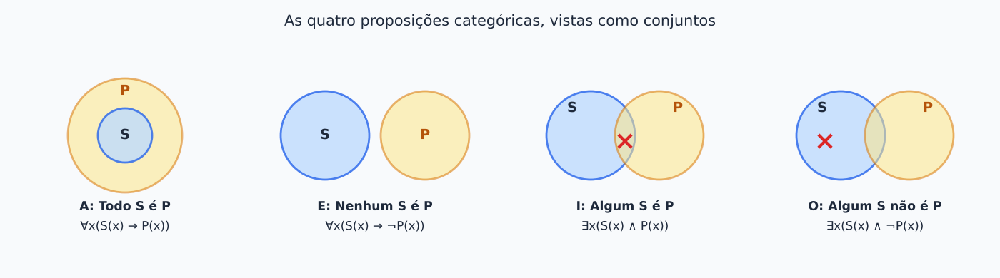

## Sobre

Traduzir para predicados é a parte mais escorregadia da matéria: não existe "tabelinha mágica", mas existe um **jeito de pensar** que funciona quase sempre. Aqui você aprende esse jeito, começando pelas frases mais simples e chegando em coisas como "apenas um estudante ganhou todos os prêmios".

Ao final você deve conseguir:

- reconhecer as quatro formas categóricas (todo, nenhum, algum, algum não) e escrevê-las em fórmulas;
- explicar por que $\forall$ vai com $\to$ e $\exists$ vai com $\land$;
- traduzir frases com várias propriedades, vários quantificadores e quantificadores **aninhados**;
- usar **funções** e **igualdade** para frases como "só Paulo deve a Hasina";
- expressar "pelo menos", "no máximo" e "exatamente" $n$ objetos.

## 1. As quatro formas categóricas

Boa parte das frases do dia a dia tem uma destas quatro formas, em que $S$ e $P$ são **classes** (conjuntos de objetos):



| Forma | Frase | Fórmula | Em palavras |
| --- | --- | --- | --- |
| **A** | Todo $S$ é $P$ | $\forall x\,(S(x)\to P(x))$ | tudo que é $S$ também é $P$ |
| **E** | Nenhum $S$ é $P$ | $\forall x\,(S(x)\to\neg P(x))$ | tudo que é $S$ não é $P$ |
| **I** | Algum $S$ é $P$ | $\exists x\,(S(x)\land P(x))$ | existe algo que é $S$ e $P$ |
| **O** | Algum $S$ não é $P$ | $\exists x\,(S(x)\land\neg P(x))$ | existe algo que é $S$ e não é $P$ |

Receita para traduzir:

1. **Marque** as classes na frase: "Algum [peixe]$_S$ é [azul]$_P$".
2. Reescreva em português "de lógica": *existe algo ($x$) que é peixe e que ($x$) é azul*.
3. Defina o glossário: $P(x)$: $x$ é um peixe; $A(x)$: $x$ é azul.
4. Monte a fórmula.

**Exemplo I:** "Alguns peixes são azuis" vira $\exists x\,(P(x)\land A(x))$.

**Exemplo O:** "Algum pinguim não mora na Antártida" vira $\exists x\,(P(x)\land\neg A(x))$, com $P(x)$: $x$ é pinguim; $A(x)$: $x$ mora na Antártida.

**Exemplo com classe composta:** "Algum pinguim que mora na Antártida não gosta de frio". A classe $S$ é "pinguim que mora na Antártida", ou seja, **duas** propriedades juntas:

$$
\exists x\,(P(x)\land A(x)\land\neg F(x)),\qquad F(x):\ x\text{ gosta de frio}
$$

**Exemplo A:** "Qualquer peixe é azul" vira $\forall x\,(P(x)\to A(x))$.

**Exemplo E:** "Nenhum peixe é azul". Duas traduções equivalentes:

$$
\forall x\,(P(x)\to\neg A(x))\qquad\equiv\qquad\neg\exists x\,(P(x)\land A(x))
$$

A primeira diz "tudo que é peixe não é azul". A segunda diz "não existe algo que seja peixe e azul".

### Quando não é categórica

"Algo é cachorro e algo é peixe" **não** é uma frase "Algum $S$ é $P$": são duas afirmações de existência, possivelmente sobre objetos diferentes.

$$
\exists x\,C(x)\ \land\ \exists x\,P(x)
$$

> [!TIP]
> **Negar $A$ dá $O$, e negar $E$ dá $I$.** "Nem todo peixe é azul" é $\neg\forall x\,(P(x)\to A(x))\equiv\exists x\,(P(x)\land\neg A(x))$, que é exatamente a forma O. Isso é o análogo do De Morgan para quantificadores: $\neg\forall\equiv\exists\neg$ e $\neg\exists\equiv\forall\neg$.

## 2. Por que $\forall$ com $\to$ e $\exists$ com $\land$?

Vamos testar a combinação "errada" em "Qualquer peixe é azul":

$$
\forall x\,(P(x)\land A(x))
$$

Em português, isso diz: *"toda coisa do domínio é peixe e é azul"*. Se existir uma cadeira no domínio, a fórmula já é falsa. Ou seja, ela fala de **tudo**, quando a frase só falava dos peixes.

O $\to$ resolve: $P(x)\to A(x)$ só "cobra" azul de quem é peixe. Quem não é peixe deixa a implicação verdadeira por vacuidade e não atrapalha.

Já com $\exists$ o raciocínio se inverte. $\exists x\,(P(x)\to A(x))$ é verdadeira se existir **qualquer coisa que não seja peixe** (a implicação fica V pela premissa falsa). Ela não afirma que existe um peixe azul.

| Quero dizer | Use | Não use |
| --- | --- | --- |
| "Todo $S$ é $P$" | $\forall x\,(S\to P)$ | $\forall x\,(S\land P)$ |
| "Algum $S$ é $P$" | $\exists x\,(S\land P)$ | $\exists x\,(S\to P)$ |

## 3. Mais de uma propriedade e palavras traiçoeiras

### Propriedades que se somam

**"Todos os filhos de João são estudantes."** Com $F(x,y)$: $x$ é filho de $y$; $E(x)$: $x$ é estudante; $j$: João.

$$
\forall x\,(F(x,j)\to E(x))\ \equiv\ \neg\exists x\,(F(x,j)\land\neg E(x))
$$

**"Nenhum filho adolescente de João é estudante."** Agora a classe é "filho de João **e** adolescente" ($A(x)$: $x$ é adolescente):

$$
\forall x\,\big((F(x,j)\land A(x))\to\neg E(x)\big)\ \equiv\ \neg\exists x\,\big(F(x,j)\land A(x)\land E(x)\big)
$$

### "E" no sujeito vira "OU" na fórmula

**"Os gatos e os cachorros são animais domésticos."** A frase junta duas classes: quem é gato **ou** cachorro é doméstico.

$$
\forall x\,\big((G(x)\lor C(x))\to D(x)\big)
$$

> [!WARNING]
> Se você escrever $G(x)\land C(x)$, estará falando de algo que é gato **e** cachorro ao mesmo tempo. A palavra "e" do português muitas vezes é um $\lor$ na lógica quando está no **antecedente** de um $\forall$.

### Todo, apenas, nenhum, nem todo

Com $V(x)$: $x$ é vermelho; $C(x)$: $x$ está na caixa:

| Frase | Fórmula |
| --- | --- |
| Todos os objetos vermelhos estão na caixa | $\forall x\,(V(x)\to C(x))$ |
| **Apenas** objetos vermelhos estão na caixa | $\forall x\,(C(x)\to V(x))$ |
| Nenhum objeto vermelho está na caixa | $\forall x\,(V(x)\to\neg C(x))$ |
| Nem todo objeto vermelho está na caixa | $\neg\forall x\,(V(x)\to C(x))$ |

Repare que "todos" e "apenas" **trocam o sentido da seta**. Dica: "apenas $S$ são $P$" significa "se é $P$, então é $S$".

Outro exemplo: "Nenhum animal é ao mesmo tempo cão e gato" é $\forall x\,(\text{Animal}(x)\to\neg(\text{Cao}(x)\land\text{Gato}(x)))$. Pela lei de De Morgan, o que está depois da seta equivale a $\neg\text{Cao}(x)\lor\neg\text{Gato}(x)$.

## 4. Vários quantificadores na mesma frase

### Quantificadores lado a lado

**"Os gatos são pretos e os cisnes são brancos."** São duas afirmações independentes. Cada uma tem o seu quantificador, e podemos usar $x$ numa e $y$ na outra:

$$
\forall x\,(G(x)\to P(x))\ \land\ \forall y\,(C(y)\to B(y))
$$

### Quantificador dentro de condicional

**"Se todos os gatos são pretos, então não existem gatos cor-de-laranja."** Com $G$: gato; $P$: preto; $L$: cor-de-laranja:

$$
\forall x\,(G(x)\to P(x))\ \to\ \neg\exists y\,(G(y)\land L(y))
$$

> [!WARNING]
> **Cuidado com a variável.** Cada quantificador só "enxerga" a variável dentro dos seus parênteses. Escrever $\neg\exists y\,(G(x)\land L(x))$ (misturando $y$ e $x$) deixaria $x$ solta e a fórmula sem sentido. Dentro do $\exists y$, só use $y$.

### Várias negações

**"Nem todos os gatos são pretos, nem há gatos maiores que Miau que sejam cor-de-laranja."** Com $M(x,y)$: $x$ é maior que $y$; $m$: Miau.

$$
\neg\forall x\,(G(x)\to P(x))\ \land\ \neg\exists y\,(G(y)\land M(y,m)\land L(y))
$$

## 5. Quantificadores aninhados: a ordem importa

Considere "**Todos gostam de alguém**": para cada pessoa $x$, existe uma pessoa $y$ de quem $x$ gosta. Com $G(x,y)$: $x$ gosta de $y$:

$$
\forall x\,\exists y\,G(x,y)
$$

A melhor forma de **sentir** a ordem é pensar em dois `for` aninhados. Cada quantificador vira um laço, e o de fora é o que aparece primeiro:

```python
pessoas = ["Ana", "Bruno", "Carlos", "Diana"]

# gosta[i][j] é True se pessoas[i] gosta de pessoas[j]
gosta = [
    [False, True,  False, False],   # Ana gosta de Bruno
    [False, False, True,  False],   # Bruno gosta de Carlos
    [True,  False, False, False],   # Carlos gosta de Ana
    [False, False, False, False],   # Diana não gosta de ninguém
]

def todos_gostam_de_alguem():
    for i in range(len(pessoas)):            # ∀x: para cada pessoa
        encontrou = False
        for j in range(len(pessoas)):        # ∃y: procura alguém
            if gosta[i][j]:
                encontrou = True
                break                         # achou um: já basta
        if not encontrou:                     # ninguém serviu para este x
            print(pessoas[i], "não gosta de ninguém")
            return False                      # um contra-exemplo derruba o ∀
    return True                               # todos passaram
```

Como ler esse código passo a passo:

1. O laço de fora percorre cada $x$ (é o $\forall$). Ele exige que **todos** passem.
2. Para cada $x$, o laço de dentro procura **um** $y$ que satisfaça (é o $\exists$). Ele para assim que acha um (`break`).
3. Se algum $x$ não achar ninguém, achamos um **contra-exemplo** ao $\forall$ e devolvemos `False`.
4. Se o laço de fora terminar sem problemas, a fórmula é verdadeira.

Nesse exemplo, Diana derruba a frase, e o programa devolve `False`.

### A mesma frase, ordens diferentes

| Fórmula | Em português |
| --- | --- |
| $\forall x\,\exists y\,G(x,y)$ | Todos gostam de alguém (cada um pode gostar de uma pessoa diferente) |
| $\exists y\,\forall x\,G(x,y)$ | Existe alguém de quem **todos** gostam (uma mesma pessoa para todos) |
| $\exists x\,\forall y\,\neg G(x,y)$ | Há alguém que não gosta de ninguém |
| $\exists x\,\neg\forall y\,G(x,y)$ | Há alguém que não gosta de **todos** (basta faltar um) |

As duas últimas **não** são a mesma coisa: "não gostar de ninguém" é bem mais forte do que "não gostar de todo mundo". No código, trocar a ordem dos `for` muda o que está sendo testado.

> [!IMPORTANT]
> $\forall x\,\exists y\,\varphi$ **não** equivale a $\exists y\,\forall x\,\varphi$. A segunda implica a primeira, mas a volta não vale. Trocar $\forall$ e $\exists$ de lugar é uma das maneiras mais comuns de errar.

## 6. Frases longas: construa por partes

**"Todo marciano verde que é rico possui uma casa em Syrtis Major."** Glossário: $M$: marciano; $G$: verde; $R$: rico; $C$: casa; $S$: fica em Syrtis Major; $P(x,y)$: $x$ possui $y$.

1. Esqueleto: "Todo marciano verde e rico **faz tal coisa**": $\forall x\,\big((M(x)\land G(x)\land R(x))\to\ \ldots\big)$.
2. O "tal coisa" é "existe uma casa em Syrtis Major que $x$ possui": $\exists y\,(C(y)\land S(y)\land P(x,y))$.
3. Junte:

$$
\forall x\,\Big((M(x)\land G(x)\land R(x))\to\exists y\,\big(C(y)\land S(y)\land P(x,y)\big)\Big)
$$

Note o padrão: $\forall$ por fora com $\to$, e $\exists$ por dentro com $\land$.

**"Todo prêmio foi recebido por algum estudante":**

$$
\forall x\,\big(\text{Premio}(x)\to\exists y\,(\text{Estudante}(y)\land\text{Recebeu}(y,x))\big)
$$

**"Pelo menos um estudante ganhou todos os prêmios":**

$$
\exists y\,\big(\text{Estudante}(y)\land\forall x\,(\text{Premio}(x)\to\text{Ganhou}(y,x))\big)
$$

Repare que as duas frases têm os mesmos quantificadores em ordem trocada e **significam coisas diferentes**: na primeira, cada prêmio pode ter ganhador diferente; na segunda, é uma só pessoa para todos.

## 7. Funções: frases mais elegantes

**"André e Paulo têm a mesma avó materna."** Só com predicados, seria preciso inventar variáveis para a mãe e para a avó. Com uma **função** $m(x)$ = "a mãe de $x$" tudo fica direto:

$$
m(m(a)) = m(m(p))
$$

Lê-se: "a mãe da mãe de André" é o mesmo objeto que "a mãe da mãe de Paulo". Funções devolvem objetos e podem ser **encaixadas**, como `m(m(a))` num programa.

## 8. Igualdade e contagem

### O símbolo $=$

$x = y$ significa que $x$ e $y$ são **o mesmo objeto**. Isso resolve frases com "outro", "exceto", "só", "apenas".

**"Paulo deve dinheiro a todos."** Com $D(x,y)$: $x$ deve dinheiro a $y$; $p$: Paulo:

$$
\forall x\,D(p,x)
$$

Cuidado: isso inclui o próprio Paulo ($D(p,p)$). Se a ideia era "a todos **os outros**":

$$
\forall x\,\big(\neg(x=p)\to D(p,x)\big)
$$

**"Só Paulo deve dinheiro a Hasina"** (ou "ninguém diferente de Paulo deve a Hasina"): se alguém deve a Hasina, esse alguém é Paulo.

$$
\forall x\,\big(D(x,h)\to x=p\big)
$$

> [!NOTE]
> Essa fórmula é verdadeira mesmo que **ninguém** deva a Hasina (a implicação fica vazia). Se você quer garantir também que Paulo deve, acrescente: $D(p,h)\land\forall x\,(D(x,h)\to x=p)$.

### Pelo menos, no máximo, exatamente

A igualdade permite **contar** objetos com uma propriedade $P$:

| Frase | Fórmula |
| --- | --- |
| Há **pelo menos um** | $\exists x\,P(x)$ |
| Há **pelo menos dois** | $\exists x\,\exists y\,\big(\neg(x=y)\land P(x)\land P(y)\big)$ |
| Há **no máximo um** | $\forall x\,\forall y\,\big((P(x)\land P(y))\to x=y\big)$ |
| Há **exatamente um** | $\exists x\,\big(P(x)\land\forall y\,(P(y)\to y=x)\big)$ |

Em "pelo menos dois", o $\neg(x=y)$ é o que garante que são objetos **diferentes**. Para "no máximo $n$", a ideia é dizer que, entre $n+1$ objetos com $P$, dois deles são iguais. E "exatamente $n$" é "pelo menos $n$" junto com "no máximo $n$".

### Um exemplo completo: "apenas um estudante ganhou todos os prêmios"

Vamos montar em camadas, com $E$: estudante; $\text{Pr}$: prêmio; $\text{Ga}(x,y)$: $x$ ganhou $y$.

1. "$x$ é um estudante que ganhou todos os prêmios": $E(x)\land\forall y\,(\text{Pr}(y)\to\text{Ga}(x,y))$. Chame isso de $\theta(x)$.
2. "Existe um $x$ assim": $\exists x\,\theta(x)$.
3. "**Apenas** um": qualquer outro $z$ com a mesma propriedade é o próprio $x$: $\forall z\,(\theta(z)\to z=x)$.

$$
\exists x\,\Big(\theta(x)\ \land\ \forall z\,\big(\theta(z)\to z=x\big)\Big)
$$

Esse é o mesmo molde de "exatamente um": existe um objeto com a propriedade e todo objeto com a propriedade é ele.

## Erros comuns

- **$\forall$ com $\land$ e $\exists$ com $\to$:** o erro número um. Veja a seção 2.
- **Trocar "todo" por "apenas":** a seta troca de lado.
- **Usar $\land$ onde o português tem "e" no sujeito:** "gatos e cachorros são domésticos" pede $\lor$ dentro do antecedente.
- **Variável de fora usada dentro de outro quantificador:** dentro do $\exists y$, use $y$.
- **Inverter a ordem dos quantificadores:** $\forall x\,\exists y$ e $\exists y\,\forall x$ dizem coisas diferentes.
- **Esquecer $\neg(x=y)$ em "maior que todos", "outro", "diferente":** sem ele, $x$ é comparado consigo mesmo.

## Resumo

- Quatro formas: **A** $\forall(S\to P)$, **E** $\forall(S\to\neg P)$, **I** $\exists(S\land P)$, **O** $\exists(S\land\neg P)$.
- **$\forall$ com $\to$, $\exists$ com $\land$.**
- Negar $A$ dá $O$; negar $E$ dá $I$: $\neg\forall\equiv\exists\neg$, $\neg\exists\equiv\forall\neg$.
- **Aninhados:** a ordem dos quantificadores muda o significado; pense em `for` dentro de `for`.
- **Funções** encurtam frases ($m(m(a))$); **igualdade** expressa "outro", "só", "pelo menos/no máximo/exatamente".
- Frases grandes: monte em camadas, de fora para dentro.

## Exercícios

**Exercício 1.** Traduza, com domínio de todas as coisas e glossário à sua escolha:

a) Algum estudante dessa turma vai ser aprovado.
b) Todo estudante dessa turma vai ao Parque do Povo ou à Vila Forró.
c) Todos os leões são ferozes.
d) Alguns leões não bebem café.
e) Algumas criaturas ferozes não bebem café.
f) Alguns cachorros perseguem todos os coelhos.


Glossário: $E$: estudante da turma; $A$: será aprovado; $P$: vai ao Parque do Povo; $V$: vai à Vila Forró; $L$: leão; $F$: feroz; $C$: bebe café; $\text{Cr}$: criatura; $\text{Ca}$: cachorro; $R$: coelho; $\text{Pe}(x,y)$: $x$ persegue $y$.

a) $\exists x\,(E(x)\land A(x))$

b) $\forall x\,(E(x)\to(P(x)\lor V(x)))$

c) $\forall x\,(L(x)\to F(x))$

d) $\exists x\,(L(x)\land\neg C(x))$

e) $\exists x\,(\text{Cr}(x)\land F(x)\land\neg C(x))$

f) $\exists x\,\big(\text{Ca}(x)\land\forall y\,(R(y)\to\text{Pe}(x,y))\big)$


**Exercício 2.** Traduza:

a) Existe pelo menos uma pessoa maior que todo mundo (domínio: pessoas; $M(x,y)$: $x$ é maior que $y$).
b) Todos os quartos possuem pelo menos uma cadeira (domínio: objetos em geral).


a) Cuidado: $\exists x\,\forall y\,M(x,y)$ exigiria $M(x,x)$, ou seja, que a pessoa fosse maior que ela mesma. O certo é excluir o próprio $x$:

$$
\exists x\,\forall y\,\big(\neg(y=x)\to M(x,y)\big)
$$

b) Com $Q$: quarto; $C$: cadeira; $P(x,y)$: $x$ possui $y$:

$$
\forall x\,\big(Q(x)\to\exists y\,(C(y)\land P(x,y))\big)
$$


**Exercício 3.** Com $G(x,y)$: $x$ gosta de $y$, diga em português o que significa cada fórmula e indique qual é a mais forte:

a) $\forall x\,\exists y\,G(x,y)$  b) $\exists y\,\forall x\,G(x,y)$


a) Cada pessoa gosta de pelo menos alguém (pode ser alguém diferente para cada uma).

b) Existe uma pessoa de quem **todos** gostam.

A **(b) é mais forte**: se existe uma pessoa $y_0$ de quem todos gostam, então cada $x$ gosta de alguém (de $y_0$), e a (a) vale. A volta não vale: três pessoas que gostam em ciclo satisfazem (a), mas não existe uma pessoa querida por todas.


**Exercício 4.** Traduza "Exatamente dois estudantes foram reprovados", com $E(x)$: $x$ é estudante e $R(x)$: $x$ foi reprovado.


"Pelo menos dois" mais "no máximo dois". Uma forma direta é dizer que existem dois diferentes e que todo reprovado é um deles:

$$
\exists x\,\exists y\,\Big(\neg(x=y)\land E(x)\land R(x)\land E(y)\land R(y)\land\forall z\,\big((E(z)\land R(z))\to(z=x\lor z=y)\big)\Big)
$$


**Exercício 5.** Teste o que você aprendeu.




Qual a tradução de "Nenhum peixe é azul"?

- [ ] $\forall x\,(P(x)\to A(x))$
- [ ] $\exists x\,(P(x)\land A(x))$
- [x] $\forall x\,(P(x)\to\neg A(x))$
- [ ] $\neg\forall x\,(P(x)\land A(x))$
---
"Nenhum peixe é azul" é a forma E. Também vale $\neg\exists x\,(P(x)\land A(x))$.



O que acontece com $\forall x\,(P(x)\land A(x))$ como tradução de "Todo peixe é azul"?

- [ ] Está correta
- [x] Diz que **tudo** é peixe e azul, não só os peixes
- [ ] Diz que nenhum peixe é azul
- [ ] É equivalente a $\exists x\,(P(x)\land A(x))$
---
O $\to$ é o que restringe a exigência a quem é peixe.



"Apenas objetos vermelhos estão na caixa" é:

- [ ] $\forall x\,(V(x)\to C(x))$
- [x] $\forall x\,(C(x)\to V(x))$
- [ ] $\exists x\,(C(x)\land V(x))$
- [ ] $\neg\exists x\,(V(x)\land C(x))$
---
Quem está na caixa tem que ser vermelho. "Todos os vermelhos estão na caixa" seria a seta no outro sentido.



Qual é a diferença entre $\forall x\,\exists y\,G(x,y)$ e $\exists y\,\forall x\,G(x,y)$?

- [ ] Nenhuma
- [x] A primeira permite um $y$ diferente para cada $x$; a segunda exige o mesmo $y$ para todos
- [ ] A segunda permite um $y$ diferente para cada $x$
- [ ] A primeira é sempre falsa
---
É a diferença entre "todos gostam de alguém" e "existe alguém de quem todos gostam".



Para dizer "Paulo deve dinheiro a todos **os outros**", o que precisamos acrescentar a $\forall x\,D(p,x)$?

- [ ] Um $\exists$
- [ ] Uma função
- [x] A condição $\neg(x=p)$ no antecedente
- [ ] Trocar $\forall$ por $\exists$
---
Sem excluir $x=p$, a fórmula também exige que Paulo deva a si mesmo: $\forall x\,(\neg(x=p)\to D(p,x))$.



