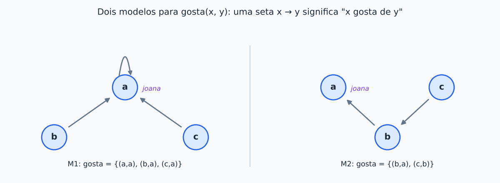

## Sobre

Escrever fórmulas é a parte da **sintaxe**. Agora vem a pergunta da **semântica**: *a fórmula é verdadeira?* Na lógica proposicional, bastava atribuir V ou F às letras. Em predicados, uma fórmula como $\forall x\,(H(x)\to\neg A(x))$ não tem valor nenhum enquanto ninguém disser **o que são** $H$, $A$ e o conjunto de objetos. Quem diz isso é o **modelo**.

Ao final você deve conseguir:

- descrever um **modelo** (domínio, constantes, funções e predicados);
- calcular o valor de uma fórmula num modelo, inclusive com quantificadores aninhados;
- usar **testemunhas** e **contra-exemplos** quando o domínio é infinito;
- definir **satisfazível**, **válida** e **consequência lógica** em predicados;
- explicar por que uma máquina não consegue simplesmente "testar todos os modelos".

## 1. O que é um modelo

Um **modelo** $\mathcal{M}$ dá significado concreto aos símbolos. Ele tem quatro partes:

| Parte | O que é | Exemplo |
| --- | --- | --- |
| **Universo** $U^{\mathcal{M}}$ | conjunto **não vazio** de objetos | $\{\text{avião-1},\text{avião-2},\text{fusca-1},\text{chevette-1}\}$ |
| **Constantes** | para cada constante, um objeto do universo | $\text{joana}^{\mathcal{M}}=a$ |
| **Funções** | para cada função de aridade $n>0$, uma função $U^n\to U$ | $m^{\mathcal{M}}(x)=$ a mãe de $x$ |
| **Predicados** | para cada predicado de aridade $n>0$, um subconjunto de $U^n$ (as tuplas em que ele vale) | $H^{\mathcal{M}}=\{\text{avião-1},\text{avião-2}\}$ |

A parte dos predicados é a mais importante: **um predicado é o conjunto das tuplas para as quais ele é verdadeiro**. Tudo que está fora do conjunto é falso.

### Primeiro exemplo

Vamos avaliar $\forall x\,(H(x)\to\neg A(x))$ ("tudo que voa não é movido a álcool") no modelo $\mathcal{M}$:

- $U^{\mathcal{M}}=\{\text{avião-1},\ \text{avião-2},\ \text{fusca-1},\ \text{chevette-1}\}$
- $H(x)$: $x$ é capaz de voar, com $H^{\mathcal{M}}=\{\text{avião-1},\text{avião-2}\}$
- $A(x)$: $x$ usa álcool como combustível, com $A^{\mathcal{M}}=\{\text{chevette-1}\}$

Como $\forall$ é um "E gigante", testamos **cada objeto**:

| $x$ | $H(x)$ | $A(x)$ | $H(x)\to\neg A(x)$ |
| --- | --- | --- | --- |
| avião-1 | V | F | V |
| avião-2 | V | F | V |
| fusca-1 | F | F | V |
| chevette-1 | F | V | V |

Todas as linhas são V, então a fórmula é **verdadeira em $\mathcal{M}$**. Escrevemos $\mathcal{M}\models\forall x\,(H(x)\to\neg A(x))$.

> [!NOTE]
> A mesma fórmula poderia ser **falsa** em outro modelo. Por exemplo, se um dos aviões usasse álcool, a linha dele daria $V\to F=F$. A fórmula não é "verdadeira" ou "falsa" sozinha: ela é verdadeira ou falsa **num modelo**.

## 2. Quantificadores num universo finito

Como vimos, num universo finito $\{o_1,\dots,o_n\}$:

$$
\forall x\,P(x)\equiv P(o_1)\land\dots\land P(o_n)\qquad\exists x\,P(x)\equiv P(o_1)\lor\dots\lor P(o_n)
$$

Na prática:

- $\forall x\,\varphi$ é V se **todas** as linhas são V. **Uma linha F já derruba** (é o contra-exemplo).
- $\exists x\,\varphi$ é V se **alguma** linha é V. **Uma linha V já basta** (é a testemunha).

## 3. Modelo com uma relação

Agora um modelo com um predicado binário. Símbolos: a constante $\text{joana}$ e o predicado $\text{gosta}(x,y)$. Considere:

- $U^{\mathcal{M}}=\{a,b,c\}$
- $\text{joana}^{\mathcal{M}}=a$
- $\text{gosta}^{\mathcal{M}}=\{(a,a),(b,a),(c,a)\}$

Para visualizar, desenhamos uma seta $x\to y$ quando $(x,y)$ está na relação:

Valor de cada fórmula em $M_1$ (o modelo da esquerda):

| Fórmula | Valor | Por quê |
| --- | --- | --- |
| $\neg\text{gosta}(\text{joana},\text{joana})$ | **F** | $\text{joana}=a$ e $(a,a)\in\text{gosta}$: Joana gosta de si mesma |
| $\forall x\,\forall y\,\forall z\,(\text{gosta}(x,y)\land\text{gosta}(x,z)\to y=z)$ | **V** | cada indivíduo gosta de **no máximo um** (só de $a$) |
| $\forall x\,\exists y\,\text{gosta}(x,y)$ | **V** | cada indivíduo gosta de **pelo menos um** (de $a$) |

Para a última, dá para montar uma "tabela" **por objeto**:

| $x$ | $y$ que serve | $\exists y\,\text{gosta}(x,y)$ |
| --- | --- | --- |
| $a$ | $a$ | V |
| $b$ | $a$ | V |
| $c$ | $a$ | V |

Todas V, então $\forall x\,\exists y\,\text{gosta}(x,y)$ é V.

### Um exemplo mais enrolado

Considere "**Nenhum dos que gostam de quem gosta de Joana gosta dela**":

$$
\forall x\,\forall y\,\big(\text{gosta}(x,\text{joana})\land\text{gosta}(y,x)\to\neg\text{gosta}(y,\text{joana})\big)
$$

Lendo devagar: se $x$ gosta de Joana e $y$ gosta de $x$, então $y$ **não** gosta de Joana.

- **Em $M_1$: falsa.** Escolha $x=a$ e $y=a$: $a$ gosta de Joana (que é $a$), $a$ gosta de $a$, e mesmo assim $a$ gosta de Joana. Um contra-exemplo basta. ($y=b$ também serve: $b$ gosta de $a$, que gosta de Joana, mas $b$ gosta de Joana.)
- **Em $M_2$** (com $\text{gosta}^{\mathcal{M}}=\{(b,a),(c,b)\}$): **verdadeira.** Quem gosta de Joana ($a$) é só $b$. Quem gosta de $b$ é só $c$, e $c$ **não** gosta de $a$. Para todos os outros pares, o antecedente é falso, e a implicação é V.

## 4. Exercício guiado: estados e transições

Um modelo também pode representar um autômato. Símbolos: constante $i$ (estado inicial), predicados $R(x,y)$ (há transição de $x$ para $y$) e $F(x)$ ($x$ é final).

- $A=\{a,b,c\}$, $i^{\mathcal{M}}=a$
- $R^{\mathcal{M}}=\{(a,a),(a,b),(a,c),(b,c),(c,c)\}$
- $F^{\mathcal{M}}=\{b,c\}$

| Fórmula | O que diz | Valor |
| --- | --- | --- |
| $\neg F(i)$ | o estado inicial não é final | **V**, pois $a\notin F^{\mathcal{M}}$ |
| $\forall x\,\forall y\,\forall z\,(R(x,y)\land R(x,z)\to y=z)$ | o autômato é determinístico (de cada estado, no máximo uma transição) | **F**, pois $a$ vai para $b$ e para $c$, com $b\neq c$ |
| $\forall x\,\exists y\,R(x,y)$ | todo estado tem pelo menos uma transição | **V**: $a\to a$, $b\to c$, $c\to c$ |

## 5. Universos infinitos

Tudo muda quando o universo é infinito. Considere o modelo:

- $U=\mathbb{R}$ (os reais)
- $Q(x,y)$: $x>y$, ou seja, $Q^{\mathcal{M}}=\{(x,y)\in\mathbb{R}^2\mid x>y\}$

A fórmula $\forall x\,\exists y\,Q(x,y)$ é **verdadeira**: para qualquer real $x$, existe um real menor (por exemplo, $x-1$).

Aqui **não dá para montar a tabela** com todas as linhas ($x=0$, $x=1$, $x=2$, ...). Precisamos de **argumentos**:

| Quero mostrar que... | Basta... |
| --- | --- |
| $\exists x\,\varphi$ é **V** | achar **uma testemunha** (um objeto que serve) |
| $\forall x\,\varphi$ é **F** | achar **um contra-exemplo** (um objeto que não serve) |
| $\forall x\,\varphi$ é **V** | argumentar que **vale para qualquer** objeto (uma prova) |
| $\exists x\,\varphi$ é **F** | argumentar que **nenhum** objeto serve (uma prova) |

As duas primeiras linhas são "baratas" (um objeto basta). As duas últimas exigem raciocínio.

### Exercício: números reais

Predicados em $\mathbb{R}$: $P(x,y)$: $x>y$; $Q(x,y)$: $x\le y$; $R(x)$: $x-7=2$; $S(x)$: $x>9$. Dê o valor de cada fórmula:

1. $\exists x\,R(x)$
2. $\forall y\,\neg S(y)$
3. $\forall x\,\exists y\,P(x,y)$
4. $\exists y\,\forall x\,Q(x,y)$
5. $\forall x\,\forall y\,[P(x,y)\lor Q(x,y)]$
6. $\exists x\,S(x)\land\neg\forall x\,R(x)$
7. $\exists y\,\forall x\,[S(y)\land Q(x,y)]$
8. $\forall x\,\forall y\,[(R(x)\land S(y))\to Q(x,y)]$


1. **V.** Testemunha: $x=9$, pois $9-7=2$.
2. **F.** Contra-exemplo: $y=10$, pois $10>9$.
3. **V.** Para todo $x$, serve $y=x-1$.
4. **F.** Seria um $y$ maior ou igual a **todos** os reais, e não existe.
5. **V.** Para quaisquer $x,y$, vale $x>y$ ou $x\le y$.
6. **V.** $\exists x\,S(x)$ é V (testemunha $x=10$) e $\neg\forall x\,R(x)$ é V (contra-exemplo $x=8$, em que $R(8)$ é F).
7. **F.** Exigiria um $y$ maior ou igual a todo $x$ (e ainda $>9$): não existe.
8. **V.** $R(x)$ só vale para $x=9$ e $S(y)$ só vale para $y>9$. Nos casos em que o antecedente é V, $x=9\le y$, e $Q(x,y)$ também é V. Nos outros, o antecedente é F.


### Exercício: strings

Símbolos: constante $e$, função $\cdot$ e predicado $\le$, escritos em notação infixa, como em $(t_1\cdot t_2)\le(t\cdot t)$. Modelo:

- $U=$ todas as strings binárias com 0 e 1, mais a string vazia $\epsilon$
- $e^{\mathcal{M}}$: a string vazia
- $\cdot^{\mathcal{M}}$: concatenação
- $\le^{\mathcal{M}}$: "é prefixo de"

Julgue:

1. $\forall x\,\big((x\le x\cdot e)\land(x\cdot e\le x)\big)$
2. $\exists y\,\forall x\,(y\le x)$
3. $\forall x\,\exists y\,(y\le x)$
4. $\forall x\,\forall y\,\forall z\,\big((x\le y)\to(x\cdot z\le y\cdot z)\big)$
5. $\neg\exists x\,\forall y\,\big((x\le y)\to(y\le x)\big)$


1. **V.** Concatenar com a string vazia não muda nada: $x\cdot e=x$, e toda string é prefixo de si mesma.
2. **V.** A string vazia $\epsilon$ é prefixo de qualquer string.
3. **V.** Para cada $x$, serve $y=\epsilon$ (ou o próprio $x$).
4. **F.** Contra-exemplo: $x=0$, $y=01$, $z=0$. $0$ é prefixo de $01$, mas $x\cdot z=00$ não é prefixo de $y\cdot z=010$.
5. **V.** Dado qualquer $x$, tome $y=x0$ (acrescente um 0). Então $x\le y$, mas $y\le x$ é falso (y é maior). Logo nenhum $x$ satisfaz o $\forall y$, e o $\exists$ é falso. Sua negação é V.


## 6. Satisfazível, válida e consequência lógica

Com modelos, as definições que você já conhece ganham o seu "par" em predicados:

| Conceito | Definição |
| --- | --- |
| **Satisfazível** | existe **pelo menos um** modelo $\mathcal{M}$ em que a fórmula é V ($\mathcal{M}\models\psi$) |
| **Válida** | é V em **todos** os modelos |
| **Insatisfazível** | é F em todos os modelos |
| **Consequência lógica** $\varphi_1,\dots,\varphi_n\models\psi$ | **todo** modelo que torna as premissas V também torna $\psi$ V |
| Conjunto **consistente** | existe um modelo que torna **todas** as fórmulas do conjunto V |

> [!NOTE]
> Se a fórmula tem variáveis livres, o valor também depende de uma "tabela de consulta" $l$ que diz quem é cada variável livre. Com sentenças (sem variáveis livres) isso não aparece.

**Exemplos:**

- $\forall x\,(H(x)\to\neg A(x))$ é **satisfazível**: o modelo da seção 1 é uma testemunha. Ela **não é válida**: no modelo em que um avião usa álcool, ela é falsa.
- $\forall x\,\neg P(x)\to\neg\exists x\,P(x)$ é **válida**: se nenhum objeto tem $P$, não existe objeto com $P$. Isso vale em qualquer modelo, qualquer que seja $P$.

### Mostrando uma consequência lógica

Vamos provar que $\forall x\,(P(x)\to Q(x))\ \models\ \forall x\,P(x)\to\forall x\,Q(x)$.

Tome **qualquer** modelo $\mathcal{M}$ que satisfaça a premissa. Precisamos mostrar que $\mathcal{M}$ satisfaz a conclusão, e há dois casos:

1. **$\forall x\,P(x)$ é F em $\mathcal{M}$.** Então a conclusão (uma implicação com antecedente falso) é V.
2. **$\forall x\,P(x)$ é V em $\mathcal{M}$.** Então todo objeto $o$ tem $P(o)$. Pela premissa, $P(o)\to Q(o)$ vale para todo $o$, logo $Q(o)$ vale para todo $o$. Então $\forall x\,Q(x)$ é V, e a conclusão também.

Nos dois casos a conclusão é V. Como $\mathcal{M}$ era qualquer, a consequência é válida.

> [!IMPORTANT]
> Para provar que algo **vale em todos os modelos**, não dá para listar os modelos. A prova toma um modelo **genérico** e raciocina sobre ele. Já para provar que algo **não** vale, basta **um** modelo (contra-exemplo).

## 7. Por que um computador sofre com isso

Na proposicional, $n$ letras davam $2^n$ linhas: grande, mas finito. Em predicados:

- Verificar se $\mathcal{M}\models\varphi$ pode ser **impossível** na prática, porque o universo pode ser **infinito** (como $\mathbb{R}$).
- Verificar se $\varphi_1,\dots,\varphi_n\models\psi$ exigiria olhar **todos os modelos possíveis**: existem infinitos universos e infinitas formas de interpretar cada predicado.

Precisamos de um método que **não dependa de testar modelos um a um**. Esse método existe e você já o conhece em versão proposicional: os **tableaux**. A próxima página mostra como estendê-lo para quantificadores.

## Erros comuns

- **Dizer que uma fórmula "é verdadeira" sem dizer em qual modelo.** O valor depende do modelo.
- **Universo vazio.** Todo modelo tem pelo menos um objeto; sem isso, $\forall x\,P(x)\to\exists x\,P(x)$ falharia.
- **Confundir "existe um modelo" com "vale em todos".** Satisfazível pede um; válida pede todos.
- **Provar $\forall$ com um exemplo.** Um exemplo **refuta** um $\forall$, mas não o prova. Com $\exists$ é o contrário: um exemplo prova, mas não refuta.
- **Esquecer que $R^{\mathcal{M}}$ é um conjunto de tuplas.** Se $(x,y)\notin R^{\mathcal{M}}$, então $R(x,y)$ é falso, mesmo que $(y,x)$ esteja lá.

## Resumo

- **Modelo** = universo não vazio + constantes + funções + predicados (conjuntos de tuplas).
- A fórmula só tem valor **num modelo**. $\mathcal{M}\models\psi$ lê-se "$\mathcal{M}$ satisfaz $\psi$".
- Em universo finito, $\forall$ é um "E gigante" e $\exists$ é um "OU gigante". Em universo infinito, usamos **testemunhas** e **contra-exemplos**.
- **Satisfazível:** algum modelo. **Válida:** todos os modelos. **$\models$:** todo modelo das premissas é modelo da conclusão.
- Testar todos os modelos é impossível; por isso precisamos de métodos como **tableaux**.

## Exercícios

**Exercício 1.** Encontre um modelo e dois predicados unários $P(x)$ e $Q(x)$ tais que $\forall x\,(P(x)\to Q(x))$ seja verdadeira.


Há infinitas respostas. Uma: $U=\mathbb{N}$, $P(x)$: "$x$ é múltiplo de 4", $Q(x)$: "$x$ é par". Todo múltiplo de 4 é par, então a fórmula é V.

Outra, com universo finito: $U=\{1,2,3\}$, $P^{\mathcal{M}}=\{1\}$, $Q^{\mathcal{M}}=\{1,2\}$. Para $x=1$: V$\to$V; para $2$ e $3$, $P$ é F e a implicação é V.


**Exercício 2.** No modelo $U=\{1,2,3\}$ com $L(x,y)$: $x<y$, calcule o valor de:

a) $\exists x\,\forall y\,L(x,y)$  b) $\exists x\,\forall y\,(\neg(y=x)\to L(x,y))$  c) $\forall x\,\exists y\,L(x,y)$


a) **F.** Para valer, $x$ seria menor que todos, inclusive que ele mesmo ($x<x$ é F).

b) **V.** Testemunha: $x=1$, que é menor que todos os outros.

c) **F.** Para $x=3$ não existe $y\in U$ com $3<y$.


**Exercício 3.** A fórmula $\forall x\,P(x)\to\exists x\,P(x)$ é válida? Justifique.


**Sim.** Em qualquer modelo, o universo é não vazio. Se $\forall x\,P(x)$ é V, todos os objetos têm $P$, e como existe pelo menos um objeto, ele é testemunha de $\exists x\,P(x)$. Se $\forall x\,P(x)$ é F, a implicação é V. Então vale em todo modelo.

(Se admitíssemos universo vazio, $\forall x\,P(x)$ seria V e $\exists x\,P(x)$ seria F, e a fórmula falharia. É por isso que exigimos universo não vazio.)


**Exercício 4.** Mostre que $\forall x\,P(x)\lor\forall x\,Q(x)\ \models\ \forall x\,(P(x)\lor Q(x))$. Vale a volta?


**Ida:** tome um modelo em que $\forall x\,P(x)$ ou $\forall x\,Q(x)$ é V. Se $\forall x\,P(x)$ é V, todo objeto tem $P$, logo todo objeto tem $P\lor Q$. Se é $\forall x\,Q(x)$, idem. Então $\forall x\,(P(x)\lor Q(x))$ é V.

**Volta: não vale.** Contra-exemplo: $U=\{1,2\}$, $P^{\mathcal{M}}=\{1\}$, $Q^{\mathcal{M}}=\{2\}$. Todo objeto tem $P$ ou $Q$, mas nem todos têm $P$ e nem todos têm $Q$.


**Exercício 5.** Teste o que você aprendeu.




Num modelo, o que é o predicado $H$ de aridade 1?

- [ ] Um número
- [ ] Um objeto do universo
- [x] Um subconjunto do universo (os objetos para os quais $H$ é verdadeiro)
- [ ] Uma função do universo nele mesmo
---
$H^{\mathcal{M}}=\{\text{avião-1},\text{avião-2}\}$ diz que $H(\text{avião-1})$ e $H(\text{avião-2})$ são V, e $H$ é F para os demais.



Para mostrar que $\forall x\,\varphi(x)$ é **falsa** num modelo, basta:

- [ ] Achar um objeto que satisfaz $\varphi$
- [x] Achar um objeto que **não** satisfaz $\varphi$
- [ ] Verificar todos os objetos
- [ ] Mostrar que $\exists x\,\varphi(x)$ é V
---
Um contra-exemplo derruba um $\forall$.



No universo $\mathbb{R}$, $\exists y\,\forall x\,(x\le y)$ é:

- [ ] Verdadeira, com $y=0$
- [x] Falsa, porque não existe real maior ou igual a todos os reais
- [ ] Verdadeira, com $y=\infty$
- [ ] Sem valor lógico
---
Para qualquer $y$, o número $y+1$ é maior, então nenhum $y$ serve. ($\infty$ não é um número real.)



Uma fórmula é **válida** quando:

- [ ] É verdadeira em algum modelo
- [ ] É falsa em algum modelo
- [x] É verdadeira em todos os modelos
- [ ] Tem quantificador universal
---
Satisfazível pede um modelo; válida pede todos.



Por que não conseguimos verificar $\varphi_1,\dots,\varphi_n\models\psi$ testando todos os modelos?

- [ ] Porque os modelos são sempre infinitos
- [ ] Porque os predicados não têm valor
- [x] Porque existem infinitos modelos possíveis (e universos possivelmente infinitos)
- [ ] Porque $\models$ só funciona na lógica proposicional
---
Diferente da tabela-verdade, não há uma lista finita de casos. Precisamos de um método como o tableaux.



