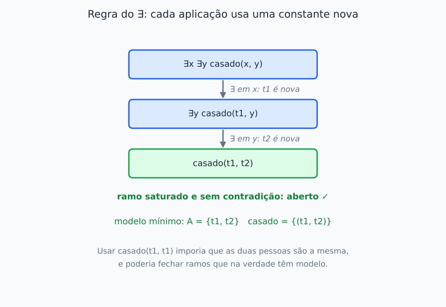
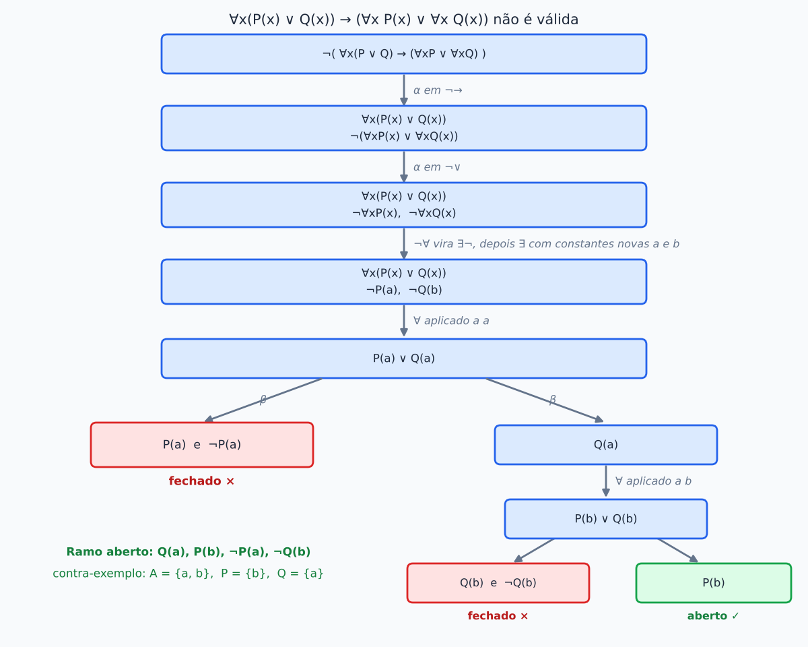

## Sobre

Na página anterior vimos que não dá para testar todos os modelos. O **tableaux** resolve isso do mesmo jeito de antes: em vez de olhar modelos prontos, ele **constrói** um. A ideia continua sendo a do detetive: supomos que a fórmula é verdadeira, vamos deduzindo o que isso exige, e vemos se a árvore bate numa contradição ou entrega um modelo.

A novidade é lidar com $\forall$ e $\exists$. Ao final você deve conseguir:

- aplicar as regras dos quantificadores (negados, $\exists$ e $\forall$);
- saber quando um ramo está **saturado**;
- ler um **modelo mínimo** de um ramo aberto;
- decidir **satisfazibilidade** e **validade** (pela negação) de fórmulas com quantificadores;
- explicar por que o método pode **nunca terminar**.

## 1. Recapitulando o tableaux proposicional

Você já sabe as duas famílias de regras do Estágio 1:

- **Regras $\alpha$** (não ramificam): $\neg\neg p$, $p\land q$, $\neg(p\lor q)$, $\neg(p\to q)$.
- **Regras $\beta$** (ramificam): $p\lor q$, $\neg(p\land q)$, $p\to q$.
- Um ramo **fecha** ($\times$) quando contém uma fórmula e sua negação.
- Um ramo **aberto e saturado** entrega um **modelo**.

Tudo isso continua valendo. Só vamos acrescentar regras para os quantificadores.

## 2. As novas regras

### Quantificador negado

Estas são as regras de De Morgan para quantificadores. Não ramificam, e a gente as usa assim que aparecem:

| Fórmula | Vira |
| --- | --- |
| $\neg\exists x\,\alpha(x)$ | $\forall x\,\neg\alpha(x)$ |
| $\neg\forall x\,\alpha(x)$ | $\exists x\,\neg\alpha(x)$ |

### Regra do $\exists$: constante **nova**

$$
\exists x\,F(x)\ \ \checkmark a\ \ \leadsto\ \ F(a)
$$

Se a fórmula é verdadeira, existe **alguém** com a propriedade. Damos um nome a esse alguém, mas esse nome precisa ser **novo**: uma constante que ainda não apareceu no ramo. Marcamos o $\exists$ com $\checkmark$, porque ele foi **usado e gasto**: uma vez só.

> [!IMPORTANT]
> Por que "nova"? Porque a gente **não sabe quem é** esse alguém. Se usássemos uma constante que já existe, estaríamos afirmando que o objeto que satisfaz o $\exists$ é aquele específico, e isso pode **restringir modelos de forma ilegítima** e fechar ramos que na verdade têm modelo.

### Regra do $\forall$: **qualquer** constante

$$
\forall x\,G(x)\ \ \backslash a\ \ \leadsto\ \ G(a)
$$

Se $\forall x\,G(x)$ é verdadeira, $G$ vale para **todos**, então vale para qualquer constante $a$ que apareça. Aqui $a$ é uma **variável arbitrária**: representa qualquer elemento do universo. Diferente do $\exists$, o $\forall$ **não é gasto**: ele continua no ramo, pois podem surgir constantes novas depois e a regra precisa ser aplicada a elas também. Anotamos $\backslash a$, $\backslash b$ para lembrar a quais constantes já aplicamos.

| Regra | Constante | Gasta a fórmula? |
| --- | --- | --- |
| $\exists$ | **nova** (nunca usada antes) | sim ($\checkmark$) |
| $\forall$ | **qualquer** do ramo (todas, no fim) | não |

## 3. Exemplo: o $\exists$ com duas variáveis

Com $\text{casado}(x,y)$: $x$ é casado com $y$, vamos ver se $\exists x\,\exists y\,\text{casado}(x,y)$ tem modelo:



Cada $\exists$ gera uma constante **nova**. Primeiro $t_1$ para o $x$, depois $t_2$ para o $y$. O ramo ficou só com literais e sem contradição: **aberto**, logo a fórmula é **satisfazível**.

**Lendo o modelo:** o universo é o conjunto das constantes do ramo, e cada predicado vale exatamente nas tuplas que aparecem como átomos positivos:

$$
A=\{t_1,t_2\},\qquad \text{casado}^{\mathcal{M}}=\{(t_1,t_2)\}
$$

### Os dois erros clássicos com o $\exists$

1. **Usar a mesma constante para duas variáveis do mesmo predicado**, como $\text{casado}(t_1,t_1)$. Isso impõe que "o que satisfaz o $\exists x$" e "o que satisfaz o $\exists y$" são o mesmo objeto, e pode fechar um ramo que tinha modelo.
2. **Reaproveitar uma constante em outro momento.** Se a mesma fórmula aparece duas vezes (por exemplo, como duas premissas), cada aplicação do $\exists$ deve receber **suas próprias** constantes ($t_1,t_2$ para uma, $u_1,u_2$ para a outra). Se uma delas reusasse $t_1,t_2$, estaríamos dizendo que os objetos são os mesmos, o que pode fechar ramos indevidamente.

## 4. Exemplos de satisfazibilidade

### Exemplo 1: $\exists x\,F(x)\land\forall x\,G(x)$

```
1. ∃xF(x) ∧ ∀xG(x)
2. ∃xF(x)  ✓a            α em ∧
3. ∀xG(x)   \a           α em ∧
4. F(a)                  ∃ com constante nova a
5. G(a)                  ∀ aplicado a a      aberto ✓
```

Ramo aberto: **satisfazível**. Modelo mínimo: $A=\{a\}$, $F^{\mathcal{M}}=\{a\}$, $G^{\mathcal{M}}=\{a\}$.

### Exemplo 2: $\forall x\,P(x)\to\exists y\,P(y)$

```
1. ∀xP(x) → ∃yP(y)
├─ ¬∀xP(x)                  β em →
│  └─ ∃x¬P(x)  ✓b           ¬∀ vira ∃¬
│     └─ ¬P(b)              ∃ com constante nova b     aberto ✓
└─ ∃yP(y)  ✓a               β em →
   └─ P(a)                   ∃ com constante nova a     aberto ✓
```

Os dois ramos ficam abertos. **Satisfazível**, com dois modelos mínimos possíveis:

- ramo da esquerda: $A=\{b\}$, $P^{\mathcal{M}}=\{\}$ (ninguém tem $P$, e o $\forall$ falha);
- ramo da direita: $A=\{a\}$, $P^{\mathcal{M}}=\{a\}$.

### Exemplo 3: $\forall x\,P(x)\land\exists y\,\neg P(y)$

```
1. ∀xP(x) ∧ ∃y¬P(y)
2. ∃y¬P(y)  ✓a           α em ∧
3. ∀xP(x)    \a          α em ∧
4. ¬P(a)                 ∃ com constante nova a
5. P(a)                  ∀ aplicado a a
   ×                     P(a) e ¬P(a)
```

O ramo fecha: **insatisfazível**. Faz sentido: "todos têm $P$" e "alguém não tem $P$" não convivem.

## 5. Saturação: quando um ramo termina

Na proposicional, um ramo terminava quando só sobravam literais. Com o $\forall$, que nunca é gasto, precisamos de um critério novo. Um ramo está **saturado** quando:

- todas as fórmulas que não são literais já foram processadas;
- **todo $\forall$ teve a regra aplicada pelo menos uma vez** (se ainda não havia constante, introduza uma, já que o universo é não vazio);
- **todo $\forall$ foi aplicado a todas as constantes** que aparecem no ramo.

Se o ramo satura sem contradição, ele está **aberto** e define um modelo. Se uma constante nova aparecer depois (por causa de um $\exists$), os $\forall$ precisam ser aplicados a ela também, e o ramo **volta a estar "em andamento"**.

> [!TIP]
> **Ordem recomendada de aplicação:**
>
> 1. Regras proposicionais ($\alpha$ e $\beta$);
> 2. Regras de quantificador negado;
> 3. Regra do $\exists$ (para criar as constantes);
> 4. Regra do $\forall$ (aplicada a todas as constantes).
>
> Deixar o $\forall$ por último evita aplicá-lo a constantes que ainda nem existem. Se puder, também adie o $\beta$ para depois do $\exists$, assim você não precisa repetir o $\exists$ em cada galho.

## 6. Validade: de novo, pela negação

Como no Estágio 1, o tableaux só procura modelos. Para saber se uma fórmula é **válida**:

$$
\varphi\text{ é válida}\iff\neg\varphi\text{ é insatisfazível}
$$

Faça o tableaux de $\neg\varphi$: se **todos os ramos fecham**, $\varphi$ é válida. Se **algum ramo fica aberto**, $\varphi$ não é válida, e o ramo aberto dá um **contra-exemplo**.

### Exemplo: $\forall x\,(P(x)\land Q(x))\to\forall x\,P(x)$ é válida?


O tableau da negação fecha: **a fórmula original é válida**. Intuição: se todo mundo tem $P$ *e* $Q$, todo mundo tem $P$.

### Exemplo: $\exists x\,F(x)\to\neg\forall x\,\neg F(x)$

```
1. ¬(∃xF(x) → ¬∀x¬F(x))
2. ∃xF(x)  ✓a              α em ¬→
3. ¬¬∀x¬F(x)               α em ¬→
4. ∀x¬F(x)   \a            dupla negação
5. F(a)                    ∃ com constante nova a
6. ¬F(a)                   ∀ aplicado a a
   ×
```

Fechado: **válida**. É o análogo de "existe $\equiv$ não é verdade que todos não".

### Exemplo: $(\forall x\,P(x)\lor\forall x\,Q(x))\to\forall x\,(P(x)\lor Q(x))$

```
1. ¬((∀xP ∨ ∀xQ) → ∀x(P ∨ Q))
2. ∀xP(x) ∨ ∀xQ(x)
3. ¬∀x(P(x) ∨ Q(x))
4. ∃x¬(P(x) ∨ Q(x))  ✓a    ¬∀ vira ∃¬
5. ¬(P(a) ∨ Q(a))
6. ¬P(a), ¬Q(a)            α em ¬∨
   ├─ ∀xP(x)  \a           β em ∨
   │   P(a)   ×
   └─ ∀xQ(x)  \a
       Q(a)   ×
```

Todos os ramos fecham: **válida**.

### Exemplo com ramo aberto: $\forall x\,(P(x)\lor Q(x))\to(\forall x\,P(x)\lor\forall x\,Q(x))$

A volta do exemplo anterior. Vamos ver o que acontece:



Dois $\exists$ produzem **duas constantes diferentes** ($a$ e $b$). O $\forall$ precisa ser aplicado às duas. O resultado: um ramo aberto com $Q(a)$, $P(b)$, $\neg P(a)$, $\neg Q(b)$.

**A fórmula não é válida.** O contra-exemplo é o modelo mínimo lido do ramo:

$$
A=\{a,b\},\qquad P^{\mathcal{M}}=\{b\},\qquad Q^{\mathcal{M}}=\{a\}
$$

Conferindo: todo objeto tem $P$ ou $Q$ ($a$ tem $Q$, $b$ tem $P$), mas nem todos têm $P$ e nem todos têm $Q$.

## 7. O limite: o tableaux pode nunca terminar

Na proposicional, o tableaux sempre termina: cada regra deixa as fórmulas menores. Em predicados, o $\exists$ pode criar constante nova, e o $\forall$ precisa ser aplicado a ela, o que pode criar outro $\exists$... Veja:


1. $\forall x\,\exists y\,P(x,y)$ precisa de uma constante: $a$.
2. Obtemos $\exists y\,P(a,y)$, que cria $b$: $P(a,b)$.
3. Agora o $\forall$ precisa ser aplicado a $b$: $\exists y\,P(b,y)$, que cria $c$.
4. E assim por diante, para sempre.

A fórmula **é satisfazível** (por exemplo, $A=\{a\}$ e $P^{\mathcal{M}}=\{(a,a)\}$), mas o método, seguindo as regras, não consegue parar para dizer isso.

Isso não é um defeito do método: é uma propriedade da lógica de predicados.

> [!IMPORTANT]
> A **satisfazibilidade** em lógica de predicados é **indecidível**: não existe algoritmo que, para toda fórmula, sempre responda "sim" ou "não" em tempo finito. **Decidir** um problema significa responder sem entrar em *loop* nem em um conjunto sem fim de operações.
>
> O que o tableaux garante é: **se a fórmula é válida, o tableau da negação acaba fechando.** Se não é válida, ele pode terminar com um ramo aberto (que dá o contra-exemplo) ou pode **nunca terminar**.

Na prática, quando você enxergar o padrão se repetindo, pare e **construa um modelo à mão**, verificando-o direto na fórmula (como no exercício (c) abaixo).

## Erros comuns

- **Reusar constante no $\exists$.** A constante do $\exists$ é sempre **nova** em cada aplicação.
- **Gastar o $\forall$.** Ele não leva $\checkmark$: continua no ramo e precisa ser aplicado a toda constante que aparecer.
- **Esquecer de aplicar o $\forall$ às constantes novas** que surgiram depois de um $\exists$.
- **Fechar um ramo só porque $P(a)$ e $\neg P(b)$ apareceram.** Para fechar, precisa ser a **mesma** constante: $P(a)$ e $\neg P(a)$.
- **Aplicar $\neg\forall$ como se fosse $\forall\neg$.** O certo é $\neg\forall x\,\alpha\leadsto\exists x\,\neg\alpha$, e $\neg\exists x\,\alpha\leadsto\forall x\,\neg\alpha$.
- **Ler "aberto" como "válida".** Para validade, o tableau é da **negação**, e **fechado** é que prova.
- **Insistir num tableau infinito.** Se o padrão se repete, tente um modelo pequeno à mão.

## Resumo

- Regras novas: $\neg\forall\to\exists\neg$; $\neg\exists\to\forall\neg$; **$\exists$: constante nova, gasta**; **$\forall$: qualquer constante, não gasta**.
- **Saturado:** só literais, e todo $\forall$ aplicado a todas as constantes (e ao menos uma vez).
- **Ramo aberto** dá um modelo mínimo: universo = constantes, predicados = átomos positivos.
- **Validade:** tableau da negação; todos fechados $\Rightarrow$ válida.
- **Limite:** a satisfazibilidade é indecidível; o tableau pode ser infinito.

## Exercícios

Para cada fórmula, verifique a **satisfazibilidade** e a **validade**. Se não for válida, dê um contra-exemplo.

**Exercício 1.** $(\forall x)\,p(x)\to(\exists x)\,p(x)$


Tableau da negação: $\forall x\,p(x)$ e $\neg\exists x\,p(x)$, que vira $\forall x\,\neg p(x)$. Não há constantes, então introduzimos $a$ (o universo é não vazio). Aplicando os dois $\forall$: $p(a)$ e $\neg p(a)$. **Fecha.**

**Válida** (e, por isso, também satisfazível).


**Exercício 2.** $(\exists x)\,(p(x)\to q(x))\to\big((\exists x)\,p(x)\to(\exists x)\,q(x)\big)$


Negação: $\exists x\,(p(x)\to q(x))$, $\exists x\,p(x)$ e $\neg\exists x\,q(x)$ (que vira $\forall x\,\neg q(x)$).

Aplicamos os $\exists$ com constantes novas: $p(a)\to q(a)$ e $p(b)$. Aplicamos o $\forall$ a $a$ e $b$: $\neg q(a)$, $\neg q(b)$. Abrindo o $\beta$ em $p(a)\to q(a)$:

- galho $\neg p(a)$: literais $\neg p(a)$, $p(b)$, $\neg q(a)$, $\neg q(b)$, **sem contradição: aberto**;
- galho $q(a)$: com $\neg q(a)$, **fecha**.

Há um ramo aberto, então **não é válida**. Contra-exemplo: $A=\{a,b\}$, $p^{\mathcal{M}}=\{b\}$, $q^{\mathcal{M}}=\{\}$. É **satisfazível** (por exemplo, com $p^{\mathcal{M}}=\{\}$, o consequente é verdadeiro).


**Exercício 3.** $(\forall x)(\exists y)\,p(x,y)\to(\exists y)\,p(y,y)$


Negação: $\forall x\,\exists y\,p(x,y)$ e $\forall y\,\neg p(y,y)$. Como no exemplo da seção 7, cada $\exists$ cria uma constante nova que exige uma nova aplicação do $\forall$: $p(a,b)$, depois $p(b,c)$, depois $p(c,d)$... **O tableau não termina.**

Mesmo assim, é fácil achar um contra-exemplo à mão: $A=\{a,b\}$, $p^{\mathcal{M}}=\{(a,b),(b,a)\}$. Todo elemento aponta para algum ($a\to b$, $b\to a$), então o antecedente é V; mas nenhum elemento aponta para si mesmo, e o consequente é F.

**Não é válida.** É **satisfazível** (por exemplo, com $p^{\mathcal{M}}=\{\}$, o antecedente é falso).


**Exercício 4.** $(\exists x)(\exists y)\,p(x,y)\to(\exists y)\,p(y,y)$


Negação: $\exists x\,\exists y\,p(x,y)$ e $\forall y\,\neg p(y,y)$. Os $\exists$ dão $p(t,u)$ com $t,u$ novas. Aplicando o $\forall$: $\neg p(t,t)$ e $\neg p(u,u)$. Saturado e sem contradição: **aberto** (e dessa vez termina).

**Não é válida.** Contra-exemplo: $A=\{t,u\}$, $p^{\mathcal{M}}=\{(t,u)\}$. É **satisfazível** (com $p^{\mathcal{M}}=\{\}$, o antecedente é falso).


**Exercício 5.** $(\exists x)(p(x)\to r(x))\leftrightarrow\big((\forall x)\,p(x)\to(\exists x)\,r(x)\big)$


Chame o lado esquerdo de $L$ e o direito de $R$. A negação de $L\leftrightarrow R$ abre em dois ramos: $\neg(L\to R)$ e $\neg(R\to L)$.

**Ramo 1** ($L$, $\neg R$): de $L$, $\exists$ com $a$: $p(a)\to r(a)$. De $\neg R$: $\forall x\,p(x)$ e $\neg\exists x\,r(x)$ (vira $\forall x\,\neg r(x)$). Aplicando aos $a$: $p(a)$, $\neg r(a)$. O $\beta$ em $p(a)\to r(a)$ dá $\neg p(a)$ (fecha com $p(a)$) e $r(a)$ (fecha com $\neg r(a)$). **Fecha.**

**Ramo 2** ($R$, $\neg L$): $\neg L$ vira $\forall x\,\neg(p(x)\to r(x))$. $R$ abre um $\beta$: ou $\neg\forall x\,p(x)$, ou $\exists x\,r(x)$.
- Se $\neg\forall x\,p(x)$: $\exists x\,\neg p(x)$ com $b$: $\neg p(b)$. Do $\forall$: $\neg(p(b)\to r(b))$, que dá $p(b)$. Contradição com $\neg p(b)$. **Fecha.**
- Se $\exists x\,r(x)$: $r(c)$. Do $\forall$: $\neg(p(c)\to r(c))$, que dá $\neg r(c)$. Contradição. **Fecha.**

Tudo fecha: **válida** (e portanto satisfazível). É a equivalência entre "existe um que não satisfaz $p$ ou satisfaz $r$" e "se todos têm $p$, alguém tem $r$".


**Exercício 6.** Teste o que você aprendeu.




Qual constante podemos usar ao aplicar a regra do $\exists$?

- [ ] Qualquer constante que já esteja no ramo
- [x] Uma constante **nova**, que ainda não apareceu
- [ ] Sempre $a$
- [ ] Nenhuma: o $\exists$ não tem regra
---
O objeto que satisfaz o $\exists$ é desconhecido. Reusar uma constante imporia que ele é um objeto já conhecido e poderia fechar ramos indevidamente.



O que fazemos com a fórmula $\forall x\,G(x)$ depois de aplicar a regra a uma constante $a$?

- [ ] Marcamos $\checkmark$ e a removemos
- [x] Mantemos no ramo, pois pode ser preciso aplicá-la a constantes que surgirem depois
- [ ] Trocamos por $\exists x\,G(x)$
- [ ] Fechamos o ramo
---
O $\forall$ vale para todos os elementos, e novas constantes (criadas por $\exists$) podem aparecer mais adiante.



O que o tableaux faz com $\neg\forall x\,\alpha(x)$?

- [ ] Transforma em $\forall x\,\neg\alpha(x)$
- [x] Transforma em $\exists x\,\neg\alpha(x)$
- [ ] Fecha o ramo
- [ ] Ramifica em $\alpha(a)$ e $\neg\alpha(a)$
---
Negar "todos" é dizer que existe um que não: $\neg\forall\equiv\exists\neg$.



O tableau da **negação** de $\varphi$ fechou em todos os ramos. O que concluímos?

- [ ] $\varphi$ é insatisfazível
- [x] $\varphi$ é válida
- [ ] $\varphi$ é satisfazível, mas não válida
- [ ] Nada: o método falhou
---
$\varphi$ é válida se, e somente se, $\neg\varphi$ é insatisfazível.



Por que o tableaux de $\forall x\,\exists y\,P(x,y)$ nunca termina?

- [ ] Porque a fórmula é insatisfazível
- [ ] Porque o $\forall$ não tem regra
- [x] Porque cada $\exists$ cria uma constante nova, que exige uma nova aplicação do $\forall$, e isso se repete
- [ ] Porque a fórmula é válida
---
A fórmula é satisfazível (há modelo finito), mas o método não consegue declará-lo. É consequência de a satisfazibilidade em predicados ser indecidível.



